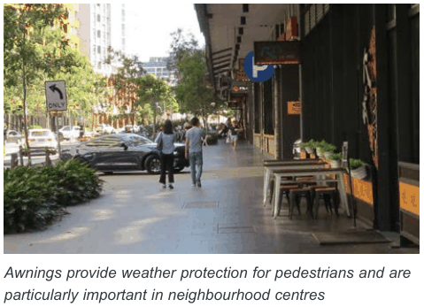
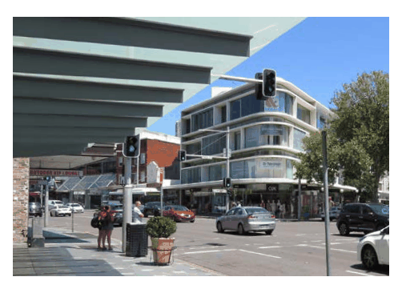
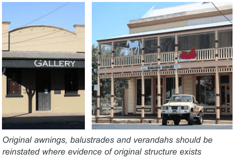
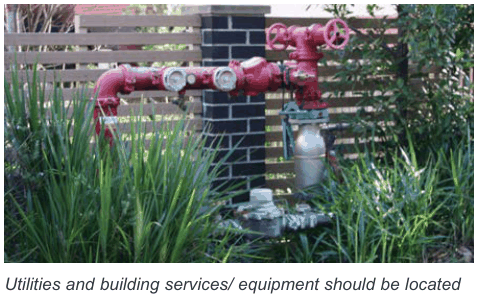

### G2  General Requirements

#### Awnings Objective

O5. To provide weather protection and comfort along pedestrian routes to promote walking and increase activity levels. O6. To encourage awnings which are lighter and more elegant in appearance to allow more light through to shop fronts.

> [Picture on page 5: a picture, saved as a picture (images/part-g-local-centres-page-5-10.gif, 150 dpi).]

| Controls |  |
|---|---|
| C16. | Refurbishment or redevelopment of a building should include the provision of an awning of a similar height, width and general appearance to that of adjoining contributory awnings. |
| C17. | Awnings should be reinstated where there is evidence that they were originally fitted or where there is a break in a continuous run of awnings. |
| C18. | New awnings on corner buildings should wrap around into side streets. |
| C19. | New awnings should be no more than 600mm higher or lower than neighbouring awnings, for continuity. As a guide, awnings should have a minimum height of 3.0m and a maximum height of 4.5m. Entry awnings may increase up to 5m in height to provide legibility. |
| C20. | Awnings are to be flat or near flat in shape. Raised or curved awning structures are not permitted. Eaves and fascias are to be flat or near flat in shape. |
| C21. | Awning fascias are to be a maximum 300mm high including any added on signage and in keeping with the scale and character of the building. |
| C22. | Steps for design articulation or to accommodate sloping streets are to be integrated with the building design and should not exceed 700mm per step. |
| C23. | Awnings are designed to respond to the rhythm of shopfronts/ vertical articulation of the development and provide continuous weather protection. |

Awnings provide weather protection for pedestrians and are particularly important in neighbourhood centres

> [Picture on page 5: a picture, saved as a picture (images/part-g-local-centres-page-5-14.gif, 150 dpi).]

Translucent awnings allow for more daylight access to the footpath and shopfronts

> [Picture on page 5: a picture, saved as a picture (images/part-g-local-centres-page-5-17.gif, 150 dpi).]

Original awnings, balustrades and verandahs should be reinstated where evidence of original structure exists

#### Verandahs and balconies Objective

O7. To increase passive surveillance of the public domain, provide architectural interest and where applicable reinstate historic verandahs.

| Controls |  |
|---|---|
| C24. | The reinstatement of verandahs is encouraged where evidence of the original structure exists. |
| C25. | Balcony balustrades should be of a light open material. Where possible, balustrades are to match predominant examples within the streetscape. |
| C26. | Existing verandahs and balconies should be retained and not infilled. |
| C27. | Balconies should be located so as to face the front or rear of the building. |

#### Public utilities/ services Objective

O8. To reduce the negative visual impact of utilities and building services.

#### Controls

| C28. | For new development and substantial alterations to existing premises provision must be made for connection to future underground distribution mains. In such developments the following must be installed: • an underground service line to a suitable existing street pole; or |
|---|---|

• sheathed underground consumers mains to a customer pole erected near the front property boundary (within 1 metre). Council may require the bundling of cables in the area surrounding the development to reduce the visual impact of overhead street cables.

C29. Roof plant, lift overruns, utilities, vents, fire hydrants, electrical substations and other service related elements are to be integrated into the built form design and complementary to the architecture of the building, with minimal impact on the streetscape and ground floor facades.

> [Picture on page 6: a picture, saved as a picture (images/part-g-local-centres-page-6-27.gif, 150 dpi).]

Utilities and building services/ equipment should be located so that the visual impact on the streetscape is minimised
