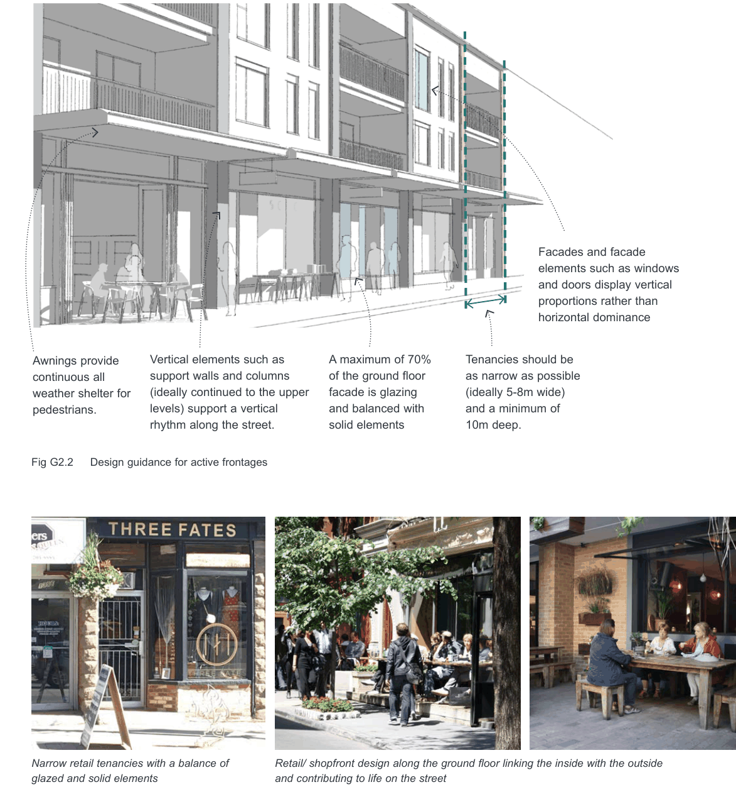

### G2  General Requirements

#### G2.3  Ground floor interfaces

The way in which buildings address streets, links and open space is crucial to the local character of an area. The ground floor in particular requires careful design of its interface with the public domain due to its significant impact on the liveliness, interest, comfort and safety of the public domain.

#### Objectives

O1. To maximise opportunities for passive surveillance of the public domain.

O2. To be adaptable to changes in use in the future.

| Controls |  |
|---|---|
| C1. | New development is to place particular focus on creating a 'human scale' at the lower levels, in particular the ground floor, through the use of detailed design, insets and projections that create interest and, where relevant, the appearance of finer grain buildings. |
| C2. | New development addresses and defines the public domain through entrances, lobbies, windows and balconies that overlook public spaces, maximising opportunities for passive surveillance. |
| C3. | All building entries are clearly visible from the public domain. Level access is provided where possible. |
| C4. | Facades that address the street have no more than 5 metres of ground floor wall length without a door or window. |

#### Active frontages Objectives

O3. To enhance the commercial viability of the area and compliment existing retail, commercial, entertainment and community uses. O4. To encourage ground floor activities to spill out into the public domain and contribute to a vibrant streetscape and activity levels.

#### Controls

C5. Along active frontages:

• the finished ground floor level is to match the footpath level; where this is not possible due to topography, the ground floor level is a maximum of 0.4m above or below the footpath;

• continuous awnings must be provided to shelter pedestrians from weather conditions;

• consistent paving, street furniture, signage, planting and lighting is desireable; and

• design guidance in Fig G2.2 is applied where possible with long expanses of floor to ceiling glass prohibited.

#### Shopfronts Objectives

O5. To preserve the surviving examples of original whole shop frontages and elements. O6. To encourage new or replacement shop fronts to be compatible with the architectural style or period of the building to which they belong and the overall character of the business centre.

| Controls |  |
|---|---|
| C6. | New shopfronts should be designed to make maximum use of vertical elements, i.e. windows should emphasise a vertical proportion (height greater than width). |
| C7. | Original early shop fronts in existing buildings should be retained and conserved. |
| C8. | If security shutters are required, they should be visually permeable (at least 75% permeability) to allow viewing of windows and allow light to spill out onto the footpath. Block-out roller shutters are not permitted. |

> [Picture on page 8: a picture, saved as a picture (images/part-g-local-centres-page-8-1.gif, 150 dpi).]
> Words printed on the picture (copied from the PDF):
> Facades and facade
> proportions rather than
> horizontal dominance

Awnings provide

continuous all

weather shelter for

pedestrians.

Vertical elements such as support walls and columns (ideally continued to the upper levels) support a vertical rhythm along the street.

Fig G2.2 Design guidance for active frontages

A maximum of 70% of the ground floor facade is glazing and balanced with solid elements

elements such as windows and doors display vertical

Tenancies should be

as narrow as possible

(ideally 5-8m wide)

and a minimum of

10m deep.

Retail/ shopfront design along the ground floor linking the inside with the outside

Narrow retail tenancies with a balance of glazed and solid elements

and contributing to life on the street
