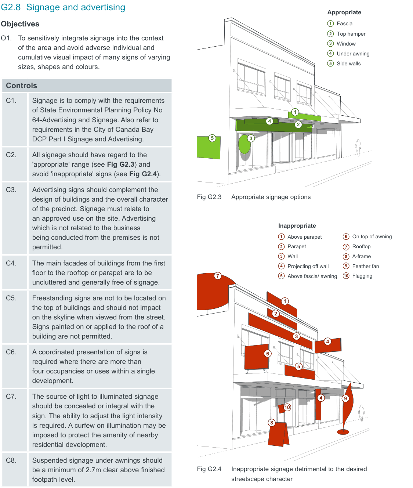

### G2  General Requirements

> [Picture on page 13: a map, saved as a picture (images/part-g-local-centres-page-13-2.gif, 150 dpi); the street names and other small labels are on the picture.]
> Labels printed on the map (copied from the PDF, in no particular order):
> Appropriate · 1 Fascia · 2 Top hamper · 3 Window · 4 Under awning · 5 Side walls · 1 · 4 · 2 · 5 · 3 · Fig G2.3 Appropriate signage options · Inappropriate · 6 · 1 · On top of awning · Above parapet · 2 · Rooftop · Parapet · 7 · 3 · 8 A-frame · Wall · 9 · 4 · Feather fan · Projecting off wall · 10 · 5 · Flagging · 7 · Above fascia/ awning · 1 · 2 · 3 · 4 · 6 · 5 · 4 9 · 10 · 8 · Fig G2.4 Inappropriate signage detrimental to the desired · streetscape character
