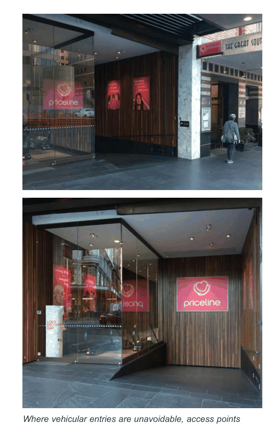

### G2  General Requirements

#### G2.10  Access and parking

The location of car parking has a significant impact on pedestrian safety and the quality of the public domain. Vehicle access points need to be integrated carefully to avoid potential conflicts with pedestrian movement and the desired streetscape character.

#### Objectives

O1. To transition to lower car ownership and support the uptake of walking, cycling and public transport use.

O2. To minimise the visual impact of car parking areas and vehicle access points. O3. To minimise conflicts between pedestrians and vehicles on footpaths, particularly along pedestrian desire lines.

#### Controls

| C1. | Vehicular access points minimise visual intrusion and disruption of the streetscape, emphasise the pedestrian experience and maximise pedestrian safety. |
|---|---|

C2. The width and height of vehicular entries is kept to a minimum. Roller doors or gates should be integrated with the architectural design of the development. Vehicular entry/ exit points are recessed by at least 0.5m behind the building line.

C3. The public footpath is continued across driveways to create a threshold, signal pedestrian priority and slow vehicle speeds.

C4. Vehicle access points are not permitted along primary active street frontages. Where rear or side access is not possible, development without parking will be considered.

C5. On-site car parking should be located below ground level where possible or located within the building and well screened, or to the rear off a laneway.

C6. At grade and above ground parking, if unavoidable, is screened from public view and should have a minimum floor to floor height of 3.1m to be able to be converted to another use in the future.

C7. Basement parking fronting the public domain can protrude up to 1.0m maximum above natural ground level.

C8. Parking that is unbundled (separated from dwelling and building ownership) should be encouraged in all developments.

> [Picture on page 15: a picture, saved as a picture (images/part-g-local-centres-page-15-48.gif, 150 dpi).]

Where vehicular entries are unavoidable, access points should be integrated into the ground floor and clearly signal pedestrian priority

G2.11  Residential Uses not covered by

#### the Apartment Design Guide

The NSW Apartment Design Guide (ADG) applies to buildings that are three or more storeys high and that comprise at least four dwellings.

For other residential development types or components of proposed development, such as 2-storey shop top housing, 2-3 storey terraces, low rise apartments, multiplexes, courtyard houses and the like, the following controls apply.

#### Objective

O1. To ensure design quality, performance of and amenity created by new residential development is of a high standard and consistent across the Canada Bay LGA.

| Controls |  |
|---|---|
| C1. | The maximum building depth is 18m unless it can be demonstrated that all habitable rooms receive adequate ventilation and solar access, e.g. through the use of a courtyard design. |
| C2. | Single aspect dwellings, if unavoidable, are only permitted if they have a northerly or easterly aspect. |
| C3. | Living rooms and private open spaces of at least 70% of apartments receive a minimum of 3 hours direct sunlight between 9 am and 3 pm in mid winter (21 June). |
| C4. | Master bedrooms have a minimum area of 10m2 and other bedrooms 9m2. |
| C5. | Building separation is as per the Apartment Design Guide, Section 3F Visual Privacy. |

C6. Private open space (POS) is designed to maximise useability, privacy, outlook and solar access.

The minimum private open space of a ground floor dwelling is calculated by the number of bedrooms x 4m2. For dwellings on the ground floor including townhouses and terraces, the minimum private open space is as follows:

| Dwelling type | Min. POS |
|---|---|
| Studio/ 1 bedroom | 20m2 |
| 2 bedroom | 28m2 |
| 3+ bedroom | 35m2 |

The minimum dimension is 4.0m x 4.0m. For dwellings on upper levels, the minimum private open space (such as decks and balconies) is as follows:

| Dwelling type | Min. POS |
|---|---|
| Studio/ 1 bedroom | 10m2 |
| 2 bedroom | 14m2 |
| 3+ bedroom | 18m2 |

The minimum dimension is 2.0m x 3.0m.
