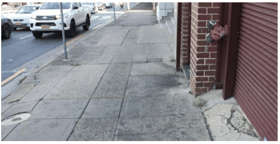
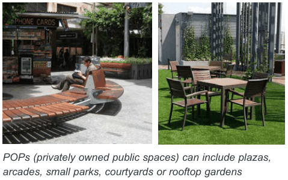
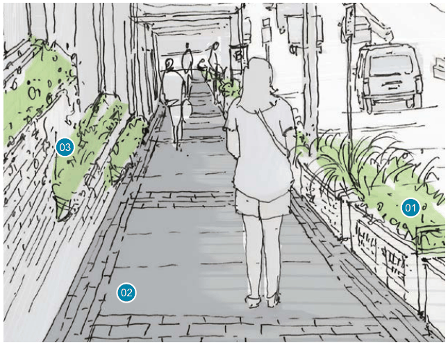
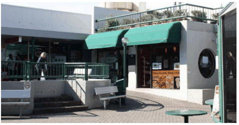
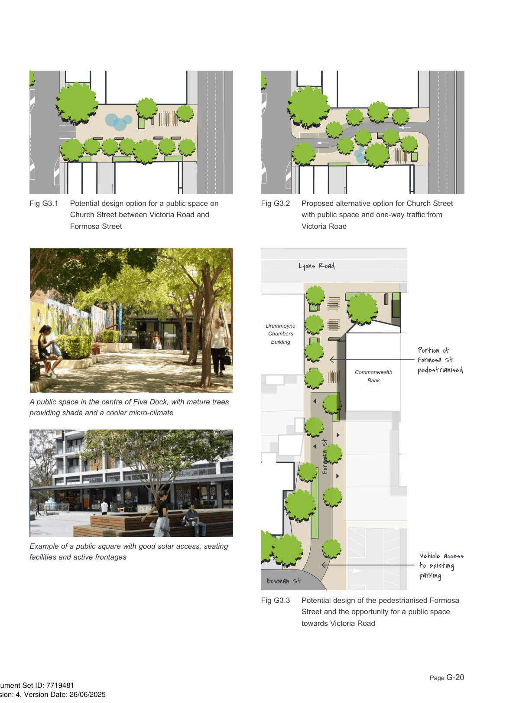
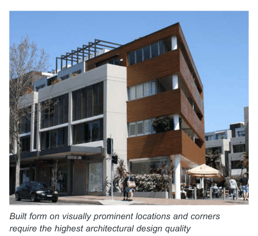
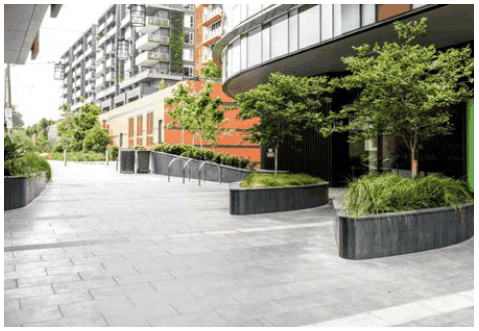
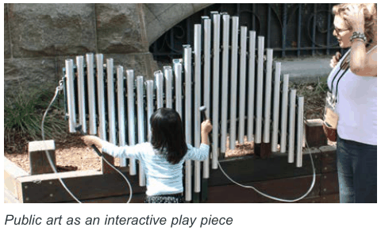
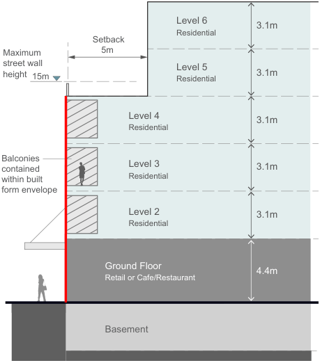
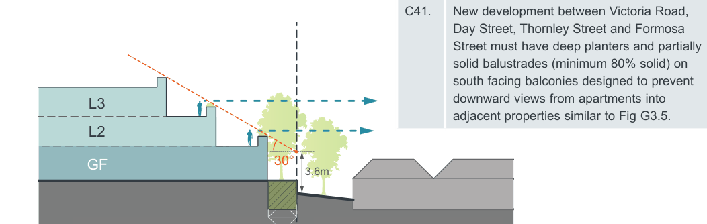

### G3  Site specific building envelope and design controls

#### G3.1  Victoria Road Drummoyne

#### Victoria Road footpath improvements Objectives

O1. To create a buffer to the fast moving traffic along Victoria Road and support increased pedestrian activity levels, safety and comfort. O2. To increase the amount of visible greenery at eye level when walking along Victoria Road.

#### Controls

C1. Footpaths along Victoria Road are identified as 'Priority area for pedestrian environment upgrade' in Fig G3.7 and Fig G3.8.

C2. Improvements are to incorporate the following design treatments:

• Upgrade of paving and consistency in surface finishes along Victoria Road;

• Upgrade and consistency of street furniture such as benches, bins, bicycle parking racks, bus shelters and the like;

• Low planting/ planter boxes along all non-stopping zones where pedestrians are immediately adjacent to moving traffic (to be maintained by Council);

• Green walls or shallow planters along facades of private development. A minimum of 10% 'greening' of ground floor facades along Victoria Road is required for all new development (to be maintained by the building owner).

#### New publicly accessible open spaces Objectives

O3. To increase the amount of open space in the precinct and to provide more areas for people to meet, gather and relax.

#### Controls

C3. Investigate the opportunity to create a new public gathering space on Church Street between Victoria Road and Formosa Street as identified in Fig G3.7 which would incorporate:

• Partial or complete closure of Church Street to vehicles (see Fig G3.1 and    Fig G3.2); and

• Sufficient space for tree planting, seating, public art, children's play area and outdoor seating areas for cafes/ restaurants.

C4. Maximise opportunities for privately owned public spaces (POPs) throughout the precinct. The following locations are proposed in Fig G3.7:

• A small square/ plaza at the northern end of Formosa Street on the corner of Lyons Road to the front of the former Commonwealth Bank site; and

• Expansion of the publicly accessible existing courtyard behind the heritage listed Sutton Building on the corner of Victoria Road and Lyons Road.

C5. New developments are encouraged to consider the creation of POPs i.e. on podiums, roof tops or internal courtyards connected by arcades/ pedestrian links.

C6. New development with a frontage to new public spaces and POPs should:

• pay particular attention to the 'human-scale' of lower levels and display a high degree of detailed design and articulation along the active frontages supporting the pedestrian slow-pace experience;

• maximise the number of doors and windows on upper levels overlooking the space;

• seek to ensure that 50% of the open space receives a minimum of 3 hours direct solar access in mid-winter (21 June) between 9am and 3pm; and

• encourage active uses on the ground floor with a preference for community facilities and cafes/ restaurants with outdoor seating.

> [Picture on page 18: a picture, saved as a picture (images/part-g-local-centres-page-18-1.gif, 150 dpi).]

The existing condition of the footpath along Victoria Road is in need of replacement

Quality footpaths and paving materials should be applied to both sides of Victoria Road and be of a consistent palette

> [Picture on page 18: a picture, saved as a picture (images/part-g-local-centres-page-18-6.gif, 150 dpi).]

> [Picture on page 18: a picture, saved as a picture (images/part-g-local-centres-page-18-7.gif, 150 dpi).]
> Words printed on the picture (copied from the PDF):
> 03
> 02
> 01

POPs (privately owned public spaces) can include plazas, arcades, small parks, courtyards or rooftop gardens

> [Picture on page 18: a picture, saved as a picture (images/part-g-local-centres-page-18-10.gif, 150 dpi).]

Sutton Place courtyard is an example of a POP and has the potential to be integrated into future redevelopment

01

Landscape treatments along 'No Stopping' zones and threshold treatments improve the ‘look & feel’ of the street

02

Improved surface finishes with standard colour and texture encourage pedestrian movement

03

Wall planting provides visual relief in the otherwise concrete dominated Victoria Road streetscape

Sketch showing the proposed footpath improvements along Victoria Road (Source: Victoria Road Urban Design Review, 2018)

#### Increased street tree planting Objectives

O4. To improve the walkability of streets adjacent to Victoria Road to make it more appealing for pedestrians to access shops and services. O5. To enhance the appearance and amenity of the area, improve the local micro-climate, provide native fauna and flora habitats and control climatic impacts on buildings and outdoor spaces.

#### Controls

C7. New street tree planting should concentrate along identified 'Street tree priority areas' i.e. Formosa Street, Renwick Street and the southern part of Wrights Road as identified in Fig G3.7 and Fig G3.8.

C8. In the identified priority areas, undergrounding of power lines should occur wherever possible to enable street trees to grow to mature levels. If undergrounding is not possible, and where appropriate, the bundling of power lines would reduce impact.

#### Landscape quality Objectives

O6. New development is to promote high quality landscape design as an integral component of the overall design.

O7. Provide native flora and fauna habitats and control climatic impacts on buildings and outdoor spaces. O8. Allow adequate provision on site for infiltration of stormwater, deep soil tree planting, landscaping and areas of communal outdoor recreation.

#### Controls

C9. A 1m setback along Formosa Street and a 0.5m setback along Victoria Road is to be provided at appropriate locations to allow for landscaping.

C10. New developments on street corners are to provide high quality landscaping and public seating.

C11. Landscaping is to be used to separate pedestrians from traffic, especially in 'no stopping' zones.

#### Formosa Street pedestrianisation Objectives

O9. To provide additional landscaping and pedestrian space along Formosa Street improving pedestrian amenity and active transport (walking, cycling). O10. To provide a high quality pedestrian environment in the 'heart' of Drummoyne within close proximity to existing retail and community facilities.

#### Controls

C12. Investigate the opportunity to convert the northern end of Formosa Street north of Bowman Street into a pedestrianised zone identified in Fig G3.7 as 'Priority area for streetscape pedestrianisation'. The proposed design options include:

• Closure to all through traffic to and from Lyons Road (see Fig G3.3); or

• Limited through traffic via a one-way system.

Pedestrianisation of this space would need to retain vehicular access to adjacent properties via a shared, slow speed zone and provide the opportunity for seating, landscaping and public art.

C13. New development that fronts onto the Formosa Street priority area for streetscape pedestrianisation must:

• minimise the number and width of vehicular driveways across the footpath;

• ensure building entries are clearly visible and pedestrian access to entries and lobbies is direct;

• maximise the number of doors and windows overlooking the street; and

• provide a landscaped front setback with substantial vegetation (except along active frontages).

C14. Investigate opportunities for the widening of footpaths and installation of landscaped street blisters at intersections along the entire length of Formosa Street.

> [Picture on page 20: a picture, saved as a picture (images/part-g-local-centres-page-20-1.gif, 150 dpi).]
> Words printed on the picture (copied from the PDF):
> Fig G3.1 Potential design option for a public space on
> Church Street between Victoria Road and
> Formosa Street
> A public space in the centre of Five Dock, with mature trees
> providing shade and a cooler micro-climate
> Example of a public square with good solar access, seating
> facilities and active frontages
> Proposed alternative option for Church Street
> Fig G3.2
> with public space and one-way traffic from
> Victoria Road
> Lyons Road
> Drummoyne
> Chambers
> Building
> Commonwealth
> Bank
> Formosa St
> Bowman St
> Portion of
> Formosa St
> pedestrianised
> Vehicle access
> to existing
> parking
> Potential design of the pedestrianised Formosa
> Fig G3.3
> Street and the opportunity for a public space
> towards Victoria Road

#### Church Street Objectives

O11. To provide additional landscaping and pedestrian space along Church Street. O12. To impove pedestrian amenity and active transport (walking, cycling) within the linear Victoria Road business/ retail core.

#### Controls

C15. Investigate the opportunity to create a public space, via the partial or complete closure of Church Street, between Victoria Road and Formosa Street as shown in Fig G3.8.

Possible design options are shown in Fig

G3.1 and Fig G3.2. Additional traffic studies would be required to determine what the ideal option would be. It may be possible to consider a hybrid option that would involve a timed directional flow.

#### Pedestrian links Objectives

O13. To improve pedestrian permeability and increase activity levels of the centre as a whole.

#### Controls

C16. Existing mid-block links as identified in Fig G3.7 are to be retained.

C17. Upgrade and where possible widen existing mid-block links. Design treatments should include:

• Good lighting levels;

• Clear sight lines;

• Permanent and temporary art and installations;

• Landscaping;

• Active uses trading to the link, where possible;

• High quality paving/ surface treatments.

C18. Wherever possible, long blocks are broken up with new high quality pedestrian prioritised links, particularly where new connections would facilitate access to public transport, open spaces and community facilities.

All new development is to consider the provision of new through site links, particularly where opportunities exist to connect retail and commercial uses along Victoria Road to parking and access along quieter streets such as Formosa Street.

Locations for two 'Desired future pedestrian links' are identified in Fig G3.7. Both connect Formosa Street with Victoria Road, one as an extension of Bowman Street and the other south of Edwin Street.

C19. New pedestrian links should be at least 5m wide, naturally lit and ventilated where possible, appropriately lit after hours, publicly accessible 24/7, and have clear sightlines from end to end.

#### Visually prominent locations

O14. To significantly improve the visual quality of the precinct by focussing on the design quality of prominent locations i.e. corner sites and localities at the end of terminating views.

#### Controls

C20. Development on sites identified as a prominent corner and/or at the end of a terminating view in Fig G3.7 and Fig G3.8 must pay particular attention to overall design quality due to the location's high visibility and impact on the local character, i.e. well proportioned facades, architectural detail, and quality materials and finishes.

#### Public art Objectives

O15. To provide a connection to the area's history and local stories, and enhance the pedestrian experience of the public domain.

#### Controls

C21. Large expanses of blank walls of new development should be utilised as a ‘canvas’ for art that has meaning and connection with the local community.

C22. Smaller pieces of public art should be incorporated into the public domain wherever possible. Key locations are identified in Fig G3.7 and Fig G3.8 and include the proposed POPs, the new public place on Church Street and the pedestrianised section of Formosa Street.

C23. Preference should be given to items that are at pedestrian level and scale, and multi-functional and/or interactive, e.g. pieces children can play on or with.

#### Smart poles Objectives

O16. To improve the visual quality of the centre in particular along Victoria Road.

#### Controls

C24. When required and in coordination with RMS, existing older-style timber light poles should be replaced with 'smart poles' able to carry banners.

> [Picture on page 22: a picture, saved as a picture (images/part-g-local-centres-page-22-31.gif, 150 dpi).]

Built form on visually prominent locations and corners require the highest architectural design quality

> [Picture on page 22: a picture, saved as a picture (images/part-g-local-centres-page-22-34.gif, 150 dpi).]

For the Victoria Road Centre, quality pedestrian links to Formosa Street are crucial for its future success

> [Picture on page 22: a picture, saved as a picture (images/part-g-local-centres-page-22-37.gif, 150 dpi).]

Public art as an interactive play piece

#### Lighting Objectives

O17. To enhance safety across the centre and discourage anti-social behaviour. O18. To increase the amenity of footpaths and public places after hours increasing activity levels. O19. To promote the civic image of the centre.

#### Controls

C25. New development is to incorporate a variety of lighting sources. As a minimum the following is to be provided:

• Pedestrian level lighting under awnings or mounted on ground level facades that sufficiently illuminates footpaths and any pedestrian links;

• Indirect lighting within shopfronts and tenancies that softly 'spills' onto the footpath after hours; and

• Indirect soft lighting of upper level facades or architectural details (note: care should be taken so that there is no light spill into apartments through windows).

C26. Public domain lighting is to be maximised and should include a wide variety of sources such as bollards and other street furniture, street lighting at pedestrian scale and uplighting of trees.

#### Night-time economy Objectives

O20. To provide a stimulus for a night-time economy within the centre and encourage clusters of businesses that also utilise suitable outdoor spaces.

#### Controls

C27. Establish a late night trading area (to midnight or 2 am) for shops, businesses and low-impact food and drink venues that trade off Victoria Road and/or the new public place on Church Street. (Note: the new hours would only apply if patrons enter and exit the venue from Victoria Road and not via a laneway or residential area).

C28. Establish a new category of trading hours for unlicensed shops, such as bookstores and clothing shops, service businesses e.g. gyms, dry cleaners and hairdressers, and public facilities e.g. libraries and community centres.

C29. Encourage weekend markets, events and small festivals, and support venues for live music such as hotels and restaurants,

#### Maximum building height Objectives

O21. To ensure new development reinforces the desired streetscape character and where appropriate retains the character of established residential areas.

O22. To provide a sense of enclosure to the street and contribute to a consistent built form scale across the precinct over time.

O23. To create a more consistent height modulation along Victoria Road that follows the topography rather than emphasising the ridges.

#### Controls

C30. New development is to conform with the maximum heights as shown in Fig G3.9 and Fig G3.10 (Building Envelopes Control Plans) and Fig G3.11 to Fig G3.15 (Building Envelopes Control Sections).

#### Number of storeys Objectives

O24. To avoid 'sunken' ground floors below footpath level resulting in a poor quality streetscape and pedestrian activation.

#### Controls

C31. New development is to conform to the maximum number of storeys as shown in Fig G3.9 and Fig G3.10 (Building Envelopes Control Plans) and Fig G3.11 to Fig G3.15 (Building Envelopes Control Sections).

#### Street wall height Objectives

O25. To help facilitate a gradual manifestation of consistent building scales and coherence along streetscapes and spatially enclose the street. O26. To minimise bulk and scale impact and help mitigate the pedestrian’s perception of building height.

O27. To allow adequate sunlight and minimise shadow impacts on the public domain. O28. To avoid a 'canyon' effect along Victoria Road in particular, where the sloping topography accentuates perceived building scale.

| Controls |  |
|---|---|
| C32. | The maximum street wall height across the centre varies between 2 and 4 storeys as illustrated in Fig G3.9 and Fig G3.10 (Building Envelopes Control Plans) and Fig G3.11 to Fig G3.15 (Building Envelopes Control Sections). |
| C33. | Building elements above the street wall height, such as balustrades, partition walls or roof overhangs must be set back at least 2.5m from the street wall height as illustrated in Fig G3.4 (Typical built form interface section). |
| C34. | Where frontages are more than 20 metres wide, building massing must be vertically articulated. |
| C35. | Where built-to alignments apply, buildings should have a minimum of 75% of their frontage built to the nil setback. The remaining 25% may be set back up to 2 metres to provide areas for entrances, landscaping, bike parking, outdoor seating etc. |

#### Floor to floor heights Objectives

O29. To address the need to revitalise the retail functions along Victoria Road, promote higher quality ground floor retail spaces and avoid sunken frontages below footpath level. O30. To ensure buildings are adaptable to a variety of uses over time.

#### Controls

C36. Minimum floor to floor heights for Victoria Road Drummoyne are as follows:

| Use | Minimum floor to floor height | Minimum floor to ceiling height |
|---|---|---|
| Retail | 4.4m | 4m |
| Adaptable | 3.7m | 3.3m |
| Commercial | 3.7m | 3.3m |
| Community | 3.7m | 3.3m |
| Residential | 3.1m | 2.7m |

Note: The ground floor is retail, commercial or community use. Residential use on the ground floor is not permitted in the centre.

Maximum

building height 20m

> [Picture on page 24: a map, saved as a picture (images/part-g-local-centres-page-24-33.gif, 150 dpi); the street names and other small labels are on the picture.]
> Labels printed on the map (copied from the PDF, in no particular order):
> 3.1m · Level 6 · Residential · Setback · 5m · 3.1m · Maximum · street wall · height 15m · Level 5 · Residential · 3.1m · Level 4 · Residential · 3.1m · Level 3 · Residential · Balconies · contained · within built · form envelope · 3.1m · Level 2 · Residential · 4.4m · Ground Floor · Retail or Cafe/Restaurant · Basement

Fig G3.4 Typical built form interface section

#### Upper level setbacks

#### Transition to lower scale residential

#### Objectives

#### Objectives

O31. To define the proportion, scale and visual

O33. To limit impacts of new development on

enclosure of the public domain and provide a level of consistency across the precinct.

surrounding lower density residential, i.e. loss of outlook, privacy and sun access.

O32. To lessen the visual impact of taller development

#### Controls

and help create a more unified, human-scale streetscape environment.

#### Controls

C40. New development on the eastern side of Victoria Road with a rear boundary to properties addressing Renwick Street must:

C37. Upper level setbacks are required towards most public domain interfaces as identified in Fig G3.9 and Fig G3.10 (Building Envelopes Control Plans) and Fig G3.11 to Fig G3.15 (Building Envelopes Control Sections).

• set back 3m as identified in Fig G3.9 and Fig G3.10 (Building Envelopes Control Plans) and Fig G3.11 to Fig G3.15 (Building Envelopes Control Sections). The setback area is to be a deep soil

zone. Basements are not permitted to encroach into this zone.

C38. The upper-most level(s) above the street wall height must be designed so that they are visually unobtrusive. Ways to achieve this include the use of lightweight construction techniques, dark colours and/or roof elements that create deep shadows.

• step back and strictly adhere to a 30 degree height plane measured from 3.6m above natural ground level at the boundary as identified in Fig G3.9 and Fig G3.10 (Building Envelopes Control Plans) and Fig G3.11 to Fig G3.15 (Building Envelopes Control Sections).

C39. If a development is more than 50 metres in length and higher than 4 storeys it should provide a vertical break in the built form for the upper two storeys.

• have deep planters and partially solid balustrades (minimum 80% solid) designed to prevent views from apartments into the rear gardens/ rear habitable rooms of properties on Renwick Street as identified in Fig G3.5.

#### L3

C41. New development between Victoria Road, Day Street, Thornley Street and Formosa Street must have deep planters and partially

> [Picture on page 25: a picture, saved as a picture (images/part-g-local-centres-page-25-59.gif, 150 dpi).]
> Words printed on the picture (copied from the PDF):
> 3.6m
> 30°
> 3m
> Victoria Rd properties
> Renwick St properties

solid balustrades (minimum 80% solid) on south facing balconies designed to prevent downward views from apartments into adjacent properties similar to Fig G3.5.
