#### L2 GF

### R e n w i c k

V i c t o ri a

Fig G3.5 A 3m deep soil zone and solid balustrades of new development will reduce overlooking of neighbouring rear gardens

### R o a d

### P r o p e r ti e s

#### Primary active frontages Objectives

O34. To increase pedestrian activity and support the economic success of the area, particularly along Victoria Road.

O35. To create diversity, avoid vehicle access points and shelter pedestrians from the weather along key pedestrian routes.

#### Controls

C42. Ground level active uses and a continuous cantilevered awning must be provided along 'Primary active frontages' as identified in Fig G3.9 and Fig G3.10.

C43. All primary active frontages must apply the design guidance outlined in Section G2 General Requirements, Fig G2.2.

C44. Ground level active uses/ tenancies must be minimum of 10m deep and be accessible without steps. Entries have a finished floor level that is at the same level as the footpath. Where this is not possible, entries are no greater than 0.4m above or below the footpath. Entries below footpath level are not permissible.

C45. Residential entries and foyers are permitted along active frontages, however, they are not to compromise the commercial activity along the street by keeping their frontage width to a minimum. The maximum width for residential entries/ foyers is 6m.

C46. Vehicle access points are generally not permitted along active frontages. Where no alternative access point can be provided, their width must be kept to an absolute minimum.

#### Secondary active frontages Objectives

O36. To enhance the appearance, attractiveness and safety of streets close to the main commercial activity.

#### Controls

C47. The interface of ground floors along 'Secondary active frontages' as identified in Fig G3.9 and Fig G3.10 must:

• consider the design requirements for primary active frontages;

• display a high degree of architectural detail and interest;

• use high quality materials and finishes;

• maximise pedestrian safety at driveway cross overs and vehicular access points;

• maximise the number of doors/ entries and windows; and

• incorporate lighting that illuminates the footpath after hours.

#### Balconies Objectives

O37. To not add to the built form visual bulk and scale. O38. To provide passive surveillance of the public domain.

| Controls |  |
|---|---|
| C48. | All balconies must be wholly contained within the building envelope. Forward protrusion beyond the envelope is not permissible. |
| C49. | Balconies should be designed so that they strike a balance between visual privacy for the resident and opportunities to overlook the public domain. Design treatment may include a combination of solid and transparent balustrade materials. |

#### Heritage and conservation Objectives

O39. To provide a link to the history of the Victoria Road centre and showcase the area's historic charm. O40. To recognise and support the significant contribution of heritage items to the character, cultural value and identity of the area. O41. To protect heritage buildings/ items and their visual setting or ‘curtilage’.

| Controls |  |
|---|---|
| C50. | New development in the proximity of the intersection of Victoria Road and Lyons Road, which has a pocket of heritage listed and contributory items, is to consider appropriate external paint schemes and sympathetic building signage. |
| C51. | Additional information signage about the area's history, located either in the public domain or on building facades, is to be provided wherever possible. |
| C52. | External facade lighting should be installed to highlight the architectural features of contributory buildings after dark. |
| C53. | Development in the vicinity of a heritage item, within a heritage conservation zone or a contributory zone, protects and enhances the cultural significance of nearby heritage items and streetscape character. |
| C54. | Where development is adjacent to a heritage item, contributory building or within a conservation area, a variation to the street wall height of the new development may be required. |
| C55. | Alterations and additions respond appropriately to the heritage fabric but do not mimic or overwhelm the original building. Designs are contemporary and identifiable from the existing building. Ways to separate the new work from the existing include providing generous setbacks between new and old, using a glazed section to link the new addition to the existing building and/or using shadow lines and gaps between old and new. |

C56. Building and facade design responds to the scale, materials and massing of heritage items through aligning elements such as eaves lines, cornices and parapets, facade articulation, proportion and/or rhythm of existing elements and complementary colours, materials and finishes.

C57. Signs on heritage buildings, including painted lettering, should be carefully located and should be sympathetic to the historic nature of the building. Adjacent signs should be designed and applied sympathetically.

C58. Where new development directly adjoins a listed heritage building, the appropriate building setback and height will be determined on a case-by-case basis having regard to the views, vistas and context of the heritage item.

C59. Highlight the assets of heritage buildings at the intersection of Lyons Road and Victoria Road by lighting the facades after dark and providing an adjacent high-quality public domain.

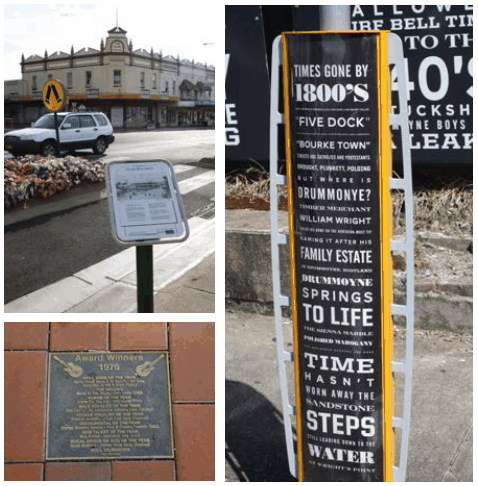

> [Picture on page 27: a picture, saved as a picture (images/part-g-local-centres-page-27-34.gif, 150 dpi).]

Examples of information integrated into the public domain, highlighting the history of the area and its buildings

#### Green walls and roofs Objectives

O42. To enhance the appearance and amenity of the area, create biodiversity and improve micro-climate conditions.

#### Controls

C60. New development should consider the incorporation of landscape elements and greenery such as:

• Vertical planting/ green walls;

• Facade indentations for landscaping; and

• Green roofs.

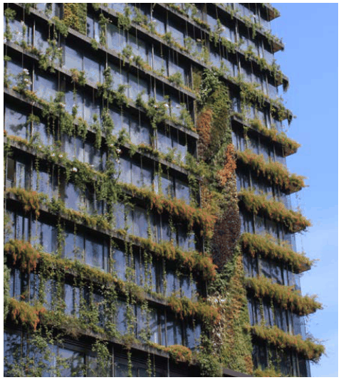

> [Picture on page 28: a picture, saved as a picture (images/part-g-local-centres-page-28-13.gif, 150 dpi).]

Example of a vertical green wall, Central Park Sydney

#### Awnings and street trees Objectives

O43. To provide for a balance of weather protection for pedestrians and the ability for mature street trees.

#### Controls

C61. Particularly along Victoria Road, new development should consider the provision of 'breaks' in awnings to allow for street tree planting.

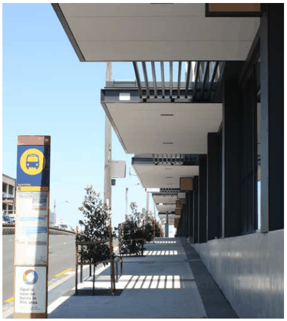

> [Picture on page 28: a picture, saved as a picture (images/part-g-local-centres-page-28-24.gif, 150 dpi).]

Example of an awning design with 'breaks' and street tree planting at 81-110 Victoria Road

#### Residential uses along Victoria Road Objectives

O44. To provide a high level of amenity for future building users and protect from negative impacts (noise, air quality, vibration).

#### Controls

C62. Development along Victoria Road is to consider the guidance in Busy Roads Interim Guidelines and the design approaches illustrated in Fig G3.6 Noise mitigating facade treatments, source: Development Near Rail Corridors And Busy Roads Interim Guideline, NSW.

C63. Noise sensitive areas (living rooms, bedrooms) are located away from Victoria

Where balconies are required, solid balustrades with

Road where possible.

sound absorption material added to the underside of balconies above is a good means of reducing noise

road

entering the building.

C64. Windows located towards Victoria Road are double-glazed (or laminated glazing) and have acoustic seals.

C65. Habitable rooms of dwellings are to be designed to achieve internal noise levels of

Providing enclosed balconies (or winter gardens) is another means of reducing the noise entering a building. Where enclosed balconies are used ventilation may need to be considered. By installing

no greater than 50dBA.

acoustic louvres ventilation requirements and reduced noise can be addressed. These approaches are shown in figure 3.16.

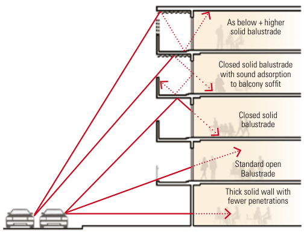

> [Picture on page 29: a map, saved as a picture (images/part-g-local-centres-page-29-35.gif, 150 dpi); the street names and other small labels are on the picture.]
> Labels printed on the map (copied from the PDF, in no particular order):
> figure 3.15: Balcony treatments · which reduce traffic noise · intrusion · As below + higher · solid balustrade · Closed solid balustrade · with sound adsorption · to balcony soffit · Closed solid · balustrade · Standard open · Balustrade · Thick solid wall with · fewer penetrations

Noise mitigating facade treatments

Fig G3.6

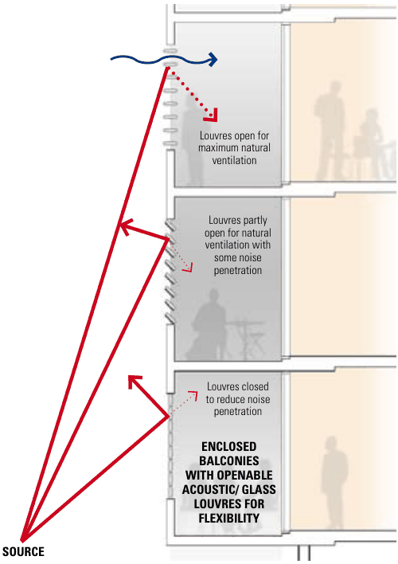

> [Picture on page 29: a map, saved as a picture (images/part-g-local-centres-page-29-38.gif, 150 dpi); the street names and other small labels are on the picture.]
> Labels printed on the map (copied from the PDF, in no particular order):
> figure 3.16: Enclosable · balconies facing the · Louvres open for · maximum natural · ventilation · Louvres partly · open for natural · ventilation with · some noise · penetration · Louvres closed · to reduce noise · penetration · ENCLOSED · BALCONIES · WITH OPENABLE · ACOUSTIC/ GLASS · LOUVRES FOR · FLEXIBILITY

#### SOURCE

(Source: Development Near Rail Corridors And Busy Roads Interim Guideline, NSW)

#### Visual privacy Objectives

O45. To protect the visual privacy of lower scale residential properties addressing Renwick Street.

#### Controls

C66. The interface of new development that shares a rear boundary with properties addressing Renwick Street must provide solid balustrades and screening vegetation as shown in Fig G3.5. Solid balustrades and screening also required for south and south-west facing balconies or terraces for buildings between Victoria Road, Day Street, Thornley Street and Formosa Street.

#### On-street parking and loading Controls

C67. New developments must not rely on Victoria Road on-street parking to meet parking and/or loading/delivery requirements or to facilitate access to the development and/or any associated commercial uses.

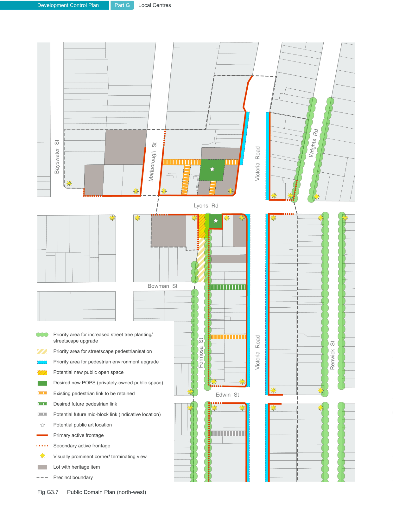

> [Picture on page 31: a picture, saved as a picture (images/part-g-local-centres-page-31-1.gif, 150 dpi).]
> Words printed on the picture (copied from the PDF):
> Wrights  Rd
> Bayswater  St
> Marlborough  St
> Lyons  Rd
> Bowman  St
> Priority area for increased street tree planting/
> streetscape upgrade
> Priority area for streetscape pedestrianisation
> Priority area for pedestrian environment upgrade
> Formosa  St
> Victoria  Road
> Victoria  Road
> Renwick  St
> College  St
> Potential new public open space
> Desired new POPS (privately-owned public space)
> Existing pedestrian link to be retained
> Edwin  St
> Desired future pedestrian link
> Potential future mid-block link (indicative location)
> Potential public art location
> Primary active frontage
> Secondary active frontage
> Visually prominent corner/ terminating view
> Lot with heritage item
> Albert  St
> Precinct boundary
> Fig G3.7 Public Domain Plan (north-west)

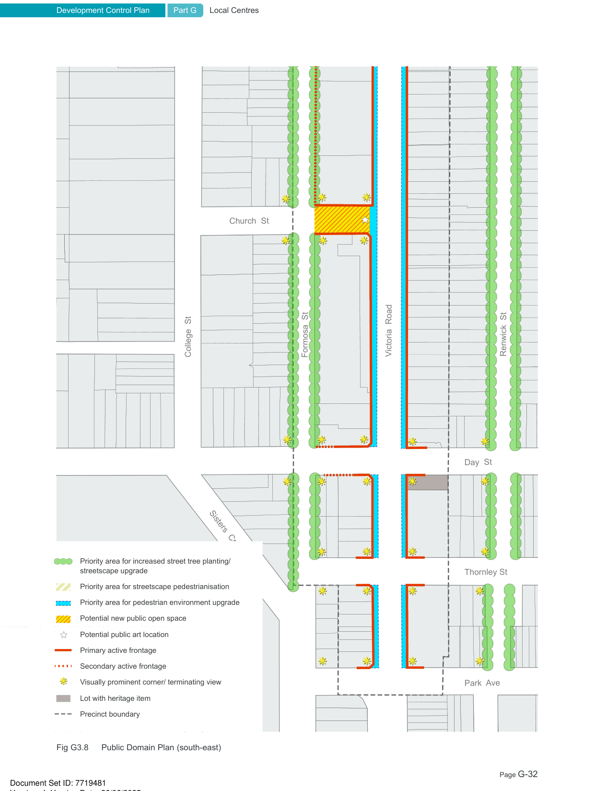

> [Picture on page 32: a map, saved as a picture (images/part-g-local-centres-page-32-1.gif, 150 dpi); the street names and other small labels are on the picture.]
> Labels printed on the map (copied from the PDF, in no particular order):
> Church  St · Renwick  St · Victoria  Road · College  St · Formosa  St · Day  St · Sisters  Cres · Priority area for increased street tree planting/ · streetscape upgrade · Thornley St · Priority area for streetscape pedestrianisation · Priority area for pedestrian environment upgrade · Potential new public open space · Potential public art location · Primary active frontage · Secondary active frontage · Visually prominent corner/ terminating view · Park  Ave · Lot with heritage item · Albert  St · Precinct boundary · Fig G3.8 Public Domain Plan (south-east)

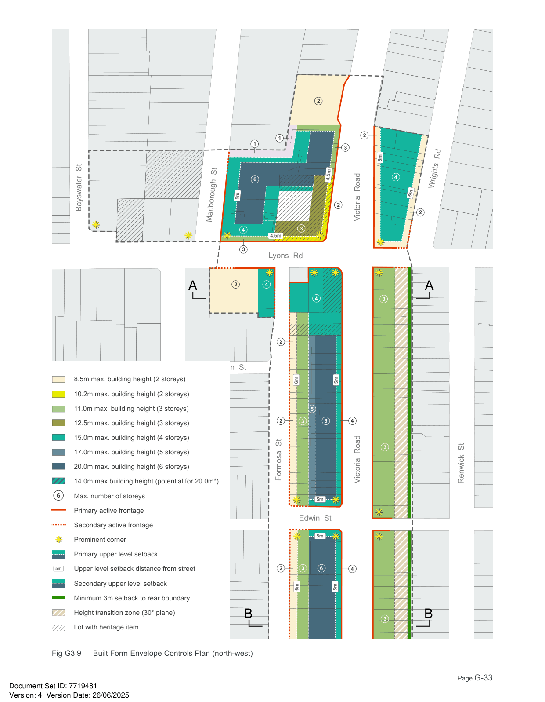

> [Picture on page 33: a map, saved as a picture (images/part-g-local-centres-page-33-1.gif, 150 dpi); the street names and other small labels are on the picture.]
> Labels printed on the map (copied from the PDF, in no particular order):
> 1 · 6 · 9m · Bayswater  St · Marlborough  St · 4 · 3 · 2 · Bowman  St · 8.5m max. building height (2 storeys) · 10.2m max. building height (2 storeys) · 11.0m max. building height (3 storeys) · 12.5m max. building height (3 storeys) · 15.0m max. building height (4 storeys) · 17.0m max. building height (5 storeys) · 20.0m max. building height (6 storeys) · College  St · 14.0m max building height (potential for 20.0m*) · 6 Max. number of storeys · Primary active frontage · Secondary active frontage · Prominent corner · Primary upper level setback · 5m Upper level setback distance from street · Albert  St · Secondary upper level setback · Minimum 3m setback to rear boundary · Height transition zone (30° plane) · Lot with heritage item · Fig G3.9 Built Form Envelope Controls Plan (north-west) · 2 · 2 · 1 · 3 · 4.5m · 2 · 3 · 4.5m · Lyons  Rd · 4 · 4 · 2 · 6m 5m · 5 · 2 · 4 · 6 · 3 · Formosa  St · Victoria  Road · Victoria  Road · 5m · Edwin  St · 5m · 6 · 3 · 2 · 4 · 6m 5m · 5m · 4 · 3 · 3 · 3 · Wrights  Rd · 5m · 2 · Renwick  St

### A

### B

### A

### B

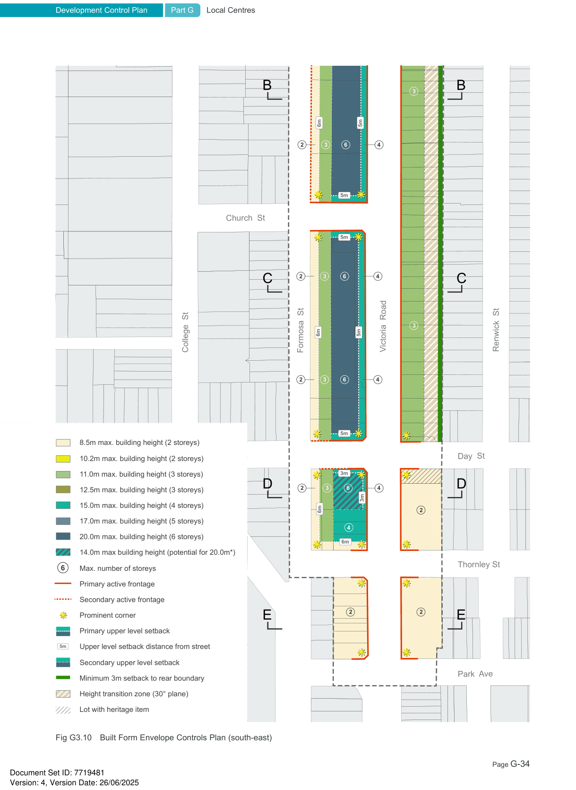

> [Picture on page 34: a map, saved as a picture (images/part-g-local-centres-page-34-1.gif, 150 dpi); the street names and other small labels are on the picture.]
> Labels printed on the map (copied from the PDF, in no particular order):
> Church  St · College  St · 8.5m max. building height (2 storeys) · 10.2m max. building height (2 storeys) · 11.0m max. building height (3 storeys) · 12.5m max. building height (3 storeys) · 15.0m max. building height (4 storeys) · 17.0m max. building height (5 storeys) · 20.0m max. building height (6 storeys) · Sisters  Cres · 14.0m max building height (potential for 20.0m*) · 6 Max. number of storeys · Primary active frontage · Secondary active frontage · Prominent corner · Primary upper level setback · 5m Upper level setback distance from street · Albert  St · Secondary upper level setback · Minimum 3m setback to rear boundary · Height transition zone (30° plane) · Lot with heritage item · Fig G3.10 Built Form Envelope Controls Plan (south-east) · 6m · 3 · 2 · 3 · 2 · 6m · Formosa  St · 3 · 2 · 3 · 2 · 6m · 3 · 5m · 6 4 · 5m · 5m · 6 4 · 3 · 5m · Victoria  Road · 6 4 · 5m · 3m · 6 4 · 3m · 2 · 4 · 6m · 2 · 2 · Renwick  St · Day  St · Thornley St · Park  Ave

### B

### C

### D

### E

### B

### C

### D

### E

Development Control Plan

Part G Local Centres

Property boundary

Fig G3.11 Built Form Envelope Section A

Key Plan Section A

Property boundary

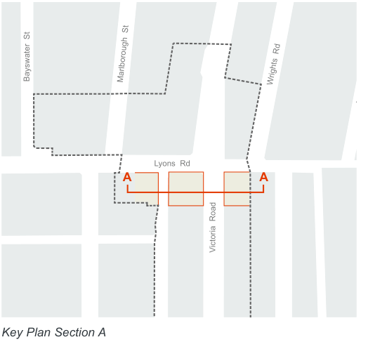

> [Picture on page 35: a picture, saved as a picture (images/part-g-local-centres-page-35-7.gif, 150 dpi).]
> Words printed on the picture (copied from the PDF):
> Bayswater  St
> Marlborough  St
> A
> Wrights  Rd
> Lyons  Rd
> A
> Victoria  Road

Property boundary

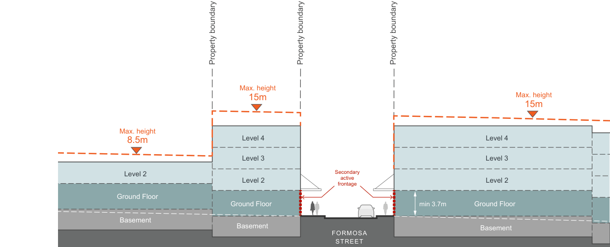

> [Picture on page 35: a map, saved as a picture (images/part-g-local-centres-page-35-9.gif, 150 dpi); the street names and other small labels are on the picture.]
> Labels printed on the map (copied from the PDF, in no particular order):
> Max. height · 8.5m · Level 2 · Ground Floor · Basement · Max. height · 15m · Level 4 · Level 3 · Level 2 · Ground Floor · Basement · Secondary · active · frontage · FORMOSA · STREET · Max. height · 15m · Level 4 · Level 3 · Level 2 · min 3.7m Ground Floor · Basement

Collingwood  St

Property boundary

Property boundary

Property boundary

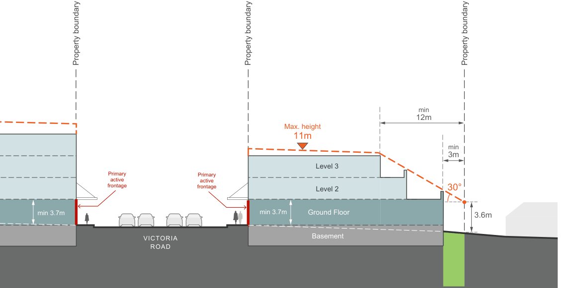

> [Picture on page 36: a map, saved as a picture (images/part-g-local-centres-page-36-4.gif, 150 dpi); the street names and other small labels are on the picture.]
> Labels printed on the map (copied from the PDF, in no particular order):
> Max. height · 11m · Level 3 · Primary · Primary · active · frontage · active · frontage · Level 2 · min 3.7m · min 3.7m Ground Floor · Basement · VICTORIA · ROAD · min · 12m · min · 3m · 30° · 3.6m

Development Control Plan

Max. height

8.5m

Secondary

active

frontage

FORMOSA STREET

Part G

Property boundary

Local Centres

Fig G3.12 Built Form Envelope Section B

Property boundary

Fig G3.13 Built Form Envelope Section C

Max. height

20m

Max. height

Property boundary

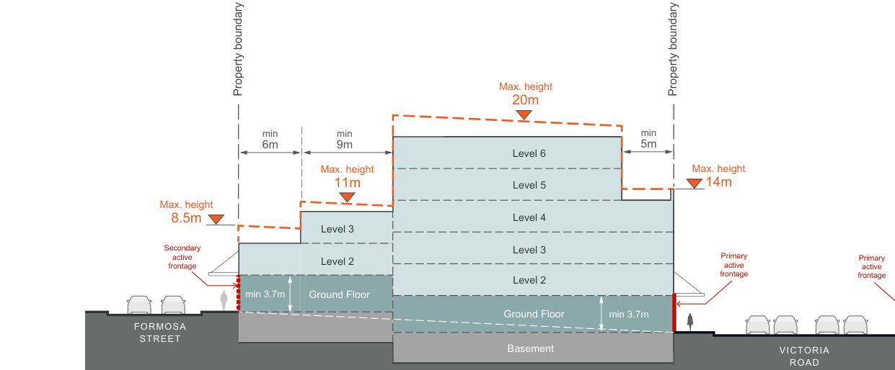

> [Picture on page 37: a map, saved as a picture (images/part-g-local-centres-page-37-19.gif, 150 dpi); the street names and other small labels are on the picture.]
> Labels printed on the map (copied from the PDF, in no particular order):
> min · 6m · min 3.7m · min · 9m · Max. height · 11m · Level 3 · Level 2 · Ground Floor · Level 6 · Level 5 · Level 4 · Level 3 · Level 2 · Ground Floor · Basement · min · 5m · Max. height · 14m · min 3.7m

Primary

Primary

active

frontage

active

frontage

VICTORIA ROAD

Property boundary

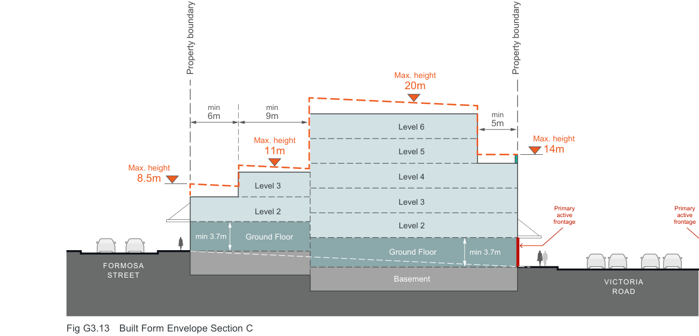

> [Picture on page 37: a map, saved as a picture (images/part-g-local-centres-page-37-29.gif, 150 dpi); the street names and other small labels are on the picture.]
> Labels printed on the map (copied from the PDF, in no particular order):
> Max. height · 8.5m · FORMOSA · STREET · min · 6m · min 3.7m · min · 9m · Max. height · 11m · Level 3 · Level 2 · Ground Floor · 20m · Level 6 · Level 5 · Level 4 · Level 3 · Level 2 · Ground Floor · Basement · min · 5m · Max. height · 14m · Primary · Primary · active · frontage · active · frontage · min 3.7m · VICTORIA · ROAD

Development Control Plan

Property boundary

Part G Local Centres

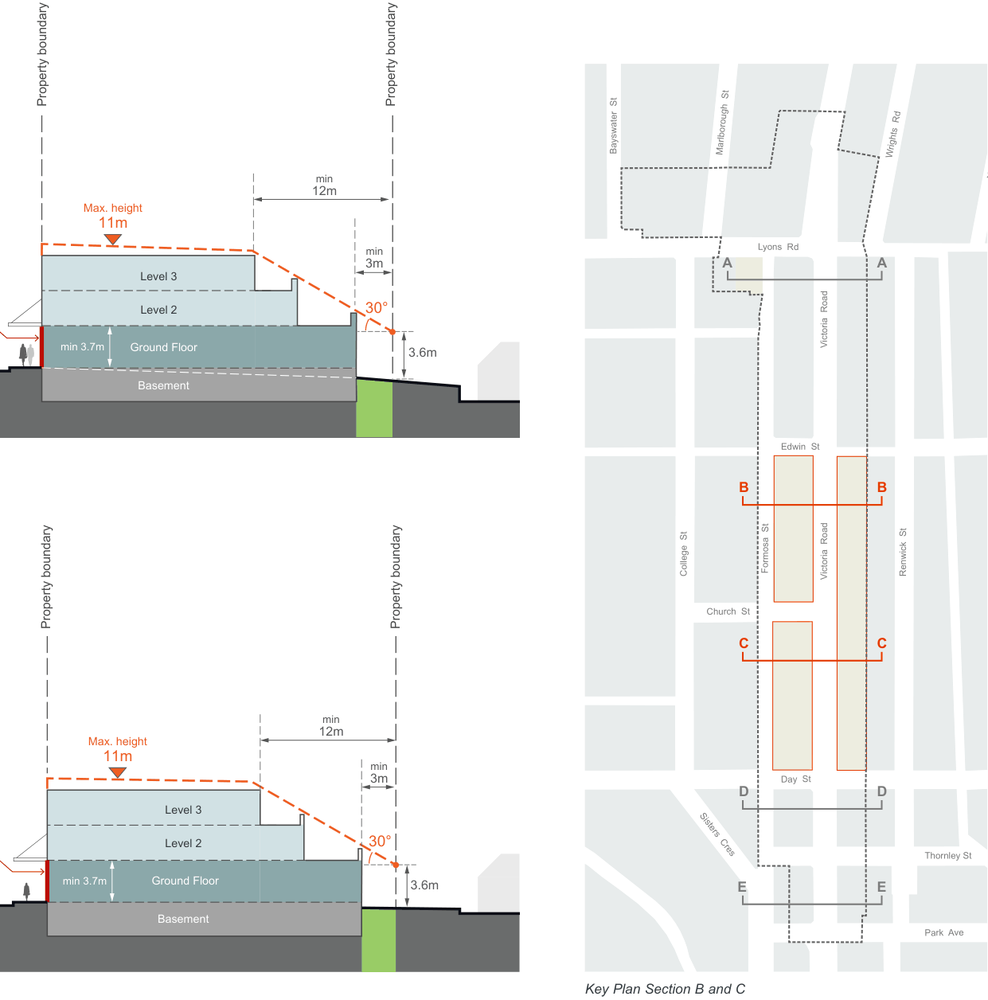

> [Picture on page 38: a map, saved as a picture (images/part-g-local-centres-page-38-4.gif, 150 dpi); the street names and other small labels are on the picture.]
> Labels printed on the map (copied from the PDF, in no particular order):
> Max. height · 11m · Level 3 · Level 2 · min 3.7m Ground Floor · Basement · Property boundary · Max. height · 11m · Level 3 · Level 2 · min 3.7m Ground Floor · Basement · min · 12m · min · 3m · 30° · 3.6m · Property boundary · min · 12m · min · 3m · 30° · 3.6m · Bayswater  St · Marlborough  St · Wrights  Rd · Lyons  Rd · A · A · Edwin  St · B · B · Formosa  St · College  St · Renwick  St · Victoria  Road · Victoria  Road · Church  St · C · C · Day  St · D · D · Sisters  Cres · Thornley St · E · E · Park  Ave

Property boundary

d  St

Key Plan Section B and C

Development Control Plan

Property boundary

Max. height

8.5m

FORMOSA STREET

Part G Local Centres

Fig G3.14 Built Form Envelope Section D

Property boundary

Property boundary

FORMOSA

STREET

Fig G3.15 Built Form Envelope Section E

Property boundary

Max. height

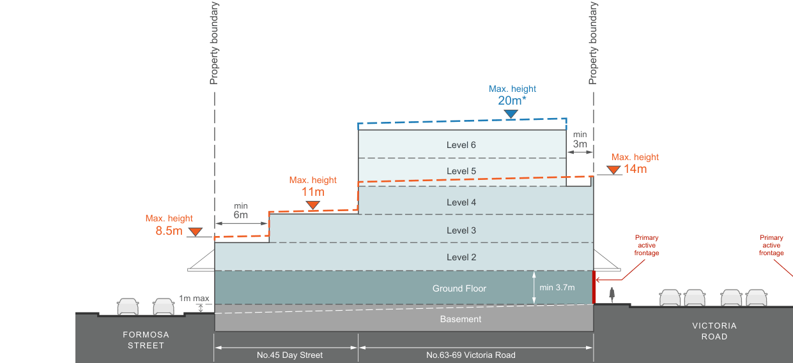

> [Picture on page 39: a map, saved as a picture (images/part-g-local-centres-page-39-16.gif, 150 dpi); the street names and other small labels are on the picture.]
> Labels printed on the map (copied from the PDF, in no particular order):
> 1m max · Max. height · 11m · min · 6m · No.45 Day Street · 20m* · min · 3m · Level 6 · Max. height · 14m · Level 5 · Level 4 · Level 3 · Level 2 · min 3.7m · Ground Floor · Basement · No.63-69 Victoria Road

Primary

Primary

active

frontage

active

frontage

VICTORIA ROAD

Property boundary

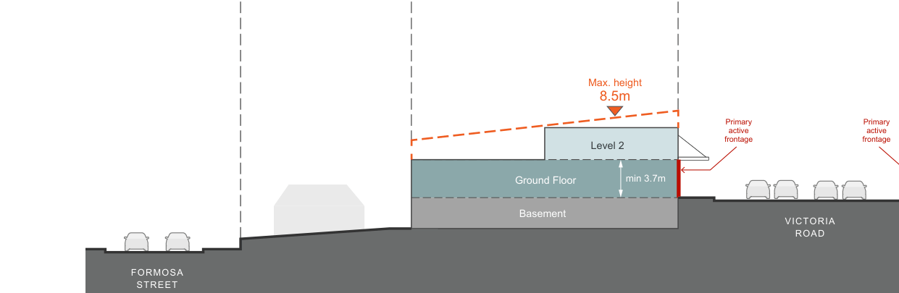

> [Picture on page 39: a picture, saved as a picture (images/part-g-local-centres-page-39-26.gif, 150 dpi).]
> Words printed on the picture (copied from the PDF):
> Max. height
> 8.5m
> Level 2
> min 3.7m
> Ground Floor
> Basement

Primary

Primary

active

frontage

active

frontage

VICTORIA ROAD

Development Control Plan

Property boundary

Part G Local Centres

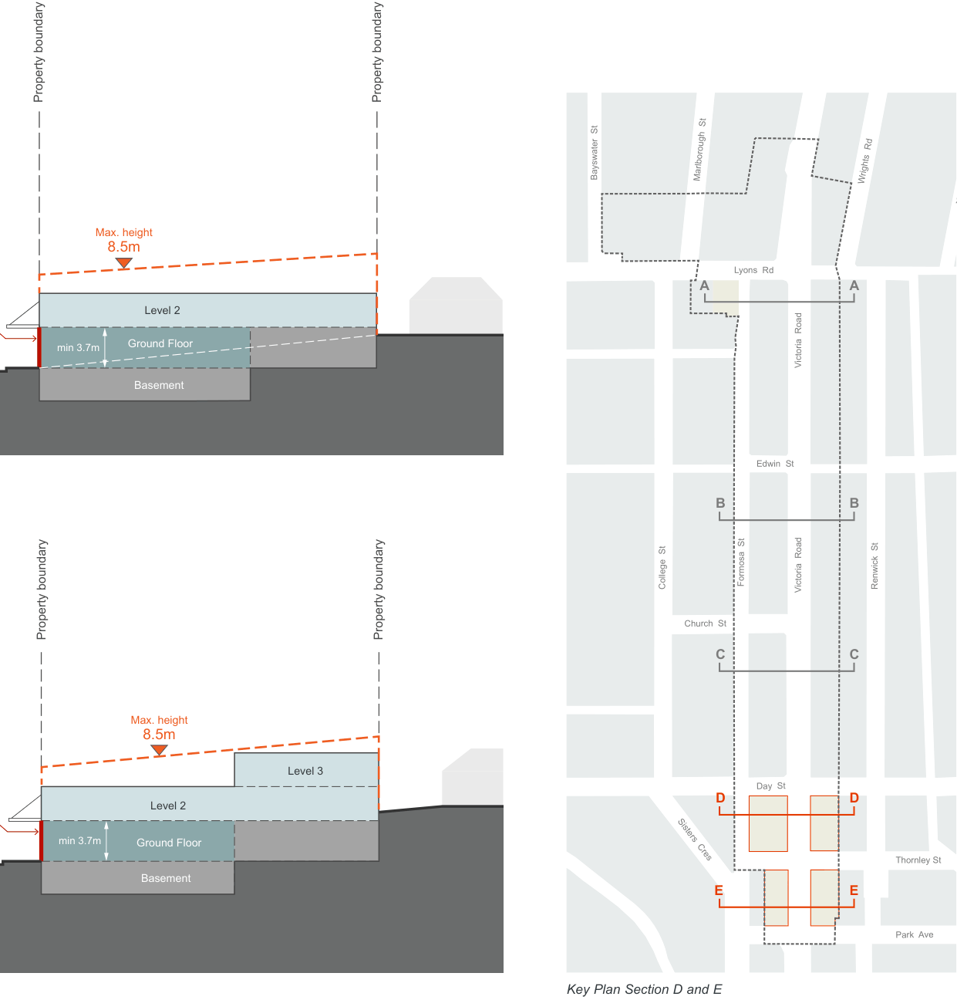

> [Picture on page 40: a map, saved as a picture (images/part-g-local-centres-page-40-4.gif, 150 dpi); the street names and other small labels are on the picture.]
> Labels printed on the map (copied from the PDF, in no particular order):
> Max. height · 8.5m · Level 2 · Ground Floor · min 3.7m · Basement · Property boundary · Max. height · 8.5m · Level 2 · min 3.7m Ground Floor · Basement · Property boundary · Level 3 · Bayswater  St · Marlborough  St · Wrights  Rd · Lyons  Rd · A · A · Edwin  St · B · B · Formosa  St · College  St · Renwick  St · Victoria  Road · Victoria  Road · Church  St · C · C · Day  St · D · D · Sisters  Cres · Thornley St · E · E · Park  Ave

Property boundary

d  St

Key Plan Section D and E

### Special area: Sutton Place / Drummoyne Village

Fig G3.16 Sutton Place - Location Plan

#### Objectives

O1. Develop a compact, functional, and permeable urban structure, which is easily accessed from surrounding streets by vehicle and by foot. O2. To ensure efficent vehicular and pedestrian access links within and between Victoria Road, Lyons Road and Marlborough Street. O3. To achieve an appropriate built form for the role of the Drummoyne Village which also respects the surrounding heritage items and conservation areas.

O4. To provide a mix of private open space and publicly accessible private open spaces.

#### Access

| Controls |  |
|---|---|
| C1. | Retain existing pedestrian throughsite link between Marlborough Street and Victoria Road. Explore potential opportunity to widen this access way if future development occurs. |
| C2. | Retain pedestrian access from Lyons Road into the courtyards through walkways and retail arcades. |
| C3. | Retain existing vehicular access to the Drummoyne Village site from Marlborough Street as far north as possible, away from major pedestrian movement paths. |
| C4. | Vehicular access to the site from Victoria Road is discouraged. |
| C5. | Investigate changing Marlborough Street into a two-way street in order to improve access, slow traffic and promote a pedestrian friendly environment. |
| C6. | Entrance to the commercial and residential uses will be provided wherever possible from the courtyards and walkways. |

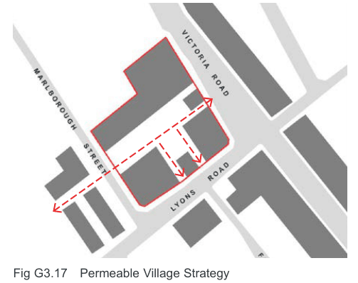

> [Picture on page 41: a picture, saved as a picture (images/part-g-local-centres-page-41-18.gif, 150 dpi).]

Fig G3.17 Permeable Village Strategy

#### Uses

#### Controls

C7. The village site will provide a mix of uses through:

• retail uses at ground level fronting onto Victoria Road, Lyons Road and existing and proposed courtyards;

• generally commercial uses are to be provided on the second and third levels and;

• residential uses are proposed on and above the third level.

#### Built Form

| Controls |  |
|---|---|
| C8. | The proposed built form is to be oriented to the street with a zero lot line to the street boundary; and enclose an open space within the interior of the block. |
| C9. | A height limit of 22m is required on the whole site to retain the scale of the Drummoyne skyline. |
| C10. | Development along Lyons Road and Victoria Road will maintain the parapet height of the Sutton Buildings as the height for their podium. The height of the podium is at 10.2m being two storeys in the Sutton Buildings and three storeys in all other buildings. |
| C11. | Development fronting Marlborough Street will have a podium of 4 storeys setback 4.5 metres above a plinth at ground level which will form a street edge. |
| C12. | The setback to upper levels (5 and 6) from the Marlborough Street frontage is to be no less than 9.0m |
| C13. | Six storey heights will be provided at least 13.5m away from Lyons Road and other street boundaries to retain the scale and character of the street and the heritage buildings. |
| C14. | Built form is to be in accordance with Fig G3.23 to Fig G3.34. |

#### Outdoor Spaces

| Controls |  |
|---|---|
| C15. | Sutton Buildings will maintain its existing courtyard. The courtyard should be increased in size by juxtaposing a similar shaped courtyard; |
| C16. | Above ground communal open space should be provided for residential uses. |
| C17. | A gap should be provided in the development to the north of the space to allow the penetration of winter sun. |
| C18. | Outdoor eating is encouraged in areas fronting the courtyards and along the Marlborough Street walkway, generating activity in these courtyards. |
| C19. | Restaurants and a possible outdoor eating terrace are encouraged at the northern end of the site to take advantage of the views to the west and the north western aspect. |

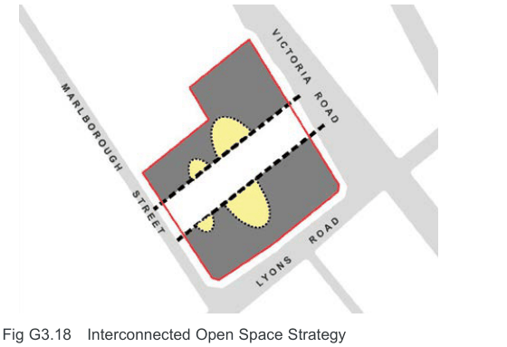

> [Picture on page 42: a picture, saved as a picture (images/part-g-local-centres-page-42-17.gif, 150 dpi).]

Fig G3.18 Interconnected Open Space Strategy

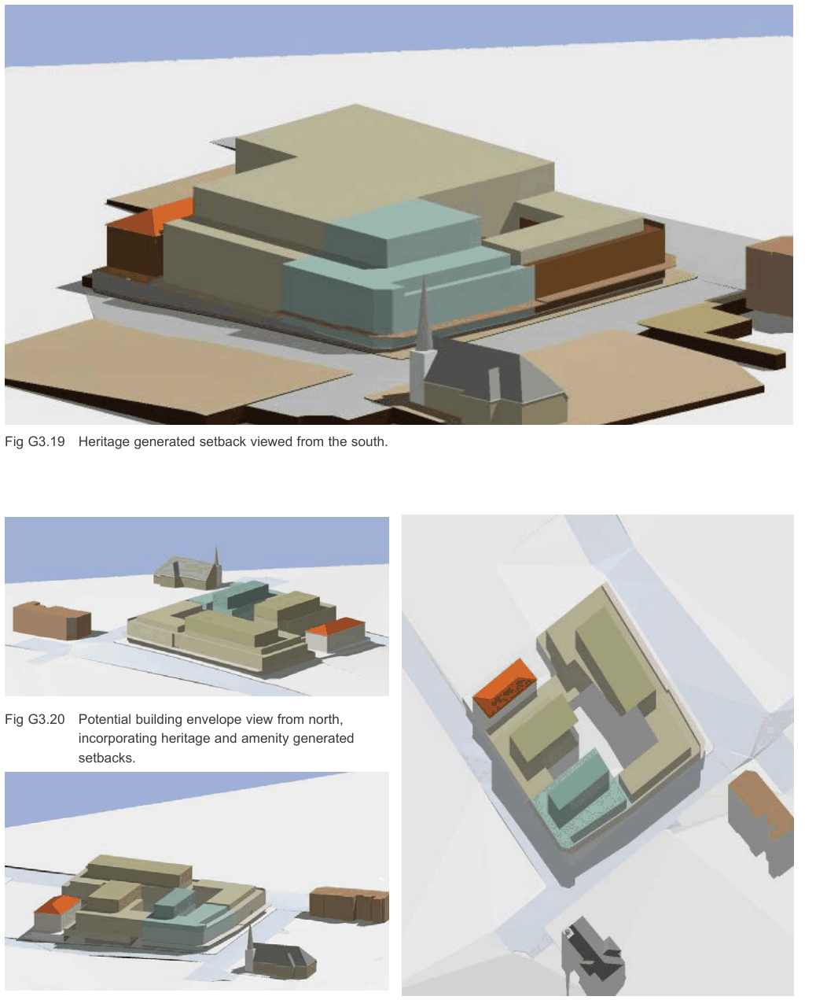

> [Picture on page 43: a picture, saved as a picture (images/part-g-local-centres-page-43-1.gif, 150 dpi).]

Fig G3.19 Heritage generated setback viewed from the south.

> Words printed on the picture (copied from the PDF):
> Fig G3.20 Potential building envelope view from north,
> incorporating heritage and amenity generated
> setbacks.

Fig G3.21 Potential building envelope view from south. Fig G3.22 Potential building envelope top view of setbacks.

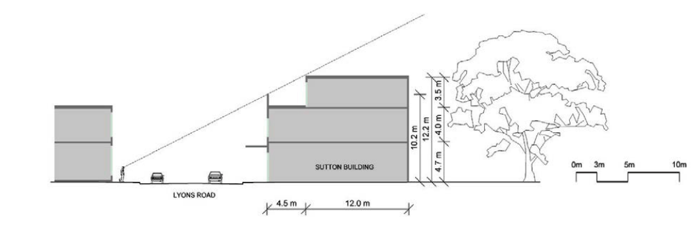

> [Picture on page 44: a picture, saved as a picture (images/part-g-local-centres-page-44-1.gif, 150 dpi).]

Fig G3.23 Heritage generated setback 1 through Sutton building. Reducing the impact of development on the street character of Lyons Road and separating new built form from the existing.

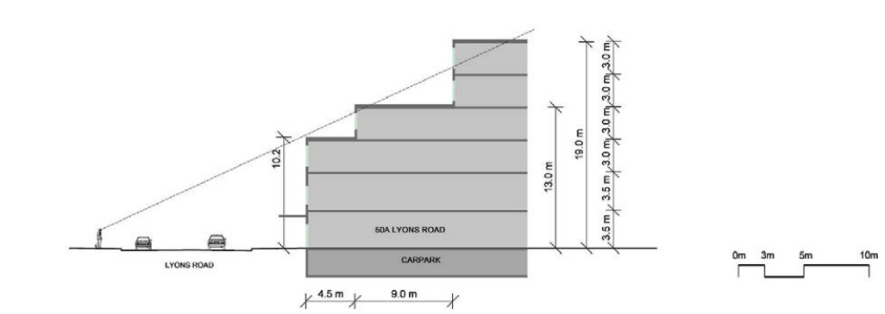

> [Picture on page 44: a picture, saved as a picture (images/part-g-local-centres-page-44-5.gif, 150 dpi).]

Fig G3.24 Heritage generated setback 2 through 50A Lyons Road. Reducing the impact of development on the heritage items on this opposite side of the street. The parapet is compatible with the adjoining heritage item.

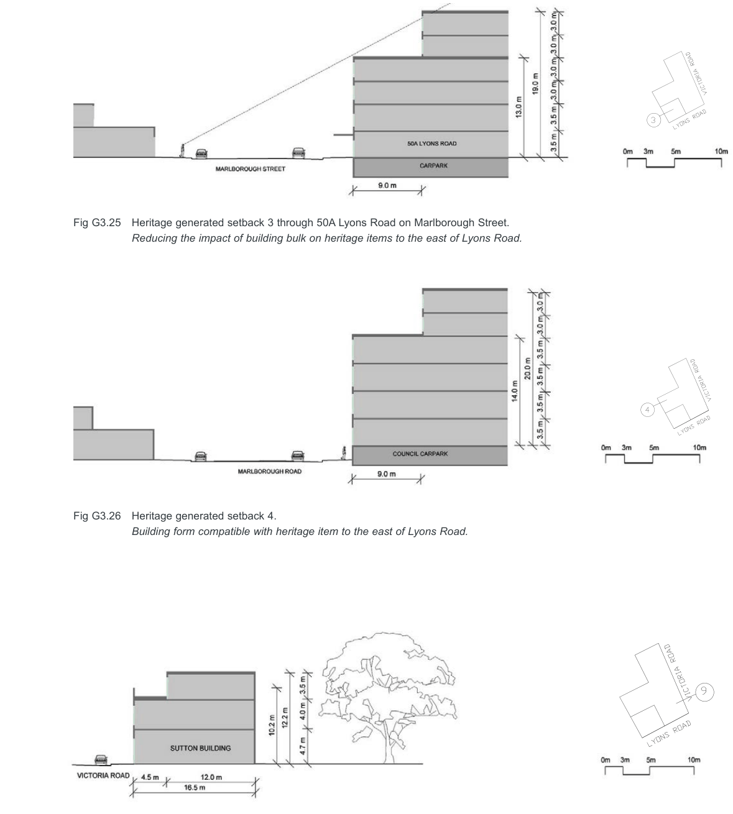

> [Picture on page 45: a picture, saved as a picture (images/part-g-local-centres-page-45-1.gif, 150 dpi).]

Fig G3.25 Heritage generated setback 3 through 50A Lyons Road on Marlborough Street. Reducing the impact of building bulk on heritage items to the east of Lyons Road.

Fig G3.26 Heritage generated setback 4. Building form compatible with heritage item to the east of Lyons Road.

> Words printed on the picture (copied from the PDF):
> Fig G3.27 Heritage generated setback 9 through Sutton Building.

Setback to separate new building from existing facade.

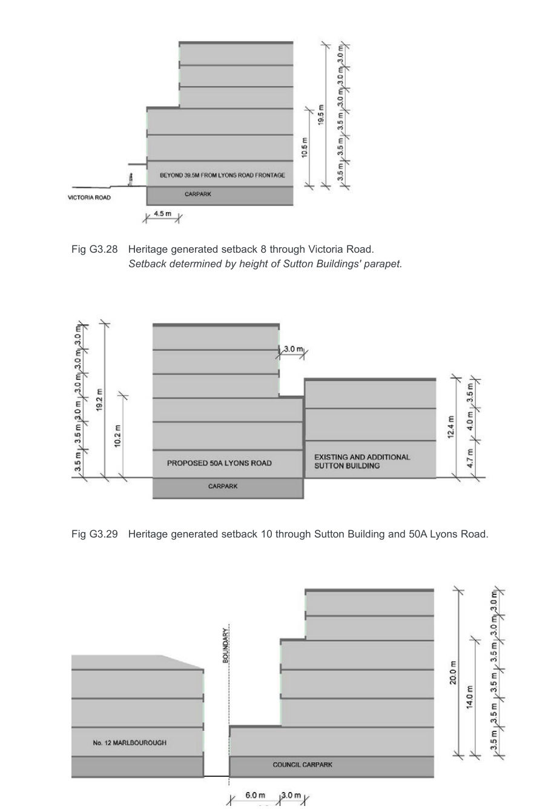

> [Picture on page 46: a picture, saved as a picture (images/part-g-local-centres-page-46-1.gif, 150 dpi).]

Fig G3.28 Heritage generated setback 8 through Victoria Road. Setback determined by height of Sutton Buildings' parapet.

Fig G3.29 Heritage generated setback 10 through Sutton Building and 50A Lyons Road.

Fig G3.30 Amenity generated setback 5. The setbacks from the boundary are generated by amenity relating to the adjoining residential building.

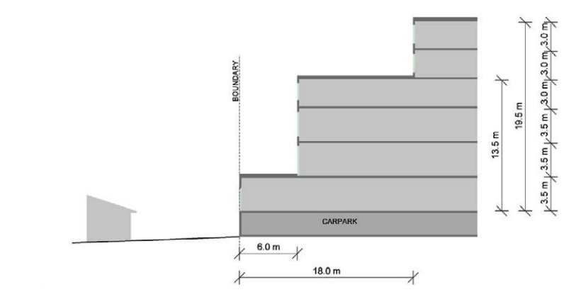

> [Picture on page 47: a picture, saved as a picture (images/part-g-local-centres-page-47-1.gif, 150 dpi).]

Fig G3.31 Amenity generated setback 6. The setbacks from this boundary are generated by amenity relating to the adjoining residential building.

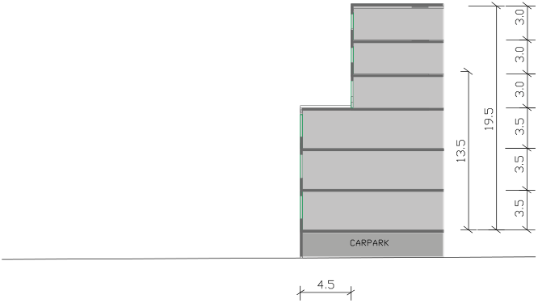

> [Picture on page 47: a picture, saved as a picture (images/part-g-local-centres-page-47-5.gif, 150 dpi).]

Fig G3.32 Amenity generated setback 7. The setbacks from this boundary are generated by amenity relating to the adjoining residential building.

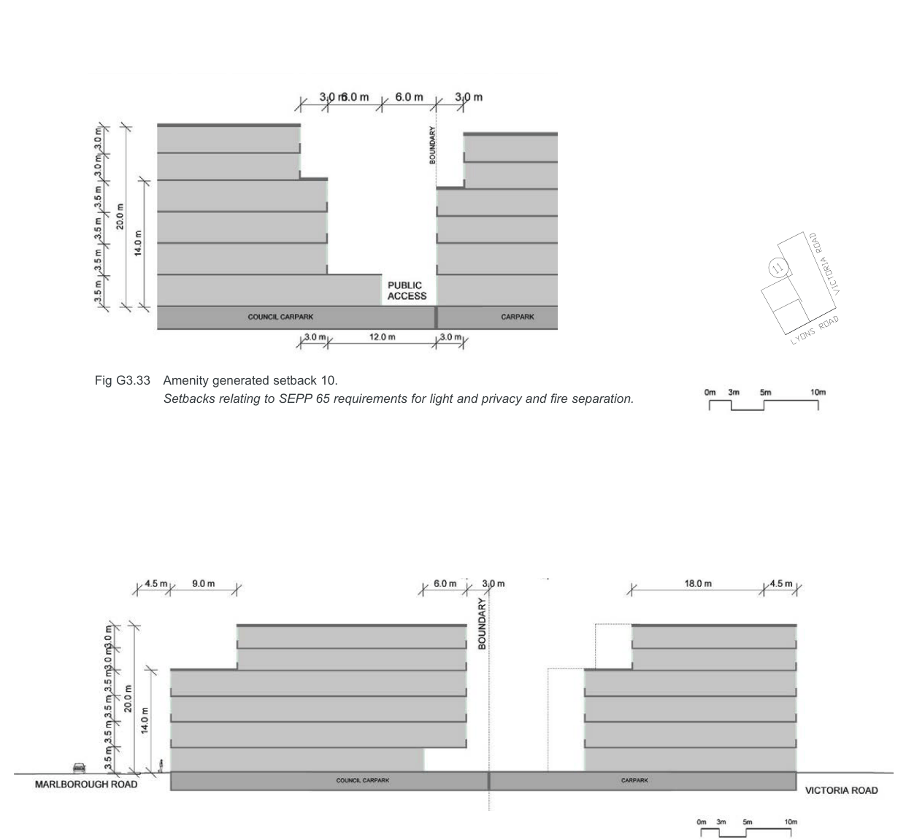

> [Picture on page 48: a picture, saved as a picture (images/part-g-local-centres-page-48-1.gif, 150 dpi).]

Fig G3.33 Amenity generated setback 10. Setbacks relating to SEPP 65 requirements for light and privacy and fire separation.

Fig G3.34 Heritage and Amenity generated setback 12. Envelope generated by desire for public space within development.

Special area: 53 – 69 Victoria Road, 45 Day Street and 46 Thornley Street,

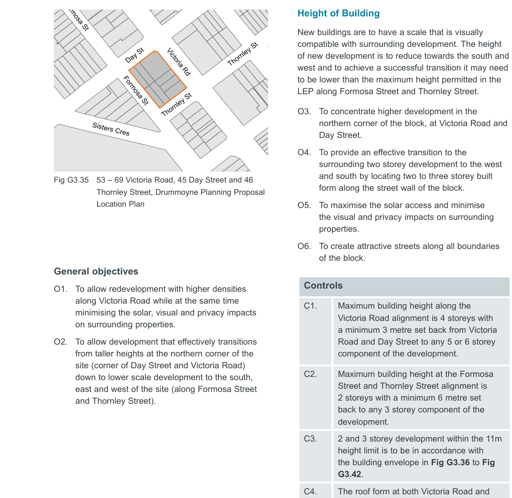

> [Picture on page 49: a picture, saved as a picture (images/part-g-local-centres-page-49-2.gif, 150 dpi).]
> Words printed on the picture (copied from the PDF):
> Day St
> Formosa St
> Day St
> Thornley St
> Victoria Rd
> Formosa St
> Thornley St
> Sisters Cres
> Fig G3.35 53 – 69 Victoria Road, 45 Day Street and 46

### Drummoyne Planning Proposal

Thornley Street, Drummoyne Planning Proposal Location Plan

#### General objectives

O1. To allow redevelopment with higher densities along Victoria Road while at the same time minimising the solar, visual and privacy impacts on surrounding properties. O2. To allow development that effectively transitions from taller heights at the northern corner of the site (corner of Day Street and Victoria Road) down to lower scale development to the south, east and west of the site (along Formosa Street and Thornley Street).

#### Height of Building

New buildings are to have a scale that is visually compatible with surrounding development. The height of new development is to reduce towards the south and west and to achieve a successful transition it may need to be lower than the maximum height permitted in the LEP along Formosa Street and Thornley Street.

O3. To concentrate higher development in the northern corner of the block, at Victoria Road and Day Street.

O4. To provide an effective transition to the surrounding two storey development to the west and south by locating two to three storey built form along the street wall of the block. O5. To maximise the solar access and minimise the visual and privacy impacts on surrounding properties.

O6. To create attractive streets along all boundaries of the block.

| Controls |  |
|---|---|
| C1. | Maximum building height along the Victoria Road alignment is 4 storeys with a minimum 3 metre set back from Victoria Road and Day Street to any 5 or 6 storey component of the development. |
| C2. | Maximum building height at the Formosa Street and Thornley Street alignment is 2 storeys with a minimum 6 metre set back to any 3 storey component of the development. |
| C3. | 2 and 3 storey development within the 11m height limit is to be in accordance with the building envelope in Fig G3.36 to Fig G3.42. |
| C4. | The roof form at both Victoria Road and Formosa Street is to be a parapet edge. |
| C5. | Basement garaging is to be designed to minimise the bulk and scale of the development, minimising blank walls to the street. Garage structures are not to extend more than 1m above the natural ground line at any point. |
| C6. | All plant must be contained within the building envelope. |

#### Bulk and Scale

The bulk and scale of a development plays an important role in helping the development fit into its surrounding context and minimise the impacts of development.

O7. To accommodate a two to three storey built form along the southern and eastern boundaries of the block.

O8. To provide height controls that accommodate the steep topography in the southern corner of the block.

#### Controls

| C7. | Basement parking is not to extrude more than 1m above the natural ground line. |
|---|---|
| C8. | Development along Formosa Street and Thornley Street is to have a two storey appearance. |

| C9. | It may be possible to provide some four storey development within the site at 53 Victoria Road where this can occur entirely within the maximum building envelope, is set back a minimum of 3 metres from the 3 storey street wall along Victoria Road and where it does not increase overshadowing or reduce privacy of adjoining properties. |
|---|---|
| C10. | The design of balconies and roof terraces is to minimise the visual bulk of the building. This is particularly important along Formosa Street and Thornley Street. |

#### Active frontages

Active frontages contribute to visual and physical activity along the street particularly along Victoria Road and may include community and civic facilities, recreation and leisure facilities and shops, restaurants and cafes.

O9. To promote activity and interest along Victoria Road and at the highly visible corners. O10. To enhance the commercial viability and compliment existing retail, commercial, entertainment and community uses. O11. To enhance safety and security in the area.

| Controls |  |
|---|---|
| C11. | Provide ground level active uses and a continuous cantilevered awning where indicated in Fig G3.36. |
| C12. | Ground level active uses are to be a minimum of 10m deep and have a finished floor level no greater than 0.4m above or below the footpath level. |
| C13. | Residential entries and foyers are permitted along ground level active street frontages but are not to compromise the commercial activity along the street. |
| C14. | Vehicle access points are not permitted in areas indicated as active street frontage. |

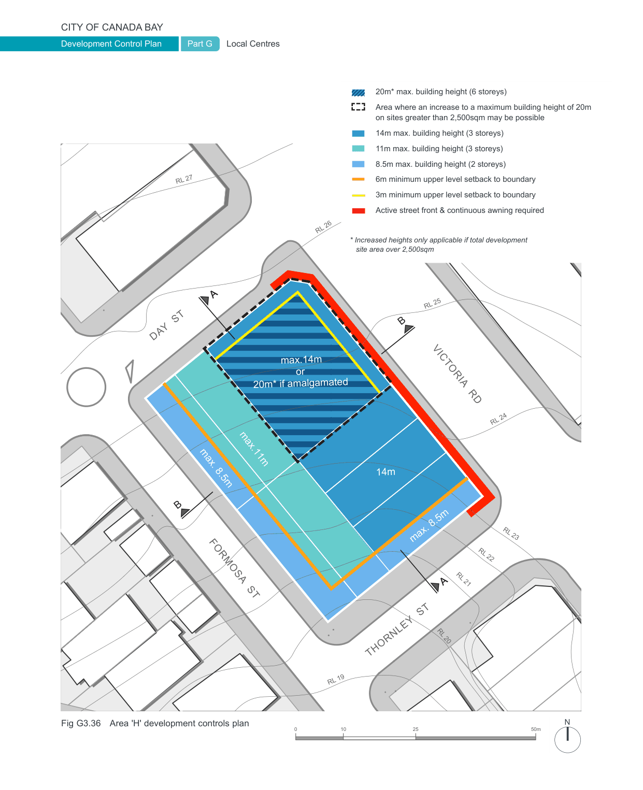

> [Picture on page 51: a map, saved as a picture (images/part-g-local-centres-page-51-1.gif, 150 dpi); the street names and other small labels are on the picture.]
> Labels printed on the map (copied from the PDF, in no particular order):
> 20m* max. building height (6 storeys) · Area where an increase to a maximum building height of 20m · on sites greater than 2,500sqm may be possible · 14m max. building height (3 storeys) · 11m max. building height (3 storeys) · 8.5m max. building height (2 storeys) · 6m minimum upper level setback to boundary · RL 27 · 3m minimum upper level setback to boundary · Active street front & continuous awning required · RL 26 · * Increased heights only applicable if total development · site area over 2,500sqm · A · RL 25 · DAY  ST · max.14m · or · 20m* if amalgamated · VICTORIA  RD · RL 24 · max.11m · 14m · max. 8.5m · B · B · RL 23 · max. 8.5m · RL 22 · A RL 21 · FORMOSA  ST · RL 20 · THORNLEY  ST · RL 19 · N · 50m · 25 · 0 10 · Fig G3.36 Area 'H' development controls plan

Maximum

Site boundary

Site boundary

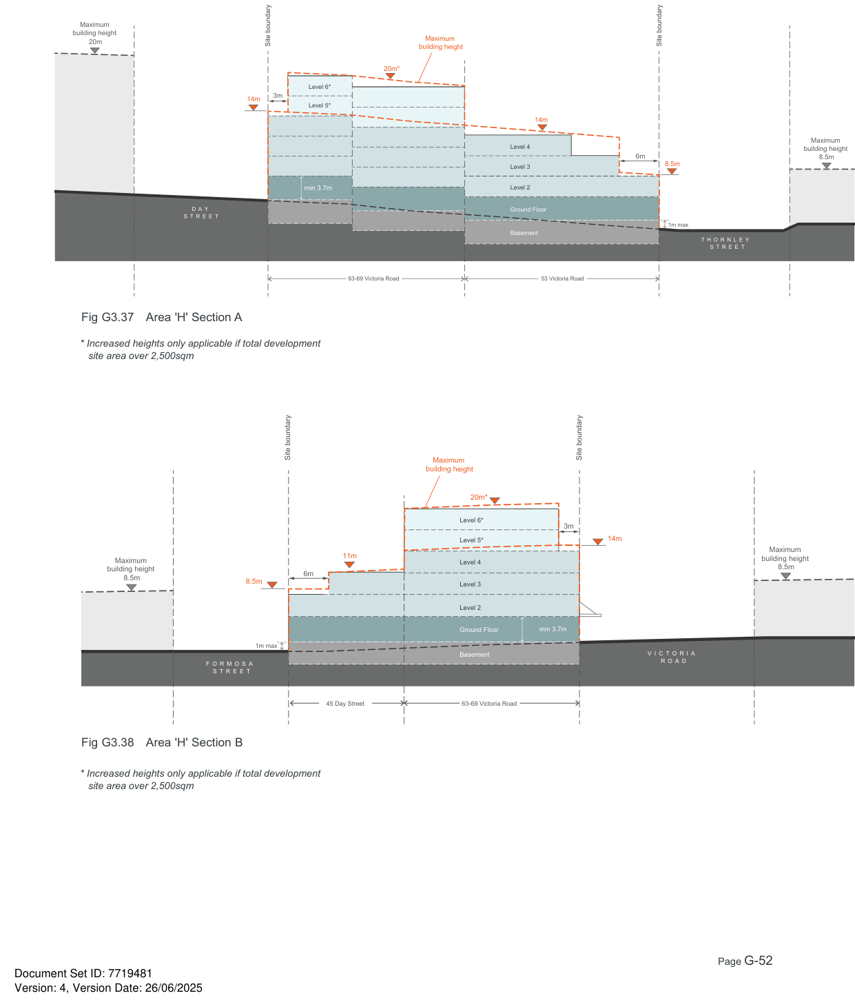

> [Picture on page 52: a map, saved as a picture (images/part-g-local-centres-page-52-4.gif, 150 dpi); the street names and other small labels are on the picture.]
> Labels printed on the map (copied from the PDF, in no particular order):
> building height · 20m · 20m* · Level 6* · 3m · 14m · Level 5* · min 3.7m · D A Y · S T R E E T · 63-69 Victoria Road · Fig G3.37 Area 'H' Section A · * Increased heights only applicable if total development · site area over 2,500sqm · Site boundary · 11m · Maximum · building height · 6m · 8.5m · 8.5m · 1m max · F O R M O S A · S T R E E T · 45 Day Street · 45 Day Street · Fig G3.38 Area 'H' Section B · * Increased heights only applicable if total development · site area over 2,500sqm · Maximum · building height · 14m · Level 4 · Level 3 · Level 2 · Ground Floor · Basement · 53 Victoria Road · Site boundary · Maximum · building height · 20m* · Level 6* · 3m · Level 5* · Level 4 · Level 3 · Level 2 · min 3.7m · Ground Floor · Basement · 63-69 Victoria Road · 63-69 Victoria Road · Maximum · building height · 8.5m · 8.5m · 6m · 1m max · T H O R N L E Y · S T R E E T · 14m · Maximum · building height · 8.5m · V I C T O R I A · R O A D

Site boundary

Site boundary

Maximum

building height

8.5m

T H O R N L E Y

S T R E E T

Fig G3.39 Area 'H' Elevation 1 Victoria Road

Maximum

building height

20m (LEP)

Site boundary

Maximum

building height

2 storeys (DCP)

D A Y

S T R E E T

Fig G3.40 Area 'H' Elevation 2 Formosa Street

Site boundary

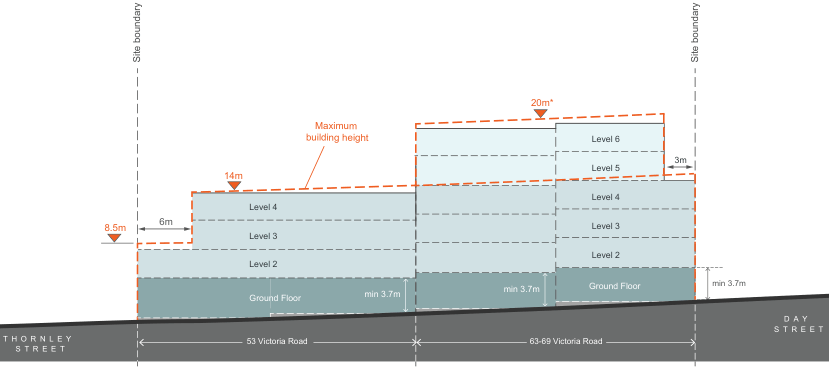

> [Picture on page 53: a map, saved as a picture (images/part-g-local-centres-page-53-20.gif, 150 dpi); the street names and other small labels are on the picture.]
> Labels printed on the map (copied from the PDF, in no particular order):
> Maximum · building height · 14m · Level 4 · 8.5m · 6m · Level 3 · Level 2 · min 3.7m · Ground Floor · 53 Victoria Road · 53 Victoria Road · 20m* · Level 6 · Level 5 · Level 4 · Level 3 · Level 2 · min 3.7m Ground Floor · 63-69 Victoria Road · 3m

min 3.7m

Site boundary

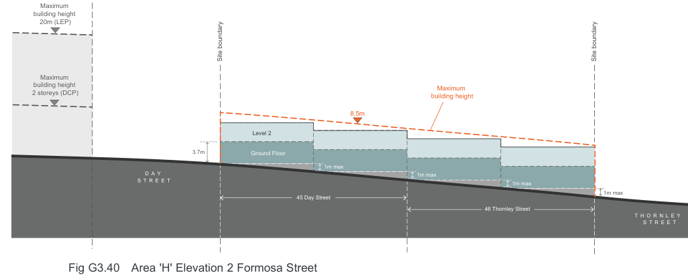

> [Picture on page 53: a picture, saved as a picture (images/part-g-local-centres-page-53-23.gif, 150 dpi).]
> Words printed on the picture (copied from the PDF):
> 8.5m
> Level 2
> 3.7m Ground Floor
> 1m max
> 45 Day Street
> Maximum
> building height
> 1m max
> 1m max
> 46 Thornley Street

1m max

Maximum building height 17m

D A Y

S T R E E T

Maximum building height 8.5m

T H O R N L E Y

S T R E E T

Site boundary

Fig G3.41 Area 'H' Elevation 3 Thornley Street

Site boundary

Maximum

building height

Site boundary

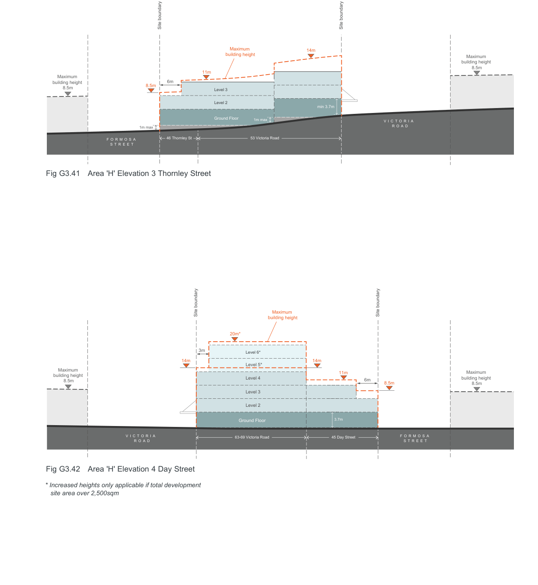

> [Picture on page 54: a map, saved as a picture (images/part-g-local-centres-page-54-7.gif, 150 dpi); the street names and other small labels are on the picture.]
> Labels printed on the map (copied from the PDF, in no particular order):
> Maximum · building height · 11m · 6m · Maximum · building height · 8.5m · 8.5m · Level 3 · Level 2 · Ground Floor 1m max · 1m max · 46 Thornley St · 53 Victoria Road · F O R M O S A · S T R E E T · 14m · min 3.7m · V I C T O R I A · R O A D · Maximum · building height · 8.5m

Site boundary

> Labels printed on the map (copied from the PDF, in no particular order):
> 20m* · 3m Level 6* · 14m · Level 5* · Maximum · building height · Level 4 · 8.5m · Level 3 · Level 2 · Ground Floor · V I C T O R I A · 63-69 Victoria Road · R O A D · Fig G3.42 Area 'H' Elevation 4 Day Street · * Increased heights only applicable if total development · site area over 2,500sqm · 14m · 11m · 3.7m · 45 Day Street · 6m · 8.5m · F O R M O S A · S T R E E T · Maximum · building height · 8.5m
