#### G3.2  Five Dock Town Centre

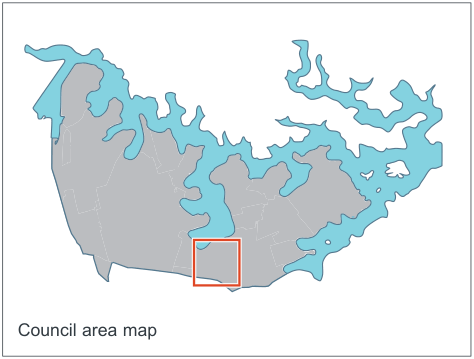

> [Picture on page 55: a picture, saved as a picture (images/part-g-local-centres-page-55-2.gif, 150 dpi).]
> Words printed on the picture (copied from the PDF):
> Council area map

#### Context

The Five Dock Town Centre is focused along each side of Great North Road between Queens Road and Fairlight Street to the south and Lyons Road to the north. The centre is a commercial, civic, community and residential precinct, with a local neighbourhood emphasis and consists primarily of 2-3 storey buildings.

Variety is created along the streetscape through different building styles which range from Edwardian and inter-war buildings to more recent development including a mixed use building on Garfield Street, which incorporates the Five Dock public library.

The centre starts in the south at the ridge line intersection at Fairlight/Queens Road with Great North Road and extends along Great North Road past First Avenue and Garfield Street with the northern end defined by intersection with the Lyons Road/Lyons Road West. The highest part of the centre occurs to the south of the centre between Kings Road and Second Avenue.

Taller buildings have views to the Sydney CBD and the Sydney Harbour Bridge to the north-east, Hen and Chicken Bay to the north-west and the Blue Mountains to the west. Land use zoning allows mixed use activities, including apartments with retail uses located on the ground floor, along Great North Road.

#### Land to which this DCP applies

This Part applies to all land shown within the area identified in 'Fig G3.43 Location Plan'.

#### Desired future character

The Five Dock Town Centre will be a place where new buildings, alterations and additions contribute to the local 'village character' and heritage values through appropriate building forms, setbacks and heights.

Development proposals in the centre are required to provide a written statement that outlines how the following future character performance criteria have been achieved:

• Mixed use: New developments and alterations add to the centre's function as a vibrant destination for the local community and visitors, by providing a diverse mix of uses including retail, hospitality, residential and recreational facilities.

• Well-proportioned streetscapes: The bulk and scale of new development and alterations ensures good access to sunlight and natural ventilation is retained along the centre's streets and to areas of public open space. Built form will also create consistent street wall heights, especially along Great North Road, and ensure the bulk and scale steps down towards adjoining residential areas.

• Quality built form: New buildings and alterations display a high level of architectural design quality with construction methods and materials that are proven to be durable over time, colours that integrate with the context and building articulation that is sympathetic with adjoining built form and the local 'village character'.

• Safety and surveillance: New buildings and alterations support street level activity by paying particular attention to the design of ground floors, facades, signage and awnings and by providing opportunities for passive surveillance of the public domain from upper levels.

• Access and mobility: New development supports accessibility of the centre by reinforcing, and where possible adding to, a permeable and attractive network of streets, lanes, footpaths and pedestrian links.

Development Control Plan Part G

Local Centres

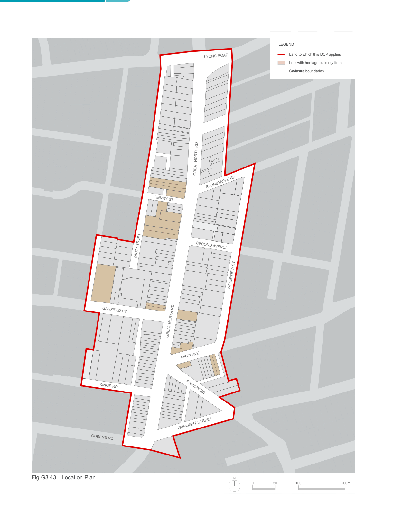

> [Picture on page 56: a map, saved as a picture (images/part-g-local-centres-page-56-3.gif, 150 dpi); the street names and other small labels are on the picture.]
> Labels printed on the map (copied from the PDF, in no particular order):
> GARFIELD ST · KINGS RD · QUEENS RD · Fig G3.43 Location Plan · LYONS ROAD · GREAT NORTH RD · BARNSTAPLE RD · HENRY ST · SECOND AVENUE · EAST STREET · WATERVIEW ST · GREAT NORTH RD · FIRST AVE · RAMSAY RD · FAIRLIGHT STREET · N · LEGEND · Land to which this DCP applies · Lots with heritage building/ item · Cadastre boundaries · 200m · 50 100

#### Public open space Objectives

O1. To increase the amount of open space in the centre and to provide more areas for the community to meet, gather and relax. O2. To ensure areas of open space have access to adequate sunlight especially in mid-winter between 12-2pm.

O3. To ensure new areas of open space are of a sufficient size to accommodate a wide variety of activities.

#### Controls

C1. Provide a Northern Gateway Plaza on the corner of Lyons Road and Great North Road (identified as Public Open Space A in 'Fig G3.45 Public Domain').

C2. Widen Fred Kelly Place to the north (identified as Public Open Space B in 'Fig

G3.45 Public Domain').

C3. Provide a new town square on the eastern side of Great North Road opposite Fred Kelly Place (identified as Public Open Space C in 'Fig G3.45 Public Domain').

#### New laneways Objectives

O4. To improve east west access and connectivity, making it easier and more attractive to cycle and walk through the centre. O5. To attract people to the new town square and create a pleasant safe environment around the square.

O6. To facilitate car parking exits and entries for buildings fronting Great North Road. O7. To provide the opportunity to service businesses on Great North Road and limit service vehicle movements along residential streets, e.g. along Waterview Street.

O8. To improve existing and create new connections between the Five Dock Public School (West Street) and Great North Road.

#### Controls

C4. Provide a network of new laneways in the block bounded by First Avenue, Second Avenue, Waterview Street and Great North Road.

| C5. | Provide a new laneway between East Street and West Street along the alignment of Lancelot Street. |
|---|---|
| C6. | Provide a new laneway between Barnstaple Road and Second Avenue. |
| C7. | All laneways are to be a minimum of six (6) to nine (9) metres wide. Where a laneway is less than nine (9) metres, the design of the laneway must demonstrate how vehicular and pedestrian traffic can be managed to avoid conflicts and safety issues. |
| C8. | New development between Barnstaple Road and Second Avenue is not permitted to provide vehicular access and servicing off Great North Road, Waterview Street, Barnstaple Road or Second Avenue. All vehicular access and servicing must be provided off the proposed laneway. |

#### Pedestrian connections Objectives

O9. To improve east-west access, making it easier to cycle and walk through the centre. O10. To create new access routes that support pedestrian activity along Great North Road.

| Controls |  |
|---|---|
| C9. | Provide a new mid-block link between Great North Road and East Street within the hatched area identified in 'Fig G3.44 Access Network and Hierarchy'. |
| C10. | Provide a new mid-block link between Garfield Street and Kings Road within the hatched area identified in'Fig G3.44 Access Network and Hierarchy'. |
| C11. | Widen the existing pedestrian link to the east of Great North Road opposite Garfield Street. |
| C12. | All pedestrian links are to be a minimum of four (4) metres wide. |
| C13. | All links are to be activated by retail, civic and/or commercial uses. |
| C14. | All links are to be naturally lit and ventilated, and well-lit after hours. |
| C15. | All links are to be publicly accessible between at least 6am and 8pm daily, however 24-hour public access is preferred. |

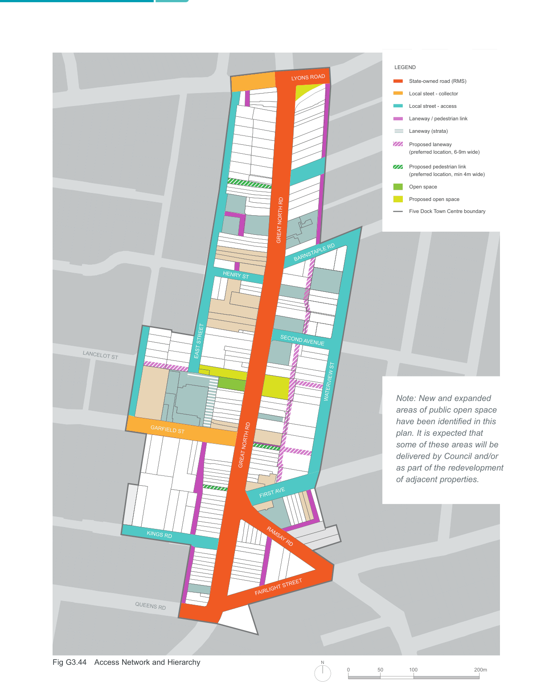

> [Picture on page 58: a map, saved as a picture (images/part-g-local-centres-page-58-1.gif, 150 dpi); the street names and other small labels are on the picture.]
> Labels printed on the map (copied from the PDF, in no particular order):
> LYONS ROAD · GREAT NORTH RD · BARNSTAPLE RD · HENRY ST · SECOND AVENUE · EAST STREET · LANCELOT ST · WATERVIEW ST · GARFIELD ST · GREAT NORTH RD · FIRST AVE · KINGS RD · RAMSAY RD · FAIRLIGHT STREET · QUEENS RD · N · Fig G3.44 Access Network and Hierarchy · LEGEND · State-owned road (RMS) · Local steet - collector · Local street - access · Laneway / pedestrian link · Laneway (strata) · Proposed laneway · (preferred location, 6-9m wide) · INGHAM AVE · Proposed pedestrian link · (preferred location, min 4m wide) · Open space · Proposed open space · Five Dock Town Centre boundary · WANGAL PL · 200m · 50 100

Note: New and expanded areas of public open space have been identified in this

plan. It is expected that some of these areas will be delivered by Council and/or as part of the redevelopment of adjacent properties.

Development Control Plan Part G

Local Centres

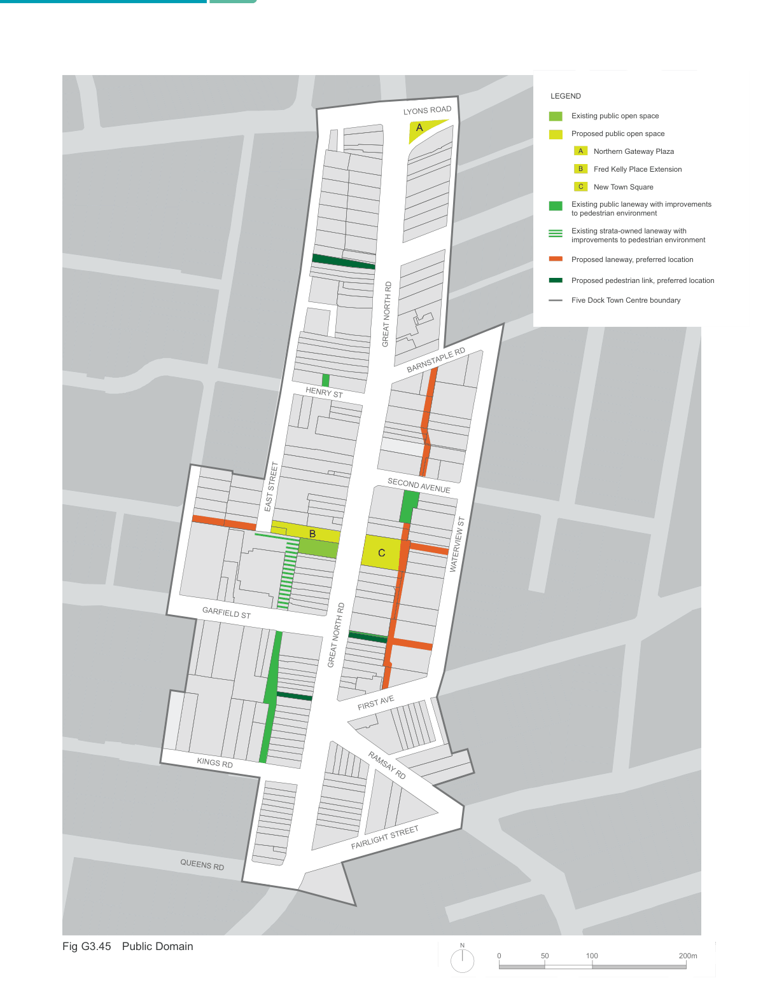

> [Picture on page 59: a map, saved as a picture (images/part-g-local-centres-page-59-3.gif, 150 dpi); the street names and other small labels are on the picture.]
> Labels printed on the map (copied from the PDF, in no particular order):
> GARFIELD ST · KINGS RD · QUEENS RD · Fig G3.45 Public Domain · LYONS ROAD · A · GREAT NORTH RD · BARNSTAPLE RD · HENRY ST · SECOND AVENUE · EAST STREET · B · C · WATERVIEW ST · GREAT NORTH RD · FIRST AVE · RAMSAY RD · FAIRLIGHT STREET · N · LEGEND · Existing public open space · A · Proposed public open space · Northern Gateway Plaza · B Fred Kelly Place Extension · C New Town Square · Existing public laneway with improvements · to pedestrian environment · Existing strata-owned laneway with · improvements to pedestrian environment · INGHAM AVE · Proposed laneway, preferred location · Proposed pedestrian link, preferred location · Five Dock Town Centre boundary · WANGAL PL · 200m · 50 100

#### Built Form

The built form controls shape the form of new development in the centre, establishing the location, height and shape of new buildings. The controls also consider visual privacy, sunlight access to adjoining properties, usability of private open spaces and pedestrian scale and amenity along the street.

#### Objectives

O11. To encourage investment in the town centre and create attractive places to live, shop and recreate. O12. To ensure adequate sunlight is available for all buildings, streets and public open spaces. O13. To promote opportunities for catalyst and landmark developments in appropriate locations. O14. To ensure the ground floor levels along key streets are appropriate for retail uses and that ground level uses in the remaining streets are adaptable over time to a wide range of uses. O15. To ensure the urban grain, built form and palette of materials used in the design of new buildings respond to the “fine grain” character of the surrounding area.

O16. To minimise the visual impact of above ground car parking and encourage car parking that is adaptable to other uses in the future. O17. To enhance the existing streetscape and ensure appropriate development scale and interface near heritage buildings and residential areas.

#### High-quality residential development Objectives

O18. To position the Five Dock Town Centre as an attractive place to live.

| Controls |  |
|---|---|
| C16. | Recommendations within the SEPP 65 (State Environmental Planning Policy No 65 - Design Quality of Residential Apartment Development) and the accompanying Apartment Design Guide are adopted by this DCP for apartment developments. |

#### Landscaping and setbacks Objectives

O19. To ensure that the amenity of residents, workers and visitors to the centre is enhanced by high quality landscaping.

O20. To create appropriate landscaping for private and common open space areas. O21. To soften and screen the interface between buildings in the centre and adjoining residential areas.

O22. To increase building separation along East Street between Henry Street and Lyons Road West. O23. To encourage the landscape character of West Street to continue past new development and up to Garfield Street.

| Controls |  |
|---|---|
| C17. | Landscape setbacks are to be in accordance with 'Fig G3.46 Primary Setbacks' |
| C18. | A landscape plan prepared by a qualified Landscape Architect is to be submitted with the development application that shows levels adjacent to the public domain; planting schedules; and type and detail of paving, fencing and other details of external areas. |
| C19. | The area within the minimum landscape setback is to be a deep soil zone, i.e. where there are no structures below. |
| C20. | For residential apartment development common open space is to be provided that occupies a minimum of 25% of the site area and has a minimum dimension of 3.0m. The common open space may be located on an elevated garden (i.e. above car parking) or on roof tops provided the area provides for the recreational and amenity needs of residents. |
| C21. | Landscaping is to give preference to species with low water needs, including native plant species and select and position trees and shrubs to control sun and winds and provide privacy. |

Development Control Plan Part G

Local Centres

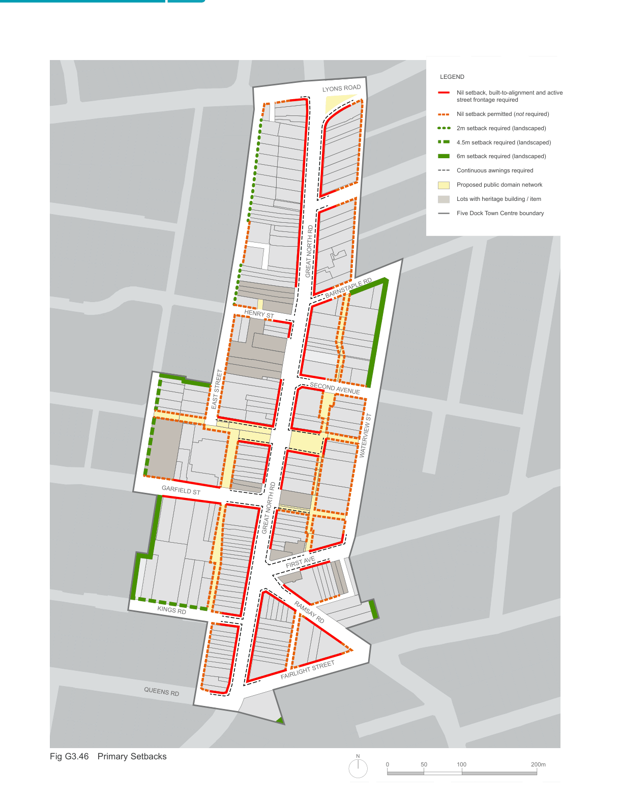

> [Picture on page 61: a map, saved as a picture (images/part-g-local-centres-page-61-3.gif, 150 dpi); the street names and other small labels are on the picture.]
> Labels printed on the map (copied from the PDF, in no particular order):
> GARFIELD ST · KINGS RD · QUEENS RD · Fig G3.46 Primary Setbacks · LYONS ROAD · GREAT NORTH RD · BARNSTAPLE RD · HENRY ST · SECOND AVENUE · EAST STREET · WATERVIEW ST · GREAT NORTH RD · FIRST AVE · RAMSAY RD · FAIRLIGHT STREET · N · LEGEND · Nil setback, built-to-alignment and active · street frontage required · Nil setback permitted (not required) · 2m setback required (landscaped) · 4.5m setback required (landscaped) · 6m setback required (landscaped) · Continuous awnings required · Proposed public domain network · INGHAM AVE · Lots with heritage building / item · Five Dock Town Centre boundary · WANGAL PL · 200m · 50 100

#### Building setbacks

For the purpose of this section of the DCP, the primary building setback is the setback between the public domain/street boundary and the building alignment, and the secondary building setback is the additional setback above the street wall height.

#### Objectives

O24. To allow redevelopment and gradual transition to higher densities while at the same time respecting heritage buildings and the 'village character' of the centre.

O25. To locate balconies and terraces along streets and laneways where they can provide passive surveillance (and increased safety) of streets and public open spaces.

O26. To reduce potential negative impacts of development such as overshadowing of streets and public open spaces. O27. To minimise negative impacts of development on existing development in the town centre and surrounding the town centre.

| Controls |  |
|---|---|
| C22. | Building setbacks are to be in accordance with 'Fig G3.46 Primary Setbacks', 'Fig G3.47 Secondary (Upper Level) Setbacks', 'Fig G3.49 Maximum Street Wall Heights', 'Fig G3.51 Example street frontage section showing maximum potential building height' and 'Fig G3.52 Maximum Building Height Zones' and any additional controls set out below. |
| C23. | Any additional floors above four storeys have a minimum setback of 6.0m unless otherwise shown in 'Fig G3.47 Secondary (Upper Level) Setbacks'. |
| C24. | Where possible along 6.0m wide laneways, increase setbacks above two (2) storeys and/or increase ground level setbacks to improve pedestrian amenity. |

#### Active frontages

Active frontages and uses contribute to visual and physical activity in the centre and include community and civic facilities, recreation and leisure facilities and shops, restaurants and cafes.

#### Objectives

O28. To promote activity and interest along key streets in the centre, in particular along Great North Road O29. To enhance the commercial viability and function of the centre and compliment current retail, commercial, entertainment and community uses. O30. To enhance safety and security in the centre.

| Controls |  |
|---|---|
| C25. | Provide ground level active uses where indicated on 'Fig G3.46 Primary Setbacks'. |
| C26. | Residential entries and foyers are permitted along active street frontages but are not to dominate or compromise the commercial viability of the street. |
| C27. | Where required, active uses must be at least 10.0m deep. |
| C28. | A continuous awning is to be provided where indicated on 'Fig G3.46 Primary Setbacks', and meet the requirements of Section 'G2.2 Building design and appearance'. |
| C29. | Vehicle access points are not permitted along active street frontages. Where rear or side access is not possible, development without parking will be considered. |

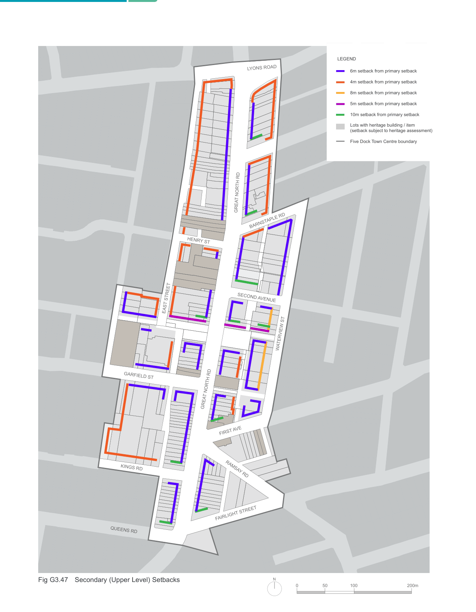

> [Picture on page 63: a picture, saved as a picture (images/part-g-local-centres-page-63-1.gif, 150 dpi).]
> Words printed on the picture (copied from the PDF):
> LYONS ROAD
> GREAT NORTH RD
> BARNSTAPLE RD
> HENRY ST
> SECOND AVENUE
> EAST STREET
> WATERVIEW ST
> GARFIELD ST
> GREAT NORTH RD
> FIRST AVE
> KINGS RD
> RAMSAY RD
> FAIRLIGHT STREET
> QUEENS RD
> N
> Fig G3.47 Secondary (Upper Level) Setbacks
> LEGEND
> 6m setback from primary setback
> 4m setback from primary setback
> 8m setback from primary setback
> 5m setback from primary setback
> 10m setback from primary setback
> Lots with heritage building / item
> (setback subject to heritage assessment)
> Five Dock Town Centre boundary
> INGHAM AVE
> WANGAL PL
> 200m
> 50 100

#### Ground floor residential Objectives

O31. To ensure residential dwellings on the ground level have a high level of amenity and create a positive interface with the street.

| Controls |  |
|---|---|
| C30. | Residential uses will only be permitted on the ground floor within the R3 Medium Density Residential zone. |
| C31. | The floor to ceiling height of ground level residential is to meet the requirements of the “Adaptable” category of 'Table G-A Minimum Floor Heights'. |
| C32. | Ground floor private open space on the street frontage is to be designed as a private terrace a minimum of 0.4m and a maximum of 1.0m above the adjacent public domain level. |
| C33. | Dwellings on the ground floor facing the street are to have individual entries from the street. |

#### Site amalgamation and isolated sites

Site amalgamations will result in a more efficient built

form. This is particularly true of corner sites which could be integrated with adjoining land to both maximise development potential and also provide enhanced amenity for building occupants and for users of public, communal and private open space.

#### Objectives

O32. To encourage site consolidation of allotments for development in order to promote the efficient use of land.

O33. To avoid development that may create isolated sites.

O34. To support more efficient car parking and servicing and reduced number of driveways. O35. To support the provision of new and/or improved public spaces as identified in 'Fig G3.45 Public Domain'.

O36. To avoid the creation of isolated sites that may be incapable of being developed in a manner that responds to the site’s context and characteristics and that maintains a satisfactory level of amenity.

| Controls |  |
|---|---|
| C34. | Provide new or improved connections as identified in 'Fig G3.45 Public Domain'. |
| C35. | Where development may create an isolated site, the applicant is required to demonstrate negotiations with property owners to include the site commenced early, well prior to the lodgement of the development application. Written evidence of negotiations is to be provided, including reasonable offers based on independent valuation and that take into account expenses likely to be incurred. |
| C36. | Where development may create an isolated site, the applicant must demonstrate with a schematic design that the isolated site can be redeveloped under the current planning controls. This must demonstrate the likely impacts between the development and the isolated site such as solar access, separation distances and privacy. |
| C37. | Site amalgamation should seek to minimise the number of driveway crossings provided to the street. |

#### Fine grain frontages Objectives

O37. To ensure development of existing small and/or narrow lots prevalent in the centre can still occur. O38. To ensure a diversity of retail shop size. O39. To encourage narrow frontage, fine grain retail in the centre.

| Controls |  |
|---|---|
| C38. | On narrow sites less than 12.0m wide alternative methods to address car parking, including car share, off site provision and/or exemptions are encouraged. |
| C39. | Developments are to create retail frontages of less than 8.0m in width or be designed so that larger frontages can be divided into smaller units in the future. |
| C40. | Reinforce the fine grain of the centre by creating smaller shop fronts or by providing articulation so that the flexibility exists to create narrower shops (5-7m) in the future. |

Development Control Plan Part G

Fig G3.48 Built form sections

#### Section A

Interface Waterview Street

Along Waterview Street the street wall height is four (4) storeys. Active street frontages, providing both residential and non-residential uses at street level are encouraged.

#### Section B

Interface East Street

East Street has a landscape setback of 0-2.0m. The street wall is three (3) storeys with an additional setback of 4.0m to the fourth (4) storey. Residential uses at street level are encouraged along this street.

#### Section C

Interface Kings Road

Kings Road has a landscaped setback of 4.5m. The street wall height is three (3) storeys with a maximum building height of 15.0m.

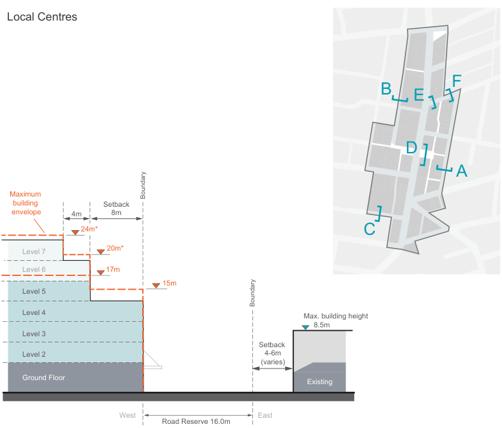

> [Picture on page 65: a map, saved as a picture (images/part-g-local-centres-page-65-30.gif, 150 dpi); the street names and other small labels are on the picture.]
> Labels printed on the map (copied from the PDF, in no particular order):
> Local Centres · Boundary · Maximum · Setback · building · envelope · 8m · 4m · 24m* · 20m* · Level 7 · 17m · Level 6 · 15m · Level 5 · Boundary · Level 4 · Max. building height · 8.5m · Level 3 · Setback · Level 2 · 4-6m · (varies) · Ground Floor · Ground Floor · Existing · West · East · Road Reserve 16.0m

#### F

#### B

#### E

#### D A

#### C

\*Level 6 and 7 only where permitted

Waterview Street

Maximum building

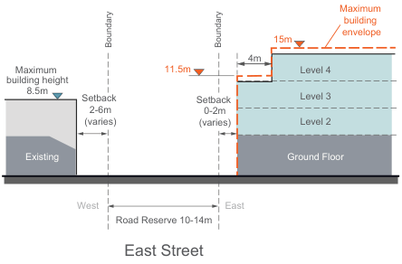

> [Picture on page 65: a map, saved as a picture (images/part-g-local-centres-page-65-41.gif, 150 dpi); the street names and other small labels are on the picture.]
> Labels printed on the map (copied from the PDF, in no particular order):
> envelope · 15m · 4m · Level 4 · 11.5m · Maximum · building height · 8.5m · Level 3 · Setback Setback · 2-6m · (varies) · Level 2 · 0-2m · (varies) · Ground Floor · Existing · East · West · Road Reserve 10-14m

Boundary

Boundary

East Street

Sping/autumn sun (approx) 12pm

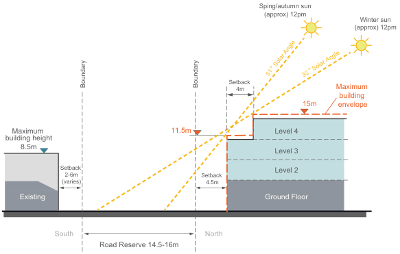

> [Picture on page 65: a map, saved as a picture (images/part-g-local-centres-page-65-47.gif, 150 dpi); the street names and other small labels are on the picture.]
> Labels printed on the map (copied from the PDF, in no particular order):
> 51   Solar Angle 32   Solar Angle · Setback · Boundary · Boundary · Maximum · 4m · 15m · building · envelope · Level 4 · 11.5m · Maximum · building height · 8.5m · Level 3 · Setback · Level 2 · Setback · 2-6m · (varies) · 4.5m · Ground Floor · Existing · North · South · Road Reserve 14.5-16m

Winter sun (approx) 12pm

Kings Road

#### Section D

Interface New Town Square

Boundary

Maximum

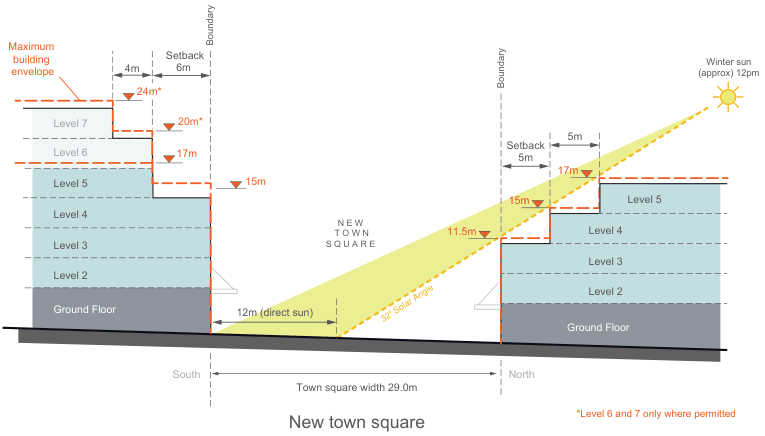

> [Picture on page 66: a map, saved as a picture (images/part-g-local-centres-page-66-5.gif, 150 dpi); the street names and other small labels are on the picture.]
> Labels printed on the map (copied from the PDF, in no particular order):
> Setback · 6m · 4m · building · envelope · Winter sun · (approx) 12pm · Boundary · 24m* · 20m* · Level 7 · 5m · Setback · Level 6 17m · 5m · 17m · 15m · Level 5 · Level 5 · 15m · Level 4 · Level 4 · 11.5m · N E W · T O W N · S Q U A R E · Level 3 · Level 3 · Level 2 · Level 2 · Ground Floor · 12m (direct sun) · Ground Floor · Ground Floor · Town square width 29.0m · South · North

In order to allow for direct sunlight in the new town square, buildings on the north side of the square are required to have a three (3) storey street wall and a 5m setback for each level above.

\*Level 6 and 7 only where permitted

New town square

Sping/autumn sun (approx) 12pm

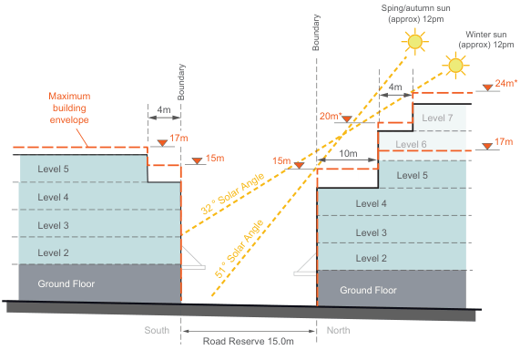

> [Picture on page 66: a map, saved as a picture (images/part-g-local-centres-page-66-17.gif, 150 dpi); the street names and other small labels are on the picture.]
> Labels printed on the map (copied from the PDF, in no particular order):
> Winter sun · (approx) 12pm · 4m · Boundary · Maximum · 4m · 20m* Level 7 · building · envelope · 17m · Level 6 · 10m · 15m 15m · Level 5 · Level 5 · Level 4 · Level 4 · 32   Solar Angle · Level 3 · Level 3 · Level 2 · Level 2 · 51   Solar Angle · Ground Floor · Ground Floor · Road Reserve 15.0m · South · North

#### Section E

Boundary

Interface Barnstaple Road (West)

24m*

17m

Along Barnstaple Road to the west of the proposed laneway, the street wall height on both sides of the street is four (4) storeys. The upper level setbacks of built form to the north facilitates solar access to Barnstaple Road.

\*Level 6 and 7 only where permitted

Barnstaple Road

#### Section F

Boundary

Boundary

Maximum

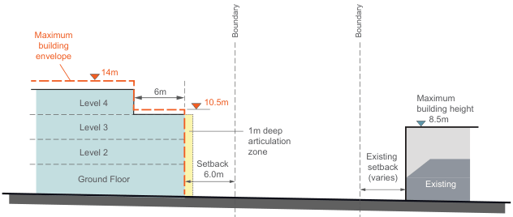

> [Picture on page 66: a map, saved as a picture (images/part-g-local-centres-page-66-36.gif, 150 dpi); the street names and other small labels are on the picture.]
> Labels printed on the map (copied from the PDF, in no particular order):
> building · envelope · 14m · 6m · 10.5m · Level 4 · Maximum · building height · 8.5m · Level 3 · Level 2 · 1m deep · articulation · zone · Existing · Setback · 6.0m · setback · (varies) · Ground Floor · Ground Floor · Ground Floor · Existing · Road Reserve 15.0m · South · North

Interface Barnstaple Road (East)

Along Barnstaple Road to the east of the proposed laneway, the maximum street wall height on the southern side of the street is three (3) storeys.

Barnstaple Road

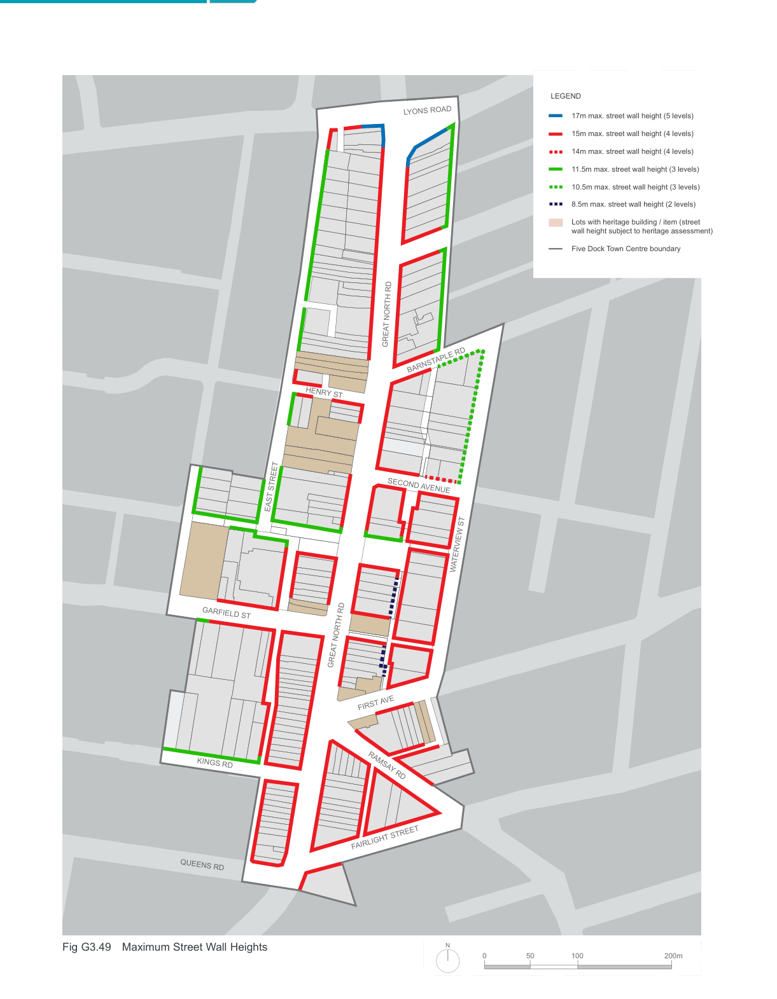

> [Picture on page 67: a picture, saved as a picture (images/part-g-local-centres-page-67-1.gif, 150 dpi).]
> Words printed on the picture (copied from the PDF):
> LYONS ROAD
> GREAT NORTH RD
> BARNSTAPLE RD
> HENRY ST
> SECOND AVENUE
> EAST STREET
> WATERVIEW ST
> GARFIELD ST
> GREAT NORTH RD
> FIRST AVE
> KINGS RD
> RAMSAY RD
> FAIRLIGHT STREET
> QUEENS RD
> N
> Fig G3.49 Maximum Street Wall Heights
> LEGEND
> 17m max. street wall height (5 levels)
> 15m max. street wall height (4 levels)
> 14m max. street wall height (4 levels)
> 11.5m max. street wall height (3 levels)
> 10.5m max. street wall height (3 levels)
> 8.5m max. street wall height (2 levels)
> INGHAM AVE
> Lots with heritage building / item (street
> wall height subject to heritage assessment)
> Five Dock Town Centre boundary
> WANGAL PL
> 200m
> 50 100

#### Build to alignment Objectives

O40. To encourage a consistent street alignment and street wall height along key streets in the centre. O41. To ensure corner buildings, located where two streets meet, provide a continuous street edge and front both streets.

O42. To ensure new buildings provide a well-defined, active edge to areas of public open space.

| Controls |  |
|---|---|
| C41. | Building setbacks are to be in accordance with 'Fig G3.46 Primary Setbacks', 'Fig G3.47 Secondary (Upper Level) Setbacks', 'Fig G3.49 Maximum Street Wall Heights' and 'Fig G3.51 Example street frontage section showing maximum potential building height'; and any additional controls set out below. |
| C42. | The nil setback applies only to the first four (4) storeys of development, unless otherwise indicated in 'Fig G3.47 Secondary (Upper Level) Setbacks'. |

#### Building heights Objective

O43. To ensure adequate sunlight is available for all buildings, streets and public open spaces. O44. To ensure the ground floor levels along key streets in the centre are appropriate for retail uses and that ground levels in the remaining streets are adaptable over time to a wide range of uses. O45. To encourage redevelopment while at the same time respecting heritage buildings and the “village character” of the centre.

| Controls |  |
|---|---|
| C43. | Building heights are to be in accordance with 'Fig G3.46 Primary Setbacks', 'Fig G3.47 Secondary (Upper Level) Setbacks', 'Fig G3.48 Built form sections', 'Fig G3.49 Maximum Street Wall Heights', 'Fig G3.51 Example street frontage section showing maximum potential building height' and 'Fig G3.52 Maximum Building Height Zones'; and any additional controls set out below. |

| C44. | Development is to be consistent with the minimum floor to ceiling heights for the specified uses within the centre shown in 'Table G-A Minimum Floor Heights'. |
|---|---|
| C45. | For development sites to the north of Fred Kelly Place and the new town square the maximum building height is to be in accordance with 'Fig G3.47 Secondary (Upper Level) Setbacks' and 'Fig G3.52 Maximum Building Height Zones'; and no incursions (including plant, balcony rails etc.) are to be permitted. |
| C46. | The finished floor level of the ground floor above the footpath level is to be no greater than 1.0 metre for residential uses and 0.4 metre for retail and commercial uses. |
| C47. | Where active uses are specified on the ground floor as identified in 'Fig G3.46 Primary Setbacks', the minimum floor to ceiling height is to comply with the category of “Retail - restaurant/cafe” in 'Table G-A Minimum Floor Heights'. |
| C48. | Where active uses are not specified on the ground floor, the minimum floor to ceiling height is to comply with the category of “Retail - general" in 'Table G-A Minimum Floor Heights'. |
| C49. | Building heights are to conform with 'Table G-B Building Heights', which shows the relationship between the height of building in storeys and the height of the building in metres. |
| C50. | New buildings are to have a scale that is visually compatible with adjacent buildings and heritage items. This may require the height of new development to be lower than the maximum height permitted. |
| C51. | The upper-most level is to be designed to reduce the visual bulk and scale of the building. Options to achieve this include increased setbacks and/or the use of dark colours and roof elements that create deep shadows. |

#### Table G-A Minimum Floor Heights

| Use | Floor to ceiling height in metres (min) | Approx. floor to floor height in metres (min) |
|---|---|---|
| Retail - general | 3.3m | 3.7m |
| Retail - restaurant /cafe | 4.0m | 4.4m |
| Commercial | 3.0m | 3.6m |
| Adaptable | 3.3m | 3.7m |
| Residential | 2.7m | 3.1m |
| Community | 3.0m | 3.6m |

#### Table G-B Building Heights

| Building height (in metres) | Building height* |
|---|---|
| 24.0m | 7 storeys |
| 20.0m | 6 storeys |
| 17.0m | 5 storeys |
| 15.0m | 4 storeys |
| 11.5m | 3 storeys |
| 8.5m | 2 storeys |

\* The number of storeys possible within any maximum building height is dependent on the use (refer to Fig G3.50)

Maximum building envelope

Option: Ground floor retail, upper levels residential

Fig G3.50 Alternate uses within the building envelope

Maximum building envelope

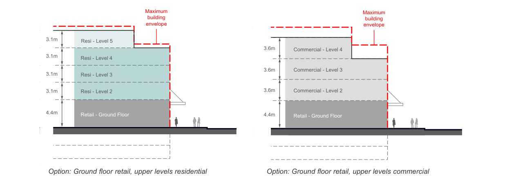

> [Picture on page 69: a picture, saved as a picture (images/part-g-local-centres-page-69-14.gif, 150 dpi).]
> Words printed on the picture (copied from the PDF):
> Resi - Level 5
> 3.1m
> 3.1m Resi - Level 4
> 3.1m Resi - Level 3
> 3.1m Resi - Level 2
> 4.4m
> Retail - Ground Floor
> Commercial - Level 4
> 3.6m
> 3.6m Commercial - Level 3
> 3.6m Commercial - Level 2
> 4.4m Retail - Ground Floor

Option: Ground floor retail, upper levels commercial

Maximum

building height

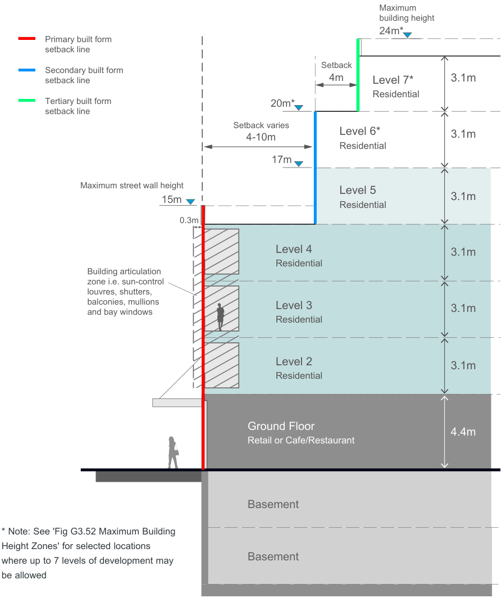

> [Picture on page 70: a map, saved as a picture (images/part-g-local-centres-page-70-3.gif, 150 dpi); the street names and other small labels are on the picture.]
> Labels printed on the map (copied from the PDF, in no particular order):
> Setback · 4m · 3.1m · Level 7* · Residential · 20m* · Setback varies · 3.1m · 4-10m · Level 6* · Residential · 17m · Maximum street wall height · 3.1m · 15m · Level 5 · Residential · 0.3m · 3.1m · Level 4 · Residential · 3.1m · Building articulation · zone i.e. sun-control · louvres, shutters, · balconies, mullions · and bay windows · Level 3 · Residential · 3.1m · Level 2 · Residential · 4.4m · Ground Floor · Retail or Cafe/Restaurant · Basement · Basement

24m*

Primary built form

setback line

Secondary built form

setback line

Tertiary built form

setback line

\* Note: See 'Fig G3.52 Maximum Building Height Zones' for selected locations where up to 7 levels of development may be allowed

Fig G3.51 Example street frontage section showing maximum potential building height

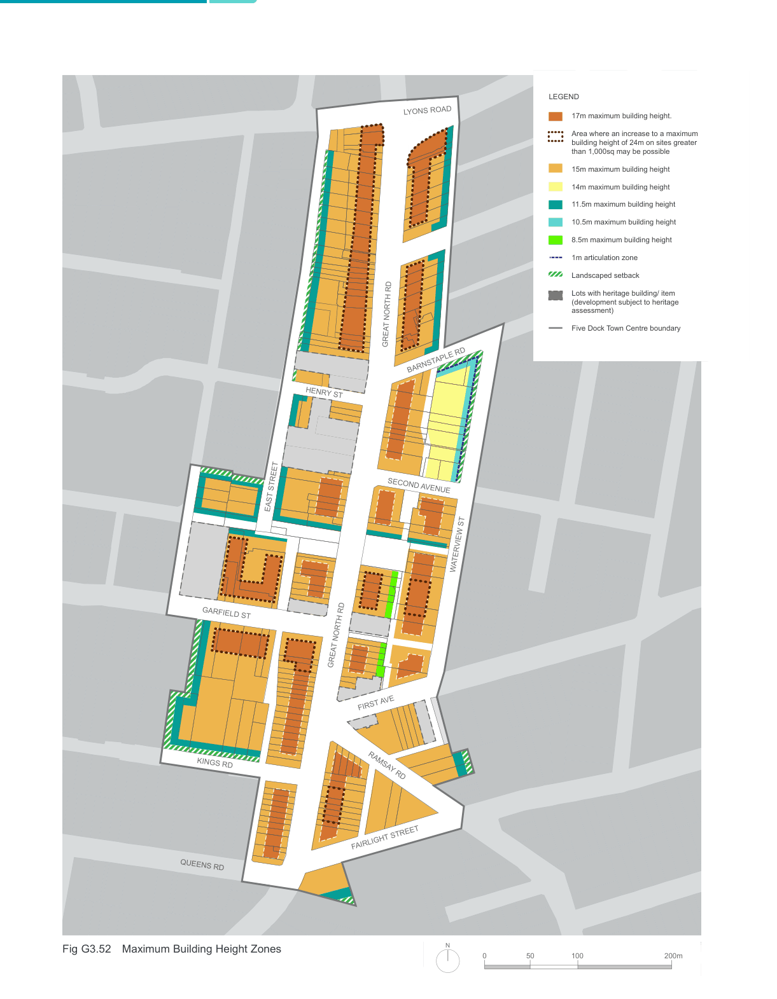

> [Picture on page 71: a map, saved as a picture (images/part-g-local-centres-page-71-1.gif, 150 dpi); the street names and other small labels are on the picture.]
> Labels printed on the map (copied from the PDF, in no particular order):
> LYONS ROAD · GREAT NORTH RD · BARNSTAPLE RD · HENRY ST · SECOND AVENUE · EAST STREET · WATERVIEW ST · GARFIELD ST · GREAT NORTH RD · FIRST AVE · KINGS RD · RAMSAY RD · FAIRLIGHT STREET · QUEENS RD · N · Fig G3.52 Maximum Building Height Zones · LEGEND · 17m maximum building height. · Area where an increase to a maximum · building height of 24m on sites greater · than 1,000sq may be possible · 15m maximum building height · 14m maximum building height · 11.5m maximum building height · 10.5m maximum building height · 8.5m maximum building height · INGHAM AVE · 1m articulation zone · Landscaped setback · Lots with heritage building/ item · (development subject to heritage · assessment) · Five Dock Town Centre boundary · FIRST AVE · WANGAL PL · 200m · 50 100

Fig G3.53 Building envelope sections

G

\*Level 6 and 7 only where permitted

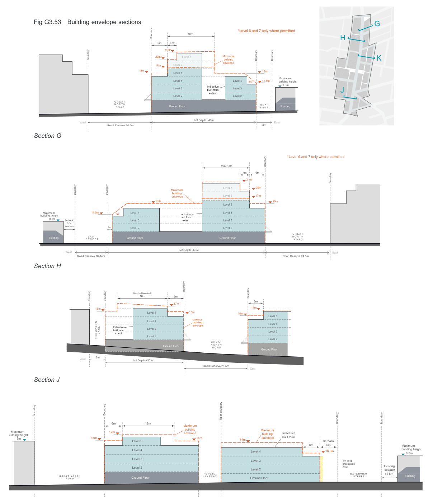

> [Picture on page 72: a map, saved as a picture (images/part-g-local-centres-page-72-4.gif, 150 dpi); the street names and other small labels are on the picture.]
> Labels printed on the map (copied from the PDF, in no particular order):
> 18m · 4m · 6m · 24m* · Maximum · 20m* Level 7 · Boundary · Boundary · Boundary · building · envelope · Level 6 · 17m · 15m · 15m · Level 5 · Level 4 · Level 4 · 11.5m · 36 · Maximum · building height · 8.5m · Level 3 · Level 3 Indicative · built form · extent · Level 2 · Level 2 · G R E A T · N O R T H · Ground Floor · Ground Floor · Existing · R O A D · R E A R · L A N E · Lot Depth ~40m · West · East · 6m · Road Reserve 24.5m

Boundary

H

K

J

Section G

\*Level 6 and 7 only where permitted

> Labels printed on the map (copied from the PDF, in no particular order):
> max 18m · 4m 6m · 24m* · Boundary · 20m* · Level 7 · Maximum · Boundary Boundary · Level 6 17m · building · envelope · 15m · 15m · Level 5 · 11.5m Level 4 · Level 4 · 36 · Maximum · building height · Indicative · built form · 8.5m Setback · extent · Level 3 · Level 3 · 2-6m · (varies) · 2m Level 2 · Level 2 · G R E A T · N O R T H · Ground Floor · Ground Floor · Existing E A S T · S T R E E T · R O A D · Lot Depth ~60m · Road Reserve 24.5m · West · East · Road Reserve 10-14m

Boundary

Section H

Boundary

> Labels printed on the map (copied from the PDF, in no particular order):
> Max. building depth · 18m 6m · Boundary Boundary · 6m · 17m · 17m · 15m · 15m · Level 5 · Level 5 · 15m · Maximum · Level 4 · Level 4 · building · envelope · Level 3 · Indicative · built form · Level 3 · L A N E extent · Level 2 · T H O M P S O N · Level 2 · G R E A T · N O R T H · Ground Floor R O A D · Ground Floor · West · Lot Depth ~30m · 6m · Road Reserve 24.5m · East

Boundary

Section J

Boundary

Boundary

> Labels printed on the map (copied from the PDF, in no particular order):
> 18m · 6m · Maximum · Maximum · building · envelope · 17m · Maximum · building height · Indicative · built form · 15m · 15m · building · envelope · 14m · 15m · Level 5 · Setback · 6m · 6m · Level 4 · 10.5m · Level 4 · Maximum · building height · 8.5m · Level 3 · Level 3 · Existing · 1m deep · articulation · zone · Level 2 · Level 2 · setback · W A T E R V I E W (4-8m) · G R E A T   N O R T H · S T R E E T · F U T U R E · L A N E W A Y · Ground Floor · Ground Floor · Existing · Ground Floor · Ground Floor · R O A D · West · East · Road Reserve 24m · Road Reserve ~15.3m · 6-9m

Rear boundary

Boundary

Boundary

Section K

#### Facades Objectives

O46. Buildings are to provide facade articulation and variation to reduce visual bulk and create shadows and texture along the facade. This can include variations in window and/or balcony size and treatment, a design with a well-defined base, middle and top, the use of horizontal and/or vertical elements and variations in setback.

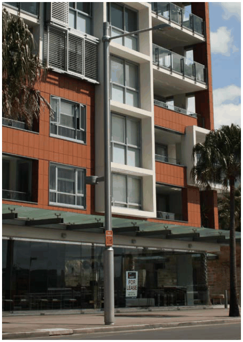

> [Picture on page 73: a picture, saved as a picture (images/part-g-local-centres-page-73-10.gif, 150 dpi).]

| Controls |  |
|---|---|
| C52. | Balconies are to support a balance of solid and void treatment in the composition of the facade. A facade which is dominated by a repetitive balcony design is to be avoided. |
| C53. | External walls are to include variations in colour and the types of materials used in order to articulate different parts of a building facade and reduce the overall bulk and scale. |
| C54. | External walls are to be constructed of high quality and durable materials and finishes with ‘self-cleaning’ attributes such as face brickwork, rendered brickwork, stone, concrete and glass. Materials and finishes with high maintenance costs, and those susceptible to degradation or corrosion are to be avoided. |
| C55. | A 1m deep facade 'articulation zone' for architectural expression and elements (e.g. balconies) is permitted within the primary setback zone along Waterview Street and Barnstaple Road as identified in 'Fig G3.52 Maximum Building Height Zones'. The maximum length of straight wall, without articulation such as a balcony or return, is 8m. |

Example of balconies with a balance of solid and void in the facade composition and treatment

#### Heritage Objective

O47. To protect buildings and spaces of heritage significance. O48. To ensure that new development on the same site as or adjacent to a heritage item responds sensitively to its heritage significance.

#### Controls

C56. New buildings on the same site as or adjoining a heritage item will need to consider the impact on heritage when determining:

• the appropriate alignment and street frontage heights;

• setbacks above street frontage heights;

• appropriate materials and finishes selection;

• the design and articulation of the facade; and

• appropriate side and rear setbacks.

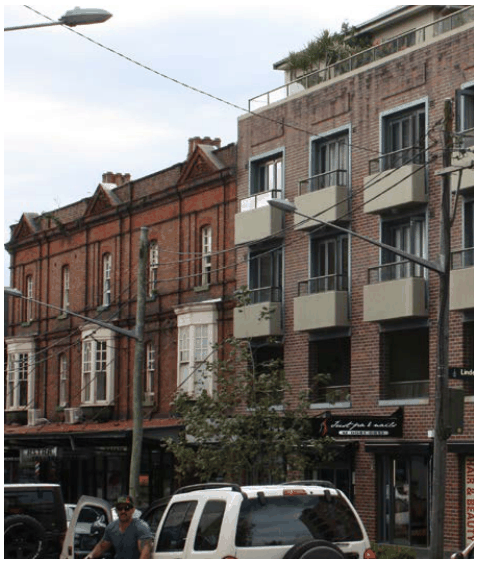

> [Picture on page 74: a picture, saved as a picture (images/part-g-local-centres-page-74-21.gif, 150 dpi).]

The composition of the facade of the new building on the right considers the adjoining a heritage item on the left.

C57. Prior to the demolition of the former heritage item at 39 Waterview Street, Five Dock (Lot 11 DP 869673), an archival record is to be prepared and submitted to Council. Once demolition has been completed, a Baseline Archaeological Assessment on the entire site is to be submitted.
