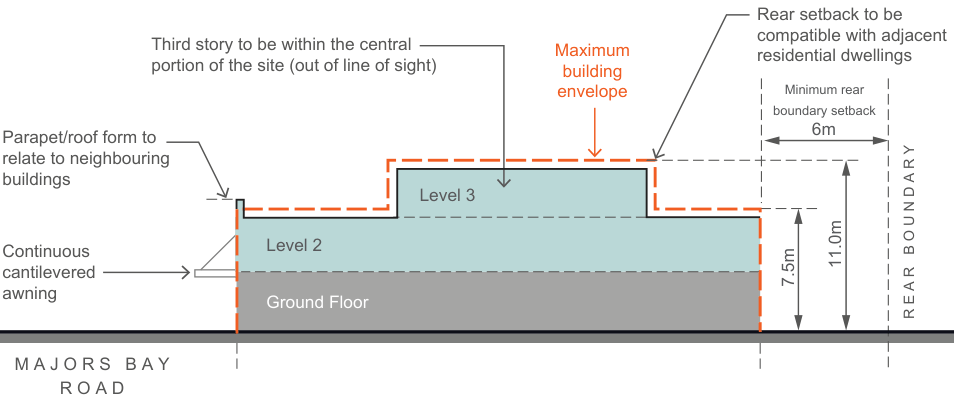

#### G3.3  Majors Bay Road Shopping Centre, Concord

Majors Bay Road Shopping Centre is a linear shopping centre with a strong boulevard quality. The street is well orientated for vistas and was laid out with the subdivisions of the surrounding estates for residential purposes between 1900-1915. The buildings within the centre, whilst not being particularly historic or architecturally impressive in themselves, impart a unified streetscape by virtue of their two storey scale and architectural styles. These elements convey a sense of history and continuity, form part of Canada Bay’s cultural heritage, and provide a sense of identity to the shopping centre. The scale of the buildings also relates well to the surrounding low rise character of Concord.

The height of buildings is an important visual element in the streetscape and represents one of the more important facets of development control in the shopping centre. Most buildings in the Majors Bay Road shopping centre are two (2) storeys high and constructed with a flat, pitched or parapet-type roof. Roof forms on new buildings should be sympathetic to adjoining buildings and materials should be selected so as to blend with the surrounding environment. The design of the developments should attempt to ensure that where adjoining buildings, particularly residential dwellings, are located in close proximity to new commercial buildings, the design of such projects should attempt to minimise any potential loss of sunlight or daylight to residences.

Refer to Fig G3.54.

| Controls |  |
|---|---|
| Height |  |
| C1. | All new work (including extensions to buildings) should not exceed a maximum height of 11.0 metres. |
| C2. | Where buildings display a uniform height at the front street alignment, new development should maintain a complementary height relationship with adjoining development. In this regard, any upper floor additions should be confined to the rear, either out of sight or setback far enough from the front building alignment so as to reduce its visibility and prominence from the shopping street. |

| C3. | Buildings are to step down at the rear, to a maximum external wall height of 7.5 metres, to be compatible with the scale and character of adjacent residential areas and in keeping with the built form pattern of retail streets. Refer to Fig G3.55. |
|---|---|
| Siting |  |
| C4. | Where new buildings are erected within established frontages, such buildings should, at least along the main street frontage, be similarly orientated to existing adjoining buildings. |
| Front setbacks |  |
| C5. | New development should be built to the predominant setback, generally the front alignment. |
| Roof forms |  |
| C6. | The style and pitch of new roofs should relate sympathetically to neighbouring buildings where possible. |
| C7. | Materials used in the construction of roofs should be selected so as to blend in and harmonise with both the subject building, adjoining properties, and the streetscape generally. |
| C8. | Structures such as ventilation shafts, lift towers etc. should not project above the roof line or disturb the symmetry of the roofscape of buildings. |
| Vehicular access/crossings |  |
| C9. | New vehicular access ways across public footpaths within the shopping centre will not generally be permitted. |
| C10. | Where rear lane access and/or parking facilities are provided to properties, Council will request owners (either by co-operation or via conditions attached to development applications) to close existing front vehicular access ways. |

Fig G3.54 Majors Bay Shopping Centre - Location Plan

Parapet/roof form to

relate to neighbouring

buildings

Continuous

cantilevered

awning

M A J O R S   B A Y R O A D

Council area map

> [Picture on page 76: a map, saved as a picture (images/part-g-local-centres-page-76-11.gif, 150 dpi); the street names and other small labels are on the picture.]
> Labels printed on the map (copied from the PDF, in no particular order):
> Third story to be within the central · portion of the site (out of line of sight) · Level 3 · Level 2 · Ground Floor · Maximum · building · envelope · compatible with adjacent · residential dwellings · Minimum rear · boundary setback · 6m · 11.0m · 7.5m

N

Rear setback to be

R E A R   B O U N D A R Y

Fig G3.55 Majors Bay Shopping Centre - Maximum Building Envelope Section
