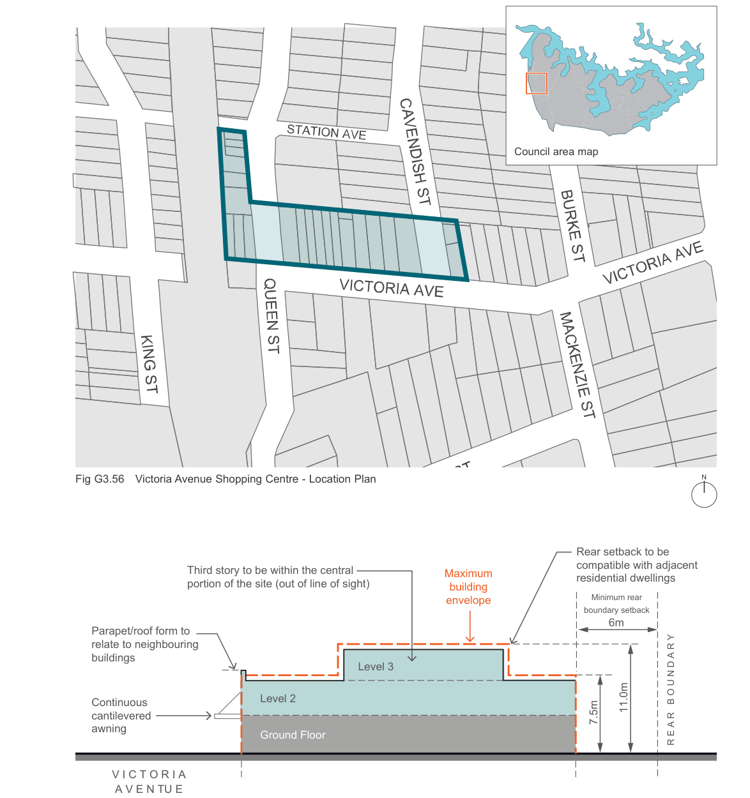

#### G3.4  Victoria Avenue Shopping Centre, Concord West

Most buildings in the shopping centre are one (1) to two (2) storeys in height and are constructed with flat, pitched or parapet type roofs.

There is a shortage of car parking in the centre which was designed and constructed before the advent of mass car ownership. The rear building line is intended to reserve parts of lots for future parking and loading areas accessed from rear service roads and to prevent such areas being “built out”. This building line applies to both new and existing buildings.

Refer to Fig G3.56.

| Controls |  |
|---|---|
| Floor space ratio |  |
| C1. | The residential component of buildings is not to exceed 50% of the total gross floor area. |
| Front setbacks |  |
| C2. | New development or extensions to existing buildings should be built to the predominant setback, generally the front alignment. |
| Rear setbacks |  |
| C3. | New development or extensions to existing buildings should be built a minimum of six (6) metres from the rear boundary. |

| Building height |  |
|---|---|
| C4. | Where buildings display a uniform height at the front street alignment, new development should maintain a complementary height relationship with adjoining development. In this regard, any upper floor additions should be confined to the rear, either out of sight or setback far enough from the front building alignment so as to reduce its visibility and prominence from the shopping street. |
| C5. | Buildings are to step down at the rear, to a maximum external wall height of 7.5 metres, to be compatible with the scale and character of adjacent residential areas and in keeping with the built form pattern of retail streets. Refer to Fig G3.57. |
| Building design |  |
| C6. | The design of new buildings should respect the existing built form of the shopping centre. New buildings, particularly those which “infill” between existing properties, should respect the scale, roof forms and proportions of adjoining buildings. This means that new buildings should attempt to “fit in”. |
| Vehicular access/crossing |  |
| C7. | New vehicular access ways across public footpaths within the shopping centre will not generally be permitted. |
| C8. | Where rear lane access and/or parking facilities are provided to properties, Council will request owners (either by co-operation or via conditions attached to development applications) to close existing vehicular access ways. |

> [Picture on page 78: a picture, saved as a picture (images/part-g-local-centres-page-78-1.gif, 150 dpi).]
> Words printed on the picture (copied from the PDF):
> Council area map
> N

Fig G3.56 Victoria Avenue Shopping Centre - Location Plan

> Labels printed on the map (copied from the PDF, in no particular order):
> Third story to be within the central · portion of the site (out of line of sight) · Level 3 · Level 2 · Ground Floor · Maximum · building · envelope · compatible with adjacent · residential dwellings · Minimum rear · boundary setback · 6m · 11.0m · 7.5m

Parapet/roof form to

relate to neighbouring

buildings

Continuous

cantilevered

awning

V I C T O R I A A V E N TU E

Rear setback to be

R E A R   B O U N D A R Y

Fig G3.57 Victoria Avenue Shopping Centre - Maximum Building Envelope Section
