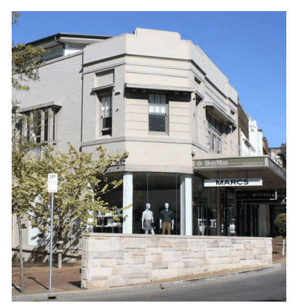
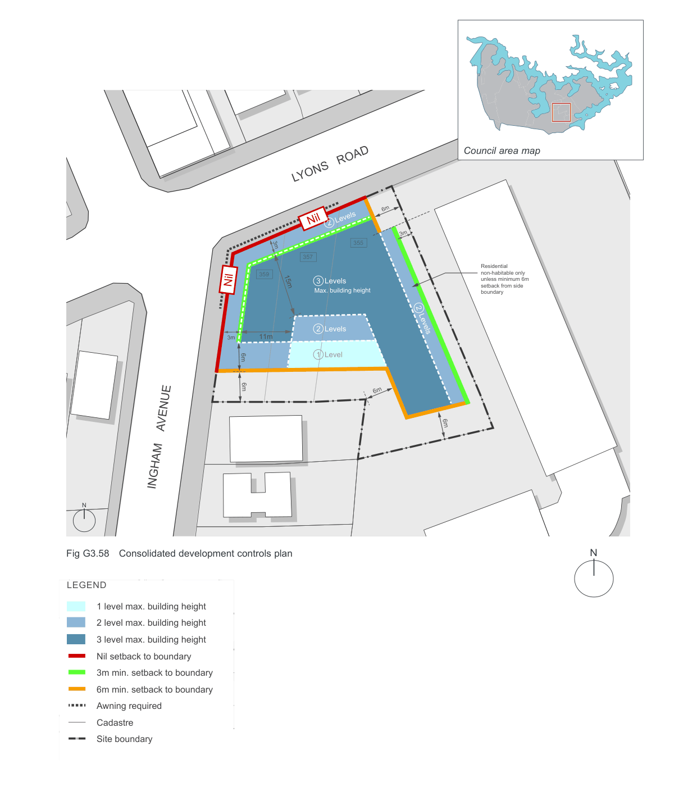
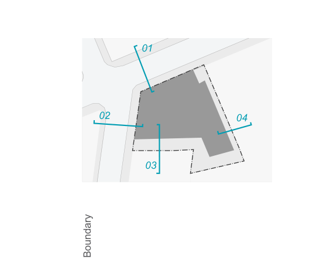
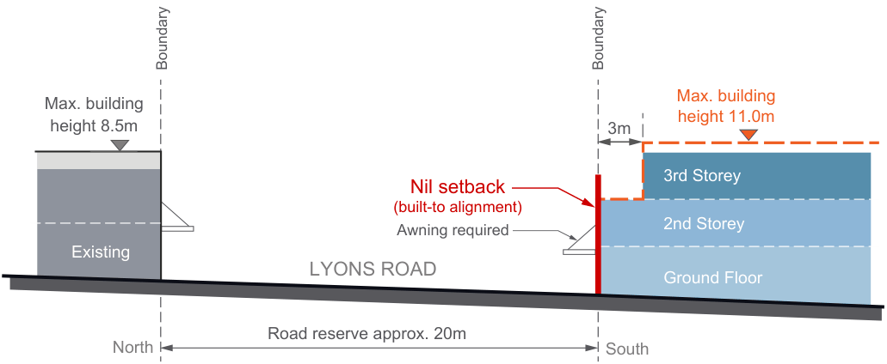
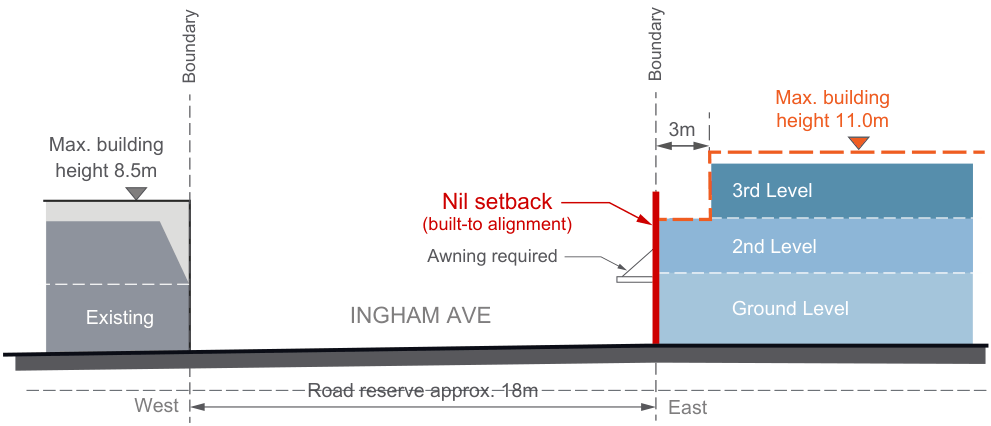
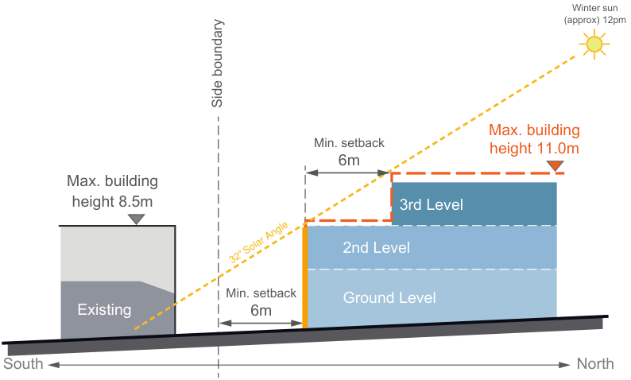
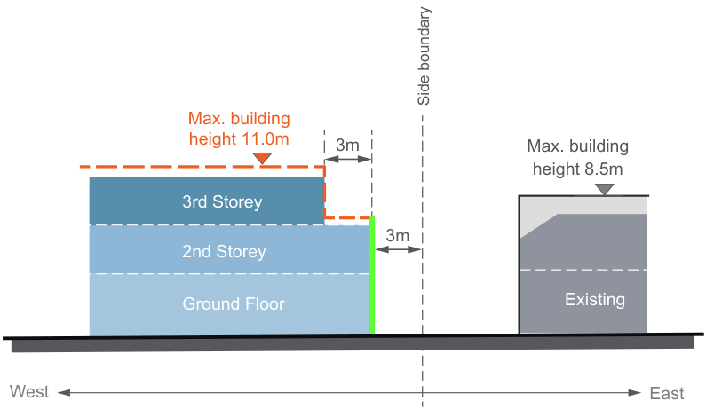

#### G3.5  355-359 Lyons Road, Five Dock

The land at 355 – 359 Lyons Road is part of a small cluster of shops that are surrounded by a predominantly residential area. The general planning controls outlined below apply in these areas to ensure the form and scale of development responds to the surrounding context and achieves an integrated urban design outcome for all properties between 355 and 359 Lyons Road.

#### Objectives

O1. To achieve a coordinated urban design outcome. O2. To enhance the existing streetscape and ensure appropriate development scale and interface near residential areas.

O3. To minimise solar access and privacy impacts upon surrounding properties. O4. To ensure future buildings provide a continuous street edge to Lyons Road.

| C6. | The building envelope is the three dimensional volume that defines the outermost part of the site that buildings may occupy. Proposed buildings will also need to demonstrate that solar access is maintained to the north facing window and private open spaces of surrounding properties. |
|---|---|
| C7. | The third storey element of the building is to have a roof design and material selection that assists in minimising the overall bulk and scale of the building. |

> [Picture on page 79: a picture, saved as a picture (images/part-g-local-centres-page-79-20.gif, 150 dpi).]

| Controls |  |
|---|---|
| C1. | Buildings are to be constructed to the front boundary (street edge) on Lyons Road. |
| C2. | A continuous awning is to be provided on the Lyons Road frontage of the site and wrap around into Ingham Avenue. |
| C3. | Buildings are to adhere to the minimum separation requirements of the Apartment Design Guide. |
| C4. | The maximum building height is 3 storeys. |
| C5. | A two (2) storey street edge is to be provided to Lyons Road and Ingham Avenue and the third floor is to have an upper level setback of 3.0 metres from both of these streets and a solid 'parapet style' balustrade for the upper floor. |

Example of an increased setback to the upper floor and a solid parapet balustrade that helps the building to 'read' as a two storey building from the street.

> [Picture on page 80: a map, saved as a picture (images/part-g-local-centres-page-80-1.gif, 150 dpi); the street names and other small labels are on the picture.]
> Labels printed on the map (copied from the PDF, in no particular order):
> Council area map · LYONS   ROAD · 6m · Nil 2  Levels · 3m · 355 · 357 · 359 · Nil · 15m · 3m · 3  Levels · Max. building height · Residential · non-habitable only · unless minimum 6m · setback from side · boundary · 2  Levels · 2  Levels · 11m · 3m · 1  Level · 6m · 6m · 6m · 6m · INGHAM    AVENUE · N · N · Fig G3.58 Consolidated development controls plan · LEGEND · 1 level max. building height · 2 level max. building height · 3 level max. building height · Nil setback to boundary · 3m min. setback to boundary · 6m min. setback to boundary · Awning required · Cadastre · Site boundary

### DRAFT

Boundary

> [Picture on page 81: a picture, saved as a picture (images/part-g-local-centres-page-81-2.gif, 150 dpi).]
> Words printed on the picture (copied from the PDF):
> 01
> 04
> 02
> 03
> Boundary

> [Picture on page 81: a map, saved as a picture (images/part-g-local-centres-page-81-3.gif, 150 dpi); the street names and other small labels are on the picture.]
> Labels printed on the map (copied from the PDF, in no particular order):
> Max. building · height 8.5m · (built-to alignment) · Awning required · Existing · Road reserve approx. 20m · North · Max. building · height 11.0m · 3m · 3rd Storey · 2nd Storey · Ground Floor · South

#### Nil setback

#### LYONS ROAD

Fig G3.59 Interface section - Lyons Road

Boundary

#### Nil setback

#### INGHAM AVE

Fig G3.60 Interface section - Ingham Avenue

Boundary

> [Picture on page 81: a map, saved as a picture (images/part-g-local-centres-page-81-12.gif, 150 dpi); the street names and other small labels are on the picture.]
> Labels printed on the map (copied from the PDF, in no particular order):
> Max. building · height 8.5m · (built-to alignment) · Awning required · Existing · Road reserve approx. 18m · West · Max. building · height 11.0m · 3m · 3rd Level · 2nd Level · Ground Level · East

Fig G3.61 Interface section - southern boundary

Fig G3.62 Interface section - eastern boundary

Winter sun (approx) 12pm

> [Picture on page 82: a map, saved as a picture (images/part-g-local-centres-page-82-5.gif, 150 dpi); the street names and other small labels are on the picture.]
> Labels printed on the map (copied from the PDF, in no particular order):
> Side boundary · Max. building · height 8.5m · Min. setback · Existing · 6m · South · Max. building · Min. setback · height 11.0m · 6m · 3rd Level · 2nd Level · Ground Level · North

Side boundary

> [Picture on page 82: a map, saved as a picture (images/part-g-local-centres-page-82-7.gif, 150 dpi); the street names and other small labels are on the picture.]
> Labels printed on the map (copied from the PDF, in no particular order):
> Max. building · 3m · height 11.0m · 3rd Storey · 2nd Storey · Ground Floor · West · Max. building · height 8.5m · Level 3 · 3m · Level 2 · Existing · Ground Floor · East
