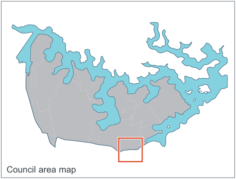
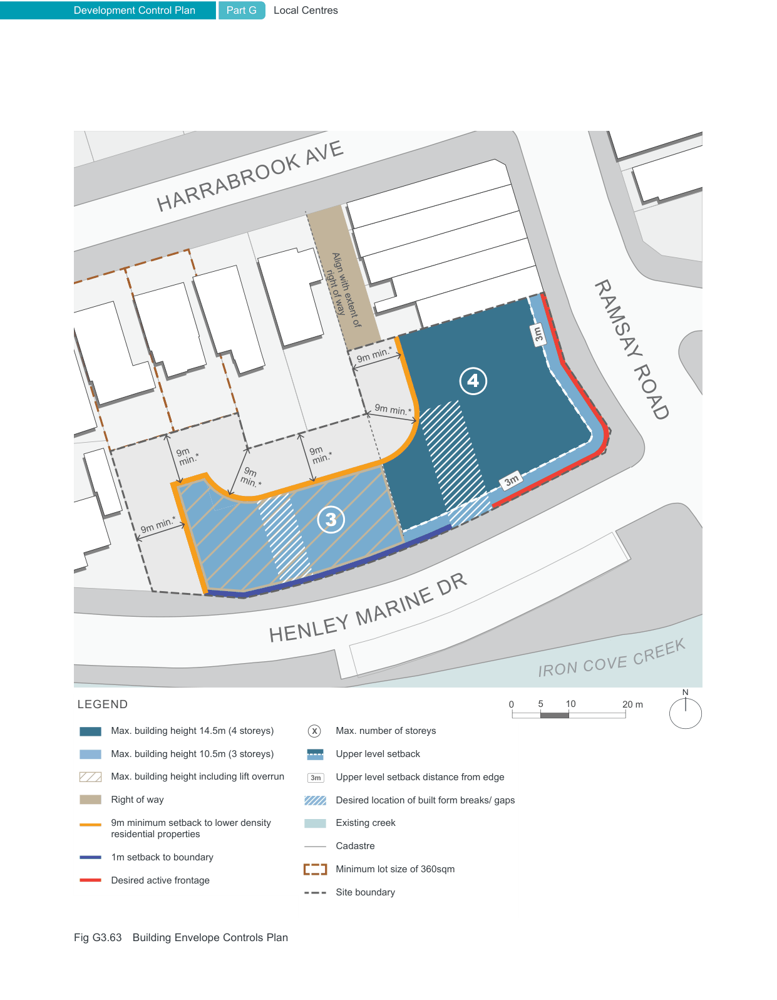
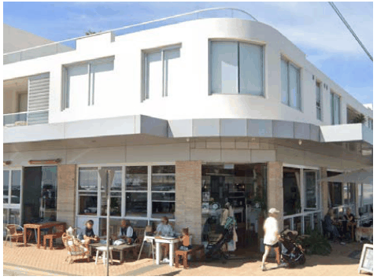
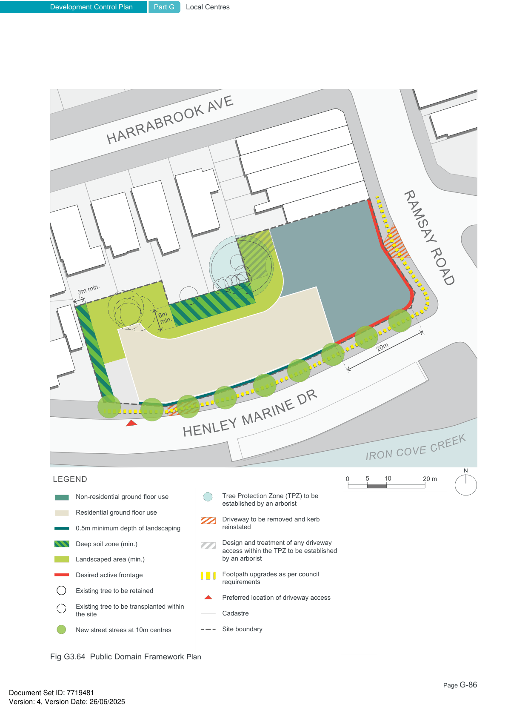
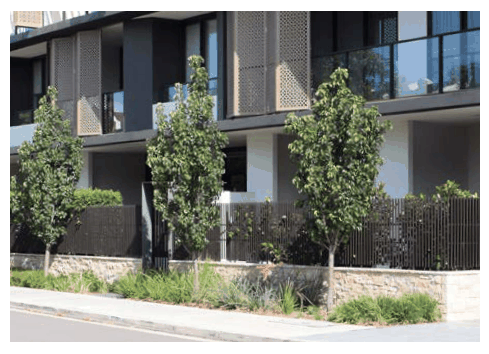
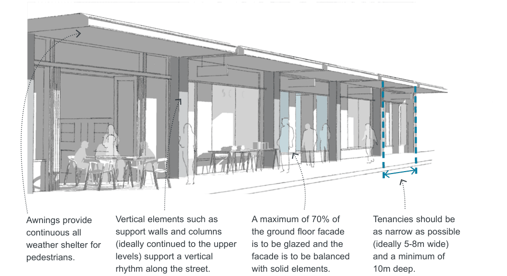
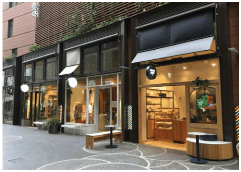
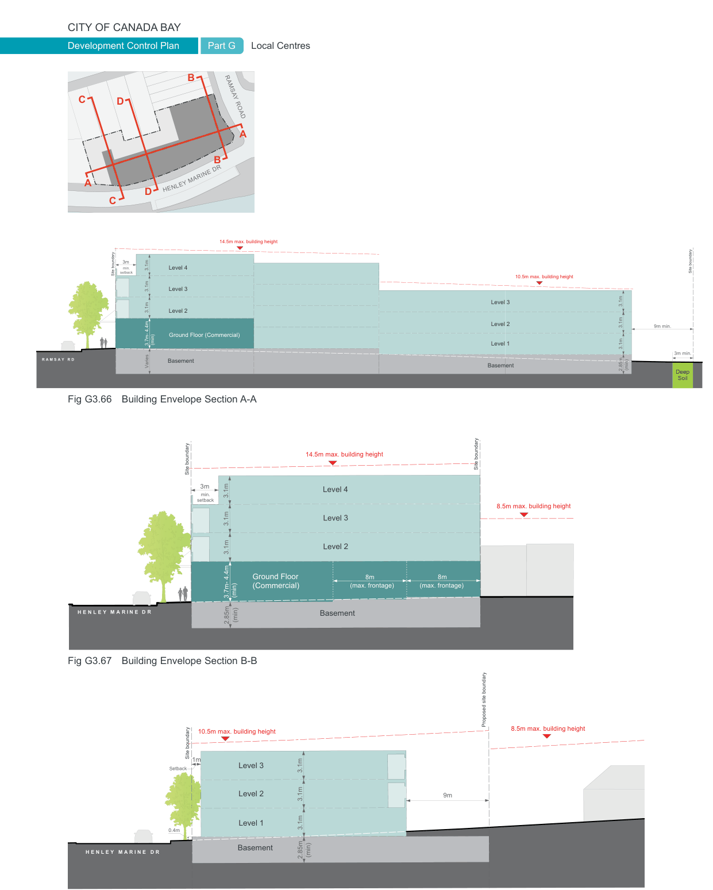
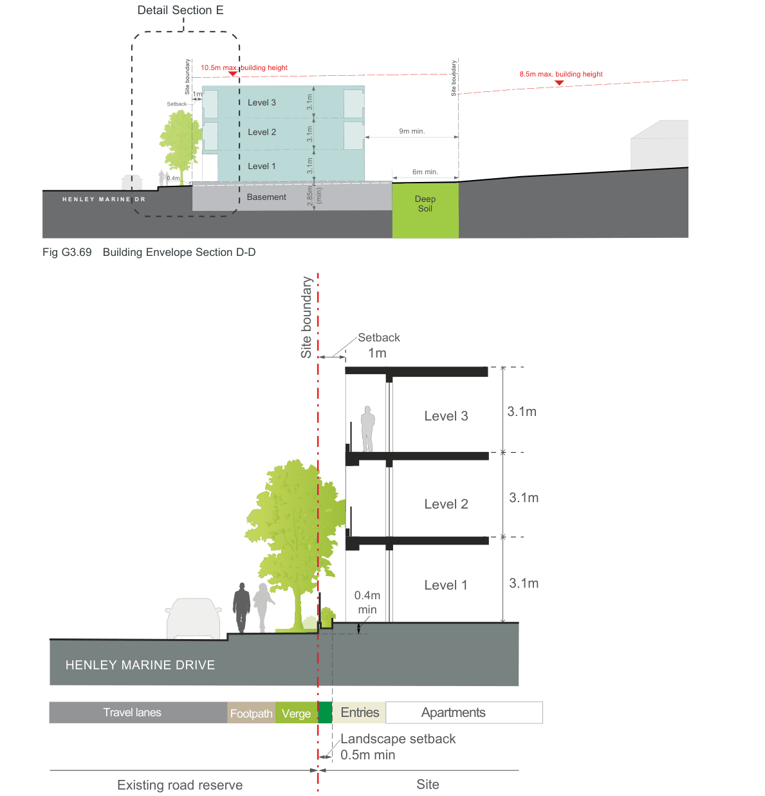

#### G3.6  1 - 7 Ramsay Road, Five Dock

> [Picture on page 83: a picture, saved as a picture (images/part-g-local-centres-page-83-2.gif, 150 dpi).]
> Words printed on the picture (copied from the PDF):
> Council area map

#### Context

1- 7 Ramsay Road is an 'L' shaped site located to the south of Harrabrook Avenue, west of Ramsay Road and north of Henley Marine Drive. The site is located within a small neighbourhood centre, on either side of Ramsay Road immediately to the north of Iron Cove Creek. The area surrounding the site is characterised by low density, 1-2 storey detached dwelling houses, with the majority being single storey bungalows.

The neighbourhood centre forms an important gateway to the City of Canada Bay Local Government Area and a transition between the historic village of Haberfield and the Five Dock Town Centre.

The planning controls outlined below apply to this site and have been developed to ensure that the form and scale of new development responds to the surrounding context and achieves a positive urban design outcome for the location.

#### Land Use Objectives

O1. Create a high-quality mixed use building at a key intersection.

O2. To provide ground level commercial floor space along Ramsay Road that supports the neighbourhood centre.

O3. To encourage residential development facing Henley Marine Drive.

O4. To ensure residential dwellings on the ground level have a high level of amenity and create a positive interface with the street. O5. To maximise opportunities for passive surveillance of the public domain.

| Controls |  |
|---|---|
| C1. | A minimum of 25% of the site area that is zoned B1 Neighbourhood Centre must be allocated to commercial development and located on the ground floor. |
| C2. | Residential dwellings on the ground floor facing Henley Marine Drive are to have individual entries from the street. |
| C3. | Where residential uses on the ground floor are permitted these should be raised between 0.4m-1.0m above the footpath to improve internal privacy of residents. |
| C4. | All parking generated by the development is to be provided for on site. |
| C5. | Any access from the lane to the north of the site should be consistent with the terms of any applicable easement or right-of-carriageway applying to the land. |

> [Picture on page 84: a map, saved as a picture (images/part-g-local-centres-page-84-1.gif, 150 dpi); the street names and other small labels are on the picture.]
> Labels printed on the map (copied from the PDF, in no particular order):
> Align with extent of · right of way · 3m · 9m min.* · 9m min.* · 9m · min.* · 9m · min.* · 3m · 9m · min.* · 9m min.* · Max. building height 14.5m (4 storeys) · Max. building height 10.5m (3 storeys) · Max. building height including lift overrun · Right of way · 9m minimum setback to lower density · residential properties · 1m setback to boundary · 0 · 20 m · 10 · 5 · N · LEGEND · Desired active frontage · X · Max. building height 14.5m (4 storeys) · Max. number of storeys · Max. building height 10.5m (3 storeys) · Upper level setback · 3m · Max. building height including lift overrun Upper level setback distance from edge · Right of way · Desired location of built form breaks/ gaps · Existing creek · 9m minimum setback to lower density · residential properties · Cadastre · 1m setback to boundary · Minimum lot size of 360sqm · Desired active frontage · Site boundary · Fig G3.63 Building Envelope Controls Plan

### HARRABROOK AVE

### 4

### RAMSAY ROAD

### 3

### R

### NE D

### RI

### MA

### EY

### NL

### HE

#### CREEK

#### IRON COVE

#### Built Form Envelope Objectives

O6. To establish an appropriately scaled gateway building for the location. O7. To achieve a development outcome which, in terms of its density, design, scale and bulk, responds in a sympathetic and harmonious manner to the surrounding fine grain character of the neighbourhood centre and adjoining residential development. O8. To minimise the apparent height of development when viewed from Ramsay Road and Henley Marine Drive.

O9. To create a high quality development with high amenity which is responsive to its location. O10. To add visual quality and interest to the new development with a focus on breaking up the massing of higher density forms when viewed from public places and neighbouring properties.

| C11. | Building façades are to be articulated to incorporate breaks that reflect building entries or provide visual connectivity to community spaces. |
|---|---|
| C12. | The upper-most level is to be designed to reduce the visual bulk and scale of the building. Options to achieve this include setbacks and the use of dark colours and roof elements that create deep shadows. |
| C13. | New development is to use roof colours and materials that minimises the heat island effect. |
| C14. | Balconies above active frontages identified in Fig G3.63 and Fig G3.64 should be designed to be integrated into and reinforce the street wall. Balconies located within upper level setbacks are to integrate the parapet into the balustrade design (see Fig G3.66). |
| C15. | Minimum floor to floor heights are to be as per the table below: |

| Controls |  |
|---|---|
| C6. | New development is to conform with the maximum heights and number of storeys as shown in Fig G3.63 Building Envelope Controls Plan and Fig G3.66 to Fig G3.70 Sections. |
| C7. | The height of new development shown within the brown hatched area in Fig G3.63, is limited to a maximum of 3 storeys (including lift overrun). The hatched area abuts the right of way alignment to its east. |
| C8. | Building heights are to transition (be lower) towards the adjoining residential uses along the site's western boundary as identified in Fig G3.63 Building Envelope Controls Plan and Fig G3.66 Section. |
| C9. | The development is to be articulated along Henley Marine Drive and is not to present a long, unrelieved built form that dominates the streetscape and is incompatible with the local character of Henley Marine Drive. |
| C10. | Built form on the corner is to address both streets and use architectural elements composed so that they 'turn the corner'. |

| Use | Min. floor to floor height | Min. floor to ceiling height |
|---|---|---|
| Retail | 3.7m – 4.4m | 3.3m-4m |
| Commercial | 3.7m | 3.3m |
| Adaptable | 3.7m | 3.3m |
| Residential | 3.1m | 2.7m |

> [Picture on page 85: a picture, saved as a picture (images/part-g-local-centres-page-85-23.gif, 150 dpi).]

Example of building on a corner where the architectural elements 'turn the corner'.

> [Picture on page 86: a picture, saved as a picture (images/part-g-local-centres-page-86-1.gif, 150 dpi).]
> Words printed on the picture (copied from the PDF):
> 3m min.
> 6m
> min.
> 20m
> 0
> 20 m
> 10
> 5
> N
> LEGEND
> Non-residential ground floor use
> Tree Protection Zone (TPZ) to be
> established by an arborist
> Residential ground floor use
> Driveway to be removed and kerb
> reinstated
> 0.5m minimum depth of landscaping
> Deep soil zone (min.)
> Design and treatment of any driveway
> access within the TPZ to be established
> by an arborist
> Landscaped area (min.)
> Desired active frontage
> Footpath upgrades as per council
> requirements
> Existing tree to be retained
> Preferred location of driveway access
> Cadastre
> Existing tree to be transplanted within
> the site
> Site boundary
> New street strees at 10m centres

### HARRABROOK AVE

### RAMSAY ROAD

### R

### NE D

### RI

### MA

### EY

### NL

### HE

#### CREEK

#### IRON COVE

### Henley Marine

Fig G3.64 Public Domain Framework Plan

#### Building Setbacks Objectives

O11. Reinforce and provide a continuous street wall along Ramsay Road.

O12. Provide adequate privacy and access to daylight, ventilation and outlook for neighbouring properties.

O13. Provide a high level of amenity and privacy for ground level dwellings facing Henley Marine Drive.

| Controls |  |
|---|---|
| C16. | New development must be set back as identified in Fig G3.63 Building Envelope Controls Plan and Fig G3.66 to Fig G3.70 Sections. |
| C17. | A three (3) storey street edge with nil setback is to be provided along Ramsay Road |
| C18. | All habitable rooms and balconies of the new development are to be set back a minimum of 9m from all side and rear boundaries adjoining residential areas. |
| C19. | Minimise overshadowing of neighbouring properties and maximise direct sunlight to adjoining public spaces. |

> [Picture on page 87: a picture, saved as a picture (images/part-g-local-centres-page-87-12.gif, 150 dpi).]

Landscaped setbacks with integrated entries and tree planting contribute to the residential streetscape.

#### Landscape and public domain Objectives

O14. To ensure that trees and landscape on neighbouring sites are retained, existing trees on the site are to be relocated on the site where possible.

O15. To control climatic impacts on buildings and outdoor spaces, maximise provision of shade and reduce the urban heat island effect. O16. To allow adequate provision on site for infiltration of stormwater, deep soil tree planting, landscaping and areas of communal outdoor recreation.

| Controls |  |
|---|---|
| C20. | At a minimum, deep soil zones are to be provided as identified in Fig G3.64 Public Domain Framework plan and to be a minimum of 8% of the site area. |
| C21. | Bin storage is not to be located within deep soil zones. |
| C22. | A minimum of 20% of the site area on the ground floor is to be a landscape area as identified in Fig G3.64 Public Domain Framework plan |
| C23. | Ground floor residential uses along Henley Marine Drive are to be provided with a minimum 0.5m wide landscape setback. |
| C24. | Non-permeable hard surfaces (i.e. concrete slabs) are not permitted in identified deep soil zones. |
| C25. | New screening landscape is to be provided along the boundary of adjoining existing residential properties. |
| C26. | No communal open space is permitted above the ground floor to avoid adverse impacts to the amenity of adjoining properties. |
| C27. | Ensure the removal of trees on site will be offset by replacement planting on site. |

> [Picture on page 88: a picture, saved as a picture (images/part-g-local-centres-page-88-1.gif, 150 dpi).]

Awnings provide

continuous all

weather shelter for

pedestrians.

Vertical elements such as support walls and columns (ideally continued to the upper levels) support a vertical rhythm along the street.

Fig G3.65 Design guidance for active frontages

#### Active Frontages Objectives

O17. To enhance the commercial viability of the area and compliment existing small-scale retail, commercial, and community uses. O18. To promote a diversity of retail shop sizes within the neighbourhood centre. O19. To provide a safe, interesting and vibrant environment that encourages pedestrian activity and supports the economic success of the neighbourhood centre.

> [Picture on page 88: a picture, saved as a picture (images/part-g-local-centres-page-88-23.gif, 150 dpi).]

Breaking the facade into smaller elements helps create variation and interest.

A maximum of 70% of

the ground floor facade

is to be glazed and the

facade is to be balanced

with solid elements.

Tenancies should be as narrow as possible (ideally 5-8m wide) and a minimum of 10m deep.

| Controls |  |
|---|---|
| C28. | Ground level active uses must be provided along 'Active frontages' as identified in Fig G3.63 and Fig G3.64. |
| C29. | Ground floor tenancies along active frontages should be no more than 8m wide to create a vertical rhythm, and variety and interest along the street. |
| C30. | Ground level active uses are to be a minimum of 10m deep. |
| C31. | Shop entries are to be level with the footpath. Where this is not possible entries are to be a maximum of 0.3m above the footpath level. Shop entries cannot be below the street level. |
| C32. | Along active frontages: • Continuous awnings must be provided to shelter pedestrians from weather conditions. • The design guidance shown in Fig G3.65 must be applied. |
| C33. | Awnings are to be designed such that they 'turn the corner'. |

> [Picture on page 89: a picture, saved as a picture (images/part-g-local-centres-page-89-1.gif, 150 dpi).]
> Words printed on the picture (copied from the PDF):
> B
> C D
> RAMSAY ROAD
> A
> B
> Y MARINE DR
> LE
> A
> HEN
> D
> C

14.5m max. building height

> Labels printed on the map (copied from the PDF, in no particular order):
> 3.1m Level 4 · 3m · min. · setback · Site boundary · Level 3 · Level 2 · Ground Floor (Commercial) · (min) · 3.7m- 4.4m · 3.1m · 3.1m · R A M S A Y   R D · Basement · Varies · 10.5m max. building height · Level 3 · Level 2 · Level 1 · Basement · Site boundary · 9m min. · 3.1m · 3.1m · 3.1m · 3m min. · (min) · 2.85m · Deep · Soil

Fig G3.66 Building Envelope Section A-A

> Labels printed on the map (copied from the PDF, in no particular order):
> 14.5m max. building height · Site boundary · Level 4 · 3m · 3.1m · min. · setback · Level 3 · Level 2 · 8m · (max. frontage) · Ground Floor · (Commercial) · (min) · 3.7m- 4.4m · H E N L E Y M A R I N E D R · Basement · 3.1m · 3.1m · (min) · 2.85m · Site boundary · 8.5m max. building height · 8m · (max. frontage)

Fig G3.67 Building Envelope Section B-B

Fig G3.68 Building Envelope Section C-C

Proposed site boundary

> Labels printed on the map (copied from the PDF, in no particular order):
> 10.5m max. building height · Site boundary · 1m · Level 3 · Setback · Level 2 · 3.1m · 3.1m · Level 1 3.1m · 0.4m · Basement · H E N L E Y   M A R I N E   D R · (min) · 2.85m · 8.5m max. building height · 9m

Detail Section E

> [Picture on page 90: a map, saved as a picture (images/part-g-local-centres-page-90-2.gif, 150 dpi); the street names and other small labels are on the picture.]
> Labels printed on the map (copied from the PDF, in no particular order):
> 10.5m max. building height · 8.5m max. building height · Site boundary · Site boundary · 1m · Setback · Level 3 · 9m min. · Level 2 · Level 1 · 6m min. · 0.4m · Basement · H E N L E Y   M A R I N E   D R · Deep · (min) · 3.1m · 3.1m · 3.1m · 2.85m · Soil

Fig G3.69 Building Envelope Section D-D

> Labels printed on the map (copied from the PDF, in no particular order):
> Setback · Site boundary 1m · 3.1m · Level 3 · 3.1m · Level 2 · 3.1m · Level 1 · 0.4m · min · HENLEY MARINE DRIVE · Travel lanes · Footpath Verge · Apartments · Entries · Landscape setback · 0.5m min · Site · Existing road reserve

Fig G3.70 Detailed Section E through ground floor residential
