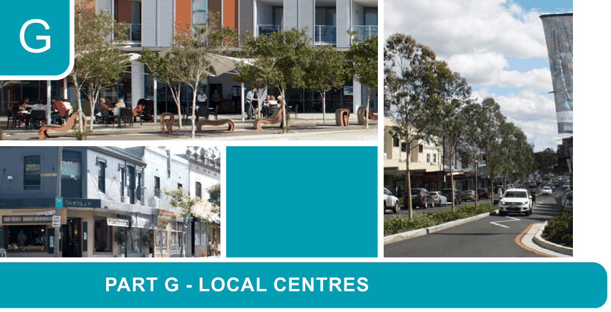

# Canada Bay Development Control Plan - Part G Local Centres

> This chapter is split into 20 section file(s), one per numbered heading, in the order they appear in the PDF.

Source PDF: [ECM_7719481_v4_CCB-DCP-08_Part-G-Local-Centres_v2022-05-16.pdf](ECM_7719481_v4_CCB-DCP-08_Part-G-Local-Centres_v2022-05-16.pdf)

> [Picture on page 1: a picture, saved as a picture (images/part-g-local-centres-page-1-1.gif, 150 dpi).]

### G

### PART G - LOCAL CENTRES

| G1 | Land to which Part G applies........................................................................................G-2 |
|---|---|
| G2 | General Requirements ...................................................................................................G-3 G2.1 General objectives ................................................................................................G-3 G2.2 Building design and appearance...........................................................................G-3 G2.3 Ground floor interfaces ........................................................................................G-7 G2.4 Building performance ...........................................................................................G-9 G2.5 Neighbourhood amenity ......................................................................................G-10 G2.6 Landscape Design .............................................................................................G-11 G2.7 Heritage...............................................................................................................G-12 G2.8 Signage and advertising......................................................................................G-13 G2.9 Public Art .............................................................................................................G-14 G2.10 Access and parking ..........................................................................................G-15 G2.11 Residential Uses not covered by the Apartment Design Guide .......................G-16 |
| G3 | Site specific building envelope and design controls ...............................................G-17 G3.1 Victoria Road Drummoyne..................................................................................G-17 G3.2 Five Dock Town Centre.......................................................................................G-55 G3.3 Majors Bay Road Shopping Centre, Concord.....................................................G-75 G3.4 Victoria Avenue Shopping Centre, Concord West ..............................................G-77 G3.5 355-359 Lyons Road, Five Dock.........................................................................G-79 G3.6 1 - 7 Ramsay Road, Five Dock...........................................................................G-83 |

<!-- sections -->
## Sections

1. [G1 Land to which Part G applies](01-g1-land-to-which-part-g-applies.md)
2. [G2.1 General objectives](02-g2-1-general-objectives.md)
3. [G2.2 Building design and appearance](03-g2-2-building-design-and-appearance.md)
4. [G2 General Requirements](04-g2-general-requirements.md)
5. [G2.3 Ground floor interfaces](05-g2-3-ground-floor-interfaces.md)
6. [G2.4 Building performance](06-g2-4-building-performance.md)
7. [G2.5 Neighbourhood amenity](07-g2-5-neighbourhood-amenity.md)
8. [G2.6 Landscape Design](08-g2-6-landscape-design.md)
9. [G2.7 Heritage](09-g2-7-heritage.md)
10. [G2 General Requirements](10-g2-general-requirements.md)
11. [G2.8 Signage and advertising](11-g2-8-signage-and-advertising.md)
12. [G2.9 Public Art](12-g2-9-public-art.md)
13. [G2.10 Access and parking](13-g2-10-access-and-parking.md)
14. [G3.1 Victoria Road Drummoyne](14-g3-1-victoria-road-drummoyne.md)
15. [L2 GF](15-l2-gf.md)
16. [G3.2 Five Dock Town Centre](16-g3-2-five-dock-town-centre.md)
17. [G3.3 Majors Bay Road Shopping Centre, Concord](17-g3-3-majors-bay-road-shopping-centre-concord.md)
18. [G3.4 Victoria Avenue Shopping Centre, Concord West](18-g3-4-victoria-avenue-shopping-centre-concord.md)
19. [G3.5 355-359 Lyons Road, Five Dock](19-g3-5-355-359-lyons-road-five-dock.md)
20. [G3.6 1 - 7 Ramsay Road, Five Dock](20-g3-6-1-7-ramsay-road-five-dock.md)
