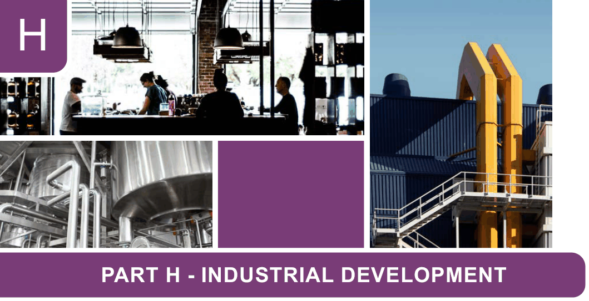

# Canada Bay Development Control Plan - Part H Industrial Development

> This chapter is split into 6 section file(s), one per numbered heading, in the order they appear in the PDF.

Source PDF: [DCP-09_Part-H-Industrial_v2022-05-16.pdf](DCP-09_Part-H-Industrial_v2022-05-16.pdf)

> [Picture on page 1: a picture, saved as a picture (images/part-h-industrial-development-page-1-1.gif, 150 dpi).]

### H

### PART H - INDUSTRIAL DEVELOPMENT

| H1 | General Objectives ........................................................................................................H-2 |
|---|---|
| H2 | Setbacks .........................................................................................................................H-2 |
| H3 | Landscaping ...................................................................................................................H-3 |
| H4 | Building form and appearance......................................................................................H-4 |
| H5 | Light and noise ...............................................................................................................H-5 |
| H6 | Public Art.........................................................................................................................H-5 |

<!-- sections -->
## Sections

1. [H1 General Objectives](01-h1-general-objectives.md)
2. [H2 Setbacks](02-h2-setbacks.md)
3. [H3 Landscaping](03-h3-landscaping.md)
4. [H4 Building form and appearance](04-h4-building-form-and-appearance.md)
5. [H5 Light and noise](05-h5-light-and-noise.md)
6. [H6 Public Art](06-h6-public-art.md)
