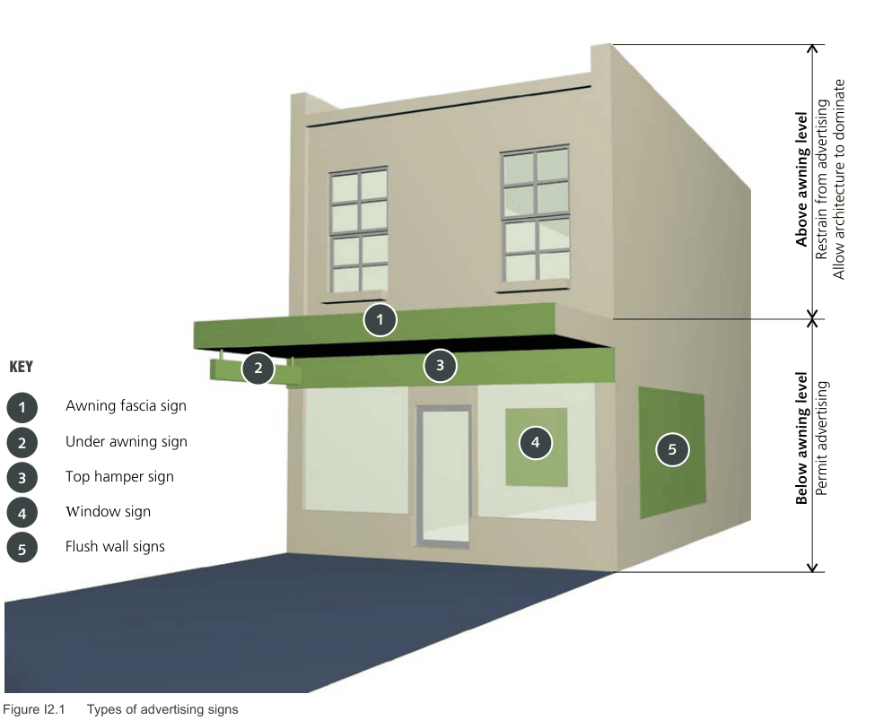

### I2  General Objectives and standards applicable to all development

#### Objectives

The siting, location, size, height, scale, design, colour, shape and materials of construction of advertisements should:

O1. Complement and enhance the predominant character of the locality; O2. Complement and enhance any building, structure or site of heritage significance on which it is to be erected or located;

O3. Not obscure the view of attractive landscapes, streetscapes, or significant buildings; and O4. Not adversely affect the safety of traffic or pedestrians.

#### Controls

C1. The minimum controls for all signs are included in Table I-A.

#### Inappropriate development

| Controls |  |
|---|---|
| C2. | The following signs and advertising structures are not considered to be appropriate: a) Signs erected or attached to the sides of buildings where such side is adjacent to residences or residential flat buildings, or where the side of the building faces a residential street unless special circumstances as determined by Council are considered to exist; b) Signs or advertisements other than those relating to the occupier(s) of the building; c) Flashing, moving, or video signs; d) More than one (1) projecting wall sign, flush wall sign or painted wall sign per elevation; e) More than one (1) outward facing sign (eg top hamper, painted or etched window sign) per ground floor shop; f) Signs located on an awning or signs attached above the awning; g) Any sign or signboard exhibited on Council’s footpath; h) Advertisements on parked motor vehicles, trailers, shipping containers or the like, whether or not registered, for which the principal purpose is for advertising; i) Private identification signs within the public domain; j) Signs attached above the roof; k) Permanent inflatable signs; l) Flag pole signs; and m) Signs of more than 20m2 in area or 8.0 metres in height. |

#### Table I-A Requirements for signage

| Type of sign | Maximum size/area and number | Location/ other requirements |
|---|---|---|
| Under Awning Sign (Illuminated or non-illuminated) | • 2.5m x 0.3m (maximum) • One per shop; or • One every 5.0m provided that distance of not less than 3.0m between the centres of signs on adjoining properties is maintained | • Erected at right angles to the building • Minimum clearance of 2.6m to footpath • Not to project beyond the awning |
| Top Hamper Sign | • Restricted to that portion of the shop front above the level of the head of the doorway or window to which it is attached. • Restricted to the underside of the awning • Not illuminated • Where shop front facade comprises full glass, hamper signs will only be permitted behind the glass • One per shop • 2.5m x 0.3m (maximum) | • Not to project more than 20mm beyond the face of the building. |
| Pole or Pylon Sign | • Max advertising area 4.65m2 • Max height 8.0m • One per site | • At least 2.6m above ground level and not to project more than 1.2m beyond the street alignment • Only where buildings are remote from the street alignment • A single retail centre and major tenant pylon is permitted along Homebush Bay Drive. |
| Flush or painted wall sign | • 5m2 or 5% of the wall area* up to 100m2 • Maximum of one flush wall sign per elevation • Should not extend beyond wall edges | • For wall areas* over 100m2 proposed signs will be considered on a merit basis but should not exceed 7.5% of wall area or a maximum of 30m2 whichever is the lesser |
| Projecting Wall Sign (Vertical) where: lowest part of sign is between 2.6m and 3.7m lowest part of sign is 3.7m-4.5m lowest part of sign exceeds 4.6m | • 0.6m maximum projection from wall face & maximum 1.8m height • 0.7m maximum projection from wall face & maximum 2.4m in height • 0.9m maximum projection from wall face & maximum 3.0m in height | • Only permitted where no awnings exist on a building • Height of sign should not be less than width • Should be erected at right angles to the face of the building • Should provide 2.6m clearance to footpath from underside of sign • Should not extend within 0.6m of the kerb alignment • One per building • Maximum width 0.4m |

| Type of sign | Maximum size/area and number | Location/ other requirements |
|---|---|---|
| Projecting Wall Sign (Horizontal) | • Maximum dimensions as follows: • 1.3m (length) x 0.8m (height) x 0.4m (width) for rectangular signs • 1.2m x 1.2m for square signs • 1.2m diameter for round signs • One per building | • Only permitted where no awnings exist on a building • Height of the sign is less than its width • Should be erected at right angles to the face of the building • Should provide 2.6m clearance to footpath from underside of sign but not more than 4.0m above footpath • Should not extend within 0.6m of the kerb alignment |
| Multi-Occupancy Buildings | • One sign per building for identification | • Under awning signs should meet above requirements for such signs |
| Awning fascia sign | • Sign to be painted on or attached to fascia • Must not project above or below the awning or the return end of the fascia | • Attached sign must be flat, with minimal projection from the fascia (similar to painting the fascia) • Not illuminated |
| Window sign | • May be painted or etched onto internal or external surface of window or attached to internal surface of window • Maximum 6m2 or 20% of the surface area of the window, whichever is the lesser | • Must continue to allow passive visual surveillance • Not illuminated |
| Obscure glazing | • Maximum 6m2 or 20% of the surface area of the window, whichever is the lesser | • Must continue to allow passive visual surveillance • The remainder of the shopfront glazing must remain clear to allow views into and out of the shop |
| Home business/ industry/ occupation sign | • Painted or attached to external wall (ground floor) or fence with minimal projection from surface to which it is attached • Not more than one per site • 1m2 in area (maximum) | • Not illuminated |
| Signs attached above awning | • Not permitted |  |
| Building identification signage | • Building identification signage is the only signage permitted above first floor level. |  |
| Roof Sign | • Not permitted |  |
| Floodlit Sign | • Not permitted except where special circumstances exist |  |

\* Measurement of the wall area does not include the area below awning area or any area obscured by the adjoining property.

> [Picture on page 6: a map, saved as a picture (images/part-i-signage-and-advertising-page-6-1.gif, 150 dpi); the street names and other small labels are on the picture.]
> Labels printed on the map (copied from the PDF, in no particular order):
> 1 · KEY · 2 · 3 · Awning fascia sign · 1 · Under awning sign · 4 · 2 · Top hamper sign · 3 · Window sign · 4 · Flush wall signs · 5 · Above awning level · Restrain from advertising · Allow architecture to dominate · 5 · Permit advertising · Below awning level

Figure I2.1 Types of advertising signs
