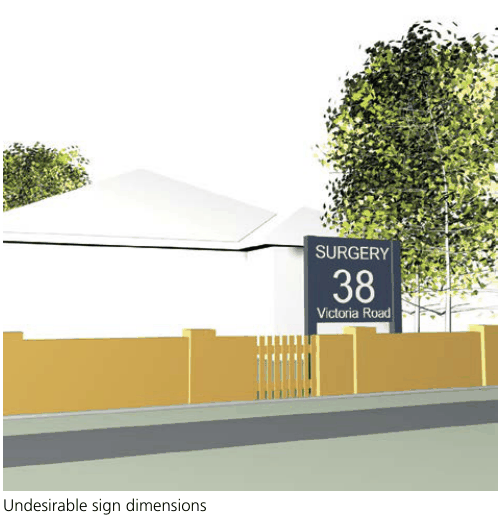
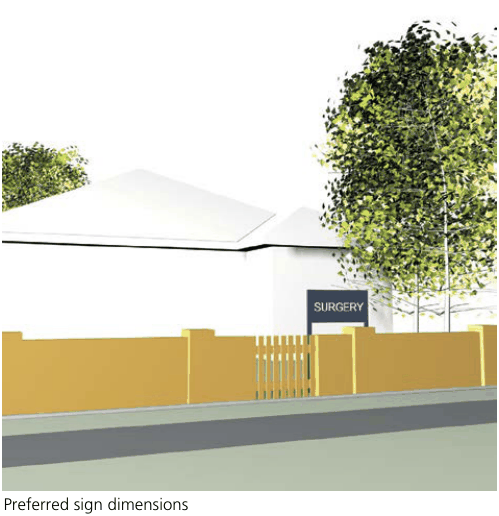

### I3  Sign proliferation and dominance

The number of signs displayed on any site should be minimised in order to avoid visual clutter, duplication of message and adverse impacts on the amenity of adjacent areas from which the signs are visible.

#### Refer to Figure I3.1 Objectives

O1. To minimise the proliferation of signs and visual clutter. O2. To ensure signs are clearly visible without dominating buildings or streets.

| Controls |  |
|---|---|
| C1. | Signs, other than those relating to the occupier of the building are not permitted. |
| C2. | Maximum size/area and number are included in Table I-A. |
| C3. | The number of advertisements displayed on any site should be minimised in order to avoid visual clutter and duplication of message. |
| C4. | Signs should be designed to provide clear property and business identification without dominating the site or the streetscape. |
| C5. | Signage should be visually sub-ordinate to the building as a whole and its façades. |
| C6. | In multi-tenanted buildings, a single coordinated free-standing advertisement or directory board should be used. |
| C7. | Signage must be designed to avoid confusion with directional and traffic signs. |
| C8. | Signage should be designed to add character to the street and complement the architecture. |
| C9. | To minimise visual clutter, signage should be integrated with awnings. |

Preferred s

> [Picture on page 7: a picture, saved as a picture (images/part-i-signage-and-advertising-page-7-14.gif, 150 dpi).]

Undesirable sign dimensions

> [Picture on page 7: a picture, saved as a picture (images/part-i-signage-and-advertising-page-7-16.gif, 150 dpi).]

Preferred sign dimensions

Undesirable sign dimensions

Figure I3.1 Undesireable and preferred sign dimensions
