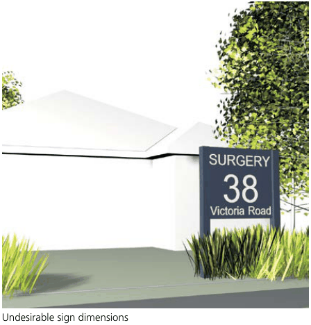
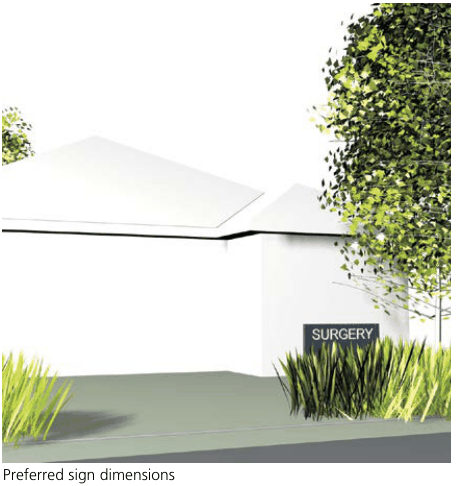

### I6  Conservation areas

Outdoor advertising should be designed and located in a manner which conserves the character and heritage significance of the building, street or area which have been identified as significant. Generally, signs on individual buildings or within conservation areas should be sensitively designed and located and should complement the building or area.

#### Objectives

O1. To ensure signs associated with heritage buildings are sensitively designed and located. O2. To ensure signs do not detract from the appearance and character of Conservation Areas.

| Controls |  |
|---|---|
| C1. | Signs and advertising structures should be designed and located in a manner which conserves or enhances heritage places and buildings, and the appearance and character of conservation areas. |
| C2. | New signs should not be placed on the side of buildings. |
| C3. | Signs should observe traditional sign locations, and wherever possible original signs should be retained and conserved at the site. |
| C4. | Signs should not break the historic parapet or roofline. |
| C5. | Signs should temper modern advertising styles with sympathetic design details (eg. sympathetic colours, margins, type, style) without trying necessarily to recreate a “historic” theme. |
| C6. | Proponents should demonstrate through research that the advertising proposal is in keeping with the historic building or place. |
| C7. | Illuminated signs should not be placed on heritage items or in conservation areas. |
| C8. | Undesirable sign dimensions Signs should be constructed with a high standard of materials and graphics. |
| C9. | Signs should be minimalist in their scale and design. |

Preferred sign dimen

> [Picture on page 9: a picture, saved as a picture (images/part-i-signage-and-advertising-page-9-16.gif, 150 dpi).]

Undesirable sign dimensions

> [Picture on page 9: a picture, saved as a picture (images/part-i-signage-and-advertising-page-9-18.gif, 150 dpi).]

Preferred sign dimensions

Figure I6.1 Undesireable and preferred signs for conservation areas

#### Refer to Figure I6.1
