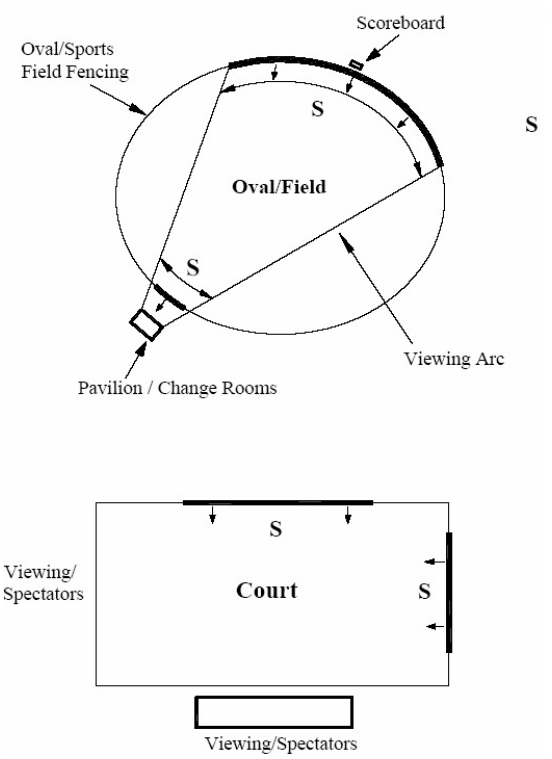

### I7  Concord Oval and Drummoyne Oval Signage

Council recognises the need for corporate and community sponsorship of sporting groups in the local

area. At the same time, it acknowledges the need to ensure that the appearance and amenity of the natural built environment of the reserves and surrounding areas is protected.

Signage approval is valid for the term stated in the consent. After this time, applicants must reapply to Council for approval to erect sponsorship signage.

#### Objectives

O1. To allow sponsorship signage for community based sporting clubs in locations and a manner that complements the role of the reserves. O2. To control the display of advertising material in such a manner as will reasonably protect the amenity of the local area. O3. To ensure that sponsorship signage is directly related to the reserve/sporting facility in which it is displayed.

O4. To coordinate the placement of signage on reserves and associated facilities to minimise clutter, avoid unnecessary duplication and improve the reserves attractiveness and function.

#### Location of sponsorship signs Controls

C1. Signage is to be located so as to be visible only to persons attending the organised sports activities on the reserve and should not face outward (Figure I7.1).

The protection of views into and within public areas is to be maintained and enhanced.

Signage is only permitted on fencing around the sporting field. Applications for signage on grandstands and scoreboards at Concord and Drummoyne ovals will be considered based on merit assessment.

Signage on perimeter fences shall face inwards towards the sporting facility and shall be restricted to the height of the fence surrounding the sporting field.

Where the rear side of the sign is visible from any road, street or waterway, the rear side shall be treated in a manner so as to blend with the existing fence structure.

The visibility of the signage from the surrounding roads, streets, waterways or residential areas is to be minimised.

#### Design and content of sponsorship signs Controls

C2. Illuminated, animated, flashing or moving signs are not permissible. No signage is to be painted directly onto a fence or other structure. All signage must include the sporting clubs name on at least 25% of the overall area of the sign.

Signage content is restricted to information about the sponsors of the teams or organisations using the sporting facility or about the products of those sponsors. Where permissible, signage on scoreboards, grandstands etc, shall not exceed the width of the structure by more than 1 metre. No signs are to extend above the existing height of the structure. Signage is not to contain any advertisements for cigarettes.

#### General Controls

C3. The applicant is to be responsible for maintaining signage in a good state of repair.

All sporting bodies and advertisers are to be made aware that signs may be removed or covered up during special “one off” events.

> [Picture on page 11: a picture, saved as a picture (images/part-i-signage-and-advertising-page-11-30.gif, 150 dpi).]

Figure I7.1 Location criteria for signage

Key: Section of fence suitable for permanent signage. Signs to face Pavilion or viewing area. Signage must not be visible from outside the reserve.

Note: The locational criteria apply to tennis courts, lawn bowls and other relevant recreation facilities within the Council Reserve system.
