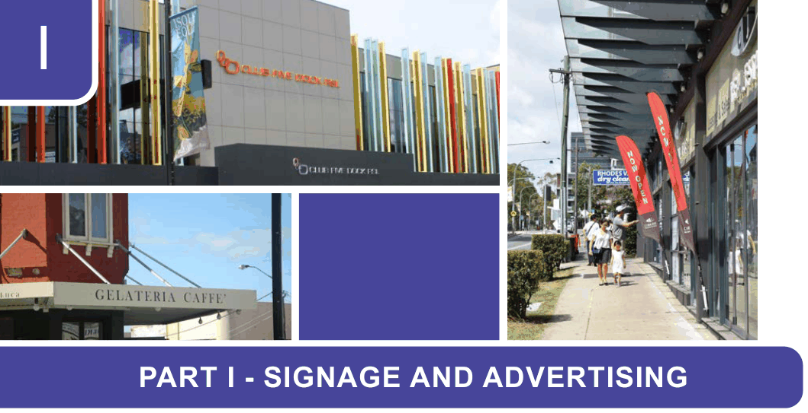

# Canada Bay Development Control Plan - Part I Signage and Advertising

> This chapter is split into 8 section file(s), one per numbered heading, in the order they appear in the PDF.

Source PDF: [DCP-10_Part-I-Signage-Advertising_v2022-05-16.pdf](DCP-10_Part-I-Signage-Advertising_v2022-05-16.pdf)

> [Picture on page 1: a picture, saved as a picture (images/part-i-signage-and-advertising-page-1-1.gif, 150 dpi).]

### I

### PART I - SIGNAGE AND ADVERTISING

| I1 | Signage and Advertising ...................................................................................................I-2 |
|---|---|
| I2 | General Objectives and standards applicable to all development ...............................I-3 |
| I3 | Sign proliferation and dominance....................................................................................I-7 |
| I4 | Sign dimensions.................................................................................................................I-8 |
| I5 | Integration...........................................................................................................................I-8 |
| I6 | Conservation areas............................................................................................................I-9 |
| I7 | Concord Oval and Drummoyne Oval Signage ..............................................................I-10 |
| I8 | Architectural amenity and residential character...........................................................I-12 |

<!-- sections -->
## Sections

1. [I1 Signage and Advertising](01-i1-signage-and-advertising.md)
2. [I2 General Objectives and standards applicable to all development](02-i2-general-objectives-and-standards.md)
3. [I3 Sign proliferation and dominance](03-i3-sign-proliferation-and-dominance.md)
4. [I4 Sign dimensions](04-i4-sign-dimensions.md)
5. [I5 Integration](05-i5-integration.md)
6. [I6 Conservation areas](06-i6-conservation-areas.md)
7. [I7 Concord Oval and Drummoyne Oval Signage](07-i7-concord-oval-and-drummoyne-oval-signage.md)
8. [I8 Architectural amenity and residential character](08-i8-architectural-amenity-and-residential.md)
