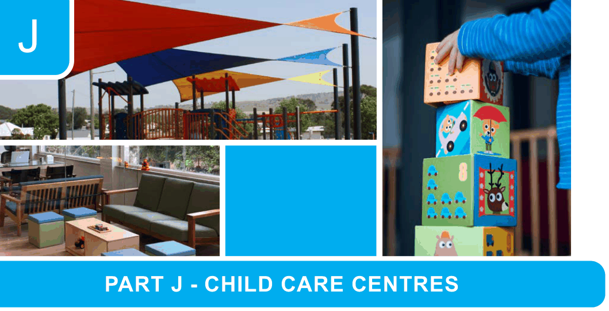

# Canada Bay Development Control Plan - Part J Child Care Centres

> This chapter is split into 3 section file(s), one per numbered heading, in the order they appear in the PDF.

Source PDF: [DCP-11_Part-J-Child-Care-Centres_v2022-05-16.pdf](DCP-11_Part-J-Child-Care-Centres_v2022-05-16.pdf)

> [Picture on page 1: a picture, saved as a picture (images/part-j-child-care-centres-page-1-1.gif, 150 dpi).]
> Words printed on the picture (copied from the PDF):
> CITY OF CANADA BAY
> Development Control Plan Part J Child Care Centres

### J

### PART J - CHILD CARE CENTRES

| J1 | Child Care Centres ..........................................................................................................J-2 |
|---|---|
| J2 | Building setbacks.............................................................................................................J-2 |
| J3 | Provision of parking.........................................................................................................J-2 |
| J4 | Signage..............................................................................................................................J-2 |

Page J-1

Version: 3, Version Date: 26/06/2025

Document Set ID: 7719484

CITY OF CANADA BAY Development Control Plan Part J Child Care Centres

<!-- sections -->
## Sections

1. [J3 Provision of parking](01-j3-provision-of-parking.md)
2. [J4 Signage](02-j4-signage.md)
3. [J2 Building setbacks](03-j2-building-setbacks.md)
