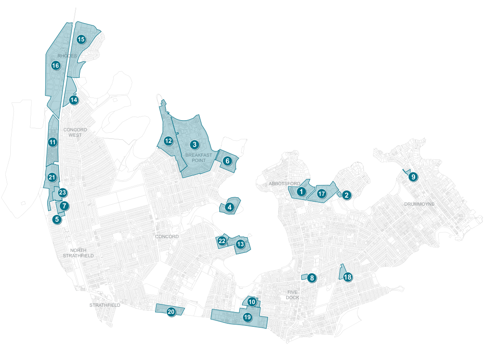

### K1  Land to which Part K applies

Part K applies to the land identified in Figure K1-1

Mortlake Point

1 Abbotsford Cove

#### 12

> [Picture on page 2: a map, saved as a picture (images/part-k-special-precincts-page-2-6.gif, 150 dpi); the street names and other small labels are on the picture.]
> Labels printed on the map (copied from the PDF, in no particular order):
> 2 · Bibby Street · 13 · 3 · 14 · Breakfast Point · 4 · Rhodes East · Cape Cabarita · 15 · 15 · Rhodes West · 5 25 George Street North Strathfield 16 · 6 · 17 · Edgewood and Kendall Inlet (former Dulux site) · RHODES · 7 · Tuscany Court · 27 George Street North Strathfield 18 · 16 · 8 · Kings Bay (PRCUTS) · 19 · 186 Great North Road, Five Dock · 9 · 2A Hythe Street, Drummoyne · 10 · 21 · Kings Bay (former Hycraft site), Five Dock · 11 · Liberty Grove · 14 · CONCORD · WEST · 11 · 12 · 3 · BREAKFAST · POINT 6 · 21 · 9 · ABBOTSFORD · 1 · 23 · 17 2 · DRUMMOYNE · 7 · 4 · 5 · CONCORD · 13 · 22 · NORTH · STRATHFIELD · 18 · 8 · FIVE · DOCK · 10 · STRATHFIELD · 19 · 20

Pelican Point, Pelican Quay Rhodes Corporate Park

Sydney Wire Mill site, Chisw

20 Burwood Concord (PRCUT Homebush North (PRCUTS 22 160 Burwood Rd, Concord 23 1 King St Concord West

Mortlake Point

1 Abbotsford Cove

#### 12

#### 2

Pelican Point, Pelican Quays and Philips Landing, Concord

Bibby Street

#### 13

#### 3

Rhodes Corporate Park

#### 14

Breakfast Point

#### 4

Rhodes East

Cape Cabarita

#### 15

Rhodes West

5 25 George Street North Strathfield

#### 16

#### 6

Sydney Wire Mill site, Chiswick

#### 17

Edgewood and Kendall Inlet (former Dulux site)

#### 7

Tuscany Court

27 George Street North Strathfield

#### 18

#### 8

Kings Bay (PRCUTS)

#### 19

186 Great North Road, Five Dock

#### 9

20 Burwood Concord (PRCUTS)

2A Hythe Street, Drummoyne

#### 10

Homebush North (PRCUTS)

#### 21

Kings Bay (former Hycraft site), Five Dock

#### 11

22 160 Burwood Rd, Concord (former Bushells Factory)

Liberty Grove

23 1 King St Concord West

Figure K1-1 Special Precincts overview map
