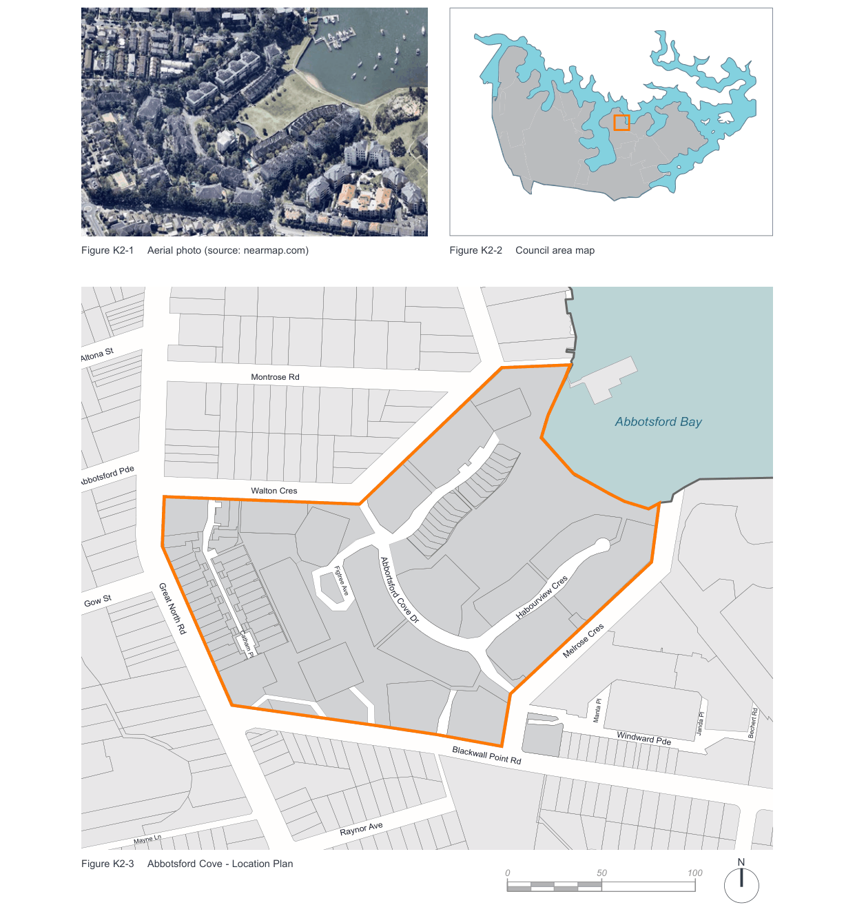
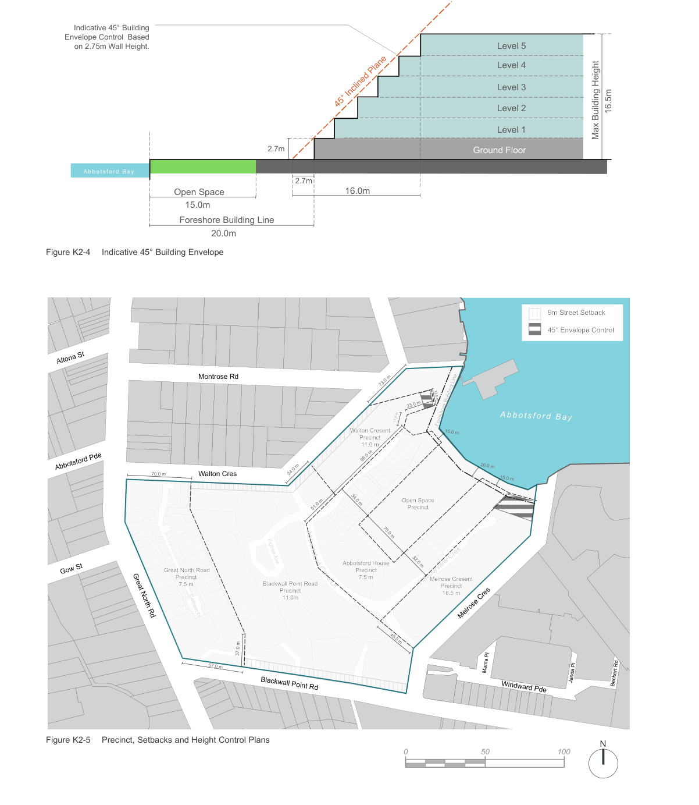

### K2  Abbotsford Cove

> [Picture on page 3: a map, saved as a picture (images/part-k-special-precincts-page-3-2.gif, 150 dpi); the street names and other small labels are on the picture.]
> Labels printed on the map (copied from the PDF, in no particular order):
> Figure K2-1 Aerial photo (source: nearmap.com) · Altona St · Montrose Rd · Abbotsford Pde · Walton Cres · Abbortsfo · r · Figtree Ave · Gow St · d Cove · D · r · Great North Rd · Catham Pl · Raynor Ave · Mayne Ln · Figure K2-3 Abbotsford Cove - Location Plan · Henry Lawson Ave · Figure K2-2 Council area map · Abbotsford Bay · Habourview Cres · Melrose Cres · Manta Pl · Janda Pl · Windward Pde · Blackwall Point Rd · 0 · 50 · 100 · Bechert Rd · N

#### K2.1 General objectives

O1. To encourage and facilitate development on the site which, in terms of scale, bulk, form and character: reflects the physical context of the site; is sympathetic to surrounding residential development; and does not dominate the landscape;

O2. To retain and incorporate existing significant buildings and trees and other site features, creating a sense of place and respecting the heritage values of the site; O3. To minimise the impact of the development in terms of overlooking, loss of view and loss of sunlight from adjoining and neighbouring properties;

O4. To provide unrestricted public access to the foreshore and to the central area of public open space located between Abbotsford House and the Bay;

O5. To provide for the active and passive recreation needs of the residents of the development which should include the rehabilitation of the Clubhouse pavilion and incorporate recreation facilities such as a swimming pool and tennis courts; and O6. To provide a publicly accessible street network as an extension of the existing street network.

#### K2.2 Specific provisions

#### Design, Scale and bulk

| Controls |  |
|---|---|
| C1. | To achieve a development outcome which, in terms of its design, scale and bulk, responds in a sympathetic and harmonious manner to the site, the bay and surrounding residential development. |
| C2. | To control the externalities of any future development and ensure that future residents of the site enjoy a high standard of amenity and environmental quality. |

The height of buildings, including any car parking levels should comply with the height limits for the five residential precincts specified in Figure K2-5 Precinct, Setbacks and Height Control Plansand detailed below:

#### Great North Road Precinct Controls

| C3. | The 7.5m height limit is compatible with the existing residential development on Great North Road. |
|---|---|

#### Blackwall Point Road Precinct

| Controls |  |
|---|---|
| C4. | The 11m height limit allows 4 levels of residential development above existing ground level. This height has been determined by considering the height and location of existing vegetation, the slope of the land and proximity to Abbotsford House. |
| C5. | On the Blackwall Point Road frontage a 9m setback to accommodate the root systems of existing vegetation will be necessary. The buildings will also be effectively screened from neighbouring development by the existing stand of weepy fig trees. |

#### Melrose Crescent Precinct

| Controls |  |
|---|---|
| C6. | The 16.5m height limit takes into consideration: the substantial fall of the site along the eastern boundary, the height of existing buildings on the site, the location next to the Lysaght site and portion of unmade road (Melrose Crescent) creating an opportunity for a buffer area. |
| C7. | A 45º envelope control for development, where the Melrose Crescent Precinct adjoins the Open Space Precinct (see Figure K2-4 Indicative 45° Building Envelope) will ensure minimal impact when viewed from the water. |

> [Picture on page 5: a map, saved as a picture (images/part-k-special-precincts-page-5-1.gif, 150 dpi); the street names and other small labels are on the picture.]
> Labels printed on the map (copied from the PDF, in no particular order):
> Indicative 45° Building · Envelope Control  Based · on 2.75m Wall Height. · Level 5 · Level 4 · Level 3 · 45° Inclined Plane · Level 2 · Level 1 · 16.5m · Max Building Height · 2.7m · Ground Floor · A bbot sf ord B ay · 16.0m · 2.7m · 15.0m · Open Space · 20.0m · Foreshore Building Line · Figure K2-4 Indicative 45° Building Envelope · 9m Street Setback · 45° Envelope Control · Altona St · Montrose Rd · 12.5 m · 23.0 m · Abbotsford Bay · 17.0 m · Foreshore Building Line · Walton Cresent 15.0 m · Precinct · 11.0 m · 20.0 m · Abbotsford Pde · 34.0 m · 73.0 m · 70.0 m Walton Cres · 15.0 m · Open Space · Precinct · 51.0 m · 96.0 m · Abbortsfo · Figtree Ave · Abbotsford House · 34.0 m · 70.0 m · 32.0 m · Great North Road · Precinct · Gow St · Precinct · 7.5 m · Melrose Cresent · Habourview Cres · 7.5 m · Blackwall Point Road · rd Cove D · Precinct · r · Precinct · 16.5 m · 11.0m · Catham Pl · Great North Rd · Melrose Cres · 45.0 m · 37.0 m · 57.0 m · Manta Pl · Janda Pl · Bechert Rd · Blackwall Point Rd · Windward Pde · N · Figure K2-5 Precinct, Setbacks and Height Control Plans · 0 · 50 · 100

#### Walton Crescent Precinct

| Controls |  |
|---|---|
| C8. | The 11m height limit together with the 9m setback will provide for development which will read as 1/2 storeys from Walton Crescent. |
| C9. | A 45º envelope control for development where the Walton Crescent Precinct adjoins the Open Space Precinct (see Figure K2-4 Indicative 45° Building Envelope) will ensure minimal impact when viewed from the water and from Walton Crescent. |

#### Abbotsford House Precinct

| Controls |  |
|---|---|
| C10. | The 7.5m height limit complements Abbotsford House and provides an appropriately scaled edge to the open space. |

#### Open Space Precinct

| Controls |  |
|---|---|
| C11. | Any structure located in the Open Space Precinct should not exceed 3.6m in height. |

#### Site coverage

| Controls |  |
|---|---|
| C12. | Buildings must occupy less than 30% of the site area. |

#### Setbacks

| Controls |  |
|---|---|
| C13. | A 20m Foreshore Building Line applies to the site (see Figure K2-4 Indicative 45° Building Envelope). |
| C14. | A 9m building setback applies to parts of the Blackwall Point Road and the Walton Crescent Precincts (see Figure K2-5 Precinct, Setbacks and Height Control Plans). |
| C15. | Any building to be located near to an existing tree must take account of the drip lines and root systems of that tree. |

#### Design and Form

| Controls |  |
|---|---|
| C16. | A 45º building envelope control will control building form on the Abbotsford Bay edge of Melrose Crescent Precinct and Walton Crescent Precinct to minimise impact of the development when viewed from the water (see Figure K2-4 Indicative 45° Building Envelope). |

#### Landscaped and Open Spaces Objectives

O7. To provide for public and private open space that meets user requirements for recreational and social activities and for landscaping; O8. To ensure that significant trees are retained or where possible relocated on the site; and O9. To assist on-site drainage by the provision of at ground landscaped open space.

| Controls |  |
|---|---|
| C17. | To ensure adequate provision of open space maximum permissible site coverage of buildings over the entire site is 30%. |
| C18. | Landscaped areas should generally be dominated by vegetation and not masonry elements. Hard paved areas should, where possible, be kept to a minimum in order to reduce stormwater runoff, although wheelchair access must be considered. |
