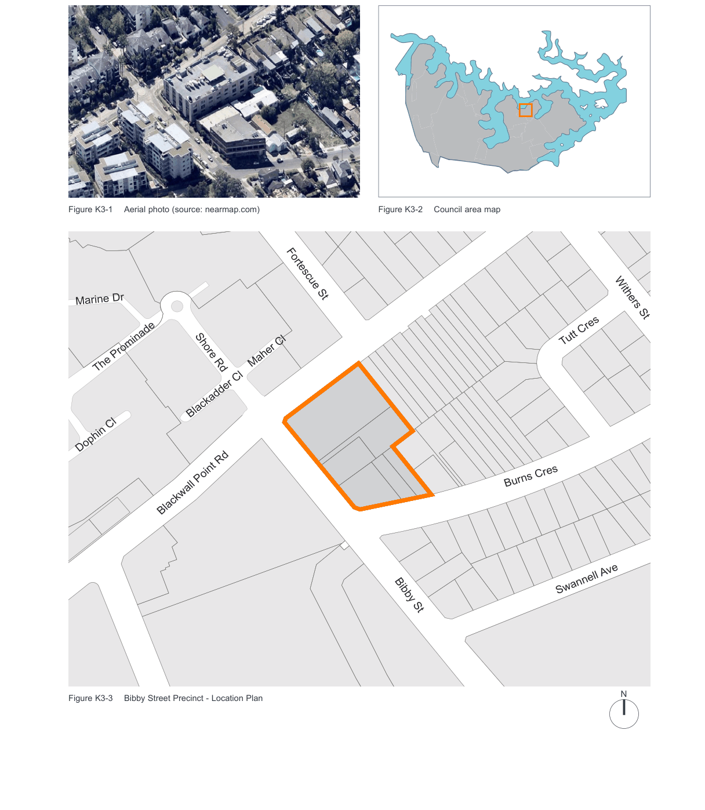

### K3  Bibby Street

> [Picture on page 7: a map, saved as a picture (images/part-k-special-precincts-page-7-2.gif, 150 dpi); the street names and other small labels are on the picture.]
> Labels printed on the map (copied from the PDF, in no particular order):
> Figure K3-1 Aerial photo (source: nearmap.com) · Fortescue St · Marine Dr · Maher Cl · Shore Rd · The Prominade · Blackadder Cl · Dophin Cl · Blackwall Point Rd · Figure K3-3 Bibby Street Precinct - Location Plan · Figure K3-2 Council area map · Withers St · Tutt Cres · Burns Cres · Swannell Ave · Bibby St · N

E

The following objectives and controls have been created to ensure an appropriate form and scale of development is provided for the former industrial precinct bound by Bibby Street, Blackwall Point Road and Burns Crescent, Chiswick.

#### K3.1 Objectives and provisions

#### Built form and scale Objectives

O1. Orientate new buildings to the north so as to maximise solar access for new dwellings; O2. Build to the building envelope line at the Bibby Street/Blackwall Point Road and Bibby Street/ Burns Crescent corners of the site to create a higher density residential “node” complementing existing development on the adjacent corners of the Bibby Street/Blackwall Point Road intersection;

O3. Establish a continuous building line along Bibby Street;

O4. Protect the solar access and privacy of existing neighbouring properties and respond to the topography and slope of the study area by establishing building height limits which “step down” the slope of the site; and O5. Relate to the existing low density residential properties by “stepping down” the height and scale of new buildings towards the north east of the site.

| Controls |  |
|---|---|
| C1. | The maximum number of storeys permitted on the site is shown in Figure K3-4 Maximum Heights. |
| C2. | The minimum boundary setbacks are shown in Figure K3-5 Access and setbacks. |
| C3. | Vehicle Access points are to be provided in accordance with Figure K3-5 Access and setbacks. |
| C4. | Fencing on the site is to be designed so that sight lines for both pedestrians and vehicles are not obscured. |
| C5. | Roof forms, plant and lift overruns are to be designed to be simple compact forms that are visually unobtrusive. |

Blackwall Point Rd

Biddy St

5 Storey Maximum

4 Storey Maximum

3 Storey Maximum

N

2 Storey Maximum

Burns Cres

0 10 20

Figure K3-4 Maximum Heights

6m

12m

Blackwall Point Rd

6m

#### Site 1

#### Site 3

16m

18m

18m

18m

#### Site 2

16m

18m

#### Site 4

#### Site 5

#### Site 6

Biddy St

11m

4.5m

4.5m

4.5m

4.5m

4.5m

4.5m

N

Location of Vehicle Access

Burns Cres

0 10 20

Figure K3-5 Access and setbacks
