### K4  Breakfast Point

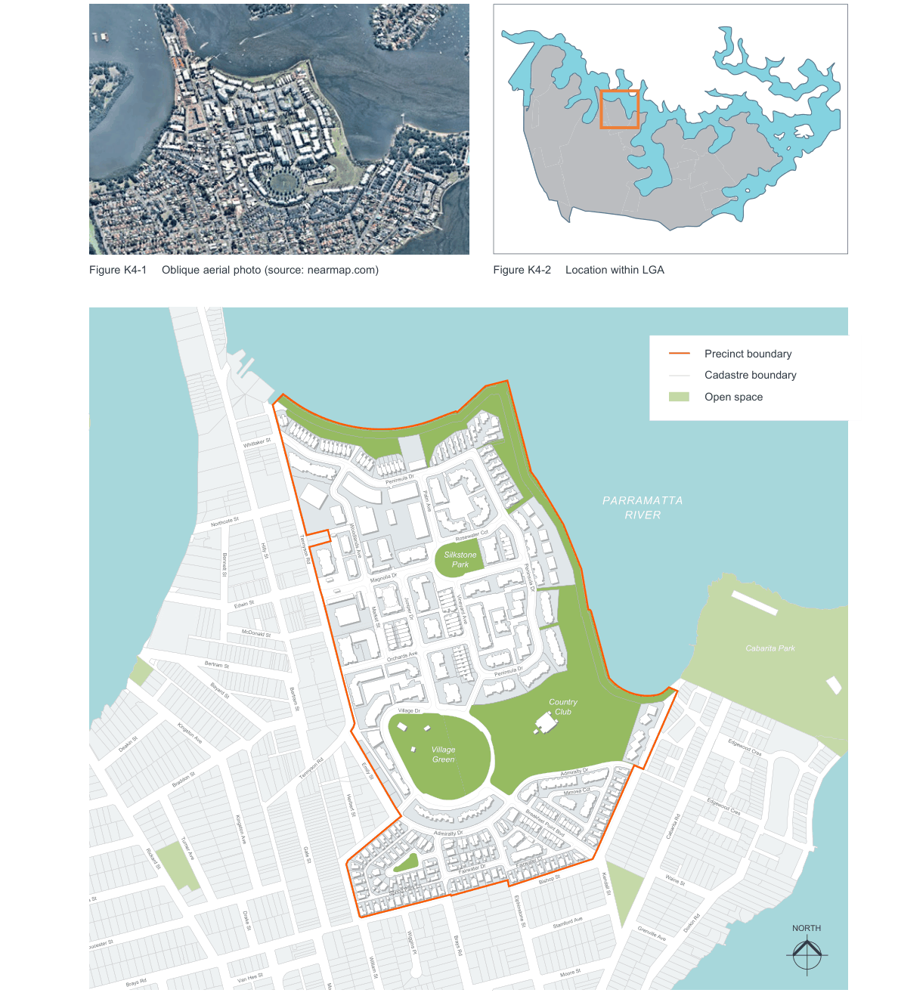

> [Picture on page 9: a picture, saved as a picture (images/part-k-special-precincts-page-9-2.gif, 150 dpi).]

Figure K4-1 Oblique aerial photo (source: nearmap.com)

Figure K4-2 Location within LGA

> Labels printed on the map (copied from the PDF, in no particular order):
> Precinct boundary · Cadastre boundary · Open space · Whittaker St · Peninsula Dr · PARRAMATTA · Palm Ave · RIVER · Northcote St · Rosewater Cct · Hilly St · Silkstone · Tennyson Rd · Park · Bennett St · Magnolia Dr · Peninsula Dr · Edwin St · Juniper Dr · Vineyard Ave · Market St · Woodlands Ave · McDonald St · Cabarita Park · Orchards Ave · Bertram St · Peninsula Dr · Bayard St · Country · Bertram St · Village Dr · Club · Kingston Ave · Deakin St · Village · Edgewood Cres · Green · Admiralty Dr · Emily St · Tennyson Rd · Braddon St · Mimosa Cct · Edgewood Cres · Herbert St · Breakfast Point Blvd · Cabarita Rd · Kingston Ave · Turner Ave · Heath St · Gale St · Fairwater Cl · Rickard St · Bishop St · Waine St · Kendall St · Fairwater Dr · Spring Park Ln · Augusta St · Elphinstone St Stamford Ave · Drake St · NORTH · Dorkin Rd · Grenville Ave · Gloucester St · Wiggins Pl Brays Rd · Moore St · William St · Van Hee St · Brays Rd · Mortlake St · Figure K4-3 Location Plan · Noble St

Norman St

Majors Bay Rd

Frederick St

Lancelot St

Anderson Rd

#### K4.1 Introduction

Breakfast Point is a 51.82 hectare master-planned residential development on a waterfront remediated industrial site 9km west of Sydney CBD, in the City of Canada Bay. Breakfast Point is predominantly a Community Scheme development. Only houses fronting ‘perimeter’ streets beyond the AGL site are not within a Community Scheme.

The AGL site, Breakfast Point, was a Schedule 2 site of Strategic Significance under State Environmental Planning Policy No 56 (SEPP 56). Under the provisions of SEPP 56 Canada Bay City Council (CBCC), in conjunction with the developer, prepared the Breakfast Point Master Plan 2002. Council adopted this plan 3 September 2002 after receipt of the Director Generals concurrence.

The objectives and controls contained within this Part are a result of a consolidation of the following plans:

• Breakfast Point Master Plan 2002

• Breakfast Point Concept Plan 2005 (amended 2013), Issue 8, 22 November 2013

• Single Dwellings on Lots at Breakfast Point DCP

#### History and characteristics

The Breakfast Point site was previously the AGL gas works. It was the primary coal gas producing site providing the energy needs of Sydney for over 100 years. With the introduction of natural gas, coal gas production ceased and the site ended its industrial life.

The subsequent remediation action plan (RAP) clean-up resulted in all the vegetation, and all the soil and significant portions of the underlying bedrock, being removed from the site. The site was subject to extensive re-shaping with the remediation program. All replacement soil and re-vegetation was subject to certified consistency with the Landscape Masterplan.

The site has extensive water-frontage to the north and east and higher land to the south and west. It is well protected from cold winter winds and benefits from cooling summer sea breezes. The land has a highly desirable residential orientation with good opportunities for incorporating passive ESD principles.

#### K4.2 Desired future character

Breakfast Point establishes a new community within an 'urban village' which embodies the principles of traditional neighbourhoods. The precinct positively relates new development to its urban context and achieves a transition to existing residential areas.

Access and open space linkages connect to the surrounds and the network of pathways for pedestrians and cyclists throughout the site encourages active transport. The precincts' waterfront location is celebrated through the creation, retention and enhancement of vistas and physical connections to the Parramatta River.

A continuous foreshore shared path along the waterfront maximises public access to the waterfront. Large areas of open space such as the Village Green, the area surrounding the Country Cub facility and Silkstone Park further add to the amenity of the precinct. The Village Centre to the west of the site offers convenience retail services, and various facilities and focal points are available for community use.

The range of dwelling types from lower scale detached houses to medium and higher rise apartment buildings offers a diverse choice of housing. Built form addresses and defines streets and open spaces, and the adaptive reuse of heritage items provides a connection to the site's past as the AGL gasworks.

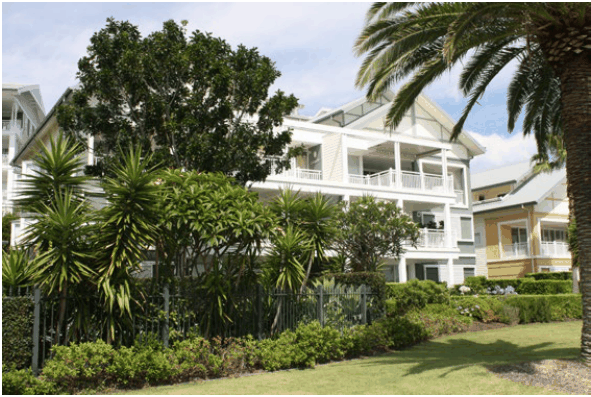

> [Picture on page 10: a picture, saved as a picture (images/part-k-special-precincts-page-10-69.gif, 150 dpi).]

Medium rise building typology in a landscaped setting

#### K4.3 General objectives

The following principles are a summarised version of the site planning principles contained in the Breakfast Point Masterplan (2002):

O1 To establish a new community within an urban village which embodies the principles of traditional neighbourhoods.

O2 To positively relate new development to its urban context and achieve a transition to existing residential areas.

O3 To provide a high level of continuity to the surrounds through access links, built form, landscape and open space linkages.

O4 To provide safe and convenient access to and through the site for all users and to establish a hierarchy of streets which respond to different types of circulation.

O5 To create a network of pathways for pedestrians and cyclists throughout the site.

O6 To ensure the creation, retention and enhancement of significant vistas to and from the site, and to and from the Parramatta River.

O7 To maximise views, access and connection to the waterfront.

O8 To ensure that the views of the site from the street and the harbour form a harmonious vista which includes vegetation in harmony with the buildings and view corridors.

O9 To achieve quality urban design with high levels of amenity at the street level and create a sense of community.

O10 To provide a variety of community focal points with different characters and functions.

O11 To provide significant areas of parkland providing easy access for the community to the waterfront.

O12 To provide a choice of residential dwellings in a variety of forms.

O13 To give definition to the public domain by ensuring buildings address the streets and give form to open spaces.

O14 To conserve heritage items with compatible uses and ensure adjacent development is of sympathetic scale and character.

O15 To provide a village centre which includes a convenience shopping centre, shops and services for the community and surrounds.

#### K4.4 Access, parking and circulation

#### Objectives

O16 To provide a co-ordinated access and circulation network designed to conveniently and safely serve the Breakfast Point community in terms of pedestrian movement, bicycles, public transport, service and emergency vehicles, private motor vehicles and car parking.

O17 To connect and integrate the network with the existing external network.

O18 To minimise and equably share any impacts on the residential amenity of the surrounding community.

O19 To provide a level of public access and permeability comparable to that existing in the adjacent residential neighbourhood.

O20 To facilitate increased public access to the foreshore.

O21 To minimise hardstand area and potential surface run-off and maximise potential stormwater absorption and area available for soft landscape treatment.

Figure K4-4 Access & Circulation Principles shows the primary access and circulation network established at Breakfast Point.

#### Site Access Controls

C1. Public vehicle access points to Breakfast Point are to be from:

Tennyson Road:

• at the main gates of the AGL works;

• approx. 150 metres north of the Emily Street intersection;

• opposite Whittaker Street; and

• at the existing gateway in vicinity of Northcote Street.

Kendall Street:

• at the intersection of Bishop and Medora Streets

Emily Street:

• via Adams Street from Brays Road Medora Street:

• opposite Medora Lane

#### Internal Road Hierarchy

| Controls |  |
|---|---|
| C2. | The road hierarchy is planned around development blocks or precincts described by a network of 'open access way’ roads connecting to the external public road system. Each development site will have access to the public road system via open access ways. |
| C3. | All roads are community owned and maintained. |

#### Public Access

| Controls |  |
|---|---|
| C4. | All Breakfast Point internal streets are ‘open access’ ways under the Community Land and Management Act. ‘Open access’ ways are effectively ‘public space’ under the Local Government Act 1993. |
| C5. | Open access ways can be considered as 'public roads' with the exception that the Community Association, not the Council, is responsible for maintenance. |
| C6. | Private Access Ways are provided where the function is for purely resident or service access to a distinct development or building. Private access roads may have restricted public access. |

#### Traffic Calming

| Controls |  |
|---|---|
| C7. | Contained carriageway widths, surfaces, street geometry and landscaping are to be the primary traffic calming devices in the design of access streets. |
| C8. | Speed humps, chicanes and similar devices are not to be used. |
| C9. | Roundabouts, where required, are to be designed to accommodate buses and large rigid trucks, and should incorporate landscape beautification. |

#### Road Standards

| Controls |  |
|---|---|
| C10. | AMCORD, Australian Standards and Council requirements are the guiding principles in the detail design of roads. The achievement of urban design objectives, on-street parking, heritage preservation and other considerations may determine standards varying from AMCORD guidelines. |

#### Public Transport

| Controls |  |
|---|---|
| C11. | A bus route is to pass within 400m (approx 5 minutes walk) of any dwelling. The collector link and foreshore connector roads are designed to accommodate bus services. |
| C12. | A ferry terminal is to be integrated into the existing pier and accommodate convenient access to people with disabilities. |
| C13. | A bus stop is to be provided on the foreshore connector road approximately 75m from the pier. |
| C14. | Commuter parking is to be provided with convenient access to the pier precinct. Parking provision is to be sufficient to cater for other water and land based activities in the pier precinct. |

#### Pedestrian Movement Foreshore Access

| Controls |  |
|---|---|
| C15. | A combined public pedestrian/ cycleway is to be provided linking the northern end of Tennyson Road and Cabarita Park on a foreshore strip of land in public ownership. |
| C16. | Open access connections to the foreshore public open space are generally no greater than 200m apart. |
| C17. | The design of foreshore access system is to consider maintenance and emergency vehicle use. |
| C18. | Open access way streets are to include pedestrian footpaths to provide for public pedestrian movement within the site and connections to the external network, and to the foreshore. |
| C19. | Provision for through-block links are to be made where necessary for reasonable convenience. |

#### Cycleways

| Controls |  |
|---|---|
| C20. | Combined pedestrian/ cycleway paths are to be provided to open space areas in accordance with Council's policy. |
| C21. | Combined pedestrian-cycle paths are to be provided to the collector link and foreshore connector link. |
| C22. | Residential access streets are to be cycle shareways. |

#### Emergency and Service Vehicle Access

| Controls |  |
|---|---|
| C23. | The road network is to be designed to facilitate emergency and service vehicle access. |
| C24. | Large sized trucks must be able to safely negotiate to within 20m of every building. |
| C25. | Roads and turning areas are to be designed to discourage reversing movements. |
| C26. | Wherever possible loop access roads are to be used. Cul-de-sacs are to incorporate the minimum turning circle of large rigid trucks. |

#### Sustainable Development

| Controls |  |
|---|---|
| C27. | All roads and movement systems are to be designed to minimise hardstand area and surface run-off, and to maximise the area available for soft landscape treatment and its potential stormwater absorption. |

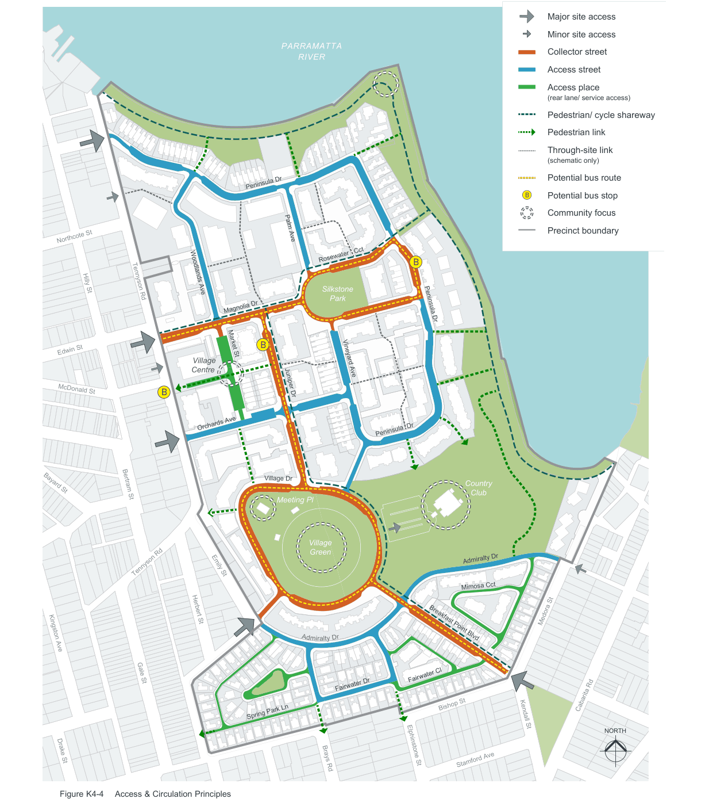

> [Picture on page 14: a map, saved as a picture (images/part-k-special-precincts-page-14-1.gif, 150 dpi); the street names and other small labels are on the picture.]
> Labels printed on the map (copied from the PDF, in no particular order):
> PARRAMATTA · RIVER · Palm Ave · Peninsula Dr · Northcote St · Rosewater   Cct · B · Hilly St · Silkstone · Woodlands Ave · Tennyson Rd · Park · Magnolia Dr · Peninsula Dr · B · Edwin St · Market St · Village · Centre · Vineyard Ave · McDonald St · B · Juniper Dr · Orchards Ave · Peninsula  Dr · Village Dr · Country · Bayard St · Club · Bertram St · Meeting Pl · Village · Green · Admiralty Dr · Emily St · Tennyson Rd · Mimosa Cct · Herbert St · Breakfast Point Blvd · Kingston Ave · Gale St · Fairwater Cl · Bishop St · Fairwater Dr · Spring Park Ln · Drake St · Elphinstone St Stamford Ave · Brays Rd · Figure K4-4 Access & Circulation Principles · Major site access · Minor site access · Collector street · Access street · Access place · (rear lane/ service access) · Pedestrian/ cycle shareway · Pedestrian link · Through-site link · (schematic only) · Potential bus route · B Potential bus stop · Community focus · Precinct boundary · Medora St · Cabarita Rd · Kendall St · NORTH

#### K4.5 Land use principles

Uses in Breakfast Point are residential and a range of potential adaptive uses for heritage items possible under the Remediation Certification. Permitted land use at Breakfast Point is in accordance with LEP 2013, which zones the land R2 Low Density Residential, R3 Medium Density Residential, B1 Neighbourhood Centre,

RE1 Public Recreation and RE2 Private Recreation.

All of the land within the Breakfast Point precinct is zoned either R2 Low Density Residential or R3 Medium Density Residential with the exception of the area occupied by the Meter Readers’ Office which lies within the B1 zone. Figure K4-5 and details below describe the land use principles:

#### Residential

Breakfast Point is planned as primarily a residential neighbourhood. The LEP permits and other compatible uses to the extent that they contribute residential amenity, convenient services and employment.

#### Residential (Transitional)

The initial development planned at Breakfast Point was single family dwelling sub-division to the south and south west of the site to provide an early environmental buffer between long-term development and neighbouring residential areas.

#### Open Space (Public)

A 15m wide open space extending the full length of the water frontage of the site is to be dedicated for public foreshore access. This area is immediately behind the sea wall which is owned and maintained under the Community Scheme.

#### Open Space (Community)

Open Space planned and provided under the Community Scheme includes the Village Green, Silkstone Park and all landscaped areas within the Community Scheme.

Community buildings, eg the Meeting Hall, the Recreation Club and active recreation facilities are planned and built within this open space. This area also includes some restricted private open space ‘rights’ under easements.

#### Recreation & Social Uses

The Meeting Hall, Recreation Club and related recreation facilities are located on Open Space within Lot 1 of the Community Scheme.

#### Village Centre

Adjacent to the remnant Mortlake Village precinct, a neighbourhood community convenience shopping and service centre has been built, comprising a convenience store, café, several small shops, a child care centre and market square, together with Community Scheme management and security offices. Work/ live terraces and shop-top apartments have been also built in this village precinct to enhance 24 hour activity and security.

#### Heritage/ Adaptive Re-use

The uses for LEP 2013 scheduled heritage items are to be appropriate to the heritage conservation guidelines for the individual items, and comply with the relevant remediation certifi cation. The economically sustainable preservation of the item will be a primary issue in the consideration of applications.

#### Commercial/ Heritage Curtilage

The curtilage of heritage items certified for ‘non-residential’ uses. Uses compatible with heritage constraints and/ or remediation certification.

Development Control Plan

Part K

Special Precincts

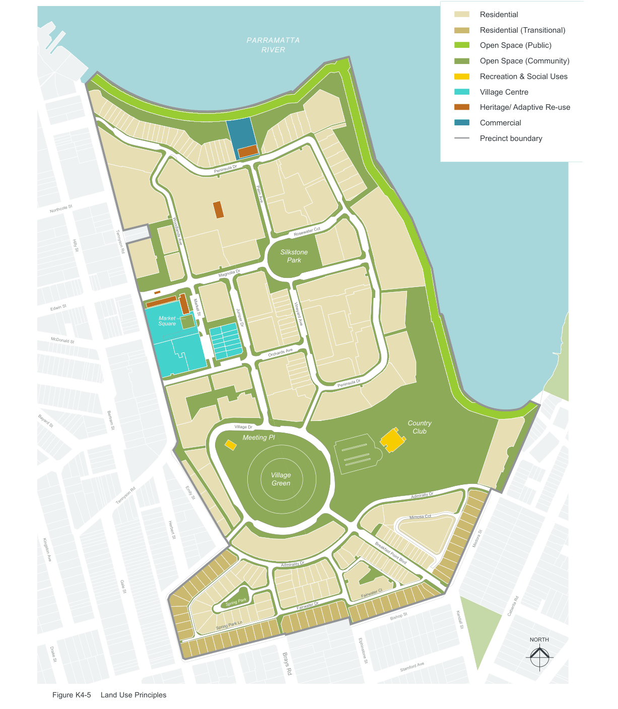

> [Picture on page 16: a map, saved as a picture (images/part-k-special-precincts-page-16-4.gif, 150 dpi); the street names and other small labels are on the picture.]
> Labels printed on the map (copied from the PDF, in no particular order):
> Northcote St · Hilly St · Edwin St · McDonald St · Bayard St · Kingston Ave · Drake St · Figure K4-5 · Tennyson Rd · Market St · Woodlands Ave · Market · Square · Bertram St · Emily St · Tennyson Rd · Herbert St · Gale St · Land Use Principles · PARRAMATTA · RIVER · Peninsula Dr · Palm Ave · Rosewater Cct · Silkstone · Park · Magnolia Dr · Vineyard Ave · Juniper Dr · Orchards Ave · Village Dr · Meeting Pl · Village · Green · r · ity D · l · mira · Ad · Spring Park · Fairwater Dr · Spring Park Ln · Brays Rd · Peninsula Dr · Country · Club · Admiralty Dr · Mimosa Cct · Breakfast Point Blvd · Fairwater Cl · Bishop St · Elphinstone St · Stamford Ave · Residential · Residential (Transitional) · Open Space (Public) · Open Space (Community) · Recreation & Social Uses · Village Centre · Heritage/ Adaptive Re-use · Commercial · Precinct boundary · Medora St · Cabarita Rd · Kendall St · NORTH

#### K4.6 Landscape & open space

At least 12 hectares of open space has been provided at Breakfast Point. This includes the Village Green and oval, the Foreshore Park, Silkstone Park, the pocket park at Spring Park Circuit and the sidewalks. This open space, being part of Lot 1 in the Community Scheme, is community owned.

#### Objectives

O22 To ensure that landscape and open space will be a major defining characteristic of Breakfast Point.

O23 To increase filtration and reduce stormwater run-off.

#### Public Access to Open Space

| Controls |  |
|---|---|
| C28. | The public access network is to be legible, direct, safe, attractive and convenient. |
| C29. | Access to open space is to be well defined and provides a safe and active high quality public domain. Accessible open space for the recreation needs of residents is to be provided. |
| C30. | Foreshore access is to be clearly identifiable for public use. |
| C31. | Located no further than 3 minutes walk from any part, the continuous Village Green/Foreshore public open space complex, together with the Central Park will provide for the active and passive open space needs of all Breakfast Point residents, and to the wider community. |
| C32. | Playgrounds and similar specific small facilities, together with a community recreation club and multi-purpose community meeting hall are to be integrated into this landscaped complex. |
| C33. | A 15m wide foreshore strip extending the full length of the harbour frontage behind the seawall is dedicated public land. |

C34. Public Open Space (open access under the Community Land Management Act) provision is to include:

Village Green

• A formal fenced playing field, constructed over an area which includes the entombed stratum, extending to include a multi-purpose community meeting hall. Foreshore Area

• Incorporating a continuous 15 metre wide minimum width along the whole of the foreshore in Council's ownership, and additional community open space averaging a total of 30 metres width. Waterfront Park

• An informal east sloping area linking the Village Green to the Foreshore area, incorporating a community recreation club and associated facilities, constructed over a designated restricted area. Silkstone Park

• A formal, elevated, passive recreation park, providing a sense of arrival from the Tennyson Road approach and providing vistas to the harbour and beyond. Spring Park

• A pocket park has been provided in Spring Park Close.

Market Square

• A open space is to be incorporated in the design of the Village Centre precinct. Its function is to provide for community activities, markets, performances, and any promotional activities which enhance the community spirit and vitality of the centre.

#### Community & Private Open Space Controls

C35. Community and private open spaces are to be provided and integrated into the design of each development precinct or project to adequately meet the needs of its residents.

#### Controls

C36. Issues to be considered in design include:

• Streetscape enhancement

• Privacy landscaping and screening

• Climate and sun control

• Swimming pools etc

• BBQ areas

• Private outdoor living and dining

• Service areas

• Shade

• View & outlook enhancement

• Boundary delineation

• Solar Access

• Environmentally Sustainable Design Standards

C37. The quantity and quality of communal and private open space and landscape treatment will be on a merits based assessment of each Development Application.

| C38. | Indicative private are as follows: Upper level dwellings: balcony, terrace 1-2 bedroom 3+ bedroom Ground level dwellings: patio, terrace 1-2 bedroom 3+ bedroom | open space provisions min area 8m2 min dimension of 2m min area 12m2 min dimension of 2m min area 16m2 min dimension 4m min area 35m2 min dimension of 4m |
|---|---|---|

#### Community Facilities Controls

| C39. | Community facilities included in the urban village, while owned and managed under the Community Plan, are publicly accessible. |
|---|---|

C40. The Village Green is maintained as a full sized sports oval, with associated amenities and picnic facilities.

C41. The Village Centre is to maintain its local convenience retail and community function, i.e. by ensuring that adequate space is provided for the following:

• a local convenience supermarket

• flexible shop space for approximately 10 specialty shops grouped around the open market square

• flexible live/ work terrace dwellings

C42. The following other community facilities are to be provided/ maintained:

• a child care centre

• a multi-purpose meeting hall to the north-west of the Village Green with strong connections to the Village Centre precinct

• recreational facilities including a gymnasium, aerobics room, swimming pools, tennis courts, putting green, dining, library and function rooms.

#### Planting Principles

| Controls |  |
|---|---|
| C43. | An informal locally native planting palette should be adopted for informal, passive open space areas, foreshore reserve and to the major recreation centre open space. |
| C44. | A formal planting palette should be adopted for streets, squares and areas of strong urban character. Deciduous species should be used extensively for solar access and shade control and to provide seasonal variety and colour. |
| C45. | Paving, fences, garden walls and all other built or service elements in the landscape are to be designed for minimum impact, to blend with soft landscape and be visually inconspicuous. |
| C46. | Vertical walls and horizontal paving are to be separated by a planting strip of ground cover or shrubs. |

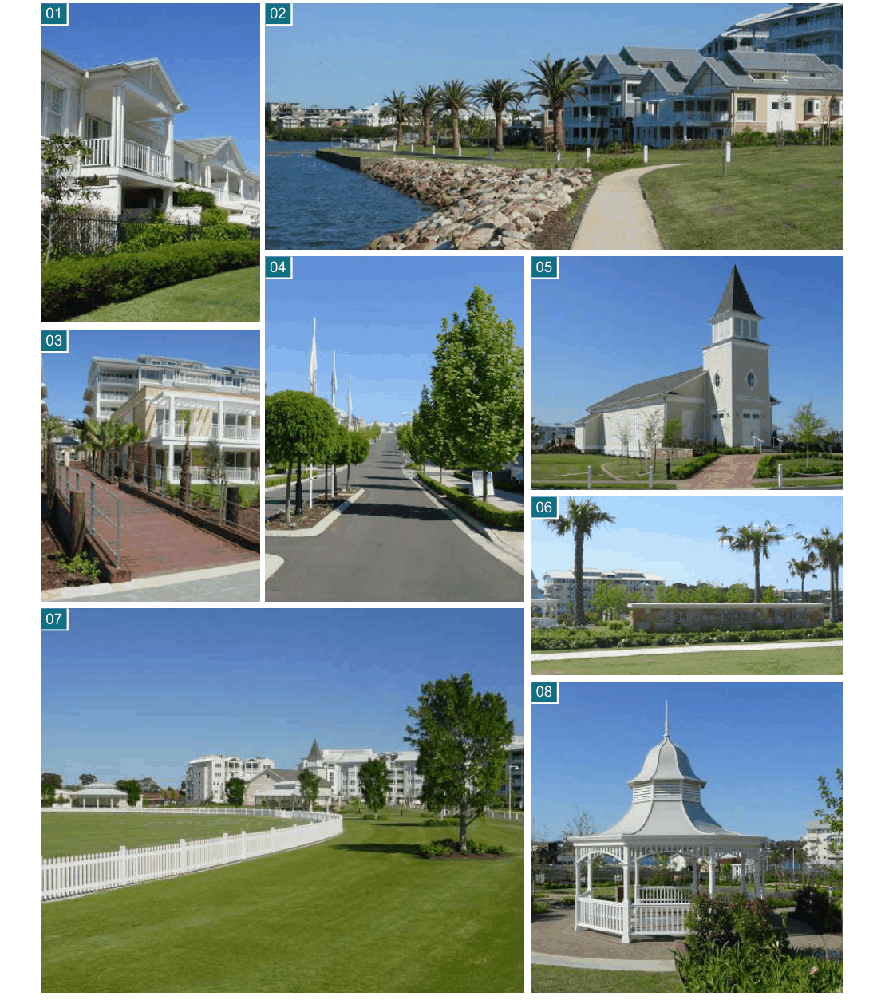

> [Picture on page 19: a picture, saved as a picture (images/part-k-special-precincts-page-19-1.gif, 150 dpi).]
> Words printed on the picture (copied from the PDF):
> 01
> 02
> 04
> 05
> 03
> 06
> 07
> 08

01.Mimosa Apartments, 02.Kendall Bay Waterfront, 03.Hunters Wharf Walkway, 04.Breakfast Point Boulevard, 05.Community Hall, 06.Silkstone Park, 07.The Village Green, 08.Pavillion at Silkstone Park

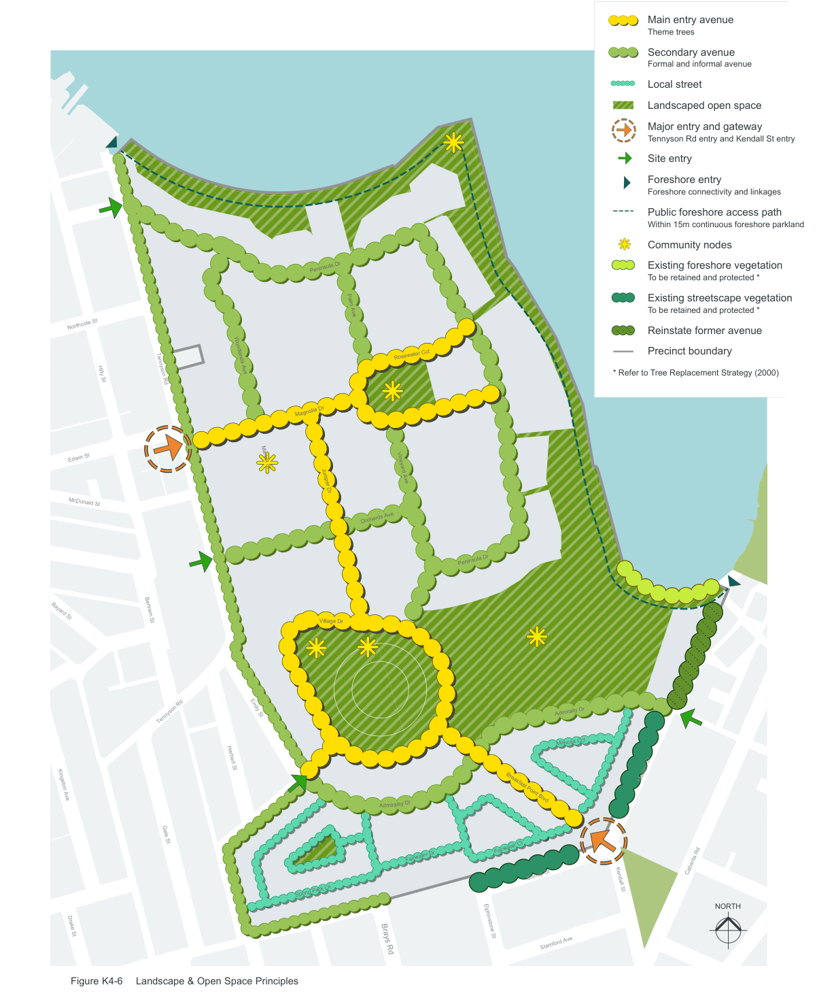

> [Picture on page 20: a map, saved as a picture (images/part-k-special-precincts-page-20-1.gif, 150 dpi); the street names and other small labels are on the picture.]
> Labels printed on the map (copied from the PDF, in no particular order):
> Peninsula Dr · Palm Ave · Northcote St · Rosewater Cct · Hilly St Tennyson Rd · Magnolia Dr · Edwin St · Market St · Woodlands Ave · Vineyard Ave · Juniper Dr · McDonald St · Orchards Ave · Bayard St · Bertram St · Village Dr · Emily St · Tennyson Rd · Herbert St · Kingston Ave · r · ity D · l · mira · Ad · Gale St · Fairwater Dr · Spring Park Ln · Drake St · Brays Rd · Figure K4-6 Landscape & Open Space Principles · Peninsula Dr · Admiralty Dr · Mimosa Cct · Breakfast Point Blvd · Fairwater Cl · Bishop St · Elphinstone St · Stamford Ave · Main entry avenue · Theme trees · Secondary avenue · Formal and informal avenue · Local street · Landscaped open space · Major entry and gateway · Tennyson Rd entry and Kendall St entry · Site entry · Foreshore entry · Foreshore connectivity and linkages · Public foreshore access path · Within 15m continuous foreshore parkland · Community nodes · Existing foreshore vegetation · To be retained and protected * · Existing streetscape vegetation · To be retained and protected * · Reinstate former avenue · Precinct boundary · * Refer to Tree Replacement Strategy (2000) · Medora St · Cabarita Rd · Kendall St · NORTH

#### K4.7 Ownership & subdivision pattern

#### Land Ownership

The ownership structure is in principle:

• Public (Council) Ownership - A 15m wide portion of Foreshore Public Open Space extending over the whole of the length of the water frontage , behind the sea wall.  The maintenance and upkeep is the responsibility of the community association under Community Scheme DP 270347.

• Freehold Torrens Title - All single family dwelling lots having frontage to existing public streets (Medora, Bishop, Adams Street and Brays Road) are individually owned Torrens Title fee simple lots.

• Lower Stratum (Entombed Cell) - The AGL retains ownership and responsibility for the containment cell stratum located a minimum of 1m below the finished surface in the vicinity of the Village Green.

• Community Schemes - The remainder of the site will be within Community Schemes.

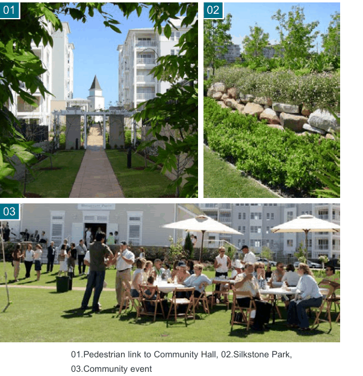

> [Picture on page 21: a picture, saved as a picture (images/part-k-special-precincts-page-21-20.gif, 150 dpi).]
> Words printed on the picture (copied from the PDF):
> 01
> 02
> 03

01.Pedestrian link to Community Hall, 02.Silkstone Park, 03.Community event

#### Master Community Scheme

Comprises land indicated in Figure K4-7 including all ‘open access’ ways (streets and public pedestrian paths) on the land. This community scheme will be responsible for the management and maintenance of all roads, facilities, landscape and service infrastructure on the site, including Council's waterfront land.

#### Other Community Schemes

A separate community scheme includes internal Torrens Title single dwellings and duplex dwellings.  A separate community scheme also exists for the strata titled apartments.

#### Public Access and Permeability

Under the Community Scheme all streets, and the vast majority of community open space areas are ‘open access ways’. Easements provide for public access rights, obligations and law enforcement as if in public ownership. Some community open space areas are subject to restrictive easements for services or private

use. Refer to registered community plan DP 270347.

The objective is to free the Council of liability for the ongoing service and maintenance costs on the site whilst ensuring access and permeability to all normally 'public' facilities.

#### Subdivision Pattern

The subdivision pattern is designed and staged to reflect the rehabilitation and sequential ownership transfer program for the site. Each stage is to be certified prior to transfer of ownership and its availability for development. Seven 'super lots' have been created to facilitate this. The subdivision yields:

• A land-subdivision creating individual single family lots fronting existing streets (Brays Road, Bishop, Adams and Medora Streets)

• Community subdivisions for land north of the perimeter, single family lots and another community subdivision for the remainder of the land

• A separate lot will be created over the 15m wide waterfront, vested in Council

• A stratum subdivision encompassing the containment cell underground to remain with AGL

Development Control Plan

Part K

Special Precincts

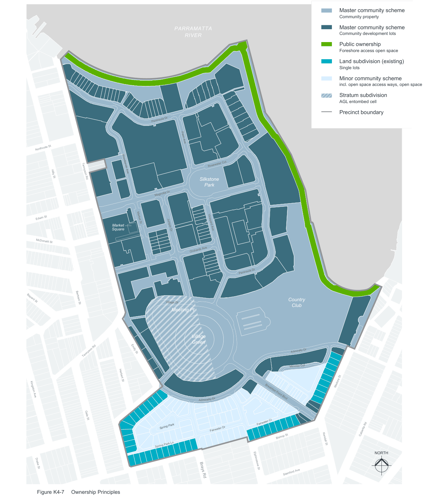

> [Picture on page 22: a map, saved as a picture (images/part-k-special-precincts-page-22-4.gif, 150 dpi); the street names and other small labels are on the picture.]
> Labels printed on the map (copied from the PDF, in no particular order):
> Northcote St · Hilly St · Edwin St · McDonald St · Bayard St · Kingston Ave · Drake St · Figure K4-7 · Tennyson Rd · Market St · Woodlands Ave · Market · Square · Bertram St · Emily St · Tennyson Rd · Herbert St · Gale St · Ownership Principles · PARRAMATTA · RIVER · Peninsula Dr · Palm Ave · Rosewater Cct · Silkstone · Park · Magnolia Dr · Vineyard Ave · Juniper Dr · Orchards Ave · Village Dr · Meeting Pl · Village · Green · r · ity D · l · mira · Ad · Spring Park · Fairwater Dr · Spring Park Ln · Brays Rd · Peninsula Dr · Country · Club · Admiralty Dr · Mimosa Cct · Breakfast Point Blvd · Fairwater Cl · Bishop St · Elphinstone St · Stamford Ave · Master community scheme · Community property · Master community scheme · Community development lots · Public ownership · Foreshore access open space · Land subdivision (existing) · Single lots · Minor community scheme · incl. open space access ways, open space · Stratum subdivision · AGL entombed cell · Precinct boundary · Medora St · Cabarita Rd · Kendall St · NORTH

#### Precincts

The majority of Community development lots (Master community scheme) have been arranged into Precincts as indicated by Figure K4-8 Precincts

#### K4.8 Floor space ratio

#### Objectives

O24 To ensure that buildings are compatible with the bulk and scale of the desired future character of the locality,

O25 To provide a suitable balance between landscaping and built form

O26 To minimise the effects of bulk and scale of buildings.

| Controls |  |
|---|---|
| C47. | The maximum floor space ratio for the land identified in Figure K4-3 must not exceed 0.67:1. |
| C48. | Development applications are to be accompanied by a cumulative compliance schedule demonstrating that the total floor space ratio of all development within the Breakfast Point precinct does not exceed 0.67:1. |

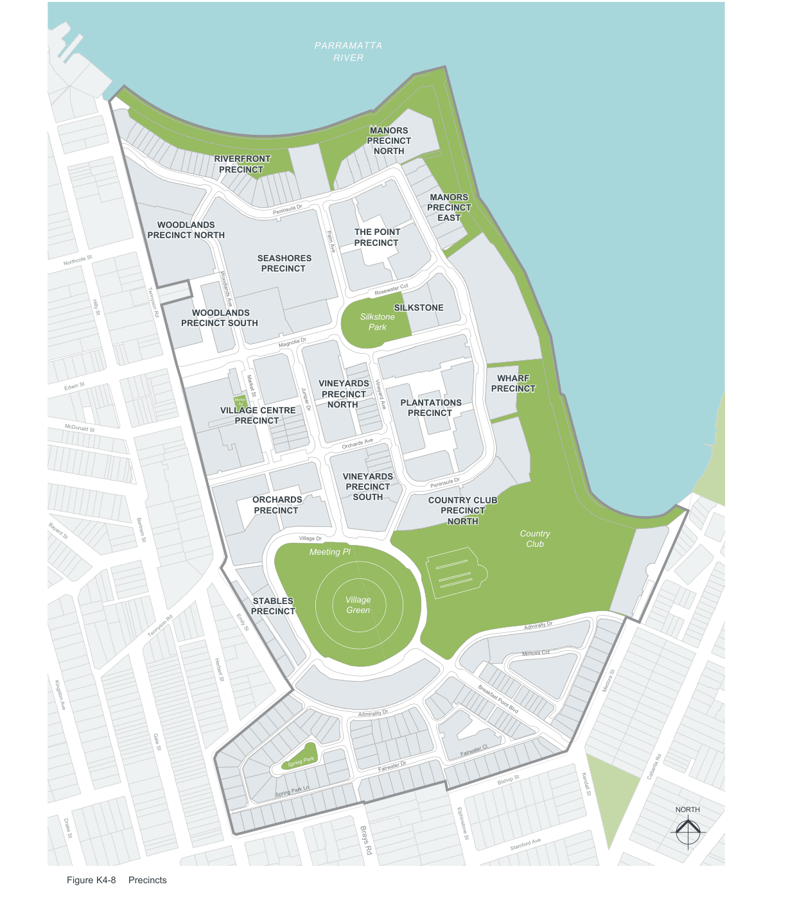

> [Picture on page 24: a map, saved as a picture (images/part-k-special-precincts-page-24-1.gif, 150 dpi); the street names and other small labels are on the picture.]
> Labels printed on the map (copied from the PDF, in no particular order):
> PARRAMATTA · RIVER · MANORS · PRECINCT · NORTH · RIVERFRONT · PRECINCT · MANORS · PRECINCT · Peninsula Dr · EAST · WOODLANDS · PRECINCT NORTH · THE POINT · PRECINCT · Palm Ave · SEASHORES · Northcote St · PRECINCT · Rosewater Cct · SILKSTONE · Hilly St Tennyson Rd · Silkstone · WOODLANDS · PRECINCT SOUTH · Park · Magnolia Dr · VINEYARDS · Edwin St · WHARF · PRECINCT · Market St · Woodlands Ave · PRECINCT · Market · Sq · PLANTATIONS · Vineyard Ave · NORTH · Juniper Dr · VILLAGE CENTRE · PRECINCT · PRECINCT · McDonald St · Orchards Ave · VINEYARDS · Peninsula Dr · PRECINCT · ORCHARDS SOUTH COUNTRY CLUB · PRECINCT · PRECINCT · NORTH · Country · Bayard St · Village Dr · Bertram St · Club · Meeting Pl · Village · Green · STABLES · PRECINCT · Admiralty Dr · Emily St · Tennyson Rd · Mimosa Cct · Herbert St · Medora St · Kingston Ave · r · Breakfast Point Blvd · ity D · l · mira · Ad · Gale St · Fairwater Cl · Spring Park · Cabarita Rd · Bishop St · Kendall St · Fairwater Dr · Spring Park Ln · NORTH · Drake St · Elphinstone St · Stamford Ave · Brays Rd · Figure K4-8 Precincts

#### K4.9 Building envelopes & built form

#### Objectives

The building envelope and built form objectives are to provide reference points for Council's merits-based assessment of Development Applications at Breakfast Point. They are:

O27 To acknowledge and enhance the prominent visual relationship Breakfast Point has to Parramatta River and its environs.

O28 To provide a complementary interface with the surrounding urban fabric, and transition between existing and new, higher density, living areas.

O29 To provide a vision for the future built character of Breakfast Point.

O30 To establish principles of building arrangements and envelopes and their relationships to site features, adjacent development, and the public domain.

O31 To provide a high standard of amenity and quality of living environment for residents.

#### Parramatta River Visual Catchment

The visual character of Breakfast Point viewed from the River, its foreshores and viewpoints beyond is to comprise:

#### Foreshore Open Space Edge

| Controls |  |
|---|---|
| C49. | A foreground dominated by informal vegetation and tree planting above the sea wall. |
| C50. | Building foreshore setbacks generally are to be varied and no less than 30m. |
| C51. | To provide visual connection to inner areas, individual building facades fronting the foreshore should be articulated and no more than 60m long. |
| C52. | Compatible public or community structures and facilities may occur in the foreshore open space. |

#### Pier Precinct (Active Waterfront Area)

| Controls |  |
|---|---|
| C53. | A formally landscaped area, focusing on the pier and associated water-based uses. Buildings in this precinct may include commercial uses at low level, and to provide interest, variety and counter- balance the scale of the pier. |

#### Skyline

| Controls |  |
|---|---|
| C54. | The skyline is to comprise of articulated low-to-mid rise roof forms interspersed with vegetation. |
| C55. | Roof forms are to be simply designed, modulated to a scale, and in materials and colours recognising the significant views to the site. |
| C56. | Roof plant and fixtures are to be fully integrated into the roof design. |
| C57. | Taller buildings are to be located towards the centre of the site, on higher land, with building height reducing towards the waterfront and adjacent development boundaries, two to five storey buildings predominate. |

#### Interface with Existing Residential Areas

| Controls |  |
|---|---|
| C58. | Development fronting the adjacent residential streets (Medora, Bishop, Adams Street and Brays Road) is to comprise dwellings or attached dwellings. |

#### Streetscape & Public Domain Character

The vision for Breakfast Point is:

• A built environment which optimises available light and sun to private and public domains within an orchestrated landscaped setting.

• A vigorous and interesting public domain reinforced by landscape and its defining, proportioned, and articulated architectural edges.

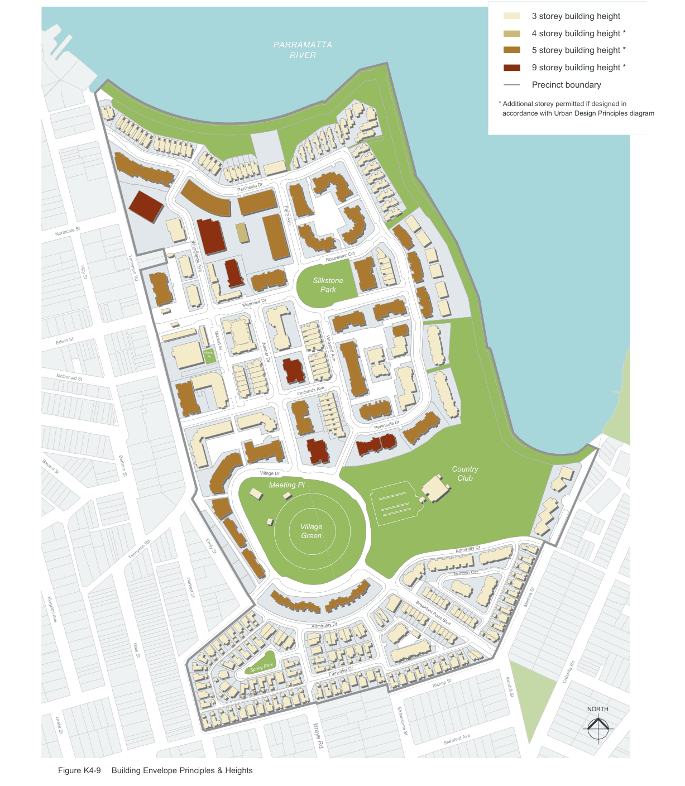

> [Picture on page 26: a map, saved as a picture (images/part-k-special-precincts-page-26-1.gif, 150 dpi); the street names and other small labels are on the picture.]
> Labels printed on the map (copied from the PDF, in no particular order):
> PARRAMATTA · RIVER · Peninsula Dr · Palm Ave · Northcote St · Rosewater Cct · Hilly St Tennyson Rd · Silkstone · Park · Magnolia Dr · Edwin St · Market St · Woodlands Ave · Market · Sq · Vineyard Ave · Juniper Dr · McDonald St · Orchards Ave · Bayard St · Village Dr · Bertram St · Meeting Pl · Village · Green · Emily St · Tennyson Rd · Herbert St · Kingston Ave · r · ity D · l · mira · Ad · Gale St · Spring Park · Fairwater Dr · Spring Park Ln · Drake St · Brays Rd · Figure K4-9 Building Envelope Principles & Heights · Peninsula Dr · Country · Club · Admiralty Dr · Mimosa Cct · Breakfast Point Blvd · Fairwater Cl · Bishop St · Elphinstone St · Stamford Ave · 3 storey building height · 4 storey building height * · 5 storey building height * · 9 storey building height * · Precinct boundary · * Additional storey permitted if designed in · accordance with Urban Design Principles diagram · Medora St · Cabarita Rd · Kendall St · NORTH

#### Building Height

| Controls |  |
|---|---|
| C59. | Building heights are to be designed to minimise the amenity impact of new development on adjoining areas and to ensure that buildings are appropriately scaled in relation to street widths and open spaces. |
| C60. | The maximum permissible height for any building at Breakfast Point is 9 storeys. |
| C61. | Refer to Figure K4-9 Building Envelope Principles & Heights which shows building heights in storeys. |

Figure K4-13 on page K-35 demonstrates how the roof level of a building with a flat roof is lower than the ridge level of a similar building with a pitched roof. This results in improved view access.

#### Solar Access, Light & Privacy

Residential development at Breakfast Point is to be in accordance with State Environmental Policy No65

– Design Quality Residential Flats standards. Where SEPP 65 does not strictly apply, (e.g. single, attached and two storey apartments) the relevant amenity principles are adopted as the guideline for minimal acceptable residential amenity standards.

| Controls |  |
|---|---|
| C62. | The location, planning and orientation of buildings and open space is to maximise opportunities for solar access, natural light and privacy to dwellings. |
| C63. | Buildings are to be sited and designed to maximise available sunlight to north-facing windows of living areas and principal areas of open space, having regard to slope, views and overshadowing. |
| C64. | Solar access to each dwelling is to be maximised. Sunshine is to be available to a main living area and private open space of each dwelling for a minimum of three hours duration between the hours of 9am and 5pm at 21 June (mid winter). |

C65. Privacy design performance criteria should be in accord with the NSW Model Code: A Model for Performance-Based Multi-Unit Housing Codes: NSW Dept Urban Affairs and Planning 1997

#### Mass & Proportion Objectives

O32 To provide for streetscape relief, pedestrian, landscape, breeze and view corridors.

O33 To maintain an appropriate residential scale to the Breakfast Point streetscape.

#### Controls

| C66. | Building facade lengths should not exceed 60 metres without a pronounced break or relieving treatment. |
|---|---|

#### Roof Form & Colour Objectives

O34 To minimise the visual prominence of roofs being overlooked by residents of higher dwellings.

O35 To provide an articulated skyline to Breakfast Point from distant viewpoints.

O36 To provide visual relief to the streetscape.

O37 To encourage subtle contrast and variety within a consistent design theme.

O38 To encourage the use of dormer style windows.

| Controls |  |
|---|---|
| C67. | Hipped and gable type roofs with wide eaves are to be the predominant roof form. |
| C68. | All roof top services, vents, lights, are to be integrated into the roof design. |
| C69. | Roof materials may vary. Roof colours are to be inconspicuous grey tones. |
| C70. | Flat roofs with carefully selected finishes and considered detailing may be used to facilitate view sharing. |

#### Facade Treatment Objective

O39 To enrich the streetscape in detail.

#### Controls

C71. Facades, particularly those defining streets are to provide modulation of light and shade through finessed secondary architectural detail, contrasting with heavier wall and roof elements.

C72. Contributing elements could include eaves, sun control, hoods, louvres, shutters, pergolas, verandahs, balconies, balustrades, porticoes, loggias, dormers, roof lanterns and ventilators.

#### Setbacks & Addressing the Street Objective

O40 To reinforce the streetscape character.

| Controls |  |
|---|---|
| C73. | Subject to adequately meeting amenity performance requirements, all buildings are to define (be parallel to) the streets and have their primary pedestrian access and address from their primary street frontage. |
| C74. | Setbacks from the street are to reflect the precedent/s established for the street. |

#### Colour & Light Objective

O41 To enhance the amount of light and reflected light available to public and private domains in a comparatively dense built environment.

| Controls |  |
|---|---|
| C75. | The predominant primary walls are to be light soft colours. |
| C76. | The predominant colour for secondary architectural detail is to be white. |

#### Ancillary Built Elements Controls

| C77. | All built elements (fences, garden and retaining walls etc.) not part of a building are to be designed to blend into the landscape to minimise their visual intrusiveness. |
|---|---|

#### Building Types

The following residential building types are anticipated at Breakfast Point responding to different locations, market sectors and lifestyles.

• Single houses - located opposite existing single dwellings and also within Community Scheme No.1, opportunity for rear access

• Semi-detached houses - rear and street car access

• Terraces - 2-3 storey, rear and semi-basement carparking

• Apartment building 2-3 storeys - semi basement carparking

• Apartment building 5 storeys - lift access, semi-basement and basement carparking

• Apartment building 9 storeys - expression of top, middle and base, basement carparking

• Waterfront houses - large single dwellings, terraces and duplexes with courtyard gardens, attached double garages

Retail, commercial and community buildings are anticipated as 1 and 2 storey, with residential development over (upper levels) where appropriate.

#### Adaptable Housing

| Controls |  |
|---|---|
| C78. | A minimum of 5% of the total dwellings are to be designed as readily adaptable to the requirements of the Essential Features of AS4299-1995 'Adaptable Housing'. |
| C79. | Adaptable housing is to be located within 300m of the Village Centre. |

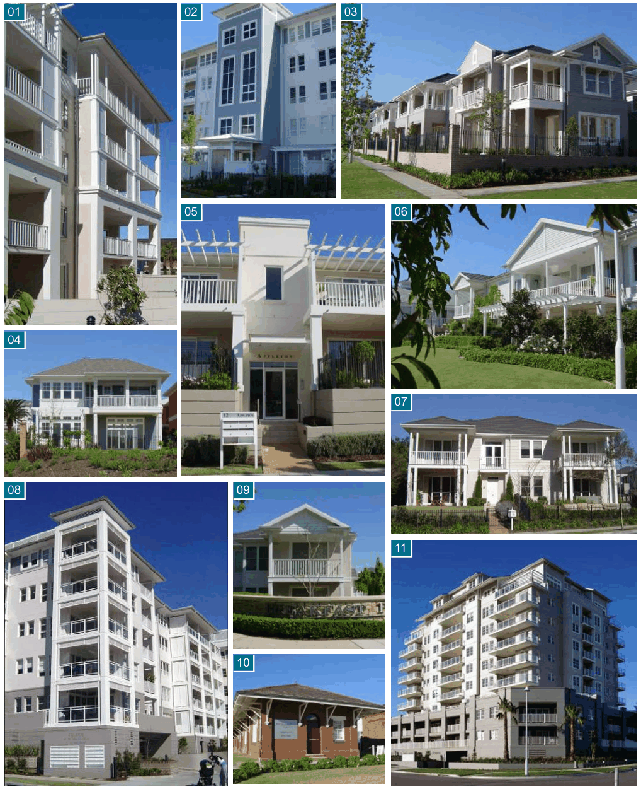

> [Picture on page 29: a picture, saved as a picture (images/part-k-special-precincts-page-29-1.gif, 150 dpi).]
> Words printed on the picture (copied from the PDF):
> 01
> 02
> 03
> 05
> 06
> 04
> 07
> 08
> 09
> 11
> 10

01.Five storey apartment building, 02.Vertical articulation of facade, 03.Two storey corner built form, 04.Detached two storey family dwelling, 05.Articuated building entry, 06.Buildings addressing open space, 07.Semi detached housing typology, 08.Corner treatment, 09.Detached dwelling, 10.Heritage-listed Meter Reader's Office, 11.High density apartments

Development Control Plan

Part K

Special Precincts

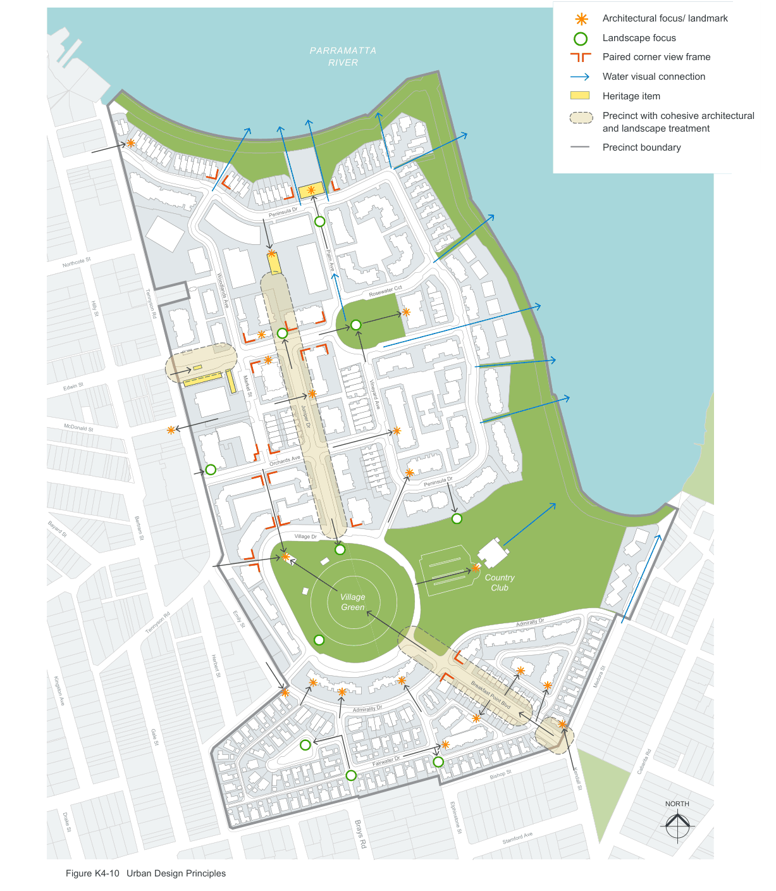

> [Picture on page 30: a map, saved as a picture (images/part-k-special-precincts-page-30-4.gif, 150 dpi); the street names and other small labels are on the picture.]
> Labels printed on the map (copied from the PDF, in no particular order):
> Northcote St · Hilly St Tennyson Rd · Edwin St · McDonald St · Bayard St · Bertram St · Tennyson Rd · Kingston Ave · Gale St · Drake St · Market St · Woodlands Ave · Emily St · Herbert St · Figure K4-10 Urban Design Principles · PARRAMATTA · RIVER · Peninsula Dr · Palm Ave · Rosewater Cct · Vineyard Ave · Juniper Dr · Orchards Ave · Village Dr · Village · Green · r · ity D · l · mira · Ad · Fairwater Dr · Brays Rd · Peninsula Dr · Country · Club · Admiralty Dr · Breakfast Point Blvd · Bishop St · Elphinstone St · Stamford Ave · Architectural focus/ landmark · Landscape focus · Paired corner view frame · Water visual connection · Heritage item · Precinct with cohesive architectural · and landscape treatment · Precinct boundary · Medora St · Cabarita Rd · Kendall St · NORTH

#### K4.10 Heritage conservation

The buildings and structures scheduled as heritage items in Canada Bay Local Environmental Plan are to be conserved and adaptively reused.

No heritage item is to be demolished, altered, removed or modified without Council consent. Listed heritage items are:

#### Gate House and Gates

Brick building with slate roof, flanked by weighbridges.

Possible uses: Security, Commercial

#### Office No.1

Early 20th Century brick office building with tile roof, bullnosed iron awnings, arches over windows.

Possible uses: Information and estate management, Commercial

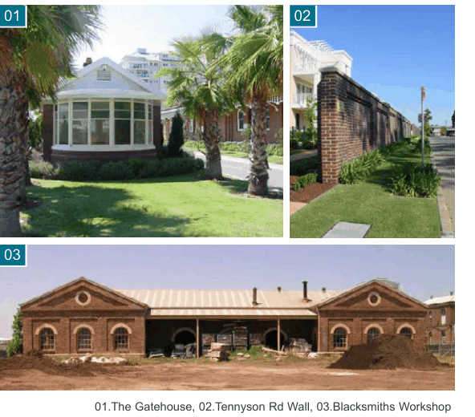

> [Picture on page 31: a picture, saved as a picture (images/part-k-special-precincts-page-31-16.gif, 150 dpi).]
> Words printed on the picture (copied from the PDF):
> 01
> 02
> 03

01.The Gatehouse, 02.Tennyson Rd Wall, 03.Blacksmiths Workshop

#### Brick Wall to Tennyson Road

Brick wall with engaged piers and spandrels. Additional openings will be made in the wall to provide vehicular access for cars and service trucks and to increase visual and pedestrian connections to adjacent urban precinct.

A Conservation Management Plan has been prepared in relation to this structure.

#### Meter Readers Office

Brick and slate building with pilasters and large overhanging eaves, which are supported by wooden brackets. Formerly contained a roofed walk-through bay to hold the time-keeping appointments.

Possible uses: estate management, commercial.

#### Blacksmiths Workshop

Polychromatic brick building with classical influences such as pilasters, string course and pediment. Roof trusses are lightweight and cast iron semi-circular headed windows have 12 panes of circular openings with louvres.

Possible uses: community recreation and amenities, commercial

#### Plumbers Workshop

Two storey brick building with parapet string course, semi-circular arches, surmount doors and multi-paned windows.

Possible uses: An interpretive display illustrating the historical roles of Breakfast Point, its locality and people is to be provided on site. The facility should include indoor and outdoor exhibits.

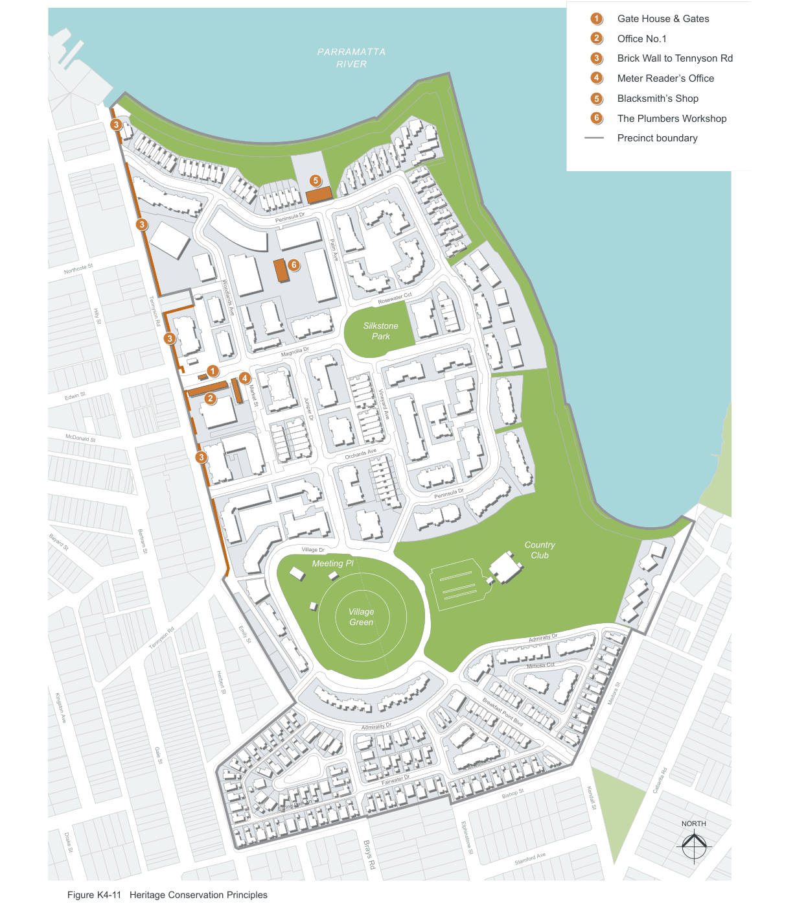

> [Picture on page 32: a map, saved as a picture (images/part-k-special-precincts-page-32-1.gif, 150 dpi); the street names and other small labels are on the picture.]
> Labels printed on the map (copied from the PDF, in no particular order):
> PARRAMATTA · RIVER · 3 · 5 · Peninsula Dr · 3 · Palm Ave · 6 · Northcote St · Rosewater Cct · Hilly St Tennyson Rd · Silkstone · Park · 3 · Magnolia Dr · 1 · 4 · Edwin St · 2 Market St · Woodlands Ave · Vineyard Ave · Juniper Dr · McDonald St · Orchards Ave · 3 · Bayard St · Village Dr · Bertram St · Meeting Pl · Village · Green · Emily St · Tennyson Rd · Herbert St · Kingston Ave · r · ity D · l · mira · Ad · Gale St · Fairwater Dr · Spring Park Ln · Drake St · Brays Rd · Figure K4-11 Heritage Conservation Principles · Peninsula Dr · Country · Club · Admiralty Dr · Mimosa Cct · Breakfast Point Blvd · Fairwater Cl · Bishop St · Elphinstone St · Stamford Ave · 1 Gate House & Gates · 2 Office No.1 · 3 Brick Wall to Tennyson Rd · 4 Meter Reader’s Office · 5 Blacksmith’s Shop · 6 The Plumbers Workshop · Precinct boundary · Medora St · Cabarita Rd · Kendall St · NORTH

#### K4.11 Remediation

The land has been remediated under an audited Remediation Action Plan (RAP).

#### Land Use and Development Constraints

The four certified remediation zones are as follows:
