## 4. Commercial/ Industrial Zone

This land includes areas under existing buildings proposed to be retained. The nature and extent of development and construction in this zone is constrained by a Section 88b Instrument attached to the land title.

Anticipated uses include commercial or industrial. Council will not grant Development Consent in this zone unless the Application includes a 'Work Method Statement' certified by the site auditor.

Development Control Plan

Part K

Special Precincts

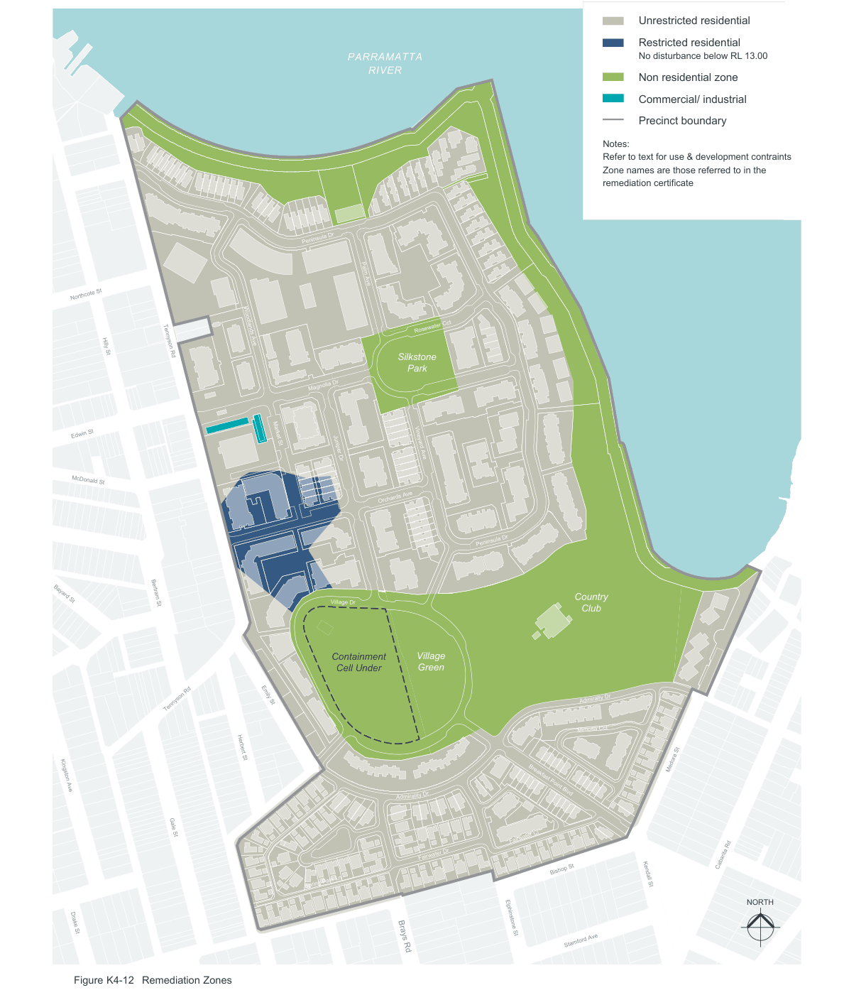

> [Picture on page 34: a map, saved as a picture (images/part-k-special-precincts-page-34-4.gif, 150 dpi); the street names and other small labels are on the picture.]
> Labels printed on the map (copied from the PDF, in no particular order):
> Northcote St · Hilly St Tennyson Rd · Edwin St · McDonald St · Bayard St · Bertram St · Tennyson Rd · Kingston Ave · Gale St · Drake St · Market St · Woodlands Ave · Emily St · Herbert St · Figure K4-12 Remediation Zones · PARRAMATTA · RIVER · Peninsula Dr · Palm Ave · Rosewater Cct · Silkstone · Park · Magnolia Dr · Vineyard Ave · Juniper Dr · Orchards Ave · Village Dr · Village · Containment · Green · Cell Under · r · ity D · l · mira · Ad · Fairwater Dr · Spring Park Ln · Brays Rd · Unrestricted residential · Restricted residential · No disturbance below RL 13.00 · Non residential zone · Commercial/ industrial · Precinct boundary · Notes: · Refer to text for use & development contraints · Zone names are those referred to in the · remediation certificate · Peninsula Dr · Country · Club · Admiralty Dr · Mimosa Cct · Medora St · Breakfast Point Blvd · Fairwater Cl · Cabarita Rd · Bishop St · Kendall St · NORTH · Elphinstone St · Stamford Ave

#### K4.12 Environmentally sustainable design

#### Objectives

O42 To reduce dependence on non-renewable and environmentally detrimental energy resources.

O43 To reduce household energy demands.

O44 To provide convenient and pleasurable access alternatives to the use of motor vehicles for local trips.

O45 To reduce residential waste to landfill.

O46 To minimise pollutants to atmosphere, ground and water.

#### Controls

| Controls |  |
|---|---|
| C80. | 90% of the individual population is within 5 minutes walking distance from the Village Centre. |
| C81. | All major destinations, the Village Green, the Recreation Centre, the Village Centre and Intensive Water Activities are located on a bus route. |
| C82. | A ferry/ bus interchange links the community to the regional employment centres of Sydney and Parramatta. Ferry usage is encouraged by provision of commuter parking at the wharf. |
| C83. | A comprehensive pedestrian/ cycleway network provides safe, convenient and attractive links between facilities. |
| C84. | Priority is given to deciduous trees and shrubs to the north of internal and external living spaces to maximise solar and light availability in winter. |
| C85. The extensive foreshore landscape area is predominantly planted using locally native species, remnant mangroves in Kendall Bay are retained. C86. Hardstand areas, roads and other impervious surfaces are minimised. |  |

#### K4.13 Definitions

"Storey" means a floor which has more than 50% of its volume above finished ground level.

"Finished ground level" means finished ground level which is determined at any point by straight-line interpolation between the designed (or built) levels at street frontage, adjacent allotment or open space boundaries.

“Existing ground level” means existing ground level which is determined at any point by straight-line interpolation between the existing levels at street frontage, adjacent allotment or open space boundaries.

A basement bounding wall is not to exceed 1.5m above the finished landscaped level unless adequately screened to Council approval.

An attic area wholly within a roof space, except for dormer style windows, is not a storey.

A mezzanine, as defined under the Building Code of Australia (BCA), may not be considered a storey subject to Council's merits assessment.

“Community” referring to land or property means land within Lot 1 of the Community Scheme DP 270347.

“Community plan” means the registered deposited plan under Community Scheme DP 270347.

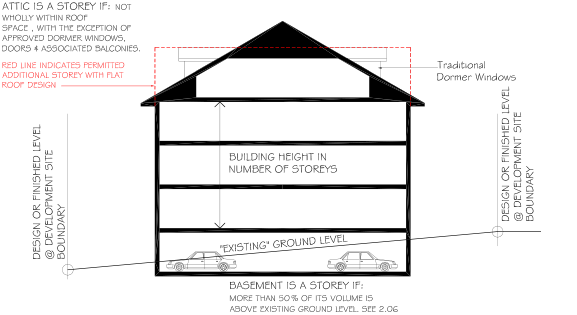

> [Picture on page 35: a picture, saved as a picture (images/part-k-special-precincts-page-35-38.gif, 150 dpi).]

Figure K4-13 Measurement of storey height

#### K4.14 Provisions for single dwellings

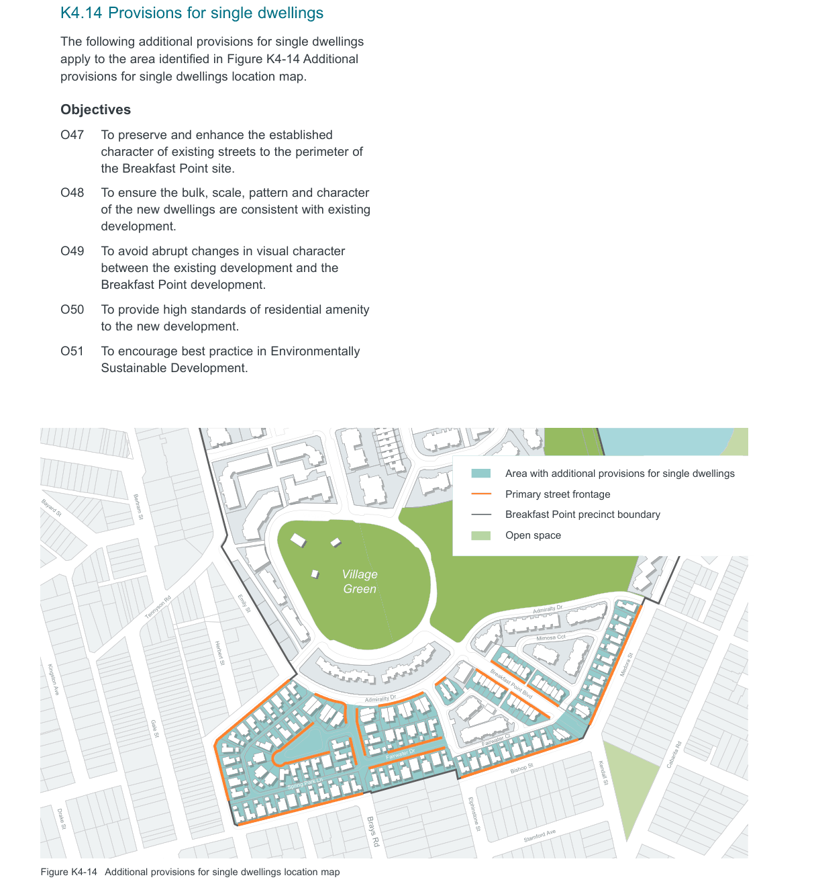

> [Picture on page 36: a map, saved as a picture (images/part-k-special-precincts-page-36-2.gif, 150 dpi); the street names and other small labels are on the picture.]
> Labels printed on the map (copied from the PDF, in no particular order):
> the Breakfast Point site. · development. · Breakfast Point development. · to the new development. · Sustainable Development. · Bayard St · Village Dr · Bertram St · Village · Green · Emily St · Tennyson Rd · Herbert St · Kingston Ave · r · ity D · l · mira · Ad · Gale St · Fairwater Dr · Spring Park Ln · Drake St · Brays Rd · Figure K4-14 Additional provisions for single dwellings location map · Peninsula Dr · Area with additional provisions for single dwellings · Primary street frontage · Country · Breakfast Point precinct boundary · Club · Open space · Admiralty Dr · Mimosa Cct · Medora St · Breakfast Point Blvd · Fairwater Cl · Cabarita Rd · Bishop St · Kendall St · Elphinstone St · Stamford Ave

The following additional provisions for single dwellings apply to the area identified in Figure K4-14 Additional provisions for single dwellings location map.

#### Objectives

O47 To preserve and enhance the established character of existing streets to the perimeter of

O48 To ensure the bulk, scale, pattern and character of the new dwellings are consistent with existing

O49 To avoid abrupt changes in visual character between the existing development and the

O50 To provide high standards of residential amenity

O51 To encourage best practice in Environmentally

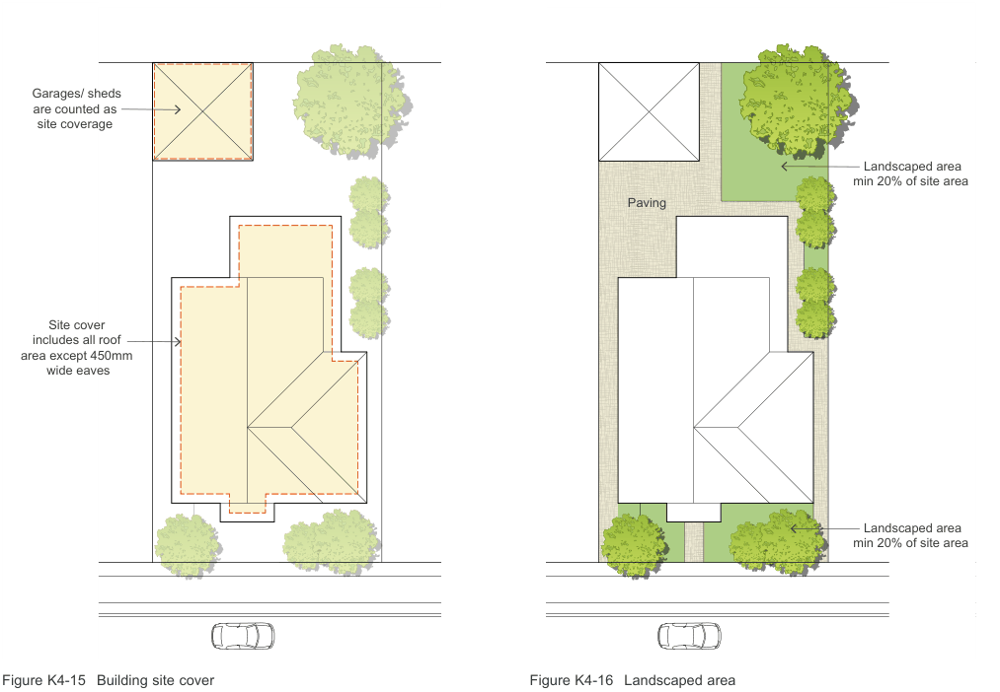

> [Picture on page 37: a map, saved as a picture (images/part-k-special-precincts-page-37-1.gif, 150 dpi); the street names and other small labels are on the picture.]
> Labels printed on the map (copied from the PDF, in no particular order):
> Garages/ sheds · are counted as · site coverage · Site cover · includes all roof · area except 450mm · wide eaves · Paving · Landscaped area · min 20% of site area · Landscaped area · min 20% of site area

Figure K4-15 Building site cover

#### Subdivision

O52 To maintain the streetscape character and the planned residential density.

#### Controls

C87. One single dwelling only is permitted per

lot. Subdivision is prohibited.

#### Building Site Cover

O53 To maintain sufficient land available for private open space, light and sun penetration, landscape, storm-water absorption and flow in accordance with sustainable development principles.

#### Controls

C88. No more than 50% of a lot area is covered by built development. Built development includes all roofed areas except eaves extending up to 450mm from external walls. Refer to Figure K4-15.

Figure K4-16 Landscaped area

#### Landscaped Area

To ensure the residential precinct has an

O54

atmosphere of a ‘garden suburb’. To provide adequate site absorption of

O55

storm water and to provide for reasonable photosynthesis in line with sustainable environmental principles.

#### Controls

A minimum of 20% of the site area is to

C89.

be soft landscape, grass, ground-cover, shrubs, and trees. Refer to Figure K4-16.

#### Dwelling Setbacks Primary Frontage

O56 To complement the character of existing neighbouring streetscape.

O57 To maintain generally consistent landscape area between kerb and dwellings on both sides of the street.

O58 To encourage elements that break down the visual bulk and scale of buildings in the streetscape.

#### Controls

C90. Main House Walls: minimum 5m setback. C91. Single storey elements such as pergolas, verandas, terraces, porticos, bay windows and partially enclosed elements: minimum 3m setback. Refer to Figure K4-17.

C92. Main house setbacks may be averaged to provide an area between the house and the front boundary equal to that area provided by a 5m setback. A minimum setback for any part of 3m must be maintained. Refer to Figure K4-18.

#### Adjoining Lots (Side Boundary)

O59 To provide separation between houses fronting streets.

O60 To provide opportunity for landscape between dwellings.

O61 To permit reasonable solar and light access between dwellings.

#### Controls

C93. Wall height up to 3.6m above natural ground level: 1.0m minimum.  Wall height up to 7.2m above natural ground level: 1.5m minimum. Refer to Figure K4-19.

C94. Garden or retaining walls: when over 500mm high, to be setback a distance equal to the height of the wall.

C95. Single storey garages wall height up to 3m: nil, provided all maintenance and services can be satisfactorily achieved wholly within the allotment, and solar access criteria can be met.

Main house wall

Single storey

element zone

3m

5m

Figure K4-17 Minimum front setback requirements

Main house wall

Main

house

wall

5m

Area between

main house walls

and boundary must

equal area of

5m setback

Figure K4-18 Minimum front setback requirements - alternative

min 1.5m

3.6m

min 1m

7.2m

Figure K4-19 Minimum side setback requirements

min 1m

min 1m

min 1.5m

SECONDARY  STREET

Area between

main walls and

side boundary must

equal area of

1.5m setback

Figure K4-20 Secondary street frontage setback requirements

Garage

7m max

6m max

crossover

Rear fence

1m setback zone

Boundary

REAR  ACCESS  LANE

Figure K4-21 Required minimum setback from access lanes

#### Secondary Street Frontage (Corner Lots)

O62 To maintain streetscape character whilst retaining reasonable privacy and security to private open spaces.

O63 To encourage variation and relief in facade treatment facing public space.

| Controls |  |
|---|---|
| C96. | Main House Walls: 1.5m minimum. |
| C97. | Pergolas, Verandas, Terraces, porticos and other partially enclosed elements: 1.0m minimum. |
| C98. | Main house setbacks may be averaged to provide an area between the house and the front boundary equal to that area provided by a 1.5m setback. A minimum setback for any part of 1.0m must be maintained. Refer to Figure K4-20. |

#### Encroachments Controls

| C99. | Eaves, gutters and downpipes may encroach into setbacks in accordance with BCA and to 450mm maximum. |
|---|---|

#### Setback from Access Lanes

O64 To provide a consistent access lane character softened by landscape.

| Controls |  |
|---|---|
| C100. | All structures, garages and fences are to be setback 1.0m from any boundary adjoining a lane. Refer to Figure K4-21. Note: This setback area is to be an easement in favour of the Community Association who will be responsible for its treatment and maintenance. |

#### Access

O65 To maintain existing streets as the address of new dwellings.

O66 To ensure the design of dwellings presents a frontage to existing streets consistent with the existing street character.

| Controls |  |
|---|---|
| C101. | Street numbers and mailboxes will be located on the streets to which the dwellings permitted by this DCP are required to have the primary frontage. |
| C102. | Public and visitor access will be from these streets. |
| C103. | On-street visitor parking will be provided on these streets. |
| C104. | On-street parking will not be available in lanes. |
| C105. | Dwellings will address and be designed to ‘front’ these streets. |

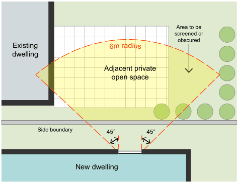

> [Picture on page 41: a map, saved as a picture (images/part-k-special-precincts-page-41-1.gif, 150 dpi); the street names and other small labels are on the picture.]
> Labels printed on the map (copied from the PDF, in no particular order):
> Area to be · screened or · obscured · ra · diu · s · 6m · Existing · dwelling · Adjacent private · open space · Side boundary · 45° · 45° · New dwelling

Figure K4-22 Screening of views to adjacent private open space from a side window

#### Tree Preservation

O67 To preserve and maintain the master-planned prominence of landscape in the character of the residential street.

O68 To assist in meeting environmentally sustainable development objectives.

| Controls |  |
|---|---|
| C106. | All trees are subject to Council's Tree Preservation Order. |
| C107. | Street trees must not be interfered with without the prior consent of Council. |
| C108. | Existing trees within the site and on public land must be protected throughout construction. |

#### Landscaping

O69 To ensure landscape and planting is considered and integrated with house planning and design.

O70 To ensure sustainable development principles are acknowledged and that impacts on neighbouring amenity are considered at the planning stage.

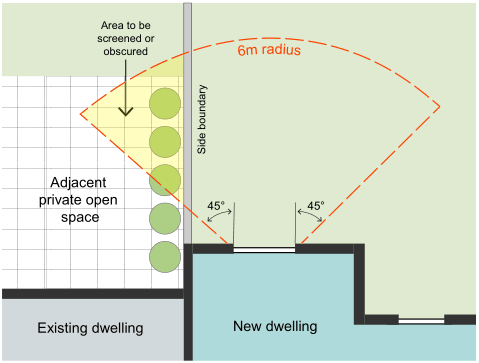

> [Picture on page 41: a map, saved as a picture (images/part-k-special-precincts-page-41-18.gif, 150 dpi); the street names and other small labels are on the picture.]
> Labels printed on the map (copied from the PDF, in no particular order):
> Area to be · screened or · obscured · ra · diu · s · 6m · Side boundary · Adjacent · private open · 45° · 45° · space · New dwelling · Existing dwelling

| Controls |  |
|---|---|
| C109. | A Landscape Principles Plan is to be submitted for approval with building plans and include detail of tree location, mature size, evergreen or deciduous, screening, hedges, shrubs, turf areas, fences, and paths and paved areas. |

Figure K4-23 Screening of views to adjacent private open space from a back window

#### Privacy

O71 To ensure the siting, design and landscaping of buildings minimises direct overlooking into habitable rooms and private open space.

O72 To ensure the siting, design and landscaping of buildings provides acoustic privacy to habitable rooms and open space.

| Controls |  |
|---|---|
| C110. | Habitable room windows are to be predominantly oriented to the street and rear of lots. |
| C111. | Habitable room windows are to be located outside a 45° angle of view from any habitable room window of any adjacent dwellings within 6m. Refer to Figure K4-22. |
| C112. | Alternate screening, obscure glazing and other solutions will be considered on merits. |
| C113. | A minimum separation between habitable room windows and balconies of 12m is to be provided unless provided with approved screening. |
| C114. | Landscaped plans are to include planting designed to minimise overlooking adjacent private open spaces. |

#### Swimming Pools and Surroundings

O73 To ensure the construction and use of swimming pools does not unduly impact on neighbourhood amenity.

| Controls |  |
|---|---|
| C115. | Prohibited: Pools between dwellings and the primary street frontage and above ground pools. |
| C116. | Safety requirements are to be to Australian Standards, and Statutory requirements. |
| C117. | Pools and surround paving are to be setback a minimum of 1.0m from any boundary. This setback is to be soft landscape treated. |

#### Fencing Primary Street Frontage Fencing (Front Fence)

O74 To provide a consistent street-scape character.

O75 To maintain a landscaped dominated street-scape visual environment.

O76 To minimise ‘built elements’ in front of dwellings.

| Controls |  |
|---|---|
| C118. | Fences are to be no greater than 1m in height. Refer to Figure K4-24. |
| C119. | Front fence treatment is to extend along side boundaries to the line of the adjacent front wall of the dwelling or 5m from the front boundary whichever is greater. Refer to Figure K4-24. |
| C120. | Fences are to be of semi-open design with low shrubs planted behind. Materials can include masonry, timber picket, metal spearpoint and combinations. Refer to Figure K4-26. |

#### Rear Lane, Side Street and Public Area Fencing

To provide a consistent fencing character

O77

throughout the estate.

To permit reasonable privacy and security

O78

without streets and public access ways being dominated by paling fences.

| Controls |  |
|---|---|
| C121. | Maximum 1.8m in height, lapped and capped timber paling fence to estate detail, painted Dulux Timbercolour Birch Grey or equal. Refer to Figure K4-25. |
| C122. | Paling fences to boundaries fronting side streets or public access ways are not to extend more than 2/3 the length of boundary. |
| C123. | The paling face of fencing is to address streets and public areas. |

min 5m

max 1m

Side fences behind front house wall

max 1.8m height

Front fence

to line of adjacent

front house wall

Figure K4-24 Front and side fence requirements

#### Adjoining Allotment Fencing (Side and Rear)

30mm O79 To provide privacy and security to private

outdoor spaces.

100mm 15mm

Weathered cap

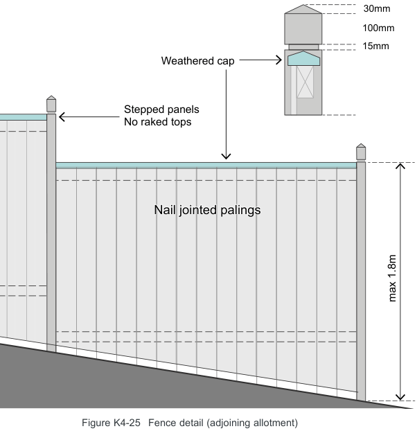

> [Picture on page 43: a picture, saved as a picture (images/part-k-special-precincts-page-43-7.gif, 150 dpi).]
> Words printed on the picture (copied from the PDF):
> Stepped panels
> No raked tops
> Nail jointed palings
> max 1.8m

O80 To allow for containment of domestic pets permitted under the management plan.

#### Controls

C124. Maximum 1.8m high lapped and capped timber paling fence to estate detail, painted Dulux Timbercolour Birch Grey or equal. Refer to Figure K4-25.

C125. No side fence is to be closer to the street than the main house wall facing the street. Refer to Figure K4-24.

#### Adjoining Community Open Spaces

O81 To provide a natural landscaped edge to the community open space whilst providing for individual privacy and security.

#### Controls

Figure K4-25 Fence detail (adjoining allotment)

C126. Maximum 1.8m high black galvanised pipe and chain wire fences and gates backed by screening landscape.

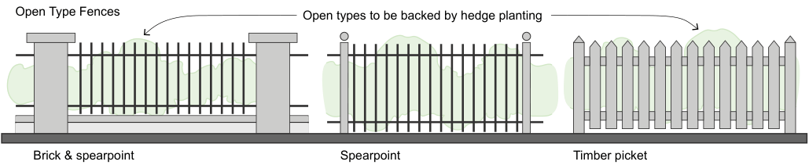

> [Picture on page 43: a picture, saved as a picture (images/part-k-special-precincts-page-43-27.gif, 150 dpi).]

Open Type Fences

Open types to be backed by hedge planting

Brick & spearpoint

Spearpoint

Timber picket

Solid Type Fences

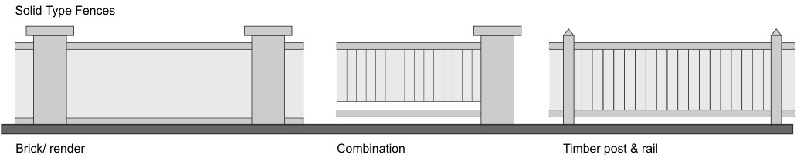

> [Picture on page 43: a picture, saved as a picture (images/part-k-special-precincts-page-43-34.gif, 150 dpi).]

Timber post & rail

Combination

Brick/ render

Figure K4-26 Fence types

#### Mail Box and Street Number

O82 To facilitate location of individual dwellings and to maintain consistency in visual elements contributing to street-scape character.

#### Controls

C127. Each dwelling is to have a mailbox, and a clearly visible street number unit to the primary street frontage integrated in fencing treatment to Australian Post requirements.

#### Building Form, Height & Character Wall Height and Storeys

O83 To preserve views and outlooks.

O84 To minimise shadow and privacy impacts.

O85 To ensure buildings reflect the natural slope of the land.

O86 To maintain a consistent two storey residential scale.

O87 To provide residents reasonable expectations for adjacent development.

#### Controls

C128. The external wall height is to be no greater than 7.2m above the natural ground level at any point. Refer to Figure K4-27.

C129. A higher gable treatment up to the maximum ridge height of 9.5m may be permitted, where it can be shown that there is no additional impact on neighbourhood amenity. Refer to Figure K4-27.

C130. No building shall exceed 2 storeys in height.

C131. Attic accommodation wholly within the roof space may be permitted subject to satisfactory design of dormer or skylight windows in terms of streetscape and neighbours amenity.

#### Roof Height and Shape

O88 To maintain a consistent visual roof-scape character and form, compatible with existing Concord residential precincts, when viewed from the public domain and higher buildings and vantage points.

| Controls |  |
|---|---|
| C132. | A minimum roof pitch of 27.5° is required. Refer to Figure K4-27. |
| C133. | The maximum ridge height is to be 9.5m above the natural ground. Refer to Figure K4-27. |
| C134. | Flat, curved and other nontraditional roof forms will only be considered where Council can be satisfied they are appropriate under the circumstances. |

Permissible only

if no additional

impact on neighbours

Ridge height

max 9.5m

Roof pitch

min 27.5°

Wall height

max 7.2m

Figure K4-27 Maximum heights and minimum roof pitch

#### Streetscape Character

O89 Design, detailing and finish is to:

• be in scale with the existing development in the street.

• add visual interest.

• enable differentiation between dwellings viewed from the street.

• provide entries readily apparent from the primary street.

• convey a sense of address.

O90 Garages and parking are to be sited and designed to minimise impact on the street.

| Controls |  |
|---|---|
| C135. | The front door and some main windows are to face the primary street frontage. |
| C136. | Street facades are to be articulated by elements such as bay windows, dormer windows, verandas, pergolas, balconies, gables, etc. |

Note: vehicle access prohibited from Brays Road, Bishop Street, Medora Street and Adams Lane.

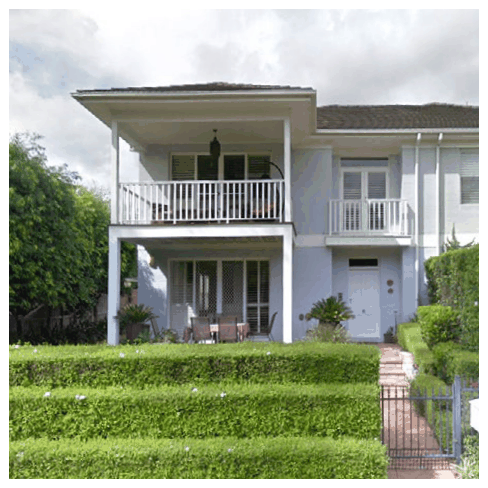

> [Picture on page 45: a picture, saved as a picture (images/part-k-special-precincts-page-45-16.gif, 150 dpi).]

Example of a well articulated facade with the main entry, windows, balconies and a verandah clearly addressing the street

#### External Materials, Finishes and Colours

O91 Materials, Finishes and Colours are to:

• be compatible with those found in the existing surrounding residential precinct.

• reflect light between dwellings and heat away from dwellings without undue glare or rogue reflections.

• avoid harsh contrasts in tone, colour or texture.

• assist in creating the desired light, bright, warm and cheerful neighbourhood character.

O92 Provide a backdrop for the desired landscape dominated streetscape.

#### Controls

C137. Wall Materials are to be:

• Facebrick with appropriate joints, rendered or bag rendered. Masonry, painted, timber or FC weatherboard cladding, painted or approved combinations of the above.

• Wall colours are to be light reflective pastel shades. No walls are to be darker than the traditional ‘liver brick’ found in the precinct.

• Strongly mottled facebrick blends are inconsistent with the desired character and are not permitted.

• Brick joints are to blend, not contrast, with brickwork.

C138. Roof Materials are to be:

• Tile, slate, shingle, or ribbed metal sheet.

• Roof Colours are to be low reflectance.

• Glazed finishes and materials causing nuisance glare are not permitted.

• Strong colours, mottled blends or flashed tiles are not permitted.

C139. Secondary Elements, trim, eaves, gutters, windows, joinery, etc, can be used to provide contrast in texture and colour to the primary wall and roof surfaces.

#### Roof Mounted Fixtures

O93 To avoid unattractive adhoc installations detracting from the roofscape and skyline outlook viewed from vantage points within and beyond the neighbourhood.

| Controls |  |
|---|---|
| C140. | No more than one miniature UHF type antenna mounted no higher than 1.5m above the highest point of the roof is permitted per dwelling. |
| C141. | No satellite disc receivers or similar devices are to be installed. |
| C142. | Solar collectors are to be mounted at the same pitch as the roof and are not to be visible from the street. Roof mounted water storage units are prohibited. |

#### Ancillary Buildings

O94 To ensure that the visual character of the neighbourhood is not prejudiced by ad-hoc sheds, outbuildings and the like.

#### Controls

C143. No ancillary buildings or structures, including prefabricated sheds, are to be erected on any lot without consent.

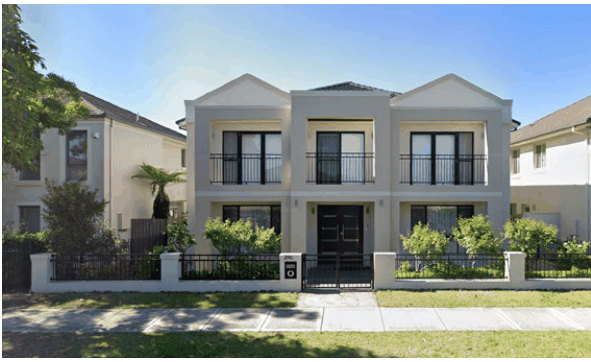

> [Picture on page 46: a picture, saved as a picture (images/part-k-special-precincts-page-46-15.gif, 150 dpi).]

Example of a building and fence design that successfully addresses the public domain and allows for views to and from the street

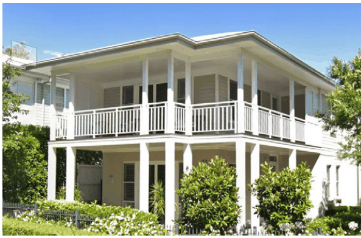

> [Picture on page 46: a picture, saved as a picture (images/part-k-special-precincts-page-46-18.gif, 150 dpi).]

Wall colours are to be light pastel shades and wall materials can be rendered facebrick, weatherboard or a combination

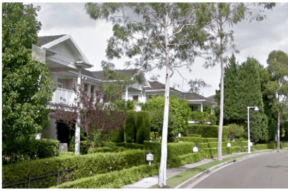

> [Picture on page 46: a picture, saved as a picture (images/part-k-special-precincts-page-46-21.gif, 150 dpi).]

Example of roof materials and colours that integrate into the neighbourhood and are low reflective/ non-glare

#### ESD Principles Energy Efficiency

O95 To achieve energy efficient housing using passive solar design, that provides residents with year-round comfort and reduces energy consumption.

#### Solar Access and Orientation

O96 Orientation, layout and landscape are to make best use of natural ventilation, sunlight and solar energy.

| Controls |  |
|---|---|
| C144. | Buildings are to be oriented to maximise solar access to living areas. |
| C145. | Windows are to be located and shaded to reduce summer heat load and permit entry of winter sunlight. |
| C146. | Exterior shading devices are to be used, eg. eaves, balconies, verandas, pergolas, window shutters, adjustable louvres, landscape devices. |
| C147. | Living areas are to be located to the north side of the dwelling. |
| C148. | Sun is to be available to a living area for at least three hours between 9am and 5pm on 21 June (mid winter). |

#### Building Materials and Landscape

O97 Materials and insulation are to be selected to assist thermal performance and maintain internal comfort levels.

O98 To encourage the use of building materials and finishes which maximise the use of renewable energy sources.

| Controls |  |
|---|---|
| C149. | High thermal mass materials are to be used for living areas and are to be designed to receive maximum sun during cooler months. |
| C150. | Insulation is to achieve an ‘R’ value (AS 2627.1993) of: • R2.0 for roofs and ceilings. • R2.0 for walls - except where the construction materials used embodies an equivalent total R value. |
| C151. | Deciduous trees are to be planted to provide summer shading and allow winter sun entry. |
| C152. | Outdoor clothes drying areas are to be provided with sun and breeze access. |
| C153. | Details of finishes, materials and colours are to be submitted to Council with the Development Application. |
| C154. | The applicant is to demonstrate that materials used in construction: • Maximise renewable resources. • Are energy efficient (low embodied energy). • Are generally non-polluting, durable, recyclable or reuseable. |
| C155. | No rainforest timbers or timbers cut from old growth forests are to be used. All timber used on site is to be stamped accordingly. |
| C156. | Porous pavers or similar which increase infiltration and reduce stormwater runoffs are to be used on driveways, and pathways wherever possible. The total impervious pavement is not to exceed 25% of the site area. |

#### Ventilation

O99 Building design is to assist internal air movement to provide acceptable thermal conditions.

| Controls |  |
|---|---|
| C157. | Dwellings are to be oriented to catch cooling summer breezes. |
| C158. | Window and door openings are to be located to facilitate cross-ventilation. |

#### Service and Appliances

O100 To maximise energy efficiency and minimise energy consumption.

| Controls |  |
|---|---|
| C159. | Development Applications are to demonstrate how energy conservation measures are incorporated in the design, including: • Hot water systems using renewable or low pollutant energy sources. • Energy efficient reticulation planning and insulation. • Energy efficient appliances. |
| C160. | Energy efficient lighting. |

#### Water Management

O101 To control freshwater consumption by reducing demand and integrating systems and appliances in dwelling design.

#### Controls

C161. New dwellings are to incorporate:

• Low flow shower roses.

• Dual flush toilets.

• Water efficient washing machines.

• Irrigation systems, if used, that are micro or drip type soil moisture sensor controlled.

C162. A storm water management plan is to be submitted with the development application.

#### Waste Management

O102 To provide adequate waste storage facilities and to facilitate recycling with a view to minimising waste entering land fills.

#### Controls

C163. Development Applications are to indicate:

• Adequate space for at-source separation of waste within each dwelling.

• Facilities for storing recyclable and waste products in locations which are not directly visible or are screened from public areas and which do not pose a threat of noise, odour or safety and which are readily accessible to Council’s waste contractors.
