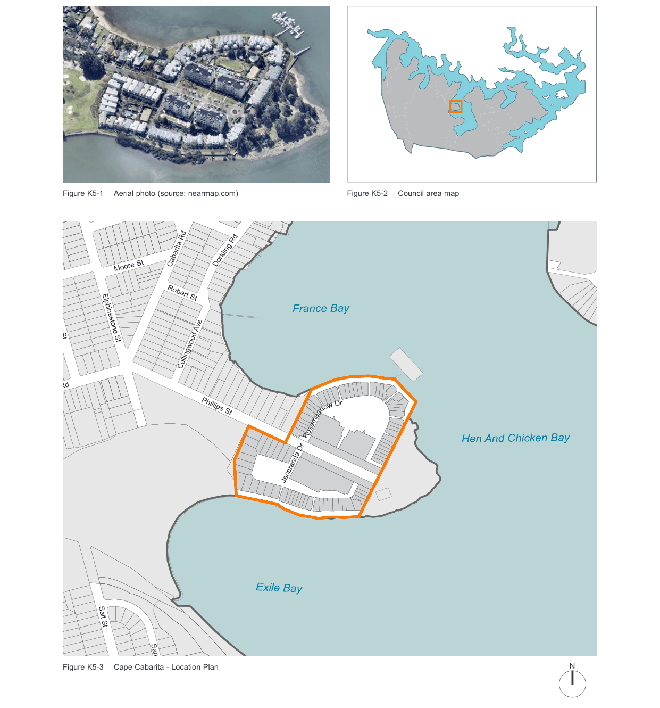
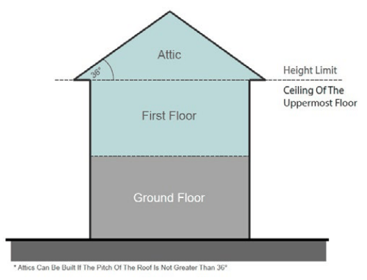
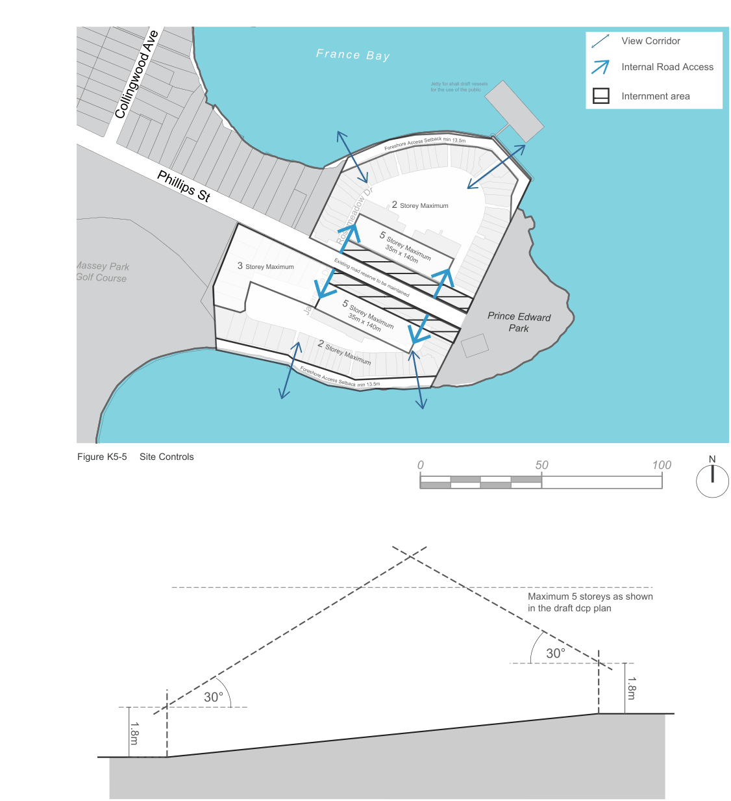
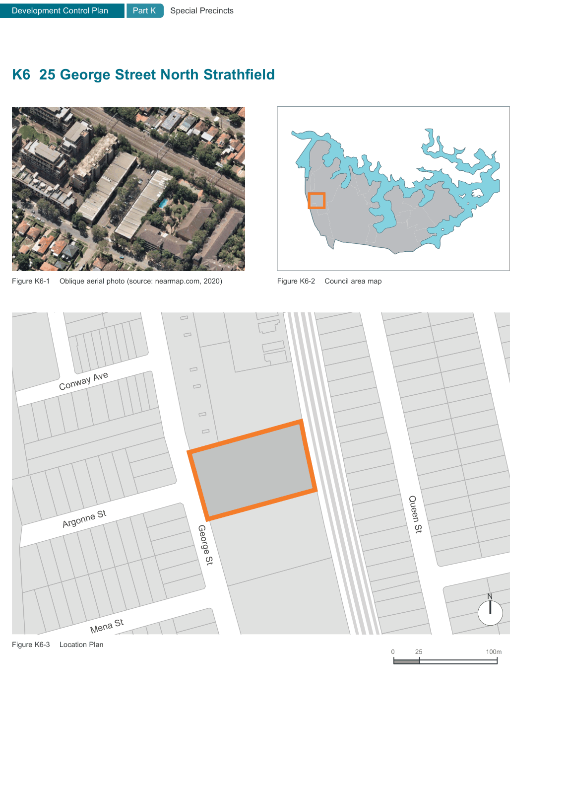

### K5  Cape Cabarita

> [Picture on page 49: a map, saved as a picture (images/part-k-special-precincts-page-49-2.gif, 150 dpi); the street names and other small labels are on the picture.]
> Labels printed on the map (copied from the PDF, in no particular order):
> Figure K5-1 Aerial photo (source: nearmap.com) · Figure K5-2 Council area map · Cabarita Rd Dorkling Rd · Moore St · Robert St · France Bay · Riverview St · Elphinestone St · Collingwood Ave · Cabarita Rd · Dr · w · o · d · a · Phillips St · Hen And Chicken Bay · Jacaranda Dr · Roseme · Exile Bay · Salt St · N · Figure K5-3 Cape Cabarita - Location Plan · Sanders Pde

Kitcheneer Ave

#### K5.1 General objectives

O1 Provide a pleasant, functional and safe environment to and along the foreshore for cyclists and pedestrians;

O2 Maintain significant views and vistas into and out of the site;

O3 Ensure adequate provision of landscaping and usable private and public open space;

O4 Provide for pedestrian and cycle linkage through the site to adjoining areas;

O5 Maximise visual and acoustic privacy to adjoining properties and within the development itself;

O6 Ensure adequate daylight and sunlight are maintained to existing development, new development and open spaces;

O7 Ensure the existing streetscape character is enhanced;

O8 Ensure development and access networks are integrated with the existing built and natural environment;

O9 Ensure development presents an appropriate bulk and scale to public areas having regard to existing development and the topography of the site; and

O10 Ensure the design orientation of buildings and materials used in construction utilise renewable resources.

#### K5.2 Specific provisions

#### Design and Siting - Streetscape Objective

O11 To integrate new development in a manner which complements the character of the area and relates to the pedestrian environment.

| Controls |  |
|---|---|
| C1. | Development on public street frontage has had regard to the character of existing development in the vicinity of the site including: • setbacks of existing buildings on Cabarita Road; • landscaping; • fence height; • spaces between dwellings; • views through the site; and • roof pitch. |
| C2. | New development and fences contribute to and is integrated into the overall streetscape at a scale which relates to the pedestrian environment. |
| C3. | Building height plane to apply from the existing boundary with Phillips Street. |
| C4. | Buildings are to be setback a minimum of 9 metres from the Phillips Street frontage. |
| C5. | Building facades are to be orientated towards public street frontages (See Figure K5-5 Site Controls). |
| C6. | Buildings are not to exceed the following (See Figure K5-5 Site Controls): • 5 storeys in height along the Phillips Street frontage; • 3 storeys in height adjoining Massey Park Golf Course; and • 2 storeys in height adjacent to the boundaries with No.31 Phillips Street, Prince Edward Park and the waterfront areas. |
| C7. | Fences having frontage to public open space or public roadway are: • not to exceed 1 metre in height of solid construction; and • not to exceed 1.8 metres if of ‘open’ type design. |
| C8. | Continuous wall and/or fencing for more than 20 metres should have some visual or physical relief. |
| C9. | Seating areas in a landscaped setting are to be provided every 100 metres along the frontage. |

#### Side boundaries Objective

O12 To minimise the impact of new development on adjoining areas.

#### Controls

C10. Buildings adjoining side boundaries will not adversely impact on the amenity enjoyed by existing adjoining dwellings. Consideration has to be given to:

• maintaining of views;

• overshadowing of private open space to give visual relief;

• minimising the impact of bulk and scale of new development on adjoining areas;

• fence design and height relates to and does not detract from Cabarita Park;

|  | • buildings are separated or articulated and |
|---|---|
|  | do not present blank walls; and |
|  | • maintenance of privacy. |
| C11. | Compliance should be achieved with the building height plane (see Figure K5-6 Building Height Plane Diagram). |
| C12. | Fences adjoining Prince Edward Park should not exceed 1.8 metres in height and be of ‘open’ appearance. |

#### Foreshore Frontage Objective

O13 To ensure the integrity of the foreshore is maintained and enhanced for public enjoyment

| Controls |  |
|---|---|
| C13. | Development along the foreshore contributes to the character of the foreshore. The development has had regard to: • minimising the visual impact of development as viewed from the water and the foreshore access way; • creating a visually integrated environment which contributes to a sense of safety and security for users of the public open space, (see also 'Access and Landscaping' sections); • the provision of cycleways, pedestrian pathways; and • providing appropriate street furniture, lighting and planting for the comfort, safety and security of users. |
| C14. | Building height plane to apply from the property boundary. |
| C15. | An average setback of 13.5 metres, having a minimum width of 9 metres, is to be provided from the high water mark to the development for a public foreshore accessway (see Figure K5-5 Site Controls). |
| C16. | Buildings are to be setback a minimum of four metres from the public foreshore accessway. |
| C17. | The location of buildings should not result in overshadowing to the foreshore between the hours of 9am to 3pm (EST) or 10am to 4pm (Daylight saving time). |
| C18. | The foreshore access is to be in a landscaped setting and comprise: • a pedestrian pathway with minimum dimensions of 1.0 metre; and • a cycleway with minimum dimensions of 0.8 metres with a separation distance of 0.7 metres. |

#### Height of Building Objective

O14 To ensure the building envelope relates to the topography of the site, providing an appropriate bulk and scale, having regard to the foreshore location, streetscape and adjoining properties.

#### Controls

C19. Building height has had regard to:

• maintenance of significant views from buildings to public areas;

• topographic variation minimising visual impact as viewed from the water, streetscape and public open spaces and conformity with the treeline along the Cabarita Road frontage;

• overshadowing of open spaces and other buildings;

• setbacks from adjoining developments;

• character of the surrounding area; and

• the human scale and relationship to open space.

C20. Buildings should not exceed the building height plane on all boundaries and development should be no higher than:

• 5 storeys within a distance of 50 metres from Phillips Street Subject to the height restrictions placed on other boundaries; and

• the ceiling height for buildings greater than two storeys shall be no greater than

2.7 metres (see Figure K5-5 Site Controls and Figure K5-6 Building Height Plane Diagram).

#### Bulk and scale Objective

O15 To ensure the location, layout and design of buildings has regard to the impact of development on views from surrounding public spaces and within the development.

#### Controls

C21. The development has had regard to:

• massing to reduce its visual impact from open spaces, roadways and the Parramatta River;

• separation between buildings should provide view corridors through the site;

• privacy between buildings; and

• providing a reasonable level of solar access to dwellings and open spaces.

C22. Buildings comply with the building height plane, floor space ratio, and landscaping provisions.

#### Building Design Objective

O16 To ensure a high quality design which is integrated into the existing environment

#### Controls

C23. The design of buildings:

• provides variety and presents as a cohesive development;

• includes architectural features which reflect the character of Concord (see also street frontage and shading); and

|  | • garages and carparks are not intrusive or |
|---|---|
|  | visually dominant. |
| C24. | Generally, buildings are to have pitched roof forms. |
| C25. | Access driveways are to provide a landscaped entry. |
| C26. | Solar hot water tanks are to be located within the roofspace of development. |

#### Views Objective

O17 To maintain views through the site from public spaces.

#### Controls

C27. Buildings are designed to:

• maximise views of Parramatta River and public open space within and throughout the development;

• minimise obstruction of views from other buildings; and

• provide vistas.

C28. A view corridor is to be maintained from Phillips Street, through the development to the foreshore on both sides.

#### Paved Areas

| Controls |  |
|---|---|
| C29. | Porous pavers or similar treatment which increases infiltration and reduces stormwater runoffs is used extensively on driveways, pedestrian access routes and for pathways in public and private outdoor open space. |
| C30. | The total impervious surfaces used for vehicular access driveways are not to exceed 10% of the total site area. |

#### Landscaping and Open Space Objective

O18 To ensure adequate and appropriate provision of usable private, communal and public open space and landscaping to meet all user needs, having regard to microclimate, security, safety, privacy, visual appearance and biodiversity.

#### Controls

C31. Landscaping should have regard to:

• retention of significant vegetation, which is not affected by the remediation of the site;

• the relationship between buildings and open spaces;

• enhancing pathway and street connections within the site and between adjoining sites;

• providing privacy to adjacent development;

• location and function of open space

• providing for thermal comfort of the users in terms of shade and shelter;

• using native species, where appropriate;

• surveillance of communal open;

• enhancing the visual appearance of the development;

• differentiating between private and public open space;

• assists in stormwater management; and

• complements the materials and colours used in the development.

#### Open Space provision Objective

O19 To provide quality open space for the enjoyment of users.

#### Controls

C32. Open space includes:

• adequate pedestrian and cycle linkages through the development and along the foreshore;

• communal  spaces which have access to sunlight for year round use;

• landscaping to enhance the amenity of the environment and enjoyment of the users;

• promoting a sense of security and safety for users;

• provides for passive and active recreational needs for the residents; and

• has regard to the heritage items on the site.

C33. A landscaped area of 50% of the site area.

#### Public Foreshore Access Objective

O20 To provide foreshore access which is clearly identifiable for public use.

#### Controls

C34. Public foreshore access is appropriately landscaped to minimize the impact of development as viewed from the water. The entrances to the foreshore are designed to reinforce its public accessibility.

C35. Directional signage is to be provided at the entrance to the foreshore path.

#### Public and Communal Open Space Controls

| C36. | Open space follows pedestrian/cycle desire lines through the site creating visually appealing spaces for both passive and active recreation. |
|---|---|

#### Private Open Space Objective

O21 To ensure adequate usable private open space to meet the needs of residents

#### Controls

C37. The development provides usable private open space which is of sufficient dimensions having regard to the size of the dwelling and:

• allows for outdoor seating and dining;

• provides outdoor drying facilities screened from public view; and

• provides for landscaping at ground level.

C38. For above ground development, the open space may take the form of a balcony directly connected to the dwelling with the following minimum requirements:

• 1 bdr - minimum area of 6m² having a minimum dimension of 2m;

• 2 bdr - minimum area of 8m² having a minimum dimension of 9m; and

• 3 bdr or greater - minimum area of 12m² having a minimum dimension of 2m.

C39. For development at ground level the following requirements apply:

• 1 bdr - minimum area of 10m² having a minimum dimension of 3m;

• 2 bdr - minimum of 16m² having a minimum dimension of 4m; and

• 3 bdr or greater - minimum area of 35m² having a minimum dimension of 4m.

#### Lighting Objective

O22 To provide lighting which enhances the security and appearance of the development

#### Controls

C40. The applicant has demonstrated that provision has been made for adequate lighting which enhances the appearance of the development and maximises security of:

• building entrances;

• public spaces and pathways;

• driveways and carparks; and

• without impacting on adjoining properties

#### Car Parking Provision Objective

O23 To ensure adequate, safe and convenient provision of parking, cycle facilities and pedestrian access which is integrated into the overall design of the site and adjoining areas.

#### Controls

C41. Adequate parking is provided having regard to:

• existing and future public transport provision;

• cyclist and pedestrian linkages through the site to adjoining areas;

• efficient and effective entry and egress to the sites;

• adequate resident and visitor carparking and parking for disabled;

• adequate bicycle storage facilities; and

• safe, convenient parking and access which minimises conflicts between motorist, cyclists and pedestrians.

C42. Secure resident parking spaces are to be provided for all dwellings in apartment buildings at basement level with internal access to the development.

C43. Secure resident parking spaces may be provided in ground level enclosed garages for attached or detached dwellings at ground level.

C44. Basement car parking is to be generally naturally ventilated and have access to some natural lighting.

C45. Parking spaces located above ground are in a landscaped setting, and are not directly visible from the Phillips Street frontage.

C46. Parking is not permitted between the building and street alignment. Parking shall be in the form of a garage, basement car park, covered carport or an equivalent open area.

C47. Entry driveways are in a landscaped setting with the appearance of being open and accessible.

C48. Security gates are not to be installed at entry and exit points into the development

> [Picture on page 55: a picture, saved as a picture (images/part-k-special-precincts-page-55-59.gif, 150 dpi).]

Figure K5-4 Attic Pitch Controls

> [Picture on page 56: a map, saved as a picture (images/part-k-special-precincts-page-56-1.gif, 150 dpi); the street names and other small labels are on the picture.]
> Labels printed on the map (copied from the PDF, in no particular order):
> View Corridor · Franc e Bay · Internal Road Access · Jetty for shall draft vessels · for the use of the public · Internment area · Collingwood Ave · k min 13.5m · re Access Setbac · Foresho · r · D · w · Phillips St · 2 Storey Maximum · 5 Storey Maximum · 35m x 140m · 3 Storey Maximum · Massey Park · Golf Course · Existing road reserve to be maintained · Jacaranda Dr · Rosemeado · Prince Edward · 5 Storey Maximum · 35m x 140m · Park · 2 Storey Maximum · Foreshore A · ccess Setback min 13.5m · Figure K5-5 Site Controls · N · 0 · 50 · 100 · Maximum 5 storeys as shown · in the draft dcp plan · 30° · 1.8m · 30° · 1.8m

\* Building height plane applies to all boundaries in this precinct

Figure K5-6 Building Height Plane Diagram

> [Picture on page 57: a map, saved as a picture (images/part-k-special-precincts-page-57-1.gif, 150 dpi); the street names and other small labels are on the picture.]
> Labels printed on the map (copied from the PDF, in no particular order):
> Figure K6-1 Oblique aerial photo (source: nearmap.com, 2020) · Figure K6-2 Council area map · Rothwell Ave · Conway Ave · Argonne St · Queen St · George St · N · Mena St · Figure K6-3 Location Plan · 100m · 25 · 0
