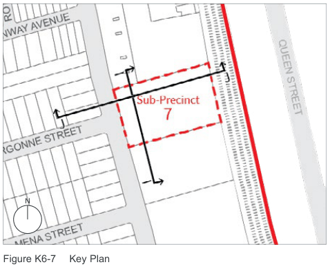
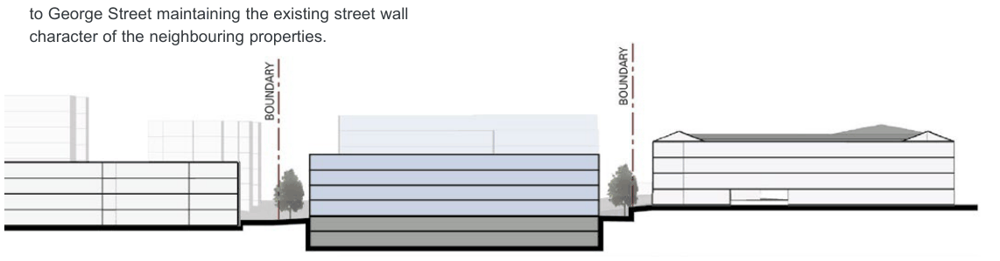
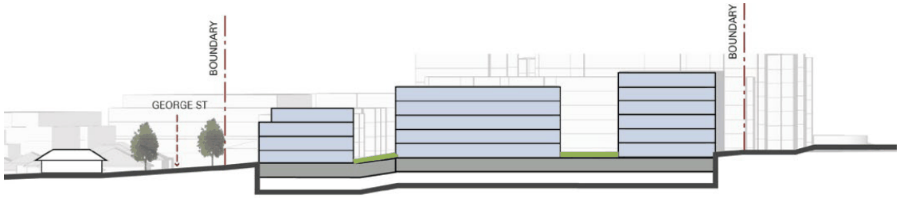

### K6  25 George Street North Strathfield

#### K6.1 General Objectives

#### Objectives

O1 To minimise the impact of new development on existing development.

O2 To allow redevelopment while at the same time respecting the existing character of the neighbourhood.

O3 To provide well-articulated built form that reduces the visual bulk and scale of  buildings.

O4 To ensure ground floor dwellings have a high level of amenity and create a positive interface with the street.

O5 To provide for increased passive surveillance of the public domain.

O6 To ensure the provision of open space and landscaped areas for the amenity of residents.

#### K6.2 Specific provisions

#### Building Setbacks

| Controls |  |
|---|---|
| C1. | Development setbacks are to be in accordance with Figure K6-4 Consolidated Development Controls Plan. |
| C2. | The upper most level of new development four storeys or higher is to provide a 2 metre setback in accordance with Figure K6-6 Section J-J. |
| C3. | The area within the primary setback of the street frontage is to be a deep soil zone and is to have no structures below. |
| C4. | Access points to underground parking are encouraged to be located between existing and new development if that will provide for increased building separation. |

#### Building Height

| Controls |  |
|---|---|
| C5. | New buildings are to be consistent with Figure K6-4 Consolidated Development Controls Plan and Figure K6-5 - Figure K6-6 Built Form Sections. Note: Maximum building heights are to be in accordance with the LEP. This control provides further, more detailed guidance, and is intended to articulate building height in storeys to better achieve the objective of this point, in particular minimising negative impacts on existing development. |
| C6. | The maximum 4 storey transition height as shown on Figure K6-6 Section J-J shall have a setback of 30m from the front boundary. The setback shall be consistent with the rear building line of the street facing building on adjoining allotments. |

#### Building Articulation

| Controls |  |
|---|---|
| C7. | The maximum length of any building more than three storeys high is 60m. |
| C8. | Where a one to three storey building is greater than 60 metres in length, the facade is articulated through the use of: • significant recesses or projections. • deep balconies. • elements of a finer scale than the main structural framing including the eaves and overhangs. • vertical elements such as blade walls or fins. |

#### Ground Floor Residential

| Controls |  |
|---|---|
| C9. | Dwellings on the ground floor facing the street are to have individual entries from the street. |
| C10. | Ground floor private open space is to be designed as a private terrace. Note: The area and dimension of private open space is to be consistent with 'Part E4.8 Private open space' of the CCB DCP. |

Interface Heights (2-4 Storeys) Transition Heights (5-6 Storeys) 4m setback or consistent

with 27 George St

6m setback

8m setback

#### 30m

Precinct boundary

#### 2-4

#### storeys

Interface

Heights

George St

Argonne St

Figure K6-4 Consolidated Development Controls Plan

#### Landscaped Open Spaces Controls

C11. To ensure adequate provision of open space, maximum permissible site coverage is 40%.

C12. Landscaped open spaces should be provided to accommodate a range of communal and individual needs. There should be a primary open space area containing a recreation facility such as a pool/spa or similar, and this facility be easily accessible to all residents on site. Smaller, more intimate landscaped areas should be provided throughout the site and be accessible via a pathway system.

C13. Landscaped areas should generally be dominated by vegetation and not masonry elements with areas capable of supporting deep soil planting. Hard paved areas should, where possible, be kept to a minimum in order to reduce stormwater runoff, although wheelchair access and remediation requirements must be considered.

RAIL LINE

#### 5-6 storeys

Transition Heights

N

#### Example Built Form Sections

#### George Street Interface

> [Picture on page 60: a picture, saved as a picture (images/part-k-special-precincts-page-60-3.gif, 150 dpi).]
> Words printed on the picture (copied from the PDF):
> N

Figure K6-7 Key Plan

Section I-I below illustrates a 4 storey building height to George Street maintaining the existing street wall

> [Picture on page 60: a picture, saved as a picture (images/part-k-special-precincts-page-60-7.gif, 150 dpi).]

character of the neighbouring properties.

Figure K6-5 Section I-I

#### George Street Interface

Section J-J shows the transition in height from George Street to the rear of the site and in conjunction with neighbouring properties to the north and south.

> [Picture on page 60: a picture, saved as a picture (images/part-k-special-precincts-page-60-14.gif, 150 dpi).]

Figure K6-6 Section J-J
