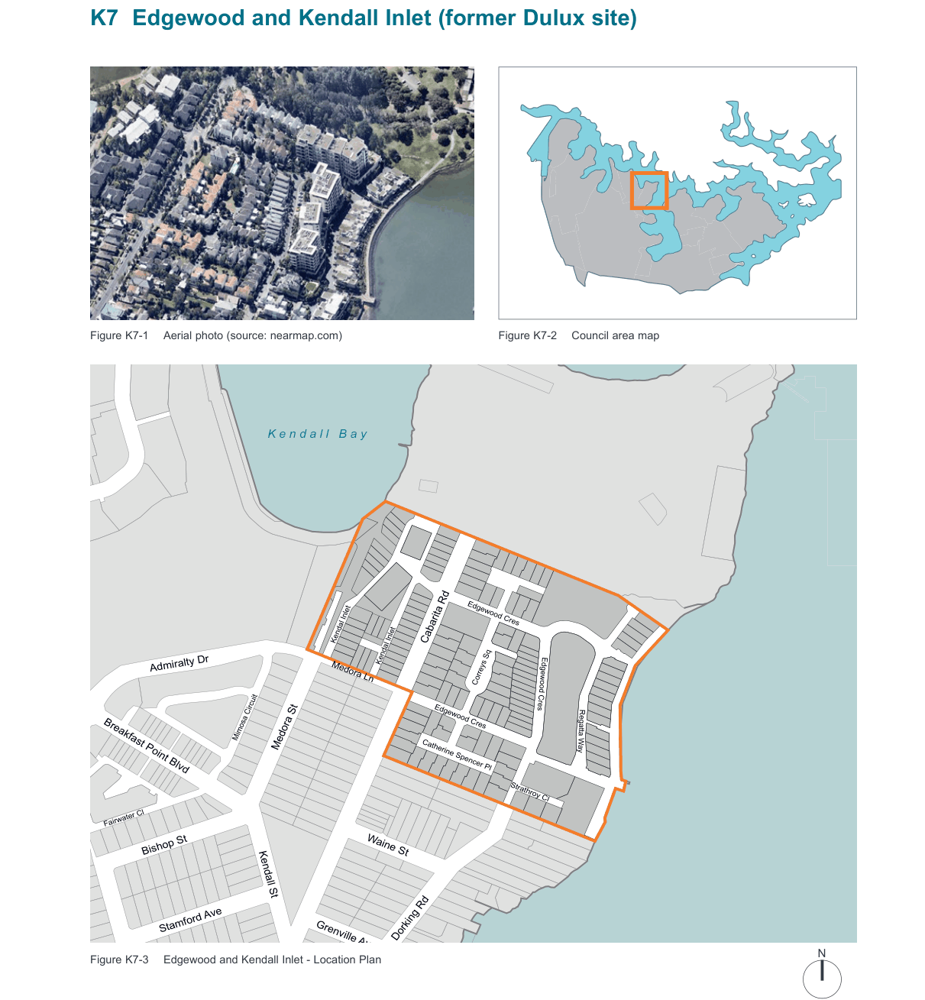
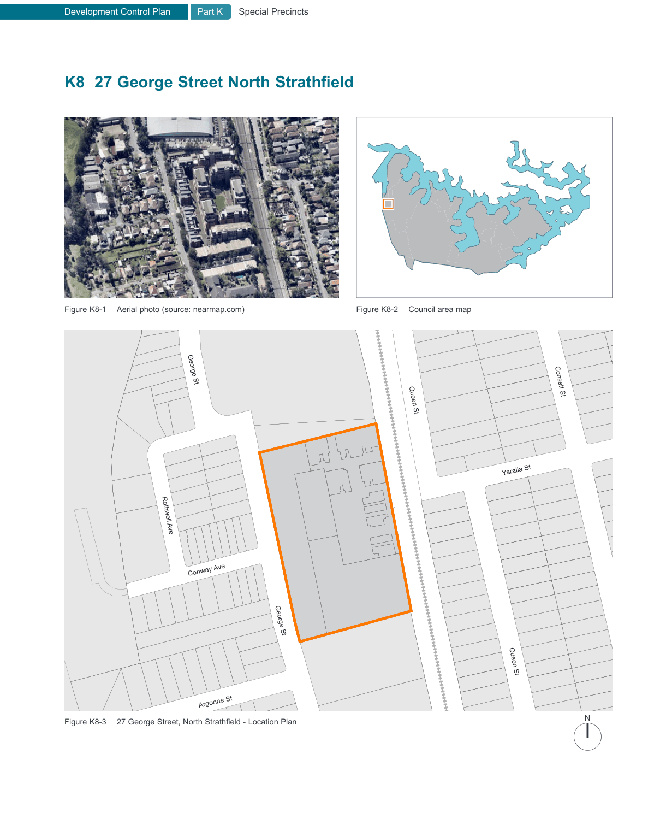

### K7  Edgewood and Kendall Inlet (former Dulux site)

> [Picture on page 61: a map, saved as a picture (images/part-k-special-precincts-page-61-2.gif, 150 dpi); the street names and other small labels are on the picture.]
> Labels printed on the map (copied from the PDF, in no particular order):
> Figure K7-1 Aerial photo (source: nearmap.com) · Figure K7-2 Council area map · K e n d a l l   B a y · Edgewood Cres · Kendal Inlet Cabarita Rd · Kendal Inlet · Admiralty Dr · Medora Ln · Correys Sq · Edgewood Cres · Edgewood Cres · Mimosa Circuit · Medora St · Regatta Way · Catherine Spencer Pl · Breakfast Point Blvd · Strathroy Cl · Fairwater Cl · Bishop St · Waine St · Kendall St · Stamford Ave · Dorking Rd · Grenville Ave · N · Figure K7-3 Edgewood and Kendall Inlet - Location Plan

F r a n c e   B a y

Elphinstone St

Robert St

#### K7.1 General objectives

O1 Provide a pleasant, functional and safe environment to and along the foreshore for cyclists and pedestrians;

O2 Maintain significant views and vistas into and out of the site;

O3 Protect the heritage buildings, Correys House and Strathroy, and their setting on the site;

O4 Ensure adequate provision of landscaping and useable private and public open space;

O5 Provide for pedestrian and cycle linkages through the site to adjoining areas;

O6 Provide adequate carparking and bicycle storage facilities on the site;

O7 Maximise visual and acoustic privacy to adjoining properties and within the development itself;

O8 Ensure adequate daylight and sunlight are maintained to existing development, new development and open spaces;

O9 Ensure the existing streetscape character is maintained and enhanced;

O10 Ensure development and access networks are integrated with the existing built and natural environment;

O11 Ensure development presents an appropriate bulk and scale to public areas having regard to existing development and the topography of the site; and

O12 Ensure the design orientation of buildings and materials used in construction utilise renewable resources.

#### K7.2 Specific provisions

#### Streetscape

O13 To integrate new development in a manner which complements the character of the area and relates to the pedestrian environment.

| Controls |  |
|---|---|
| C1. | Buildings are to be setback 9 metres from the Cabarita Road frontage. |
| C2. | Buildings facades are to be oriented towards existing public street frontages. |
| C3. | Buildings are not to exceed two storeys in height on the Cabarita Road frontage. |
| C4. | Building length on Cabarita Road is not to exceed 20 metres to give the appearance of separate buildings and provide views into the site. |
| C5. | Fences having frontage to public open space or public roadway are: • not to exceed 1 metre in height if of solid construction; and • not to exceed 1.5 metres if of 'open' type design. |
| C6. | Continuous fencing for more than 20 metres (average frontage of existing development) should have some visual or physical relief. |
| C7. | Seating areas in a landscaped setting are to be provided every 100 metres along the frontage. |

#### Side Boundaries

O14 To minimise the impact of new development on adjoining areas.

| Controls |  |
|---|---|
| C8. | Buildings must comply with the building height plane. (see definitions) |
| C9. | Wall openings should be provided at a minimum of 3 metre separation. |
| C10. | Fences on the southern boundary will need to comply with the Dividing Fences Act. |
| C11. | Fences adjoining Cabarita Park should not exceed 1.8 metres in height and be of 'open' appearance. |

#### Foreshore Frontage

O15 To ensure the integrity of the foreshore is maintained and enhanced for public enjoyment.

#### Controls

C12. Building height plane to apply from the property boundary. An average setback of

13.5 metres, having a minimum width of 9 metres, is to be provided from the high water mark to the development for public foreshore access.

C13. Buildings are to be setback a minimum of four metres from the public foreshore accessway. The location of buildings should not result in overshadowing to the foreshore between the hours of 9am - 3pm (EST) 10am - 4 pm (Daylight saving time).

C14. The foreshore access is to be in a landscaped setting and comprise:

• a pedestrian pathway with minimum dimensions of 1.0 metre; and

• a cycleway with minimum dimensions of

0.8 metres with a separation distance of

0.7 metres.

#### Height of Building

O16 To ensure the building envelope relates to the topography of the site, providing an appropriate bulk and scale having regard to the foreshore location, streetscape and adjoining properties.

#### Controls

C15. Buildings should not exceed the building height plane on all boundaries and development should be no higher than:

• 11 metres from existing ground level to the ridge lines of the building as measured from Cabarita Road.

#### Bulk and Scale

O17 To ensure the location, layout and design of buildings has regard to the impact of development on views from surrounding public spaces and within the development.

#### Controls

C16. Buildings comply with the building height plane, floor space ratio, landscaping and tree lining of Cabarita Road.

#### Building Design

O18 To ensure a high quality design which is integrated into the existing environment.

#### Controls

| C17. | All buildings are to have pitched roof forms. |
|---|---|
| C18. | Access driveways are to provide a landscaped entry. |

#### Visual and Acoustic privacy

O19 To provide visual and acoustic privacy to adjoining properties and within the development itself.

#### Controls

C19. The minimum separation distance between directly overlooking dwelling units is:

• 6m between non-habitable rooms; and

• 9m between habitable and non-habitable rooms; and

• 12m between habitable rooms.

C20. Where there are direct views between living areas or into adjoining private open space, fixed windows should be obscured or windows offset or screened appropriately.

Balconies are to adhere to the following setbacks:

• 6m from walls without balconies or windows; and

• 12 metres from walls with balconies or windows.

C21. Bedrooms of one dwelling do not share walls with living rooms or garages of adjacent dwellings.

Bedroom windows are at least 3m from shared streets, driveways and parking areas of other dwellings.

Shared walls and floors between dwellings are constructed in accordance with the noise transmission and insulation requirements of the Building Code of Australia.

#### Views

O20 To maintain views through the site from public spaces.

#### Controls

C22. A view corridor is to be maintained from Cabarita Road, through the development to the foreshore on both sites.

#### Open Space Provision

O21 To provide quality open space for the enjoyment of users.

#### Controls

C23. A landscaped area of 45% of the site area.

#### Private Open Space

O22 To ensure adequate usable private open space to meet the needs of residents.

#### Controls

C24. For above ground development, the open space may take the form of a balcony directly connected to the dwelling with the following minimum requirements:

• 1 bdr - minimum area of 6m² having a minimum dimension of 2m;

• 2 bdr - minimum area of 8m² having a minimum dimension of 2m; and

• 3 bdr or greater - minimum area of 12m² having a minimum dimension of 2m.

C25. For development at ground level the following minimum requirements apply:

• 1 bdr - minimum area of 10m² having a minimum dimension of 3m;

• 2 bdr - minimum area of 16m² having a minimum dimension of 4m; and

• 3 bdr or greater - minimum area of 35m² having a minimum dimension of 4m.

#### Location of Parking Controls

C26. Parking is not permitted between the building and street alignment.

C27. Parking shall be in the form of a garage, basement car park, covered carport or an equivalent open area.

#### Vehicular Access Controls

C28. Security gates are not to be installed at entry and exit points into the development from Cabarita Road.

Vehicular access into  the development is to be directly from Cabarita Road, with the exception of service vehicles to access Strathroy.

#### Protection of Heritage Buildings and Context

O23 To protect and enhance heritage buildings on the site and in their context.

#### Controls

C29. No development is to be within the Cabarita Road frontage and Correy's House. In addition, a minimum curtilage of 10 metres is to be maintained around Correy's House.

No development is to be located between the Parramatta River and Strathroy House. In addition, a minimum curtilage of 10 metres is to be maintained around Strathroy House.

C30. The curtilage of the heritage buildings is to be landscaped, using species appropriate to the heritage context.

#### Use of Heritage Items

O24 To ensure the use of buildings will not impact on the heritage significance or detract from residential amenity.

#### Controls

C31. Where a public or community use is proposed, the hours of operation will be dependent upon:

• the nature of use proposed;

• the proximity to residences; and

• the likely noise generated. A Heritage Management Plan is to be prepared which includes:

• uses proposed for Correy's House and Strathroy House;

• landscaping

• means of access;

• hours of operation;

• maintenance program; and

• management program.

> [Picture on page 66: a map, saved as a picture (images/part-k-special-precincts-page-66-1.gif, 150 dpi); the street names and other small labels are on the picture.]
> Labels printed on the map (copied from the PDF, in no particular order):
> Figure K8-1 Aerial photo (source: nearmap.com) · Figure K8-2 · George St · Rothwell Ave · Conway Ave · George St · Argonne St · Figure K8-3 27 George Street, North Strathfield - Location Plan · Council area map · Queen St · Yaralla St · Queen St · Consett St · N · Hillier St
