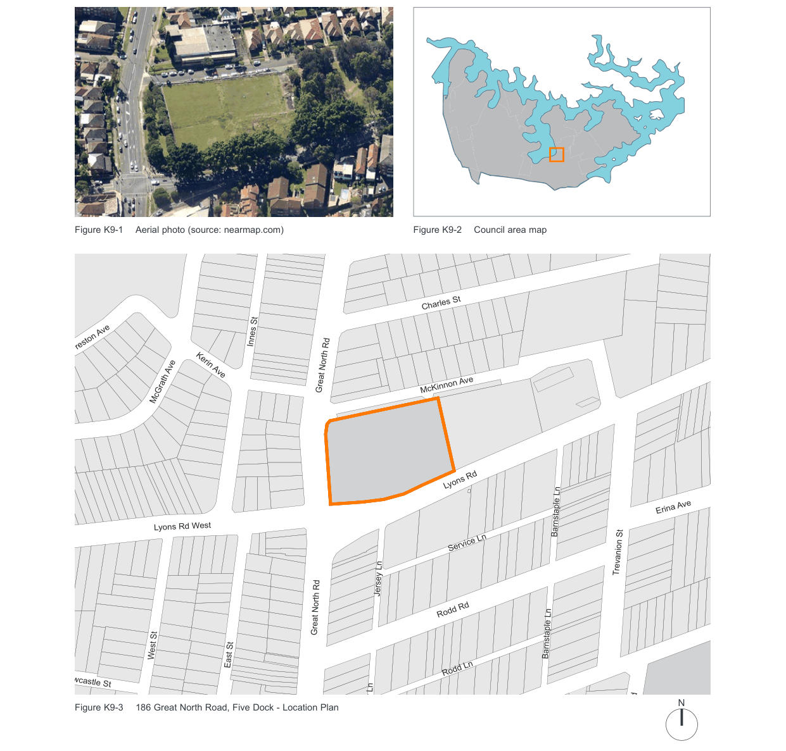
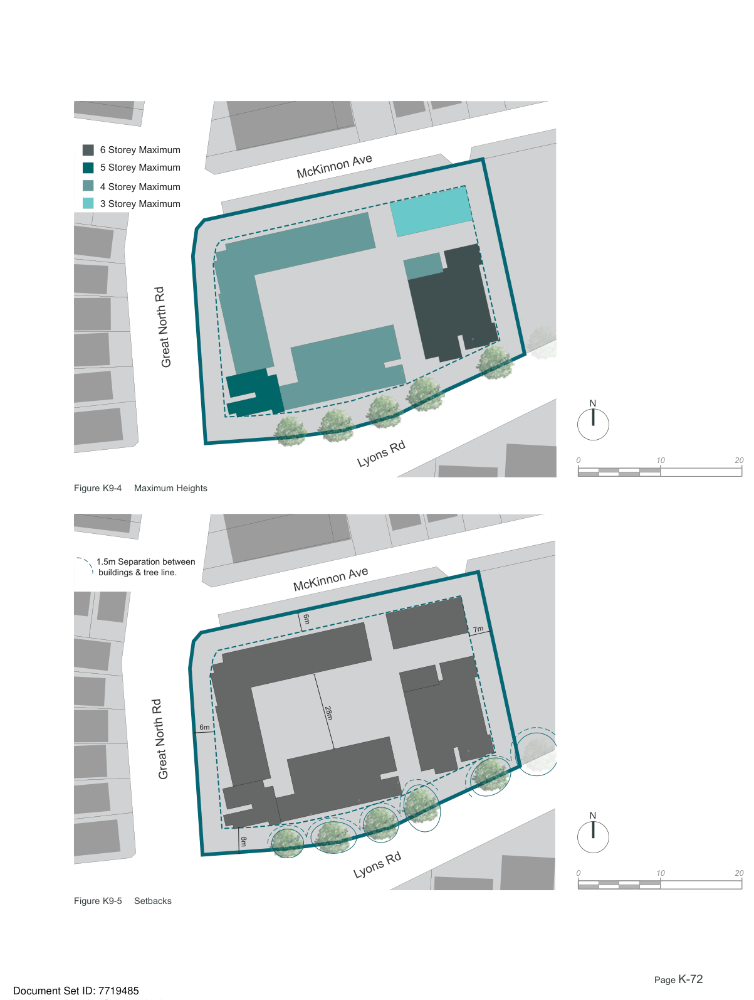
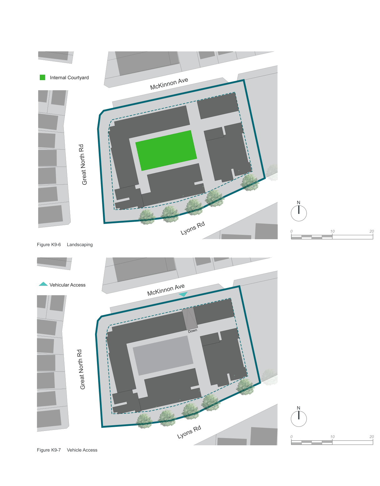
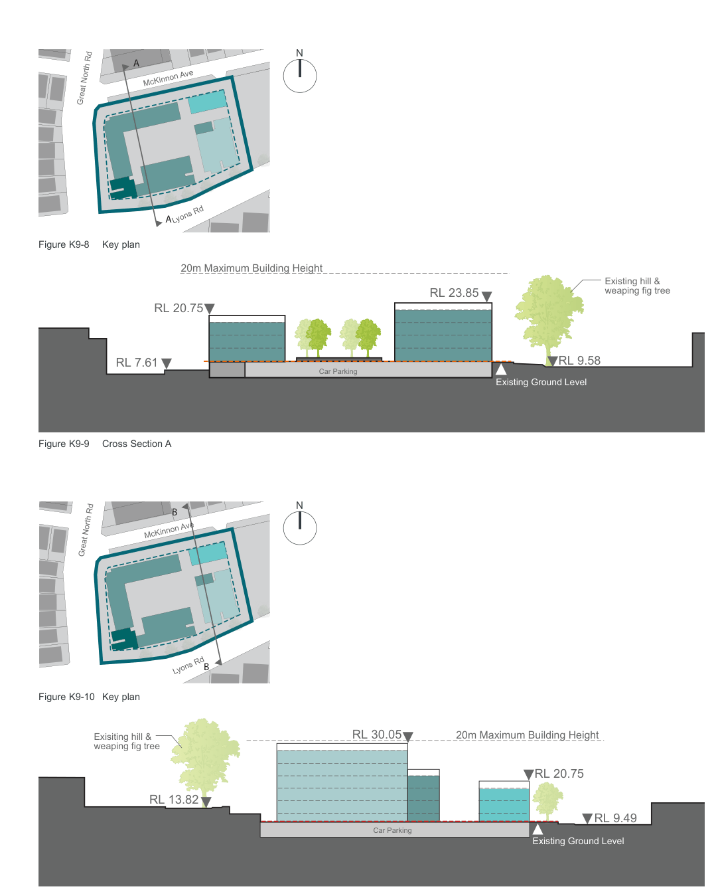
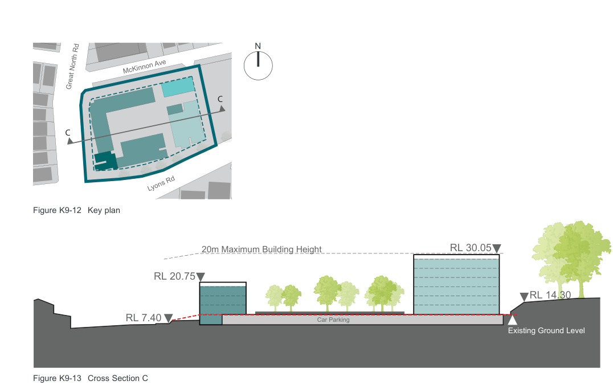
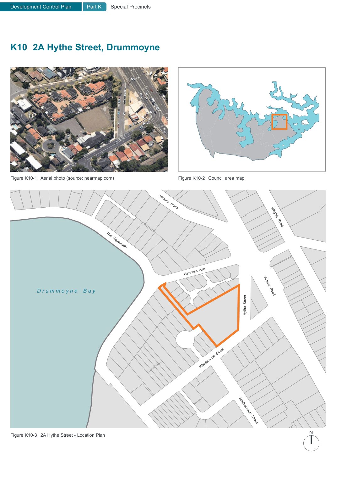

### K9  186 Great North Road, Five Dock

> [Picture on page 70: a map, saved as a picture (images/part-k-special-precincts-page-70-2.gif, 150 dpi); the street names and other small labels are on the picture.]
> Labels printed on the map (copied from the PDF, in no particular order):
> Figure K9-1 Aerial photo (source: nearmap.com) · Innes St · Preston Ave · Kerin Ave · Great North Rd · McGrath Ave · Lyons Rd West · Jersey Ln · Great North Rd · West St · East St · Newcastle St · Figure K9-3 186 Great North Road, Five Dock - Location Plan · Jersey Ln · Figure K9-2 Council area map · Gildea Ave · Charles St · McKinnon Ave · Lyons Rd · Barnstaple Ln · Service Ln · Rodd Rd · Barnstaple Ln · Rodd Ln · Erina Ave · Trevanion St · N · Park Rd

The  following objectives and controls have been prepared to ensure that the land at 186 Great North Road, Five Dock accommodates a high quality development.

#### K9.1 Objectives and provisions

O1. Future development has adequate building setbacks and separation so that buildings are seen within a landscaped setting; O2. Provide lower building heights on the McKinnon Avenue and Great North Road frontages to provide an appropriate bulk/scale relationship with the surrounding locality; O3. To protect important built and natural elements both in the private and public domain; and O4. Ensure the use of high quality facade and design finishes.

| Controls |  |
|---|---|
| C1. | The maximum number of storeys permitted on the site is shown in Figure K9-4 Maximum Heights, Figure K9-9 Cross Section A, Figure K9-11 Cross Section B and Figure K9-13 Cross Section C. |
| C2. | The minimum setbacks from boundaries are shown in Figure K9-5 Setbacks. |
| C3. | A minimum of 38% of the site is to comprise landscaped area. (Landscaped area means any part of the site used for growing plants, grasses and trees but does not include any building, structure or hard paved area). |
| C4. | A minimum of 28% of the site area is to comprise deep soil landscaping. (Deep soil area means any part of the total landscaped area that does not include buildings or other structures under - with the exception of measures for the remediation of contaminated land). |

| C5. | The Fig trees on Lyons Road are to be protected throughout construction and following completion of building through setbacks of the building and associated basements. |
|---|---|
| C6. | Vehicle Access from Great North Road and Lyons Road is not permitted. Vehicular access to and from the site must be from McKinnon Avenue. Refer to Figure K9-7 Vehicle Access. |
| C7. | The Tobruk Memorial is to be retained on the corner of Great North Road and Lyons Road. |
| C8. | In addition to the 8.0m from the southern boundary adjacent to Lyons Road, all buildings are to be set back an additional 1.5m from the canopy of the Fig trees. |
| C9. | Buildings are to be designed to face the street, and to enhance the public domain through entrances, good quality finishes and well resolved architectural design. |
| C10. | Fencing on the site is to be designed so that sight lines for both pedestrian and vehicles are not obscured. |
| C11. | Roof forms, plant and lift overruns are to be designed to be simple compact forms that are visually unobtrusive. |

Development Control Plan Part K

6 Storey Maximum 5 Storey Maximum 4 Storey Maximum 3 Storey Maximum

Great North Rd

Figure K9-4 Maximum Heights

1.5m Separation between

buildings & tree line.

Great North Rd

Figure K9-5 Setbacks

Special Precincts

> [Picture on page 72: a map, saved as a picture (images/part-k-special-precincts-page-72-13.gif, 150 dpi); the street names and other small labels are on the picture.]
> Labels printed on the map (copied from the PDF, in no particular order):
> 6m · 8m · McKinnon Ave · Lyons Rd · McKinnon Ave · 6m · 7m · 28m · Lyons Rd · N · 0 · 10 · 20 · N · 0 · 10 · 20

Development Control Plan

Internal Courtyard

Great North Rd

Figure K9-6 Landscaping

Vehicular Access

Great North Rd

Figure K9-7 Vehicle Access

Part K Special Precincts

> [Picture on page 73: a map, saved as a picture (images/part-k-special-precincts-page-73-9.gif, 150 dpi); the street names and other small labels are on the picture.]
> Labels printed on the map (copied from the PDF, in no particular order):
> McKinnon Ave · Lyons Rd · McKinnon Ave · Down · Lyons Rd · N · 0 · 10 · 20 · N · 0 · 10 · 20

> [Picture on page 74: a map, saved as a picture (images/part-k-special-precincts-page-74-1.gif, 150 dpi); the street names and other small labels are on the picture.]
> Labels printed on the map (copied from the PDF, in no particular order):
> N · A · McKinnon Ave · Great North Rd · A · Lyons Rd · Figure K9-8 Key plan · 20m Maximum Building Height · RL 20.75 · RL 7.61 · Car Parking · Existing hill & · weaping fig tree · RL 23.85 · RL 9.58 · Existing Ground Level

Figure K9-9 Cross Section A

> Labels printed on the map (copied from the PDF, in no particular order):
> N · B · McKinnon Ave · Great North Rd · B · Lyons Rd · Figure K9-10 Key plan · RL 30.05 · Exisiting hill & · weaping fig tree · RL 13.82 · Car Parking · 20m Maximum Building Height · RL 20.75 · RL 9.49 · Existing Ground Level

Figure K9-11 Cross Section B

> [Picture on page 75: a map, saved as a picture (images/part-k-special-precincts-page-75-1.gif, 150 dpi); the street names and other small labels are on the picture.]
> Labels printed on the map (copied from the PDF, in no particular order):
> N · McKinnon Ave · Great North Rd · C · C · Lyons Rd · Figure K9-12 Key plan · 20m Maximum Building Height · RL 20.75 · Car Parking · RL 7.40 · RL 30.05 · RL 14.30 · Existing Ground Level

Figure K9-13 Cross Section C

> [Picture on page 76: a map, saved as a picture (images/part-k-special-precincts-page-76-1.gif, 150 dpi); the street names and other small labels are on the picture.]
> Labels printed on the map (copied from the PDF, in no particular order):
> Figure K10-1 Aerial photo (source: nearmap.com) · Figure K10-2 Council area map · Victoria  Place · Wrights  Road · The  Esplanade · Henricks  Ave · D r u m m o y n e    B a y · Victoria  Road · Hythe  Street · Westbourne  Street · Marlborough  Street · N · Figure K10-3 2A Hythe Street - Location Plan · Tavistock  Street
