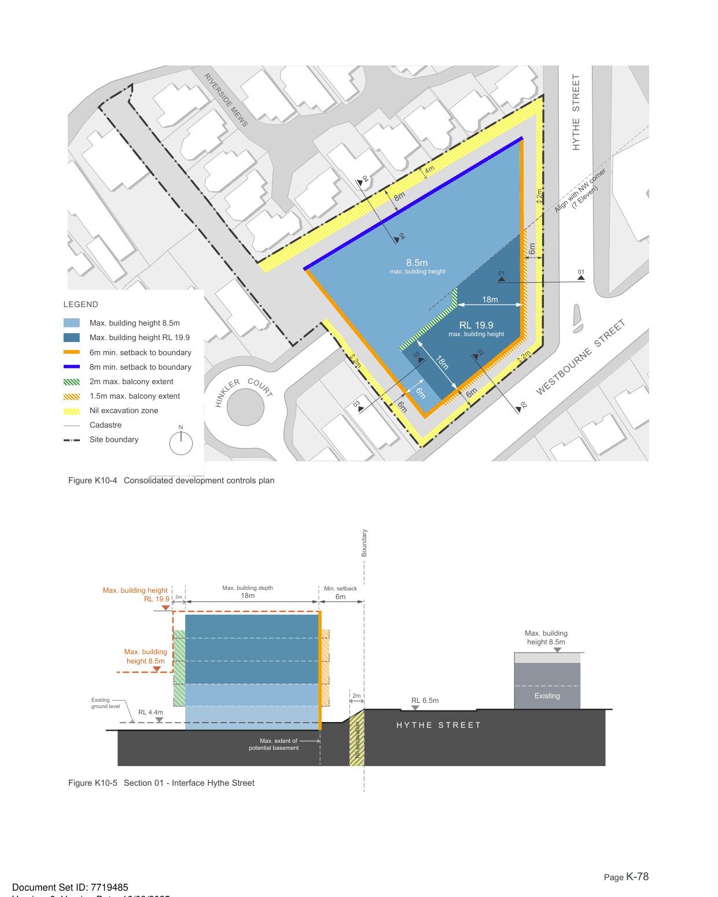
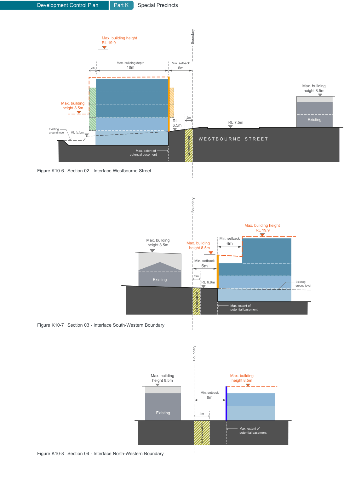
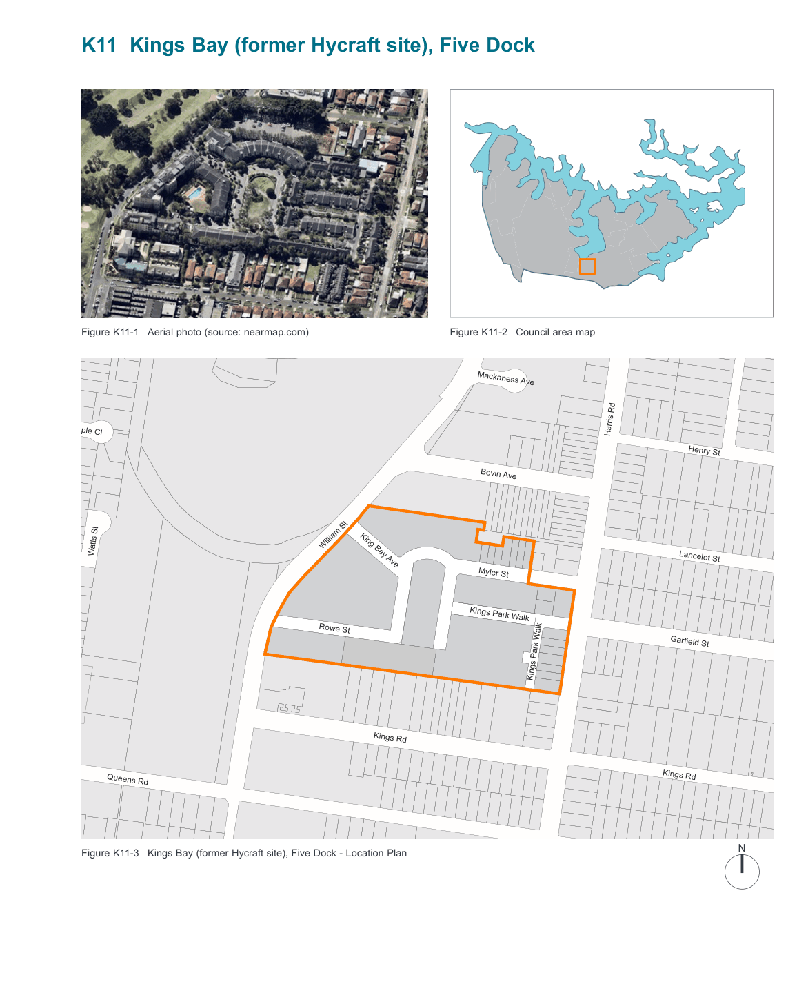

### K10  2A Hythe Street, Drummoyne

#### K10.1 General objectives

O1 To achieve a coordinated urban design outcome.

O2 To enhance the existing streetscape and ensure appropriate development scale and interface near residential areas.

O3 To minimise solar access and privacy impacts upon surrounding properties.

O4 To minimise the impact of any  excavation on adjoining buildings and existing landscape.

O5 The design of balconies is not to significantly increase the visual bulk of the building.

| Controls |  |
|---|---|
| C1. | Buildings are to adhere to the following setbacks: 6m to the south-western property boundary; 6m to the western boundary; 8m to the north-western property boundary. |
| C2. | The maximum building height is RL 19.9 on the corner of Westbourne Street and Hythe Street. The maximum building height on the remainder of the site is 8.5 metres. |
| C3. | Water Sensitive Urban Design systems are to be implemented and detailed in landscape plans and stormwater solutions on the site. |
| C4. | No excavation is to occur within the “Nil excavation zone”. |
| C5. | Balconies within the balcony zone are to have a light weight design character, for example a glass or metal balustrade |
| C6. | Preclude vehicular access and egress from Westbourne Street and Hinkler Court. |

Development Control Plan

Part K Special Precincts

> [Picture on page 78: a map, saved as a picture (images/part-k-special-precincts-page-78-3.gif, 150 dpi); the street names and other small labels are on the picture.]
> Labels printed on the map (copied from the PDF, in no particular order):
> LEGEND · Max. building height 8.5m · Max. building height RL 19.9 · 6m min. setback to boundary · 8m min. setback to boundary · 2m max. balcony extent · 1.5m max. balcony extent · Nil excavation zone · Cadastre · N · Site boundary · RIVERSIDE MEWS · 04 · 2m · C · R O · E U · L R · K T · N · I · H · 03 · Figure K10-4 Consolidated development controls plan · Max. building height · RL 19.9 · 2m · Max. building · height 8.5m · Existing · ground level · RL 4.4m · Max. building depth · 18m · Max. extent of · potential basement · Boundary · Min. setback · 6m · 2m · Nil excavation · Figure K10-5 Section 01 - Interface Hythe Street · 8m · 4m · 04 · 8.5m · max. building height 01 · 18m · RL 19.9 · max. building height · 18m · 6m · 6m · 03 · 02 · 6m · RL 6.5m · H Y T H E   S T R E E T · HYTHE  STREET · 2m · (7 Eleven) · Align with NW corner · 6m · 01 · 2m · WESTBOURNE  STREET · 02 · Max. building · height 8.5m · Existing

> [Picture on page 79: a map, saved as a picture (images/part-k-special-precincts-page-79-1.gif, 150 dpi); the street names and other small labels are on the picture.]
> Labels printed on the map (copied from the PDF, in no particular order):
> Boundary · Max. building height · RL 19.9 · Max. building depth Min. setback · 2m · 18m · 6m · Max. building · height 8.5m · Max. building · height 8.5m · 2m · Existing · RL · 6.5m · RL 7.5m · RL 5.5m · Existing · ground level · W E S T B O U R N E    S T R E E T · Nil excavation · Max. extent of · potential basement · Figure K10-6 Section 02 - Interface Westbourne Street · Boundary · Max. building height · RL 19.9 · Min. setback · Max. building · 6m · Max. building · height 8.5m · height 8.5m · Min. setback · 6m · 2m · Existing · RL 6.8m · Existing · ground level · Max. extent of · potential basement · Nil excavation · Figure K10-7 Section 03 - Interface South-Western Boundary · Boundary · Max. building · Max. building · height 8.5m · height 8.5m · Min. setback · 8m · Existing · 4m · Max. extent of · potential basement · Nil excavation · Figure K10-8 Section 04 - Interface North-Western Boundary

> [Picture on page 80: a map, saved as a picture (images/part-k-special-precincts-page-80-1.gif, 150 dpi); the street names and other small labels are on the picture.]
> Labels printed on the map (copied from the PDF, in no particular order):
> Figure K11-1 Aerial photo (source: nearmap.com) · Maple Cl · William St · Watts St · King Bay Ave · Rowe St · Kings Rd · Queens Rd · Figure K11-3 Kings Bay (former Hycraft site), Five Dock - Location Plan · Spencer St · William St · Figure K11-2 Council area map · Mackaness Ave · Bevin Ave · Myler St · Kings Park Walk · Kings Park Walk · Harris Rd · Harris Rd · Henry St · Lancelot St · Garfield St · Kings Rd · N · Queens Rd · Courland St
