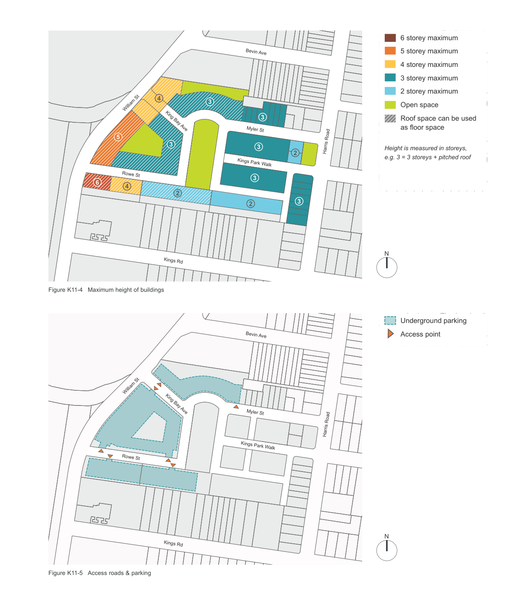

### K11  Kings Bay (former Hycraft site), Five Dock

#### K11.1 General objectives

O1. To create a new form of housing in this area which in terms of scale, bulk and form respects the existing pattern of the public domain and mediates between the built form of the area and earlier inner city suburbs;

O2. To facilitate development of the site which responds to the context of the site by locating larger scale development adjacent to open space areas or non residential uses; O3. To minimise the impact of the new development on the site on privacy and sunlight access of neighbouring residential properties; O4. To provide for the recreation needs of the new residents of the site;

O5. To identify and retain any significant trees on the site; and

O6. To provide safe access to and from the site for cars and pedestrians.

#### K11.2 Specific provisions

#### Density, Design, Height, Scale and Bulk Objectives

O7. To achieve development of the site which will introduce new housing forms to this area in a way which respects the traditional urban environment; and

O8. To ensure that the bulk and scale of the new development is sympathetic to the existing development in the area.

#### Height

| Controls |  |
|---|---|
| C1. | Subject to the maximum height of buildings, is to comply with the heights for the various sections of the site as shown in Figure K11-4 Maximum height of buildings. |
| C2. | Not withstanding the above, the roofspace of buildings west of the central park as shown hatched on the height plan (see Figure K11-4 Maximum height of buildings) can be used as floor space. |

#### Site coverage Controls

| C3. | Building footprints must not occupy more than 30% of the total site area. |
|---|---|

#### Setbacks

| Controls |  |
|---|---|
| C4. | The wall to the below grade parking structure is to be set back a minimum of 3.5m from the boundary of William Street. |
| C5. | Buildings are to be set back a minimum of 6m from the boundary of William Street at ground level. |
| C6. | Buildings are to be set back a minimum of 5m from the boundary of Harris Road at ground level. |
| C7. | Buildings are to be set back a minimum of 7.5m from the rear property boundaries in Kings Road at ground level. |
| C8. | For the 5 & 6 storey building heights shown on Figure K11-4 Maximum height of buildings the top floor of each will be set back a further 2.5m from the floor below along William Street. |
| C9. | Houses at the eastern side of the central park are to be setback a minimum of 4.5m from lot boundary. |

#### Design and Built Form

| Controls |  |
|---|---|
| C10. | The site is to be developed as part of a comprehensive scheme where there is a strong relationship in design terms between the various elements of the development. |
| C11. | There is to be a variety of medium density development on the site ranging from terrace houses to residential flat buildings located around a central open space area (see Figure K11-4 Maximum height of buildings). |
| C12. | Higher density development should be located at the western end of the site where its apparent height and bulk can be related to open space and non residential uses or serviced apartments on neighbouring boundaries. |
| C13. | Where appropriate, buildings should formally present to the existing street frontages and integrate with existing streetscapes. |
| C14. | Roof forms should be predominantly pitched especially on the lower density development on the site. |
| C15. | The orientation of development should capitalise on solar access and views, and buildings should be located in relation to roads and open space to create a strong sense of place. |

#### Open Space Objectives

O9. To provide open space which will form a physical focus for the development; O10. To meet the requirements of the residents of the site in relation to formal and informal recreation activities. These requirements are to be assessed on the basis of the likely future population of the site; and

O11. Design and integrate landscaping into the development both as part of the open space areas and other areas of the public domain.

#### Location and Design

| Controls |  |
|---|---|
| C16. | Figure K11-4 Maximum height of buildings shows the location for the major open space areas on the site. Other smaller areas may be provided on the site for informal activities. A standard of 2.51ha per 1,000 residents of dedicated public open space has been adopted by Council. A minimum of 5,000m2 is to be provided on site. |
| C17. | Where possible there should be pedestrian linkages between the open space areas. |
| C18. | Landscaped open space areas should provide for a range of recreation needs covering both formal and informal activities. |

#### Private Open Space

| Controls |  |
|---|---|
| C19. | At least 40m2 per dwelling of landscaped private open space is to be provided on the site. This does not need to adjoin each dwelling but can be provided in larger areas. |
| C20. | Each dwelling must have an area of open space attached to it. This may be by way of a balcony or roof terrace, or at ground level. This open space area should have a minimum area of 10m2. |

> [Picture on page 83: a map, saved as a picture (images/part-k-special-precincts-page-83-1.gif, 150 dpi); the street names and other small labels are on the picture.]
> Labels printed on the map (copied from the PDF, in no particular order):
> Bevin Ave · 4 · 3 · William St · 3 · King Bay Ave · Myler St · 5 · 3 · 3 · Harris Road · 2 · Kings Park Walk · Rowe St · 3 · 6 · 2 · 4 · 3 · 2 · Kings Rd · Figure K11-4 Maximum height of buildings · Bevin Ave · William St · King Bay Ave · Myler St · Harris Road · Kings Park Walk · Rowe St · Kings Rd · Figure K11-5 Access roads & parking · 6 storey maximum · Henry St · 5 storey maximum · 4 storey maximum · 3 storey maximum · 2 storey maximum · Open space · Roof space can be used · as floor space · Lancelot St · Height is measured in storeys, · e.g. 3 = 3 storeys + pitched roof · Garfield St · N · Underground parking · Henry St · Access point · Lancelot St · Garfield St · N
