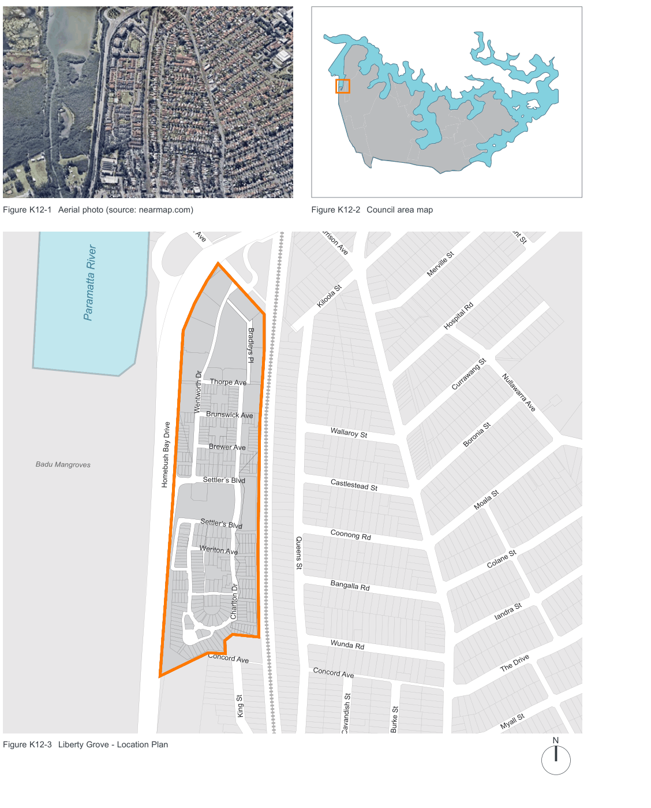

### K12  Liberty Grove

> [Picture on page 84: a map, saved as a picture (images/part-k-special-precincts-page-84-2.gif, 150 dpi); the street names and other small labels are on the picture.]
> Labels printed on the map (copied from the PDF, in no particular order):
> Figure K12-1 Aerial photo (source: nearmap.com) · Oulton Ave · Paramatta River · Bradleys Pl · Thorpe Ave · Wentworth Dr · Brunswick Ave · Brewer Ave · Badu Mangroves · Settler’s Blvd · Homebush Bay Drive · Settler’s Blvd · Weriton Ave · Charlton Dr · Concord Ave · King St · Figure K12-3 Liberty Grove - Location Plan · Figure K12-2 Council area map · Fremont St · Harrison Ave · Merville St · Kiloola St · Hospital Rd · Currawang St · Nullawarra Ave · Wallaroy St · Boronia St · Castlestead St · Moala St · Coonong Rd · Queens St · Colane St · Bangalla Rd · Iandra St · Wunda Rd · The Drive · Concord Ave · Myall St · Burke St · Cavandish St · N

#### K12.1 General objectives

To provide guidance for the residential development of the land which is attractive to potential and existing residents of Canada Bay, appropriate for the local environment and which takes account of the following:

O1. Maintenance of the amenity of existing nearby residents of Canada Bay as far as possible with regard to stormwater drainage, landscape quality, privacy, solar access, traffic and noise impacts; O2. Maintenance of existing levels and quality of public open space facilities in Canada Bay; O3. Integration of the built form with the existing landscape and the locality generally; and O4. Public access to achieve integration into the Canada Bay community.

#### K12.2 Specific provisions

#### Development Density Objective

O5. To provide a maximum density control that will assist in encouraging a variety of building forms which would be appropriate within the local area by providing for development which takes into account the opportunities and constraints imposed by local infrastructure while providing for an acceptable bulk and scale of development.

#### Controls

C1. The maximum permitted density based on the Gross Site Area shall be 65 dwellings per hectare. “Gross Site Area” means the area of the whole of the land shown edged orange on Figure K12-3 Liberty Grove - Location Plan.

C2. Where possible there should be pedestrian linkages between the open space areas.

C3. Landscaped open space areas should provide for a range of recreation needs covering both formal and informal activities.

#### Site coverage

| Controls |  |
|---|---|
| C4. | The total site cover of all buildings shall not exceed 35% of the Gross Site Area. This clause applies to all buildings except those provided solely for the following purposes: • Public recreation, open space or amenities; and • Garbage storage areas. |

#### Site requirements Objectives

O6. To ensure siting of buildings and landscaping to meet reasonable user and neighbour requirements for privacy.

O7. To provide flexibility in the siting of buildings and minimise adverse impact on adjacent and adjoining properties.

O8. To achieve a coherent site layout that provides a pleasant, attractive, manageable and resource-efficient living environment.

O9. To provide adequate space for landscaping, visual and acoustic privacy.

#### Setbacks Controls

C5. The following Building Line setbacks apply:

• To the Gross Site property boundary - 10m provided however that this may be increased to 15m taking into account the height of any building or structure and its likely impact; and

• To any internal road - 4m.

C6. Generally at least one half of any Building Line Setback shall be comprised solely of soft landscaping.

#### Traffic and Access Objective

O10. To provide vehicular access that is efficient in layout and provides a safe and pleasant environment for residents and visitors.

#### Controls

C7. There shall be no vehicular access to or from the site via Concord Avenue or King Street and all access shall be via Homebush Bay Drive and Oulton Avenue.

#### Open Space Objectives

O11. To provide convenient open space and recreational opportunities for the residents of multi-unit housing projects; O12. To enhance the quality of the built environment, and the appearance and character of the site by providing for landscaping; O13. To meet the wider community needs for open space and recreation and assist in maintaining the levels of quality and provision of open space; O14. To provide for landscaping which takes into account the sensitivity of the adjoining environment of Homebush Bay and minimises the impact of stormwater discharge; O15. To provide for passive recreation opportunities; and

O16. To provide for privacy and shade.

#### Landscaping

| Controls |  |
|---|---|
| C8. | All areas not occupied by buildings or roads shall be landscaped predominantly with ‘soft’ landscaping. |
| C9. | Not more than 10% of all landscaping may be used for hard landscaping. |
| C10. | Paths and paving within landscaped areas should be kept to a minimum and within soft landscaped areas allowed only so as to provide access and for discrete passive recreation opportunities. |
| C11. | Selection and plantings of trees and shrubs should primarily reflect trees and plants of the Parramatta River valley. |
| C12. | A balance of upper, mid and lower canopy trees is required in all landscaped areas but especially in perimeter setbacks. |

#### General Provisions Objective

O17. To maintain the amenity of existing dwellings near the site and reflect the character of Concord.

#### Architectural Design Controls

C13. External design of buildings should have regard to the traditional styles of Concord and especially the California Bungalow theme and especially to the principal features thereof including the following:

• gable ended pitched roofs;

• pilasters and pillars supporting roofs and awnings;

• verandahs; and

• detailed eaves.
