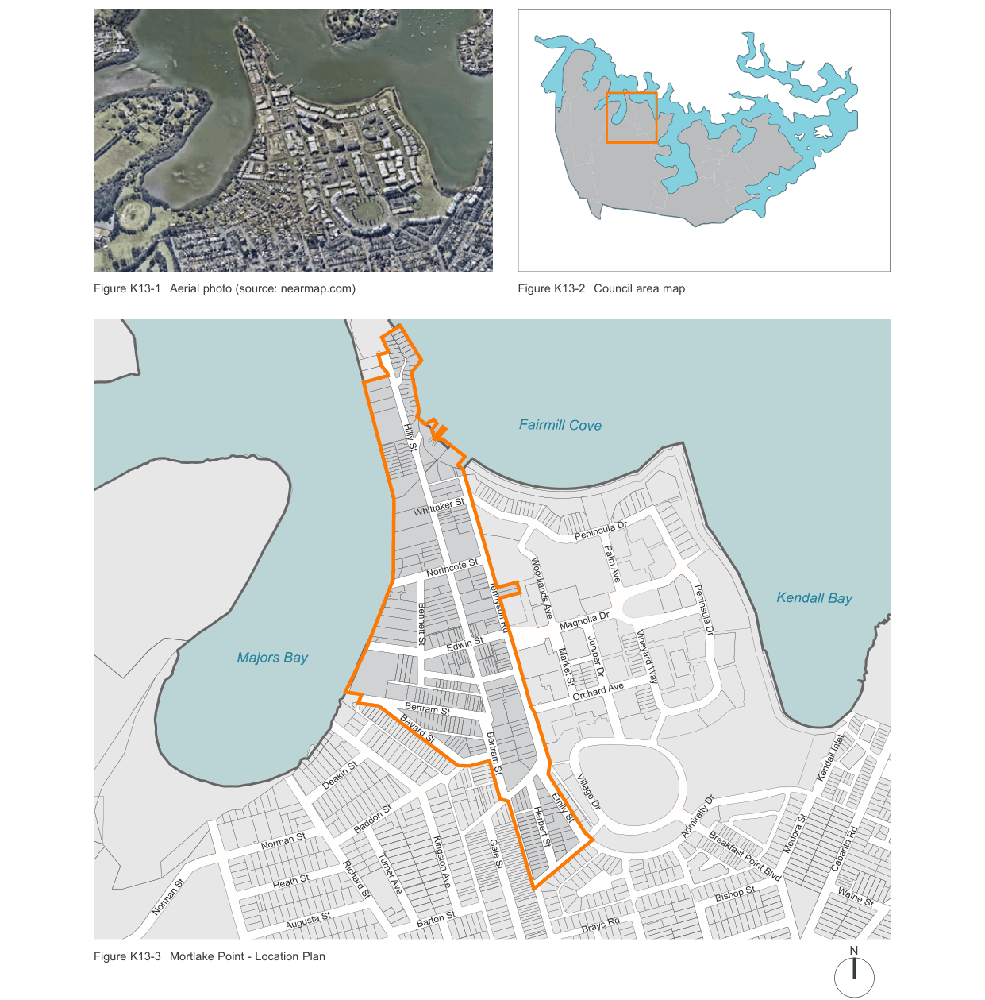

### K13  Mortlake Point

> [Picture on page 87: a map, saved as a picture (images/part-k-special-precincts-page-87-2.gif, 150 dpi); the street names and other small labels are on the picture.]
> Labels printed on the map (copied from the PDF, in no particular order):
> Figure K13-1 Aerial photo (source: nearmap.com) · Figure K13-2 Council area map · Fairmill Cove · Hilly St · Whittaker St · Peninsula Dr · Northcote St · Kendall Bay · Tennyson Rd · Peninsula Dr · Bennett St · Magnolia Dr · Edwin St · Majors Bay · Juniper Dr · Vineyard Way · Palm Ave · Woodlands Ave · Market St · Orchard Ave · Bertram St · Bayard St · Bertram St · Kendall Inlet · Deakin St · Village Dr · Emily St · Baddon St · Admiralty Dr · Herbert St · Norman St · Medora St · Gale St · Cabarita Rd · Breakfast Point Blvd · Kingston Ave · Heath St · Turner Ave · Richard St · Bishop St · Waine St · Norman St · Barton St · Augusta St · Brays Rd · N · Figure K13-3 Mortlake Point - Location Plan · Gloucester St

Brays Rd

#### K13.1 General objectives

The objectives of the Land Use Compatibility component of this DCP are outlined below.  All development in Mortlake Point is to comply with these Objectives.

O1 Ensure that all potential amenity impacts of proposed development are mitigated through appropriate design responses;

O2 Ensure that new residential development provides an acceptable level of amenity where located adjacent to non-residential land uses, through design responses that mitigate any impact from existing non-residential land uses;

O3 Ensure that residential development would not in any way affect the lawful consent of existing non-residential land uses;

O4 Ensure that the impact generated by new non-residential development, such as operating hours, noise, privacy, vehicular and pedestrian traffic and other factors is controlled so as to not affect the amenity of adjacent residential development; and

O5 Ensure that Council is provided with relevant and sufficient information that allows Council to determine the land use compatibility impacts of a proposed development.

#### K13.2 Specific provisions

#### General Compatibility Standard for All

#### Development

| C3. | Development is to use appropriate site layouts that use buildings, walls and other physical aspects to minimise environmental impact on adjacent land uses. |
|---|---|
| C4. | Adequate provision shall be made for off-street parking on all developments to ensure that no conflicts arise between residential and non-residential developments in the utilisation of on-street parking generally. |

| Controls |  |
|---|---|
| C1. | All development is to utilise a continuous buffer treatment along the interface with adjacent non-compatible land uses. In particular, this should apply to the side and rear boundaries of proposed developments. |
| C2. | While frontages must be designed so as to not create an unnecessary “solid” frontage that would be unacceptable as streetscape treatment. |

#### Design Requirements for Non-Residential

#### Developments

| Controls |  |
|---|---|
| C5. | New non-residential development adjacent to residential development should not generate industrial airborne emissions causing noise, odour, fumes and dust to the extent to which it will affect the amenity of adjacent residential development. |
| C6. | External walls facing residential properties are to be constructed of materials with good sound insulating quality and no large openings that would transmit noise. |
| C7. | Plant equipment and machinery is to be located within the building or screened from adjacent residential uses. |
| C8. | Vehicular access must not be provided along the boundary adjacent to residential uses. |
| C9. | Loading and maneuvering areas are to be located within the building or screened from adjacent residential uses. |
| C10. | The development must be designed so that any traffic generated has a minimal impact on adjacent residential uses and on the local road system. |
| C11. | Signage must be of a character that does not detract from the visual amenity of the existing residential uses. |

| Controls |  |
|---|---|
| C12. | Lighting systems within the development must not create light spillage onto adjacent residential uses. |
| C13. | Hours of operation (including waste collection) being limited to between 7am and 6pm, Monday to. Friday, with limited hours on Saturday for some uses and no operation on Sunday. |
| C14. | New non-residential development is to use site layouts that use buildings, walls and other physical elements to provide further protection for noise-sensitive uses from off-site noise. |

#### Compatibility Requirements for Residential

#### Development

| Controls |  |
|---|---|
| C15. | External walls facing non-residential properties are to be constructed of materials with good sound insulating quality and no large openings (including windows) that would transmit noise. |
| C16. | The building plan; walls, windows, doors and roof are to be designed to reduce intrusive noise levels from potential sources of noise emanating from adjacent non- residential uses. Attention should be paid to re-orientating noise sensitive rooms (living, dining, bedrooms) away from potential sources of noise. |
| C17. | Balconies and other external building elements are to be located, designed and treated to minimise noise infiltration. |
| C18. | Where windows are to face non-residential development, they are to be fitted with noise-attenuating glass to minimise the impact of background noise from non-residential development. |
| C19. | Landscaping with appropriate setbacks is to be provided on communal and private open space to create a visual buffer between adjacent non-residential development and filter any air-borne particles generated by industry. |

#### Building Height and Scale Objectives

O6 To ensure that new development:

a) Provides appropriate scale and compatibility with the Mortlake streetscape and the Parramatta River foreshore context;

b) Ensures reasonable access of all development to significant views, vistas and landmarks within and around Mortlake Point;

c) Maintains and enhances environmental amenity in the immediate context of the development, including reasonable solar access, adequate levels of privacy and an acceptable level of view sharing; and

d) Achieve comfortable street environments for pedestrians in terms of daylight, scale, sense of enclosure, as well as providing a healthy environment for street vegetation.

| Controls |  |
|---|---|
| C20. | Maximum height of new development is not to exceed 12 metres from natural ground level to the uppermost point of the roof structures. |
| C21. | Building heights are to respond to the topography of Mortlake Point through building heights that ensure the sharing of views to significant land marks and encourage appropriate response to the natural topography. |
| C22. | Where appropriate, new development is to adopt the predominant height and shape of adjoining development and have similar bulk and mass, taking into account the size and shape of the lot, with taller buildings or elements of one building placed on the higher parts of the site. |

#### Building Setbacks

To ensure that new development:

a) Provides appropriate relationship to the existing streetscape, by ensuring uniform built form patterns in new development;

b) Ensures that new development contributes to the public domain in Mortlake Point by providing front setbacks that ensure a comfortable street environment for pedestrians in terms of providing solar access, appropriate human scale and a healthy environment for street vegetation;

c) Strengthens the relationship of new development in Mortlake Point to significant landmarks in the immediate and broader context; and

d) Provide side and rear setbacks that provide adequate opportunity for ventilation, solar access, view sharing and privacy in residential buildings.

| Controls |  |
|---|---|
| C23. | The front setback is 7.5 metres on all sites. |
| C24. | On the frontages to Northcote Street, Edwin Street, McDonald Street and Bertram Street, a minimum frontage of 7.5 metres is required to facilitate vista termination and visual access to significant views to the west. |
| C25. | Where Non-Residential development is directly adjacent to Residential development, development is set back at least 4.0 metres from the side and rear boundaries. |
| C26. | All other residential development is to be set back a minimum 3 metres from the side and rear property boundaries. |

#### Foreshore access

| Controls |  |
|---|---|
| C27. | Foreshore access is to be encouraged and promoted by securing public access to the foreshore areas of open space for improvement of and linkages with local and regional areas of open space. |

C28. All development on land located along the foreshore in the area to which this DCP applies is to ensure that adequate public access is provided, to a width of eight (8) metres.

| C29. | The Council is to consider all opportunities to increase public access to the foreshore through acquisition, dedication or right-of- way. |
|---|---|

#### Streetscape and Public Domain Objectives

O7 To create a high quality environment for local residents and workers in Mortlake Point;

O8 To ensure that new development within Mortlake Point makes a positive contribution to the streetscape and public domain in the area by ensuring a safe, attractive and comfortable environment; and

O9 Ensure that development includes aspects of landscaping that add to the habitat values of the area.

| Controls |  |
|---|---|
| C30. | Mid-block connections are to be provided for pedestrians on large sites, in particular those sites directly abutting public foreshore areas. Links should be a minimum of 3 metres in width and where appropriate, be dedicated as public right of way. |
| C31. | Landscaping is to be utilised by development to encourage improved pedestrian amenity through the provision of shade-giving trees spaced at regular intervals of at least 6 metres. |
| C32. | Landscaping should incorporate, where possible, native vegetation to improve the habitat potential of the area. |
| C33. | Pedestrian access is to be clearly legible from the street. |
