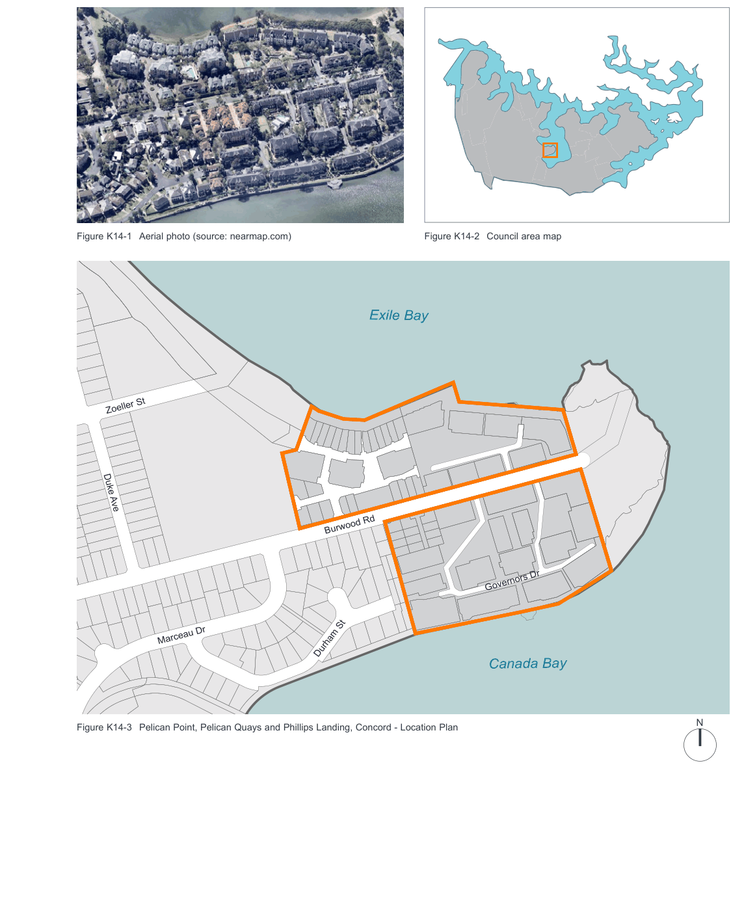
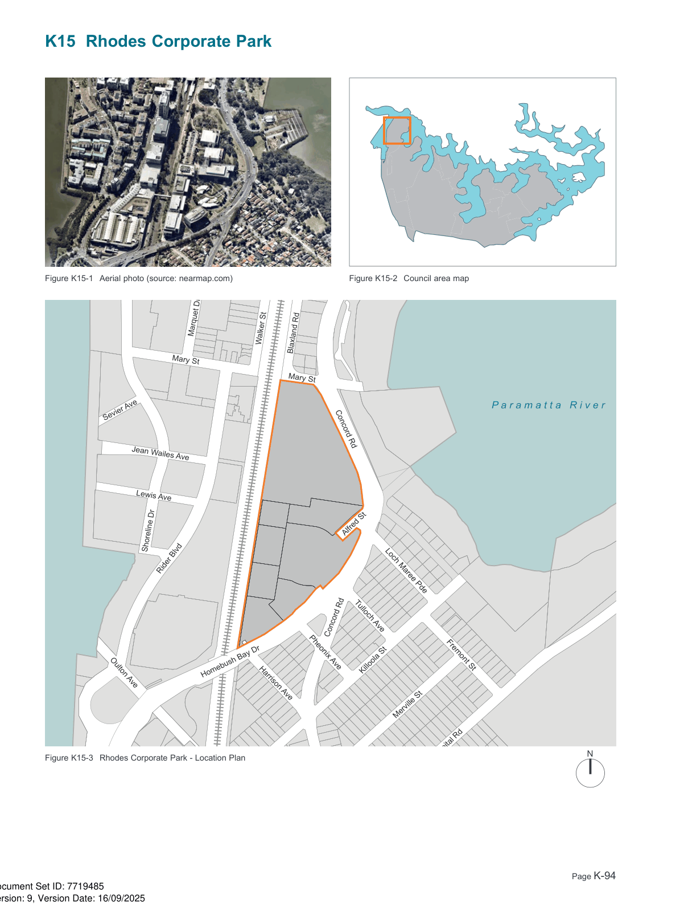

### K14  Pelican Point, Pelican Quays and Philips Landing, Concord

> [Picture on page 91: a map, saved as a picture (images/part-k-special-precincts-page-91-2.gif, 150 dpi); the street names and other small labels are on the picture.]
> Labels printed on the map (copied from the PDF, in no particular order):
> Figure K14-1 Aerial photo (source: nearmap.com) · Figure K14-2 Council area map · Exile Bay · Sanders Pde · Zoeller St · Duke Ave · Burwood Rd · Governors Dr · Marceau Dr · Durham St · Canada Bay · N · Figure K14-3 Pelican Point, Pelican Quays and Phillips Landing, Concord - Location Plan

Salt St

Ward St

#### K14.1 General objectives

O1. The development of the site shall promote public access to and along the waterfront for residents and the general public; and O2. To ensure that the development of the site does not cause detriment to the public enjoyment of the foreshore, by providing standards for development, including height, site cover and density, minimum standards of landscaped areas, and design standards for driveways, and materials and finishes of the buildings, etc.

#### K14.2 Specific provisions

#### Development Density Controls

C1. The Council shall not consent to any residential development of the land to which this plan applies if the total dwelling density exceeds forty-five (45) dwellings per gross hectare.

#### Public Foreshore Access

| Controls |  |
|---|---|
| C2. | Provision shall be made for public access to the foreshore of the Parramatta River. The requirement in this regard is to be a corridor with a depth of thirteen point five (13.5) metres measured from the relevant property boundary or where that boundary comprises a seawall, battered embankment or the like, 13.5 metres from the top of that wall or embankment and for the full extent of any frontage to the Parramatta River. |
| C3. | The area for public access shall be landscaped and maintained to Council’s satisfaction and include a pedestrian pathway with a minimum width of two (2) metres. |

#### Setbacks and Building Lines Controls

C4. The following Building Lines are imposed:

a) To the foreshore. 13.5 metres.  (Note: For the purpose of this clause, the building line shall be measured from Medium High Water Mark or where existing, the top of any seawall);

b) To Burwood Road, generally 9 metres, with an absolute minimum of 7.5 metres at any point;

c) To Bayview Park, 9 metres; and

d) To any boundary other than as in a), b) or c) 5 metres.

C5. Buildings which exceed two storeys in height shall be setback, on average, as follows:

• From the foreshore, 20 metres; and

• From Burwood Road, 15 metres.

#### Height of Buildings

| Controls |  |
|---|---|
| C6. | Buildings within 20 metres of the foreshore or within 15 metres of Burwood Road, shall generally not exceed a height of two (2) storeys. |
| C7. | Buildings generally shall not be in excess of three (3) storeys. |
| C8. | Buildings generally shall have a height no greater than fifteen (15) metres where the height is measured from ground level to the highest point of the roof at any place. |
| C9. | No external wall of any building shall have a vertical rise of more than two (2) storeys without some architectural feature which interrupts the vertical plane of that wall, to Council’s satisfaction. |

#### Site cover Controls

C10. The total site cover of all buildings within the development shall be equal to or less than 35% of the total site area for buildings of two or more storeys.

#### Driveways and Paved Areas Controls

C11. Driveways and paved areas should be of brick or cobblestone pavers or the like, selected to complement the materials and finishes and landscaping of the development.

#### Materials and Finished of Main Buildings Controls

C12. The buildings shall be predominantly masonry construction with tiled roofs. External materials and finishes and the architectural style and features such as balconies, gables, etc. shall reflect the predominant style and character of existing residential development within the City of Canada Bay Council, particularly the ‘California Bungalow’ Federation and related influences.

#### General Controls

C13. The sandstone kerbing to Burwood Road is to be maintained.

> [Picture on page 94: a map, saved as a picture (images/part-k-special-precincts-page-94-1.gif, 150 dpi); the street names and other small labels are on the picture.]
> Labels printed on the map (copied from the PDF, in no particular order):
> Figure K15-1 Aerial photo (source: nearmap.com) · Figure K15-2 Council area map · Walker St · Blaxland Rd · Mary St · Mary St · Sevier Ave · Concord Rd · Jean Wailes Ave · Lewis Ave · Alfred St · Shoreline Dr · Marquet Dr · Rider Blvd · Loch Maree Pde · Tulloch Ave · Concord Rd · Pheonix Ave · Fremont St · Killoola St · Homebush Bay Dr · Oulton Ave · Harrison Ave · Merville St · N · Hospital Rd · Figure K15-3 Rhodes Corporate Park - Location Plan
