### K16  Rhodes East

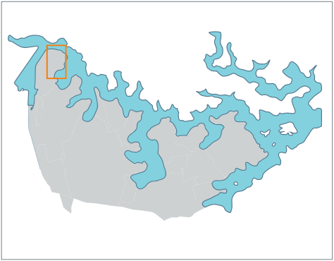

> [Picture on page 99: a picture, saved as a picture (images/part-k-special-precincts-page-99-2.gif, 150 dpi).]

#### K16.1 Introduction

This Development Control Plan (DCP) establishes a framework to guide development in the Rhodes East Priority Precinct (the Precinct).

#### Name of this DCP

This DCP is called the Rhodes East Development Control Plan.  The DCP has been prepared pursuant to the provisions of the Environmental Planning and Assessment Act 1979 (the Act).

#### Land to which this DCP applies

This DCP applies to development indicated within the boundary of the Rhodes East Precinct as shown in Figure K16-1.

#### Purpose of this DCP

The purpose of this DCP is to guide the future development of the Precinct by:

• identifying the vision, development principles, key elements and indicative structure for the Precinct;

• communicating the planning, design and environmental objectives and controls against which the consent authority will assess development applications;

• ensuring the orderly, efficient and environmentally sensitive development of the Precinct; and

• promoting a high quality urban design outcome.

#### Relationship to other plans

This DCP adopts the following provisions of the City of Canada Bay Development Control Plan 2017:

i) Part B - Notification and Advertising

ii) Part C - General Controls with the exception of C3.1 and C3.2

iii) Part D - Heritage

iv) Part E - Residential Development E2.5, E2.6 and E4.2

v) Part H - Signage and Advertising

vi) Part I - Child Care Centres.

A provision of this DCP will have no effect to the extent that:

i) it is the same or substantially the same as a provision in the Canada Bay Local Environmental Plan 2013 (CBLEP 2013) or another environmental planning instrument (EPI) applying to the same land; or

ii) it is inconsistent with a provision of the CBLEP 2013 or another EPI applying to the same land, or its application prevents compliance with a provision of the CBLEP 2013 or another EPI applying to the same land.

In either case the provision in the CBLEP 2013 or other EPI will prevail.

This DCP should be read in conjunction with:

• The Canada Bay Local Environmental Plan 2013

• The City of Canada Bay Engineering Specifications

• The City of Canada Bay Contaminated Land Policy

• The City of Canada Development Contribution Plans

• The City of Canada Bay Planning Agreements Policy

• The City of Canada Bay Rhodes East Public Domain Plan

• The City of Canada Bay Rhodes East Street Design Guide

The onus is on any prospective applicant to confirm with Council if there are any additional or updated documents.

#### Apartment Design Guide compliance

The State Environmental Planning Policy No 65 - Design Quality and Residential Apartment Development applies to residential flat buildings, shop top housing and mixed use development with a residential accommodation component in the Precinct.

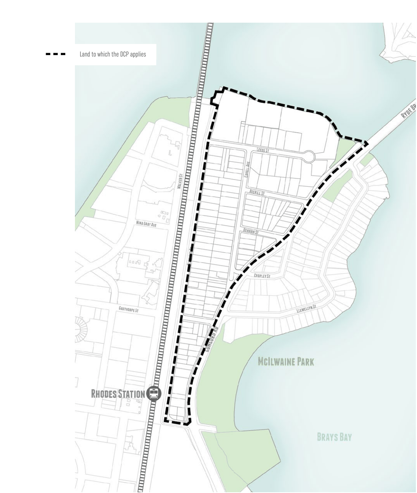

> [Picture on page 100: a picture, saved as a picture (images/part-k-special-precincts-page-100-1.gif, 150 dpi).]
> Words printed on the picture (copied from the PDF):
> Land to which the DCP applies

Figure K16-1 Land to which this DCP applies

200m

50 100

N

#### Consent authority

Unless otherwise authorised by the Act, City of Canada Bay Council is the consent authority for all development in the Precinct to which this DCP applies.

#### Application of this DCP

This Development Control Plan (DCP) is to supplement the Canada Bay Local Environmental Plan (LEP) 2013 and provide more detailed provisions to guide development.

This DCP has been made in accordance with the Environmental Planning & Assessment Act 1979 (the Act) and must be read in conjunction with the provisions of Canada Bay LEP 2013.

Compliance with the provisions of this DCP does not necessarily guarantee that consent to a Development Application (DA) will be granted. Each DA will be assessed having regard to the LEP, this DCP, other matters listed in Section 4.15 of the Act, and any other policies adopted by the consent authority.

If there are circumstances when it is not relevant to comply with the controls in this DCP, applicants must provide a written submission clearly demonstrating compliance with the objectives of this DCP, and detailing the reasons the control/s should be varied. The proposed variation must result in a better outcome and meet all objectives of this DCP. The submission must also clearly demonstrate the variation sought will not adversely impact on the local amenity.

#### Role of the draft Precinct Plan

The Rhodes East draft Precinct Plan at Figure K16-3 on page K-110 shows how the overall Precinct may develop over time. It is intended as a guide to demonstrate how the vision, overarching objectives, development principles and key elements for the Precinct may be achieved.

#### Consistency with objectives and controls

Clauses in this DCP contain objectives and controls relating to various aspects of development. The objectives enable Council and applicants to consider whether a particular proposal will achieve the development outcomes established for the Precinct. The controls, if met, mean that development would be consistent with the objectives.

Development Control Plan

Part K Special Precincts

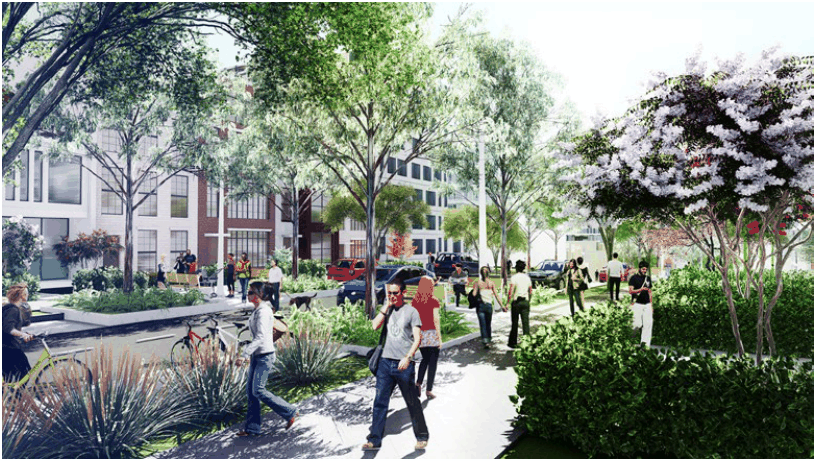

> [Picture on page 102: a picture, saved as a picture (images/part-k-special-precincts-page-102-3.gif, 150 dpi).]

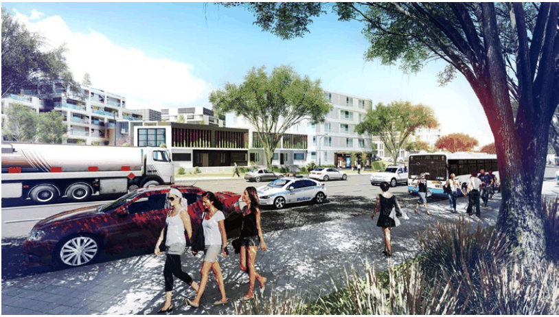

> [Picture on page 102: a picture, saved as a picture (images/part-k-special-precincts-page-102-4.gif, 150 dpi).]

Above: Artist impressions of the desired future look and feel of Rhodes East Precinct

#### K16.2 Desired Future Character

#### Vision for Rhodes East

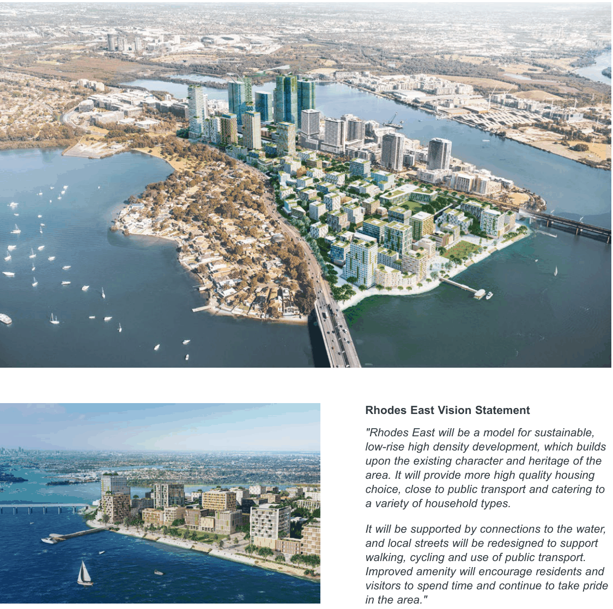

> [Picture on page 103: a picture, saved as a picture (images/part-k-special-precincts-page-103-3.gif, 150 dpi).]

#### Rhodes East Vision Statement

"Rhodes East will be a model for sustainable, low-rise high density development, which builds upon the existing character and heritage of the

area. It will provide more high quality housing choice, close to public transport and catering to a variety of household types.

It will be supported by connections to the water, and local streets will be redesigned to support walking, cycling and use of public transport. Improved amenity will encourage residents and visitors to spend time and continue to take pride in the area."

#### Overarching Objectives Planning

Ensure Rhodes East can meet the challenges of the future by building sustainability and longevity into planning, design and commercial capability from the start.

#### Active transport

Design integrated transport services and experiences that prioritise walking, cycling and the use of public transport.

#### Affordable housing

Provide affordable housing options for key workers in the area, for example people working in occupations such as teaching, child care, policing or nursing.

#### Density with a human scale

Deliver buildings with podiums and a range housing typologies that promote activity on the lower levels of buildings. The range of built forms will result in more open space, more sunlight into buildings, and a closer connection to the ground.

#### Waterfront access

Provide enhanced public access to the Parramatta River foreshore, including the provision of housing and public open space with views to the water.

#### Public spaces

Provide a range of high quality, pedestrian prioritised public spaces that are safe for gathering and socialising.

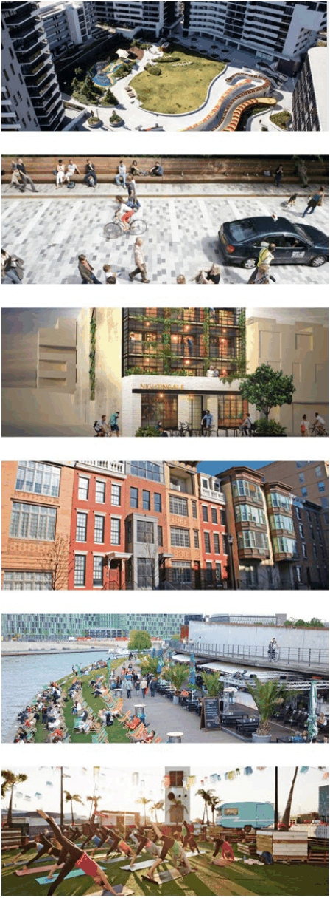

> [Picture on page 104: a picture, saved as a picture (images/part-k-special-precincts-page-104-30.gif, 150 dpi).]

#### Design Principles A place led approach

The redevelopment of Rhodes East has been framed around a place led approach that builds on the existing urban fabric and character to create a pedestrian friendly human scaled outcome.

Traditional city-building has created the world's most successful urban places which typically consist of a broad range of lots, blocks and buildings assembled to create livable, mixed use walkable communities. Development was incremental, with a diversity of lot sizes and building types, ranging from the very small to the very large, and also a strong public realm.

Throughout the consultation process, the local community has consistently affirmed a desire to celebrate the inherent character of Rhodes East. As a result, the existing urban structure has informed a fine grain human scale urban renewal that will provide a genuine point of difference and create a unified community that is greater than the sum of its parts.

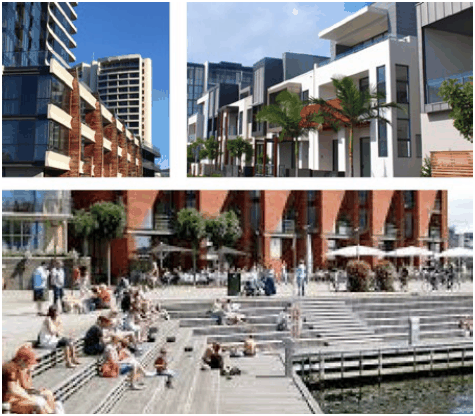

> [Picture on page 105: a picture, saved as a picture (images/part-k-special-precincts-page-105-21.gif, 150 dpi).]

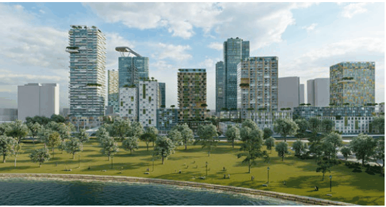

> [Picture on page 105: a picture, saved as a picture (images/part-k-special-precincts-page-105-22.gif, 150 dpi).]

#### A peninsula of choice

Rhodes East is an established urban area with an existing community. It contains a number of different places, each with its own unique identity and character, contributing to the overall experience and attraction of the Peninsula. The commitment to delivering 5% Affordable Housing combined with the definition of a housing mix within the LEP, will ensure that Rhodes East provides choice and variety to the Peninsula.

#### Urbanity through density

Successful urban renewal projects increase intersection density or the number of intersections in a given

area. Intersection density corresponds closely to block size, so the greater the intersection density, the smaller the block. Small blocks make neighbourhoods more walkable and, in conjunction with smaller redevelopment sites, creates the pre-conditions to deliver authentic fine grain, human scale development in accordance with the Rhodes East Vision for Cavell Avenue Precinct.

#### Opportunities for a modal shift

A key focus is to create an urban structure that maximises opportunities for walking, cycling and public transport patronage. Improving connectivity through additional street and pedestrian connections is critical to achieving the modal shift required to support the new Rhodes East community.

An integrated high quality urban design outcome, not just density, is required to engage and stimulate the pedestrian, particularly along key desire lines, improving the pedestrian experience.

Active transport infrastructure, and reduced or low parking rates within close proximity to public transport, is part of an integrated urbanity model. Modal shift is also supported by creating the environment to support active transport including 'Context Sensitive Streets', a well connected access network, creating more compact blocks, and increasing intersection densities.

#### A fine-grain pedestrian friendly environment

A fine-grain pedestrian friendly environment is supported by the 'high–low' built form model, where height is distributed in a manner that allows for good solar access, orientation and view corridors in addition to active facades and ground floor controls.

Desired densities can be achieved without overshadowing community open space, parks or other buildings by strategically locating the tallest elements on the south west of blocks with the balance of development being low to mid rise.

#### A feasible and sustainable outcome

A liveable, walkable and sustainable environment will encourage active transit and reduce reliance on private vehicle trips. This not only reduces local traffic volumes and eases congestion, but provides healthier lifestyles and activates the public realm.

Site specific floor space ratio bonuses is available to incentivise developers to deliver new streets ensuring the additional population can be sustained as the development progresses. Similarly, floor space ratio bonus is available for delivery upon higher sustainability targets set out in the LEP.

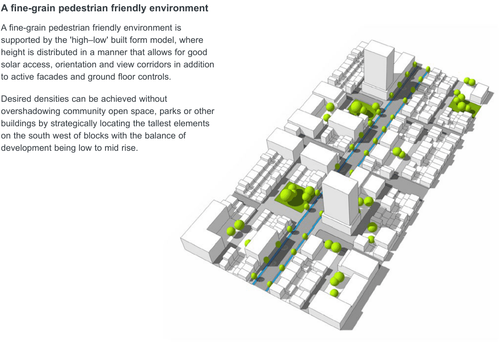

> [Picture on page 106: a picture, saved as a picture (images/part-k-special-precincts-page-106-42.gif, 150 dpi).]

#### Character Areas

The following Character Areas, shown in Figure K16-2, have been identified for Rhodes East based upon their function, use, street pattern and built form attributes:

• Station Gateway East Character Area - a key transport hub located between Rhodes Station and Concord Road, with a character influenced by adjoining built form and functions.

• Leeds Street Character Area - a predominately light industrial area with large building structures, which is heavily transport dominated (vehicles and river traffic).

• Cavell Avenue Character Area - centrally located area, situated on the most elevated part of the Investigation Area, with a mix of residential and community uses.

#### Character Statements Station Gateway East

This character area will proudly announce arrival at Rhodes East from the south and guide people to the Station and Mcllwaine Park. The built form will reflect its location adjacent to the Station with increased density and encourage the use of public transport as opposed to the private vehicle.

The built form will provide an active, mixed used podium and street level frontage with formal landscaping that complements the character of Mcllwaine Park.

There will be street level activation and a safe, pedestrian friendly environment will be prioritised to promote connectivity between the Station, across Concord Road, into Mcllwaine Park with a link to Parramatta River.

#### Leeds Street Character Area

This character area will provide a multi-modal, water-based destination. The Leeds Street Character Area will introduce meaningful visual and physical connections to the water in addition to a vibrant mix of uses. The lifestyle and activities promoted within this character area will prioritise pedestrians and facilitate human interaction.

Buildings will be flexible and multi-purpose and, whilst they may have larger floor plates, an active street frontage to public areas will be created. The built form will respond to the northern aspect of the character area through the sensitive location of height combined with block permeability and building separation ensuring pedestrian level views of Parramatta River from the centre of Rhodes East.

#### Cavell Avenue Character Area

The Cavell Avenue Character Area will largely consist of residential and community uses through a ‘density done well’ approach that will deliver a diversity of heights and human scale built form focusing on a balance between increased housing, public/ private amenity and an active and safe pedestrian environment.

Future development will facilitate enhanced connectivity, between the east and west of the Peninsula and to public transport and will also create localised ‘place’ features along key desire lines and view axes.

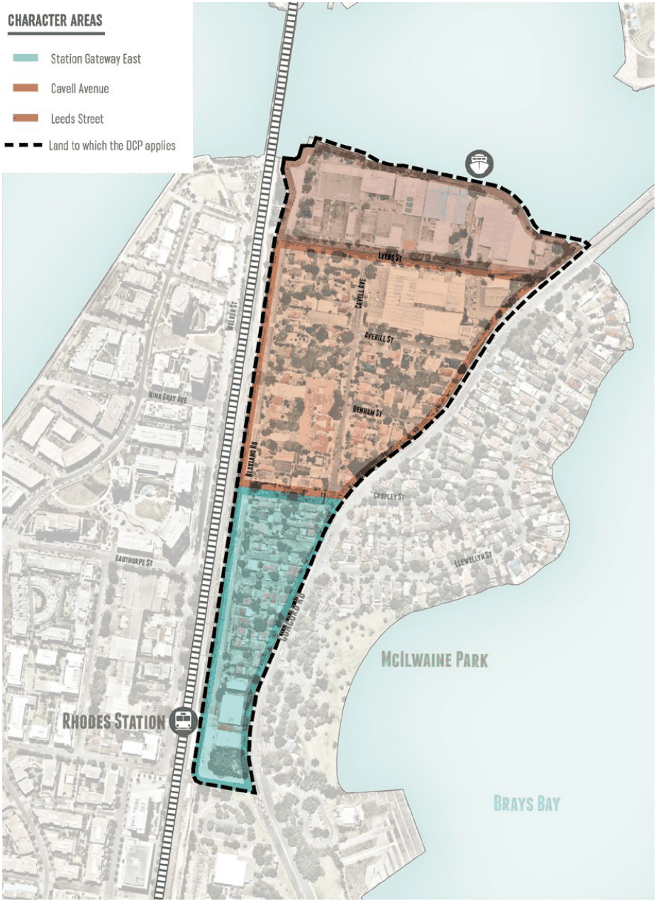

> [Picture on page 108: a picture, saved as a picture (images/part-k-special-precincts-page-108-1.gif, 150 dpi).]

Figure K16-2 Character areas

0 50

N

200m

#### Rhodes East Precinct Plan

Development is to be generally consistent with the key elements in Table K16-1 and the Rhodes East Precinct Plan at Figure K16-3.

Where variations are proposed, development is to demonstrate how the vision, development principles, key elements for the Precinct and relevant specific objectives are to be achieved.

#### Table K16-1 Key elements of Rhodes East Precinct Land use

#### Residential

• 3537 new dwellings (8210 population) by 2036 comprising a mix of dwelling types

• 5% affordable housing across the Precinct

#### Retail / commercial

• 400m2 GFA of convenience retail

• 4600 m2 GFA of destination retail

• 11,100m² GFA of commercial space

#### Education and community

• A new primary school for 1000 students

• 300m2 of publicly accessible plazas at key corners along pedestrian routes, each plaza co-located with non-residential uses on the ground floor of developments.

• 1750 m2  of adaptable community uses space

#### Movement network

• Pedestrian and cycle activity and public transport interchange functions are prioritised

• New streets will create a more permeable movement network and increase connectivity

• New pedestrian station bridge will increase connectivity and encourage active transport

• Interchange upgrades, bus and rail upgrades

#### Open space and public domain

• New areas of public open space including:

• Minimum 7500 m2 of a new foreshore park

• Continuous 15m-wide foreshore promenade providing connectivity to the precinct and future ferry wharf

• Minimum 550 m2 Bridge Plaza providing connection between the train station and McIlwaine Park

• New parks plazas improved foreshore access and river activation

#### Built form

• The built form will be characterised by a mix of residential development supported by commercial, educational and community uses

• Building heights range from 1 to 37 storeys incorporating terraces to apartment buildings in addition to a number of taller landmark buildings

• Integration of existing heritage items within the development

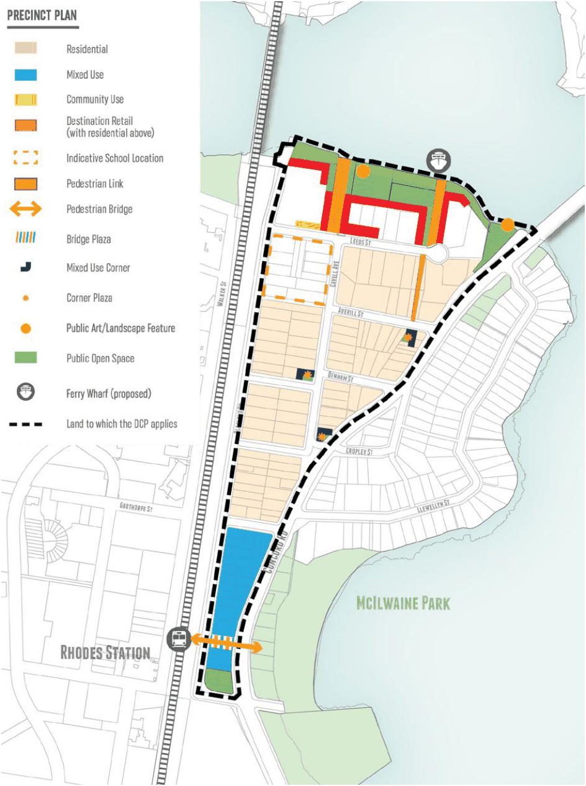

> [Picture on page 110: a picture, saved as a picture (images/part-k-special-precincts-page-110-1.gif, 150 dpi).]

Figure K16-3 Precinct Plan

0 50

N

200m

#### K16.3 Key development parameters

The key development parameters for the Rhodes East Precinct identify metric limits to the size of (amalgamated) lots, their maximum and minimum frontage length, building heights and floor space ratios. An overview of these key controls is provided in Table K16-2 on page K-115.

#### Maximum lot size

The maximum lot size control applies to The Cavell Avenue Character Area. This control seeks to limit development that incorporate large floorplates and to protect the values and desired future character of the area.

#### Objectives

O1 To deliver fine grain, activated and visually interesting developments and streetscapes on a variety of lot sizes.

O2 To avoid large scale development that dominates the character of an area.

O3 To facilitate a range of development sizes resulting in built form diversity.

#### Controls

C1. All new development is to comply with maximum lot size as per Figure K16-4 and Table K16-2. Also refer to relevant Local Environmental Plan 2013 clauses and maps.

#### Maximum lot frontage length

Maximum lot frontage lengths apply to the Cavell Avenue Character Area.

Similar to the maximum lot size control, the intention is to limit large scale amalgamation and development, particularly in areas that have an existing fine grain lot pattern and narrow frontage widths.

#### Objectives

O4 To integrate new development into existing fine grain streetscapes and avoid long lengths of continuous, homogeneous development.

O5 To facilitate a fine-grain built form outcome which creates architectural variety and visual interest along streetscapes.

#### Controls

C2. All new development is to comply with maximum and minimum frontage length as per Figure K16-4 and Table K16-2. Also refer to relevant Local Environmental Plan 2013 clauses and maps.

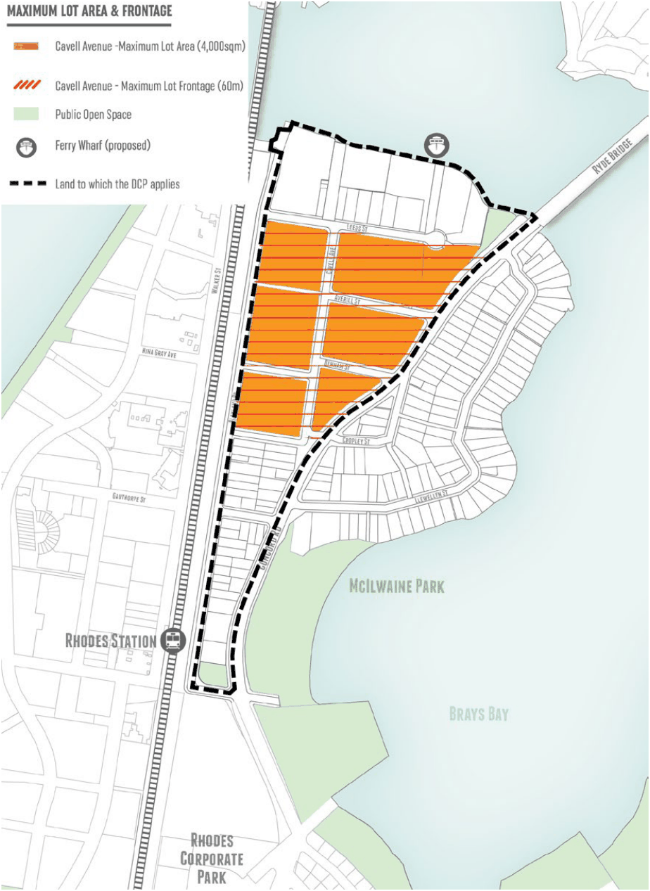

> [Picture on page 112: a picture, saved as a picture (images/part-k-special-precincts-page-112-1.gif, 150 dpi).]

Figure K16-4 Maximum lot size and frontage length plan

200m

50 100

N

#### Maximum building height

Building form and scale contribute to the physical definition of the street network and the hierarchy of public spaces. A range of building heights across Rhodes East is encouraged to deliver variety, diversity and different architectural styles whilst ensuring the creation of low-rise, high density development.

Taller buildings are to be located close to key community services and facilities, near the train station before stepping down towards Concord Road. Please refer to Section K16.6 Built form strategy for futher information.

#### Objectives

O6 To facilitate appropriate growth and housing delivery across the Precinct.

O7 To locate higher scale residential uses close to Rhodes Station to optimise access to the station facilities and around the mixed use area at Leeds Street.

O8 To step down heights and density towards the Parramatta River within a human scale, fine grain development pattern.

#### Controls

C3. All new development is to comply with maximum building height as per Figure K16-6 and Table K16-2.

C4. In selected locations, an increase in permissible height may be possible, linked to the provision and delivery of new streets. Refer to Section K16.3 Bonus Height and FSR of this DCP. Also refer to relevant Local Environmental Plan 2013 clauses and maps.

C5. Maximum building height are inclusive of floor space bonus achievable through application of Basix Affected Building clause in the Canada Bay LEP.

#### Maximum floor space ratio

The floor space ratio standards, in tandem with the maximum building heights, allow for taller built form elements to be located within each block, while the remainder of the development would be at lower scale. This minimises overshadowing impacts to adjoining development whilst achieving a high quality, pedestrian friendly public realm and encouraging the provision of a range of building typologies and housing choice.

#### Objectives

O9 To minimise the visual and overshadowing impact of new development on lower scale neighbouring properties and the public domain, by limiting the bulk and scale of new development.

O10 To protect existing and future open spaces from overshadowing impacts and ensure adequate solar amenity for these open spaces.

#### Controls

C6. All new development is to comply with maximum floor space ratio as per Table K16-2.

C7. In selected locations, an increase in permissible FSR may be possible linked to the provision and delivery of new streets and delivery of Basix targets. Refer to Section K16.3 Additional Height and FSR of this DCP. Also refer to relevant Local Environmental Plan 2013 clauses and maps.

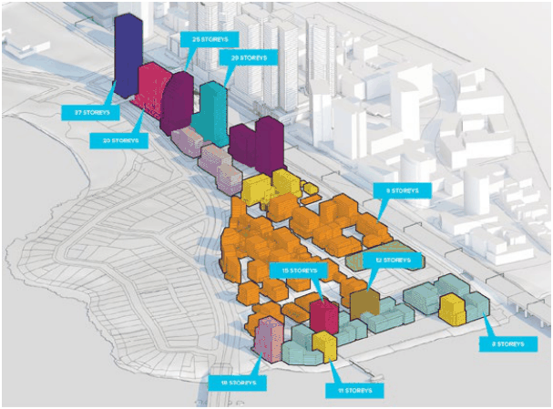

> [Picture on page 113: a picture, saved as a picture (images/part-k-special-precincts-page-113-67.gif, 150 dpi).]

Figure K16-5 Height distribution

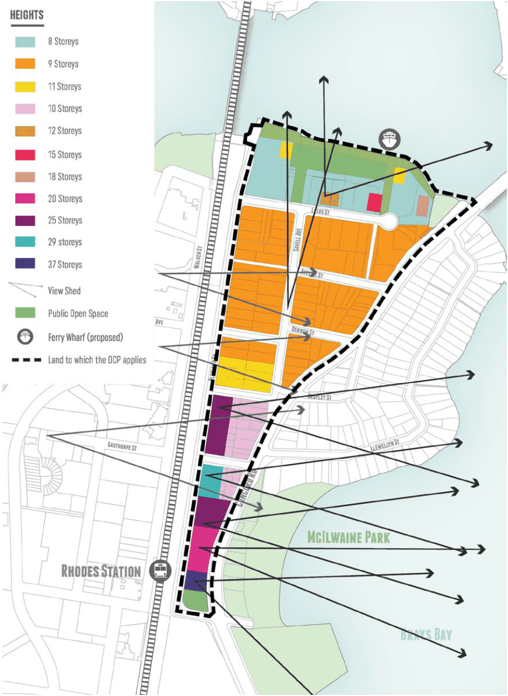

> [Picture on page 114: a picture, saved as a picture (images/part-k-special-precincts-page-114-1.gif, 150 dpi).]

Figure K16-6 Maximum building heights plan

200m

50 100

N

#### Table K16-2 Overview of key development

parameters

| Cavell Avenue |  |
|---|---|
| Max. lot size | 4,000m2 |
| Max. lot frontage length | 60m |
| Max. building height | Up to 36m (11 Storeys) including Basix bonus |
| Max. floor space ratio | Refer to LEP |

#### Transfer of Floorspace and FSR

The location of two new streets are identified within the Precinct Plan for Rhodes East. These new streets are fundamental to the delivery of the intersection and frontage densities necessary to support the public life envisaged and encourage a modal shift.

An increase to building height and FSR is possible for selected locations identified on Figure K16-8 to facilitate the provision of the new streets.

#### Objectives

O11 To support/ deliver new streets to improve connectivity within the Precinct.

| Controls |  |
|---|---|
| C8. | Additional heights and FSR apply to selected locations as per Figure K16-8 and are linked to the delivery of new streets as outlined above. |
| C9. | Across the precinct, an increase in permissible FSR is possible linked to delivery of BASIX targets. |

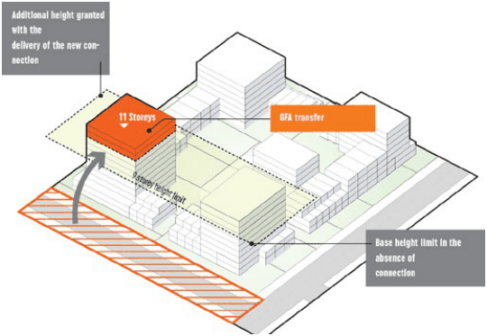

> [Picture on page 115: a picture, saved as a picture (images/part-k-special-precincts-page-115-17.gif, 150 dpi).]

Figure K16-7 Explanatory diagram of bonus height and FSR

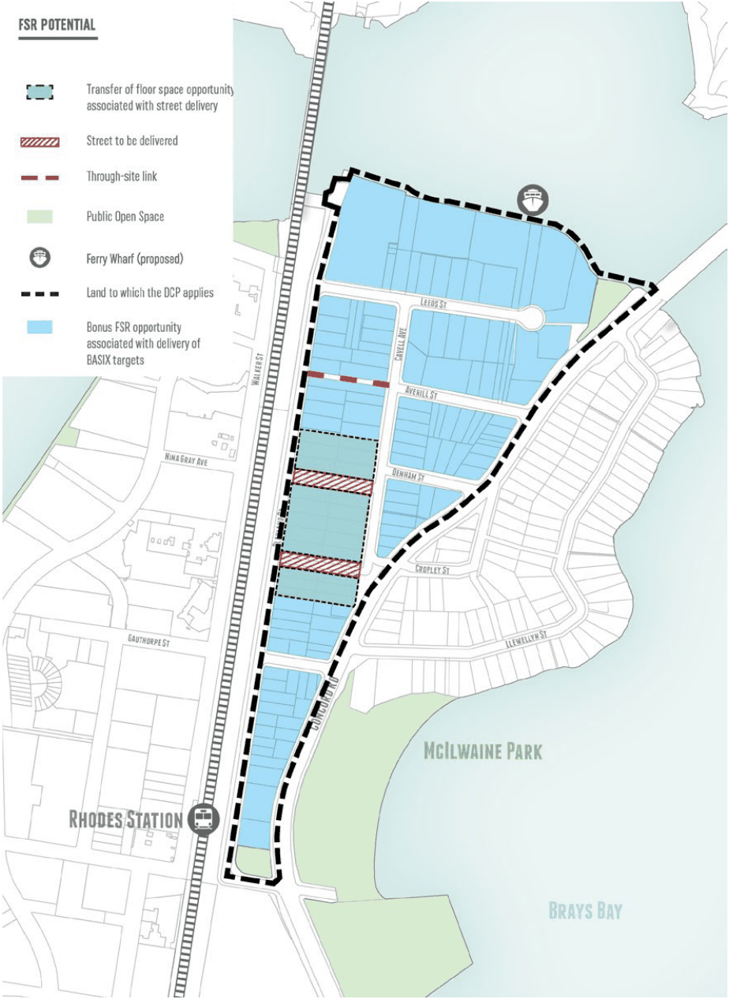

> [Picture on page 116: a picture, saved as a picture (images/part-k-special-precincts-page-116-1.gif, 150 dpi).]

Figure K16-8 Bonus height and FSR plan

200m

50 100

N

#### K16.4 Public Domain

#### Street network and access Context sensitive streets

Context Sensitive Street design aims to balance the often competing objectives of traffic capacity with place amenity, or place-led character, considering both character and capacity. Streets that connect key destinations will support and prioritize pedestrians and cyclist through cycleways, wider pedestrian paths and shade trees.

A number of new connections are proposed to improve connectivity and promote pedestrian activity across the Precinct. Their addition encourages a finer grain of development as smaller, more compact blocks are created to provide a human scaled environment that has the ability to accommodate a range of housing types and sizes.

The two new streets shown in Figure K16-9 provide east-west connections between Cavell Avenue and Blaxland Road. It is proposed that these streets will be delivered via transfer of floorspace as outlined in Section K16.3 (Transfer of Floorspace and FSR subheading) of this DCP.

#### Objectives

O1 To create a public domain that supports and encourages pedestrian movement through activated streets and human-scale development fronting onto a defined hierarchy of streets.

O2 To support the concept of a fine grain, vibrant streetscape experience whilst ensuring that a viable built form siting and access solution can be achieved.

O3 To provide a clear street hierarchy and a more permeable urban structure.

O4 To provide a safe space for walking and cycling and offer universal access, providing greater independence for children and families as well as the elderly and disabled.

O5 To strengthen the landscape character and quality of the Precinct through the retention and enhancement of existing and planting of additional street trees and landscaping.

| Controls |  |
|---|---|
| C1. | The existing street pattern is to be retained and new streets are to be provided as per Figure K16-9 |
| C2. | Street design including the upgrade of existing and the delivery of new streets are as per the Canada Bay Rhodes East Public Domain Plan. |

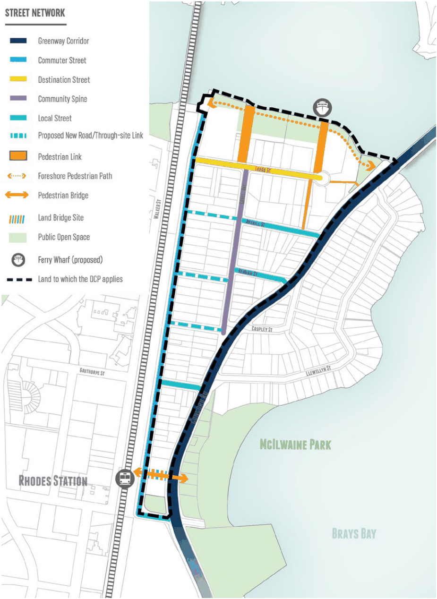

> [Picture on page 118: a picture, saved as a picture (images/part-k-special-precincts-page-118-1.gif, 150 dpi).]

Figure K16-9 Street network plan

200m

50 100

N

#### Pedestrian and cycle network

The proposed network of pedestrian and cycle paths connects to key destinations within and beyond the Rhodes Peninsula and encourages active transport that benefit the health of individuals and wider community, including less air and noise pollution from private motor vehicles.

The key improvements include:

• Linking into broader foreshore network beyond Rhodes East Precinct

• Connecting separated cycleway and pedestrian paths within the Leeds Street Character Area to the Rhodes West foreshore promenade

• Widening and upgrading pathway connections under the northern foreshore bridges

• Delivering a designated ‘Commuter Cycleway’ along Blaxland Road

• Delivering new pedestrian links over the railway and Concord Road to create a continuous pedestrian loop within Rhodes.

#### Objectives

O6 To provide a convenient, efficient and safe network of pedestrian paths and cycle ways between key locations within and beyond the Precinct.

O7 To encourage more physically active lifestyles and support a modal shift reducing car ownership and reliance.

O8 To ensure development addresses the pedestrian and cycle network and enables ease of access to entry lobbies, links and bicycle facilities.

| Controls |  |
|---|---|
| C3. | The pedestrian and cycle network is as per Figure K16-10 and designed as per the Canada Bay Rhodes East Public Domain Plan. |
| C4. | Provide spaces on private property that enable pedestrian access and use (eg. Connections within a site, lobbies and the like) that are accessible and at-grade. |
| C5. | Bicycle facilities, such as parking, secure storage and end-of-trip facilities are required to be easily accessible from the public domain and conveniently located near entrances and/or lifts of new development. |
| C6. | The location of the building entrances must be clearly visible from the public open space network to support surveillance and safety of the pedestrian and cycle network. |

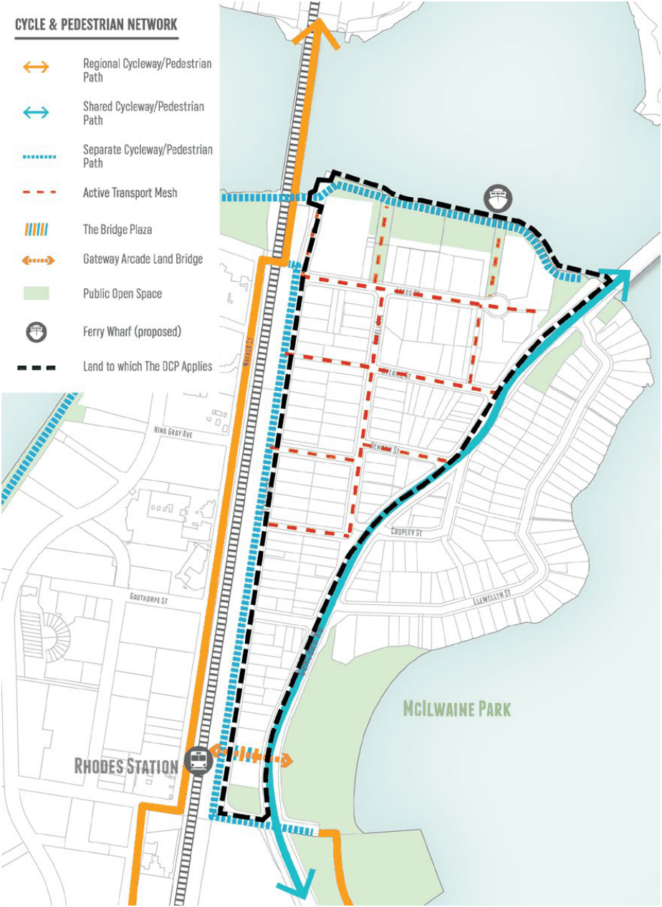

> [Picture on page 120: a picture, saved as a picture (images/part-k-special-precincts-page-120-1.gif, 150 dpi).]

Figure K16-10 Pedestrian and cycle network plan

200m

50 100

N

#### Open Space Network

The open space network in Rhodes East is envisaged to become a continuous network of ‘Green Streets’ and parks over time. New development on land adjoining this network plays an important role in supporting its quality, usability and pedestrian priority.

#### Objectives

O9 To provide an integrated, continuous open space network that links existing and proposed open spaces within the Precinct and beyond.

O10 To enhance the everyday quality of life for residents, workers and visitors by providing new quality public open spaces including pocket parks, plazas and green links.

O11 To ensure that new development adjoining the open space network complements the landscape character and supports ease of access, public use, safety and pedestrian priority.

| Controls |  |
|---|---|
| C7. | The open space network is as per Figure K16-11 and designed as per the Canada Bay Rhodes East Public Domain Plan. |
| C8. | Private spaces that are visible but physically inaccessible to the general public (i.e. front setbacks, communal open space and the like) are designed so that they integrate with the treatment of the open space network. |
| C9. | The selection of furniture, pavement and lighting for private space visible from the public domain is to demonstrate a similar style and treatment as outlined in the Canada Bay Rhodes East Public Domain Plan. |
| C10. | Public domain in Green Streets are to be configured and designed to prioritise walking and cycling along both footpaths and carriageways. |

C11. McIlwaine Park must not receive any additional overshadowing from new development between 8.30am and 12.30pm on the Winter Solstice.

Turfed area within McIlwaine Park (Figure K16-11) must not receive any additional overshadowing from new development between 8.00am - 2.00pm on the Winter Solstice.

Bray's Bay must not receive any additional overshadowing from new development between 8.30am and 12.30pm on the Winter Solstice.

King George Reserve must not receive any additional overshadowing from new development between 8.30am and 12.30pm on the Winter Solstice.

Uhrs Reserve must not receive any additional overshadowing from new development between 8.30am and 12.30pm on the Winter Solstice.

C12. Open Space of the School Site must not receive any additional overshadowing from new development between 10.00am and 2.00pm on the Winter Solstice.

Location of school's open space is to be determined through a detailed architectural design process.

C13. The Foreshore Park in Leeds Street Character Area must not receive any overshadowing from new development between 8.30am and 12.30pm in the Primary Zone on the Winter Solstice.

The Foreshore Park must not receive more than 50% overshadowing from new development after 12.30pm on the Winter Solstice.

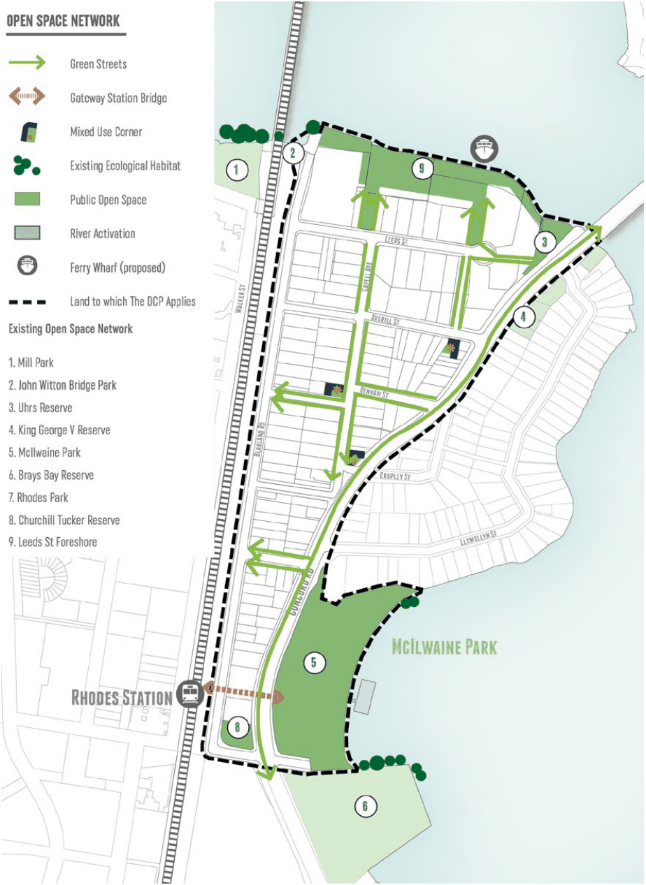

> [Picture on page 122: a picture, saved as a picture (images/part-k-special-precincts-page-122-1.gif, 150 dpi).]

Figure K16-11 Open space network plan

200m

50 100

N

#### Landscape Treatment and Urban Elements

The design of the public domain is to adhere to plans prepared by City of Canada Bay. Landscape design on private land needs to integrate with the design intention and treatment outlined in this document.

This will help to integrate new development into the streetscape, enhance the appearance and amenity of the area, provide for recreation, preserve biodiversity and improve micro-climatic conditions.

#### Objectives

O12 To promote high quality landscape design as an integral component of the overall design of new development.

O13 To conserve and incorporate significant natural features, vegetation and native fauna and flora habitats.

| Controls |  |
|---|---|
| C14. | Existing street trees and landscape features are retained wherever possible. |
| C15. | Landscape design complements the proposed built form and minimises the impacts of scale, mass and bulk of the development in its context. |
| C16. | Landscape design highlights architectural features, defines entry points, indicates direction, and frames and filters views from and into the site. |
| C17. | Native species must comprise at least 50% of the plant schedule, incorporating a mix of locally native trees, shrubs and groundcovers appropriate to the character of the area. |
| C18. | The selection and location of vegetation and trees should: a) Provide shade in summer and sun access in winter to building facades and public and private open spaces b) Reduce glare from hard surfaces c) Channel air currents into the building d) Provide windbreaks where desirable e) Screen noise and enhance visual privacy where desirable. |

| C19. | Where suitable, landscape areas on the development sites are to be made publicly accessible to pedestrians unhindered by fencing or other structural barriers. |
|---|---|
| C20. | All development is to provide places for residents to meet. This is to be in the form of a community notice board or room, shared laundry spaces, picnic tables and / or covered seating areas in landscaped surroundings. |
| C21. | Mature tree canopies must achieve at least 25% site coverage as calculated cumulatively as private and public domain. |
| C22. | A detailed landscape plan is to be provided as part of a Development Application to demonstrate how the street block of the subject development site will achieve 25% canopy cover at ground level, including within the development site. Trees on building structures do not contribute to canopy cover under this control, and where relevant may be considered as contributing to the green view index requirements. |
| C23. | On site landscape replacement must be provided as the equivalent or more of the total site area. Landscape replacement can be provided through the following: • Vertical and facade greening; • Rooftop greening and greening of communal podium spaces; and • Public open space, through site links within the site boundary. |

#### Controls

C24. All development must contribute to and demonstrate a 25% Green View Index using the methodology outlined in Figure K16-12 to Figure K16-16 and described below.

The Green View Index (GVI) is a numerical value given to the amount of green canopy and landscape perceived by an individual at street level. Tree canopies, understorey vegetation, and facade greening are the three primary contributors to the GVI.

The GVI target for Station Gateway West (Precinct D) is 25%. To achieve this, the design of streets and new developments must include an objective assessment of the GVI value achieved, using the following method:

• Where tree canopies and understorey vegetation do not achieve the GVI target, facade greening is required to the extent necessary to achieve the minimum requirement.

C25. Compliance with the green view index and urban tree canopy cover are not interchangeable, and must be considered as separate requirements.

C26. All public space design must adhere to the Australian Standard Design for Access and Mobility (AS1428).

C27. Public domain step risers must be no less than 100mm, and no greater than 150mm (exception can be made for vanishing steps).

Seating steps shall be in the range of 150mm-500mm

C28. Circulation paths must be a minimum of 2.4m in width and extend to a minimum of 80% of the depth of the space.

Trees planted flush-to-grade, light poles, public space signage, and litter bins are permitted within circulation paths, however, 1.8m of continuous path must remain clear of fixed furniture elements at all times.

Circulation paths must have a cross-fall no greater than 2.5%.

C29. The following elements are prohibited from the public park / plaza / building interfaces, and if located adjacent to the public park / plaza, should be screened or concealed from view: Garage entrances, driveways, parking spaces, loading berths, exhaust vents, mechanical equipment, and building bin storage facilities.

Vents and mechanical equipment are prohibited on any adjacent building walls within 5m of the level of the public park / plaza. Air intake vents and intake shafts, such as those to serve underground facilities, are permitted within the public domain if they are incorporated into design features and do not impair view lines.

C30. Quality paving is required for all public domain areas.

#### Controls

C31. Seating requirements:

At least 1 lineal metre of seating must be provided for every 30m2 of public domain space along the foreshore and within parks and plazas.

Movable seating for cafes may constitute up to 50% of the seating requirement, and may be stored outside of trading hours.

Up to 50% of seating may be informal (e.g. low walls/seating steps).

50% of formal seating is required to have backs and armrests.

There are six types of seating that may be used to satisfy the seating requirements: moveable seating, fixed individual seats, fixed benches, seat walls, planter ledges, and seating steps.

C32. Seating must be minimum 450mm depth, and in the height range of 400mm to 500mm.

Seating provided on planter ledges are required to be at least 550mm deep.

Seating steps can provide flexible seating

– from simple perches to generous, amphitheater-style seating --and are permitted to range between 150mm and 500mm in height.

C33. Deterrents to seating, such as spikes, rails, or deliberately uncomfortable materials or shapes, placed on any surfaces that would otherwise be suitable for seating are prohibited within public plazas.

Devices incorporated into seating that are intended to prevent damage caused by skateboards are permitted. Such deterrents are required to be spaced at least 1.5m apart from one another, be constructed of high-quality materials that are integrated with the seating design, and must not inhibit seating.

C34. Requirements for event power supply are to be as directed by council.

All power supply points are to be thoughtfully located for convenience and to minimize visual clutter. Power supply must be located in lockable in-ground power boxes wherever possible.

C35. Public drinking fountains / water refill stations must be provided as directed by Council.

The product selection and location must consider accessibility for all, including children and pets. The design must consider proximity to key areas such as the play space, amenities building, and ferry wharf.

C36. Bollards should only be included where it is necessary to discourage vehicle movement. They must not be perceived as a pedestrian barrier. They should only be used as an element of access control. Bollards are recommended where trafficable areas adjoin flush with public spaces (e.g. plazas, through site links).

In alignment with best practice, a variety of bollards can be used. This includes bollards that contain planting, removable bollards, fixed bollards and bollards as seating elements.

C37. Requirements for general waste and recycling bins are to be as directed by Council.

All waste facilities are to be located within 15m of seating and gathering spaces. Visual appearance and impacts of smell should be carefully considered when locating waste facilities.

C41. Public art must be delivered in accordance with City of Canada Bay’s Public Art Plan 2014.

Public art gives people reason to stop and engage with the public domain. It can also celebrate cultural and environmental diversity and instill a sense of belonging.

A site specific Public Arts Plan is to be prepared by an arts and cultural planner and will be required to address the following:

Identify opportunities for the integration of public art in the proposed development;

Identify themes for public art;

Durability, robustness and longevity of the public art;

Demonstrate how public art is incorporated in the site and built form design;

Demonstrate that the scale of the public art is appropriate and proportionate to the development and thoughtfully sited & integrated with the building to create a point of interest and define the location of area; and

Provide a program for installation and integration with the construction program for the development.

| Controls |  |
|---|---|
| C38. | All signage in public space must be visible and legible. Signage design (i.e. font, colour and shape) should be aligned with the greater public domain elements palette. Where appropriate, wayfinding and signage should integrate digital technologies, as outlined in the City of Canada Bay’s Operational Plan 2019-2020. |
| C39. | Public bicycle parking is required in accordance with the City of Canada Bay’s standards, as outlined in the Development Control Plan (DCP). |
| C40. | To ensure a vibrant and visually appealing public space, consideration must be given to the treatment of adjoining walls and facades. Any building entry must be clear and legible. The entries must be unobstructed within 5m of entry. Walls required for planters or to mitigate changes in grade must not be visually or spatially intrusive on the space, and must be designed to a comfortable seating height wherever possible. Blank building walls or facades facing onto public space must be treated with public art or screened with vertical planting to a minimum height of 5m above the ground. |

14m

14m

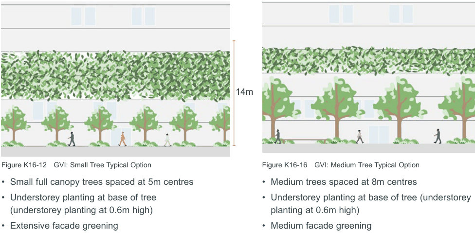

> [Picture on page 127: a picture, saved as a picture (images/part-k-special-precincts-page-127-3.gif, 150 dpi).]

Figure K16-12 GVI: Small Tree Typical Option

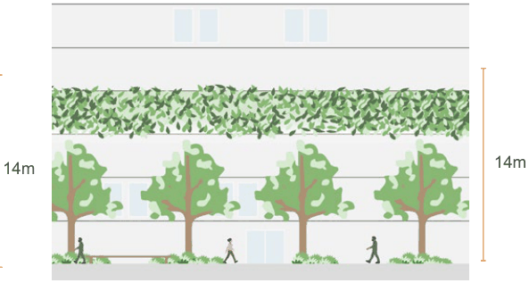

> [Picture on page 127: a picture, saved as a picture (images/part-k-special-precincts-page-127-5.gif, 150 dpi).]

Figure K16-16 GVI: Medium Tree Typical Option

• Small full canopy trees spaced at 5m centres

• Medium trees spaced at 8m centres

• Understorey planting at base of tree (understorey planting at 0.6m high)

• Understorey planting at base of tree (understorey planting at 0.6m high)

• Extensive facade greening

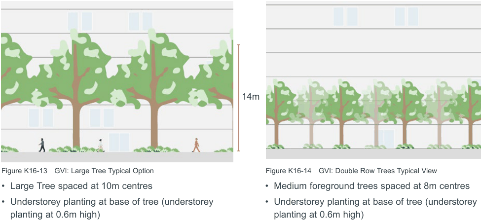

> [Picture on page 127: a picture, saved as a picture (images/part-k-special-precincts-page-127-14.gif, 150 dpi).]

• Medium facade greening

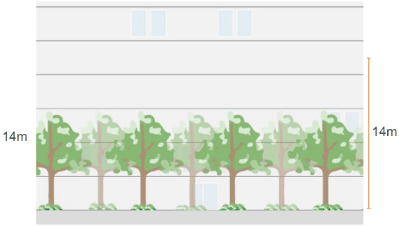

> [Picture on page 127: a picture, saved as a picture (images/part-k-special-precincts-page-127-16.gif, 150 dpi).]

14m

14m

Figure K16-13 GVI: Large Tree Typical Option

Figure K16-14 GVI: Double Row Trees Typical View

• Large Tree spaced at 10m centres

• Medium foreground trees spaced at 8m centres

• Understorey planting at base of tree (understorey planting at 0.6m high)

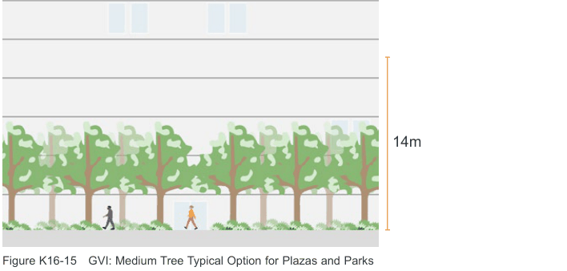

> [Picture on page 127: a picture, saved as a picture (images/part-k-special-precincts-page-127-25.gif, 150 dpi).]

• Understorey planting at base of tree (understorey planting at 0.6m high)

• Possible where there is widened verge or open space to the streetscape

14m

Figure K16-15 GVI: Medium Tree Typical Option for Plazas and Parks

• Medium foreground trees spaced at 3-5 m centres for plazas and parks.

#### Heritage landscape

Most heritage landscape elements in the Rhodes East Precinct are located on public land, however, new development can impact on their heritage value.

#### Objectives

O14 To ensure that new development does not impact on the heritage value or threaten the retention of the landscape elements, i.e. provision of vehicular access, methods of construction, future runoff or overshadowing impacts.

O15 To ensure that contributory landscape elements are retained and conserved to the greatest extent possible.

#### Controls

C42. New development must not threaten the retention and impact on the heritage value of the following items:

i) heritage listed reserves of Uhrs Reserve, King George Park and Mcllwaine Park

ii) locally native planting in Mcllwaine Park

iii) heritage listed street trees on Cavell Avenue

iv) remnant trees at the northern part of 4A Cavell Avenue (incorporated into future development).

C43. Where trees are missing from the established planting rhythm or are in poor health, they should be replanted to create a substantial streetscape character and public benefit in keeping with the existing character.

C44. Other significant landscape elements which are not heritage listed should be individually assessed for their contributory value if threatened.

#### Integration of art

Permanent public art and art on private land visible from the public domain is to be integrated throughout the Precinct and may include sculptural art, lighting, typography, facade treatments and interactive art.

#### Objectives

O16 To provide opportunities to celebrate local history and culture and foster community dialogue.

O17 To enhance a sense of place and support the values of the Character Areas and the Rhodes East Precinct as a whole.

#### Controls

C45. New artwork should be integrated throughout the Precinct and on both public and private land, e.g. corner plazas, parks, reserves, the foreshore, built form facades, and within setbacks and foyers.

C46. New artwork reflects the principles, themes and opportunities as outlined in the City of Canada Bay Rhodes Peninsula Art Plan.

C47. New development above 4 storeys are to allocate 0.5% of the capital cost of development towards artwork. This art can either be provided/ integrated on the site of the development or paid as contribution to Council’s public art fund.

Art integrated on site must be visible from the public domain and be permanent with a lifespan of 30+ years.

#### K16.5 Public-private interface

#### Street and upper level setbacks

The proposed front setbacks have been identified to provide appropriate outcomes for the designated function, land use and intended character of the street. Upper level setbacks seek to lessen the visual impact of taller development and create a unified, human-scale streetscape environment.

#### Objectives

O1 To respect and enhance the existing streetscape presence and character of the Precinct.

O2 To facilitate a sensitive transition from existing built form to future development.

O3 To enhance development and its relationship with adjoining sites and the public domain, particularly access to sunlight, outlook, view sharing, ventilation and privacy.

O4 To provide a sense of enclosure to the street and contribute to the Precinct’s desired human-scale character.

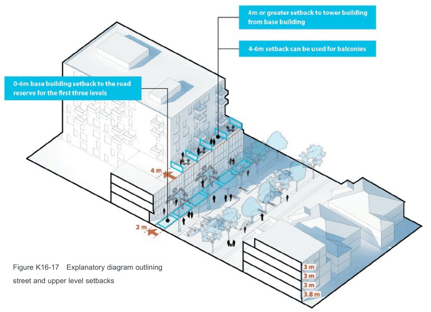

> [Picture on page 129: a picture, saved as a picture (images/part-k-special-precincts-page-129-21.gif, 150 dpi).]
> Words printed on the picture (copied from the PDF):
> Figure K16-17 Explanatory diagram outlining
> street and upper level setbacks

| Controls |  |
|---|---|
| C1. | Street setbacks and upper level setbacks are as per Figure K16-17 and Figure K16-18 with the exception of development of or within the vicinity of heritage items. Refer to Section K16.6 (Heritage items subheading) of this DCP. |
| C2. | The setback between the property boundary and the building line is to be landscaped, with a minimum 50% of the setback area to be deep soil. |
| C3. | Fencing is a maximum of 1.2m in height and at least 50% transparent. |
| C4. | Ground floors with ‘vibrant’ uses such as retail, commercial or cafes/ restaurants address the public space, are occupied by uses that contribute to pedestrian activity and are easily accessible at grade. Refer to Section K16.5 (Façade design subheading) of this DCP. |

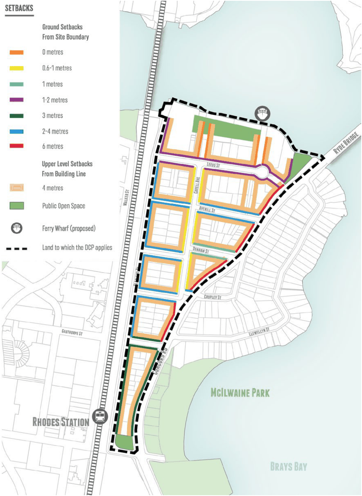

> [Picture on page 130: a picture, saved as a picture (images/part-k-special-precincts-page-130-1.gif, 150 dpi).]

Figure K16-18 Street and upper level setbacks plan

200m

50 100

N

#### Primary and secondary streets

Primary Streets are important pedestrian connections and should be the principal address for any new development with particular emphasis on a high quality interface to the public domain and appropriate built form scale.

A significant portion of Primary Street frontages is envisaged to consist of terraces and multi-unit terrace apartments to achieve a safe and animated streetscape environment, while Secondary Streets will allow for vehicle access points and shared residential lobby entries.

#### Objectives

O5 To create a public domain that supports and encourages pedestrian movement through activated streets and human-scale development fronting onto a defined hierarchy of streets.

O6 To support the concept of a fine grain, vibrant streetscape experience whilst ensuring that a viable built form siting and access solution can be achieved.

O7 To promote streetscape legibility along key pedestrian desire lines.

O8 To facilitate street tree planting and landscaping along priority pedestrian streets (uninterrupted by driveway crossovers) to provide shade and amenity.

O9 To promote passive surveillance on primary and secondary streets whilst balancing the practical requirement for access and servicing on secondary streets.

| Controls |  |
|---|---|
| C5. | Primary and Secondary Streets are to be delivered as per Figure K16-20. |
| C6. | Multi-dwelling housing (terraces) that address the street is required along 85% of any Primary Street frontage and along 60% of any Secondary Street frontage. (Buildings north of Leeds Street and within the Station Gateway East Character Area are exempt from this control in order to enable large floorplate non-residential uses). |
| C7. | Vehicular access points are not permitted along Primary Streets unless a development has no Secondary Street frontage. |
| C8. | ‘Undesirable’ elements along Primary Streets such as vents, electric substations, or plant and equipment spaces should not be located within the setback area. |

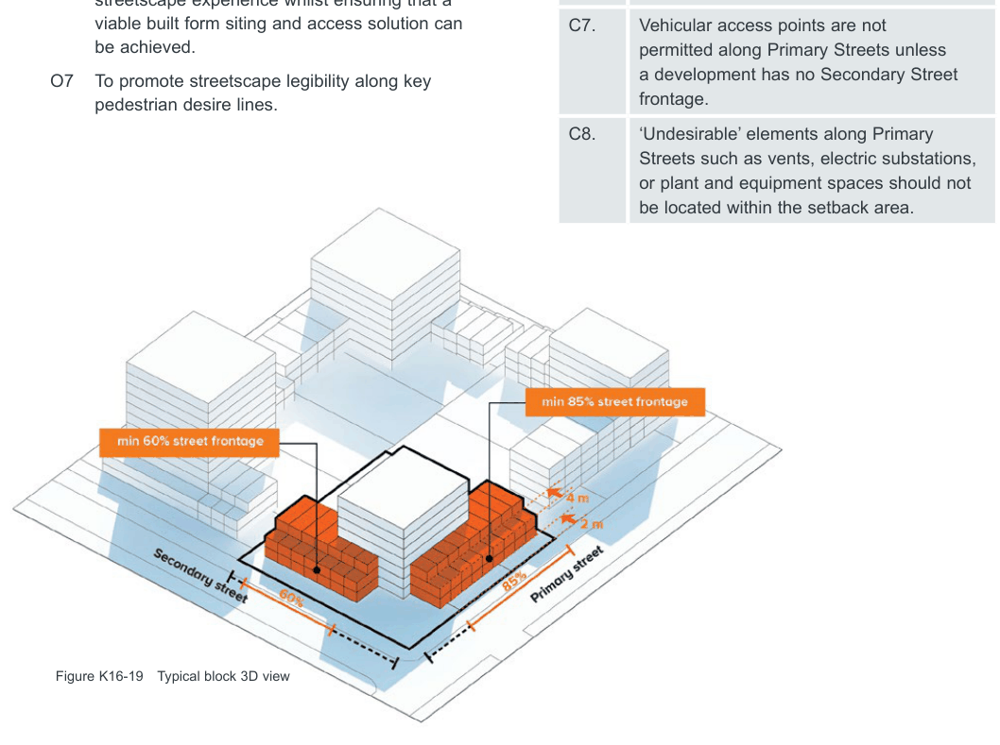

> [Picture on page 131: a picture, saved as a picture (images/part-k-special-precincts-page-131-34.gif, 150 dpi).]
> Words printed on the picture (copied from the PDF):
> Figure K16-19 Typical block 3D view

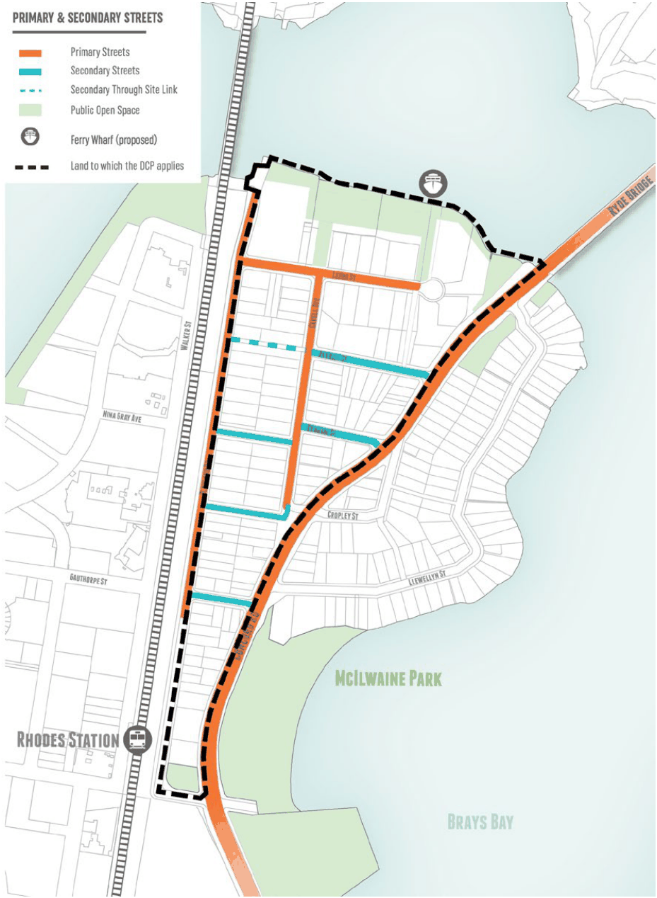

> [Picture on page 132: a picture, saved as a picture (images/part-k-special-precincts-page-132-1.gif, 150 dpi).]

Figure K16-20 Primary and secondary frontages

200m

50 100

N

#### Facade design

New development can fall into one of the three facade categories identified: ‘Vibrant’ facades, ‘Friendly’ facades or ‘Mixed’ facades. These categories are based on the intended function and pedestrian priority of the public space they address. For example, Vibrant facades are located along key desire lines and provisions for this category are more detailed than those that apply to the other two categories.

#### Objectives

O10 To support pedestrian activity by ensuring a high level of interest and facade design quality addressing the public domain.

O11 To maximise the number of building entries that clearly address the street.

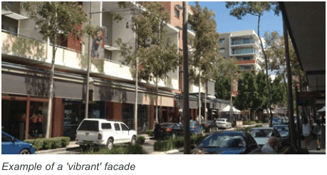

> [Picture on page 133: a picture, saved as a picture (images/part-k-special-precincts-page-133-16.gif, 150 dpi).]

Example of a 'vibrant' facade

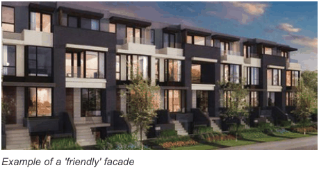

> [Picture on page 133: a picture, saved as a picture (images/part-k-special-precincts-page-133-18.gif, 150 dpi).]

Example of a 'friendly' facade

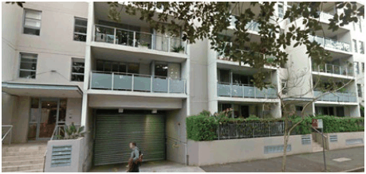

> [Picture on page 133: a picture, saved as a picture (images/part-k-special-precincts-page-133-20.gif, 150 dpi).]

Example of a 'mixed' facade

#### Controls

| C9. | Facade categories that apply to new development are as per Figure K16-21. |
|---|---|
| C10. | The maximum length of a straight wall, without articulation such as a balcony or return, is 8m. |
| C11. | ‘Vibrant’ facades are to deliver: • Small (narrow) units with a minimum of 15 front doors per 100m facade length • Ability to cater for a wide variety of uses such as shops, cafes, restaurants, bars, fruit/ vegetable markets, community uses and live-work units |

• A high degree of visual richness in facade details and architectural expression with a focus on vertical facade articulation, ’ins and outs’ (recesses and projections to create shadows)

• Vehicle access and servicing zones are not permitted

• Signage is integrated into the overall architectural design.

C12. ‘Friendly’ facades are to deliver:

• Relatively small (narrow) units with a minimum of 10 front doors per 100m facade length

• Ability to cater for some variety of uses such as shops and live-work units, including residential lobbies

• Some degree of visual richness in facade details and architectural expression

• Limited vehicle access and servicing via tight, recessed openings is permitted

• Signage is integrated into the overall architectural design.

C13. ‘Mixed’ facades are to deliver:

• A minimum of 6 front doors per 100m facade length

• Blank facades over 10% of facade or 10m2 are required to be of visual interest, i.e. by architectural treatment, detailing, art or greenery/ green walls

• Signage is integrated into the overall architectural design.

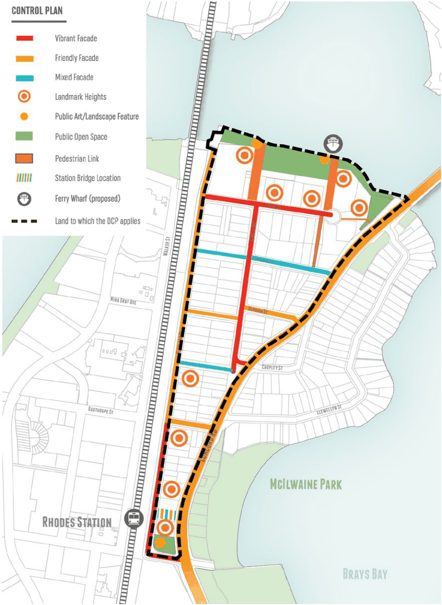

> [Picture on page 134: a picture, saved as a picture (images/part-k-special-precincts-page-134-1.gif, 150 dpi).]

Figure K16-21 Public domain interface plan

200m

50 100

N

#### K16.6 Built form, diversity and use

#### Built form strategy in the Cavell Avenue

#### Character Area

The built form strategy in the Cavell Avenue Character Area seeks to deliver quality density and is based on a 'high-low' model, where taller buildings and towers are mixed with low to mid rise development such as terraces, terrace-style apartments and/ or walk-up apartments (typically 2-3 storeys). This desired built form outcome achieves a number of benefits, including:

• the mix and transition of height limits the impact on the amenity of existing lower scale residential areas, including overshadowing or loss of views;

• the mix of housing form creates a stimulating interface to the street and a human-scale environment, which supports pedestrian activity. The maximum heights identified on the Local Environmental Plan map ‘Height of Building’ illustrates the maximum height achievable on a site.

A requirement included in the Local Environmental Plan is for multi-dwelling typologies to be provided as part of all development which addresses primary and secondary street frontages (see Section K16.5

- Primary and secondary streets subheading). It is therefore not possible for the maximum height to be achieved across the entirety of any site.

Examples of the desired 'high-low' built form outcome

The preferred outcome for development sites is a 'high plus low' built form outcome, which is achieved when the height limit is only fully realised on part of the site in order to comply with the maximum FSR constraints.

This typically occurs when a development comprises a single taller element to optimise views and/ or minimise solar impact on communal open space and key public open spaces. The developer benefits from a height limit that allows a strategically located taller element, whilst the public domain is protected from the impact of a more consistent bulk and mass.

The alternate option is a 'low to medium' built form outcome which maximises the FSR with none of the buildings reaching the maximum height. The FSR is evenly spread across the development site to form a consistent height envelope.

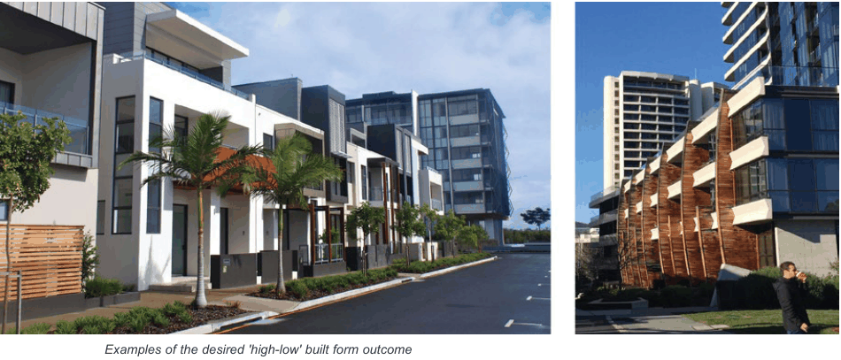

> [Picture on page 135: a picture, saved as a picture (images/part-k-special-precincts-page-135-44.gif, 150 dpi).]

#### Tower and Podium Design

750 sqm gross floor area max.

The Rhodes Planned Precinct builds on the ADG to provide a location-specific recommendation that gives equal priority to the public realm and experience as to that of the private open spaces and residences.

core

Therefore, additional floorplate controls, building separation and a height transition strategy are implemented (in excess of ADG at certain heights).

#### Objectives

balconies

(Above) Maximum gross floor area of 750 square metres

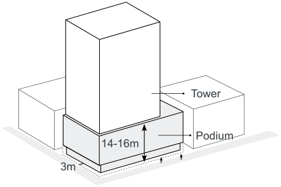

> [Picture on page 136: a picture, saved as a picture (images/part-k-special-precincts-page-136-15.gif, 150 dpi).]
> Words printed on the picture (copied from the PDF):
> Tower
> Podium
> 14-16m
> 3m

O1 To minimise overshadowing and wind impacts to co-located open spaces and public domain

O2 To minimise loss of sky views and enable equitable view sharing

O3 To allow for the passage of natural light and reduce "wall of buildings" from key public spaces.

#### Controls

C1. Consistent with the Objectives and supplementing SEPP 65, building-to building setbacks within the Precinct are to achieve the following separation controls: 15 - 20 storeys - 24m Above 20 storeys - 40m

C2. Residential towers above podium level shall have a maximum gross floor area of 750 square metres.

C3. Towers above 20 storeys are to provide a 5 storey differential in building height from all adjacent towers.

C4. A minimum podium height of approximately 14-16m building height is required.

C5. A tower and podium building typology is required, subject to the following outcomes:

a) A ground floor setback of 3m is to be provided.

L

b) A Podium to Tower setback of 4m is to

Tower

be provided.

1/3L

c) Maximum 1/3 of a tower frontage

Podium

along a street or public space can be extended down to the ground.

Public Gathering Area

Public gathering areas must be associated with the 2/3 of the façade that is grounded by a podium.

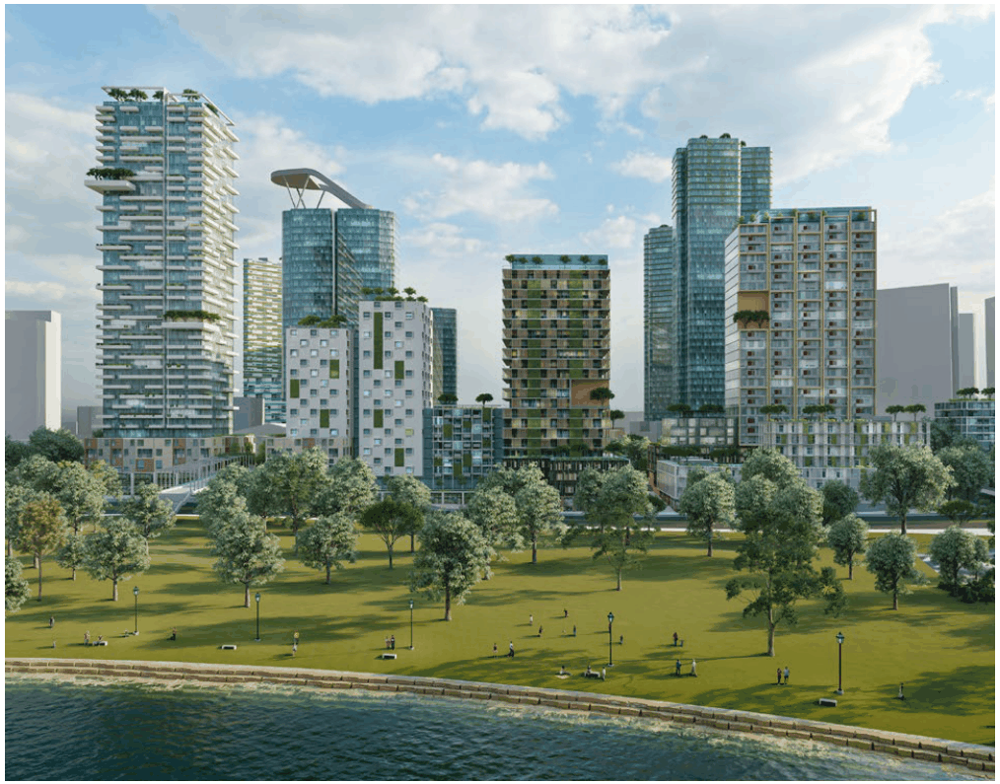

> [Picture on page 137: a picture, saved as a picture (images/part-k-special-precincts-page-137-1.gif, 150 dpi).]

Examples of the desired built form outcome incorporating tower design controls

#### Floor to ceiling heights

Floor to ceiling heights are directly linked to the potential use of a building, and the level of natural ventilation and daylight access. The ground floor levels of all new development in Rhodes East should have increased ceiling heights to ensure good internal amenity and long term adaptability.

#### Objectives

O4 To create resilient urban places by ensuring buildings, in particular at ground floor, are flexible and adaptable over time to a wide range of uses and changing demands.

| Controls |  |
|---|---|
| C6. | Development is to be consistent with the following minimum floor to ceiling heights: Use Min. height (m) Retail/ commercial 3.6m Community 3.3m Residential/ terraces 3.1m Above ground parking not permitted |
| C7. | The minimum floor to ceiling height of all ground floors is to comply with the category of “Retail/ commercial' in the above table. |
| C8. | The finished floor level of the ground floor above the footpath level is to be no greater than 1.0 metres for residential uses and 0.4 metres for retail and commercial uses. |

#### Residential uses not covered by the Apartment

#### Design Guide

The NSW Apartment Design Guide (ADG) applies buildings that are three or more storeys high and that comprise at least four dwellings. For other residential development types, such as 2-3 storey terraces, low rise up-over or walk-up apartments, multiplexes, urban courtyard houses and the like, the following controls apply.

#### Objectives

O5 To ensure design quality, performance of and amenity created by new residential development is of a high standard and consistent across the Precinct.

| Controls |  |
|---|---|
| C9. | The maximum building depth is 18 metres unless it can be demonstrated that all habitable rooms receive adequate ventilation and solar access, e.g. through the use of a courtyard design. |
| C10. | The minimum private open space of a ground floor dwelling is calculated by the number of bedrooms x 4m2. |
| C11. | Single aspect dwellings, if unavoidable, are only permitted if they have a northerly or easterly aspect. |
| C12. | Parking is not permitted to be visible from streets and open spaces. Access to parking via a driveway, lane or basement carpark entry is permitted if one access point services a minimum of 5 dwellings. Front garages, carports and individual driveways are strictly not permitted. |
| C13. | At least 70% of living rooms and private open spaces of a dwelling receive a minimum of 2 hours direct sunlight between 9 am and 3 pm at mid winter. |
| C14. | Master bedrooms have a minimum area of 10m2 and other bedrooms 9m2. |
| C15. | Building separation is as per the Apartment Design Guide, Section 3F Visual Privacy. |

#### Affordable housing

Affordable housing means rented housing occupied by households on very low, low or moderate incomes. For Rhodes East, there is a requirement to provide a proportion of affordable dwellings as specified in the Canada Bay Affordable Housing Contribution Scheme.

#### Objectives

O6 To ensure that low to moderate income households can afford to live in Rhodes East by increasing the stock of appropriate affordable housing.

| Controls |  |
|---|---|
| C16. | A minimum of 5% total gross floor area is dedicated as affordable housing in the areas identified in Figure K16-22. |
| C17. | Dwellings dedicated to affordable housing are to be of equivalent design quality, diversity and mix as all other dwellings. |
| C18. | Affordable housing is to be consistent with the requirements of the Canada Bay Affordable Housing Contribution Scheme. |

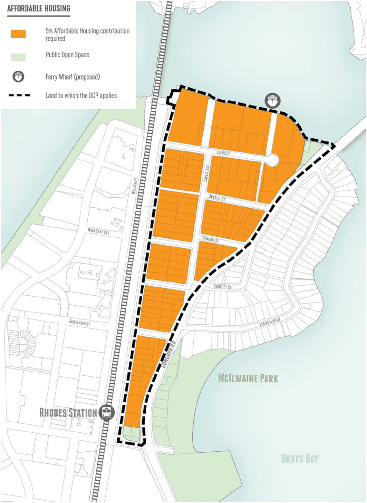

> [Picture on page 140: a picture, saved as a picture (images/part-k-special-precincts-page-140-1.gif, 150 dpi).]

Figure K16-22 Affordable housing plan

200m

50 100

N

#### Materials, finishes and colours

The selection and choice of materials, finishes and colours should have regard to robustness, durability, energy performance and compatibility to the surrounds.

#### Objectives

O7 To ensure building exteriors positively contribute to the desired future character of the area and streetscape.

| Controls |  |
|---|---|
| C19. | The composition of facades balances solid and void elements and does not display large areas of a single material, including reflective glass. |
| C20. | External walls are constructed of high quality and durable materials and finishes with low maintenance attributes such as face brickwork, rendered brickwork, stone, concrete and/or glass. |
| C21. | Sidewalls are designed as an architecturally finished surface that complements the main building facade. |
| C22. | Visually prominent elements such as balconies, overhangs, awnings, and roof tops are to be of high design quality. |
| C23. | Roof plant, lift overruns, utilities, vents and other service related elements are to be integrated into the built form design and complementary to the architecture of the building. |
| C24. | Facades reinforce the vertical proportions and support a vertical rhythm along the street. |
| C25. | Adjoining buildings are considered in terms of setbacks, awnings, parapets, cornice lines, selection of materials and finishes, and facade proportions. |
| C26. | Design to be approved by the City of Canada Bay Design Review Panel. |

#### Heritage items

A number of local heritage items are situated within the Precinct, shown in Figure K16-23 and listed in the LEP. This section outlines provisions for adaptive reuse of and development in the vicinity of selected heritage items in addition to the provisions contained in the Heritage controls in the Canada Bay DCP.

#### Objectives

O8 To protect buildings, spaces and streetscapes of heritage significance within and in the vicinity of the Precinct.

O9 To ensure that new development responds sensitively to the heritage significance of each listed item and does not physically overwhelm or dominate a heritage item or impact on its setting.

| Controls |  |
|---|---|
| C27. | All development of and in the vicinity of a heritage item is to address the requirements of the Heritage controls in the Canada Bay DCP. |
| C28. | New development provides appropriate transitions to existing buildings, structures and streetscapes of heritage value. |
| C29. | New development uses sympathetic materials, colours and finishes that reflect and harmonise with original materials to maintain the character of heritage items and contributory buildings. |
| C30. | Whilst not formally heritage listed, the Coptic Church on Cavell Avenue has a strong historical association with the Community. If it is to be retained in situ then the setting and orientation of the building is to be respected. |

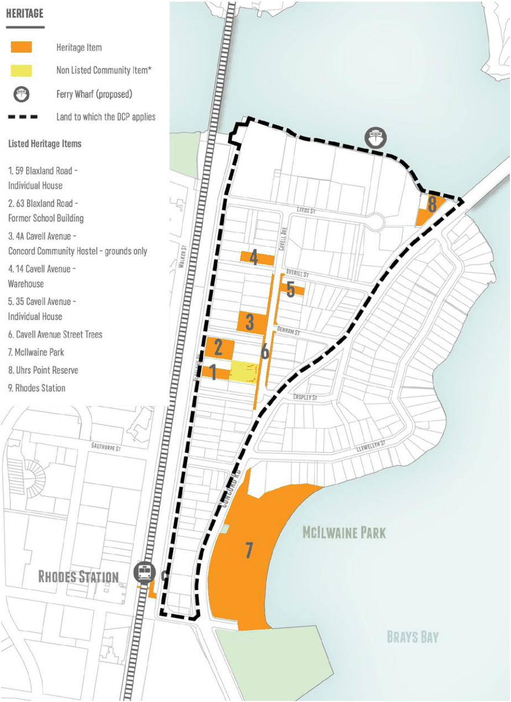

> [Picture on page 142: a picture, saved as a picture (images/part-k-special-precincts-page-142-1.gif, 150 dpi).]

Figure K16-23 Heritage items plan

200m

50 100

N

\*The Coptic Church has a strong historical association with the community and is to be retained in situ.

There are a number of heritage items within the Rhodes East Precinct for which specific development controls apply as follows:
