### K17  Rhodes West

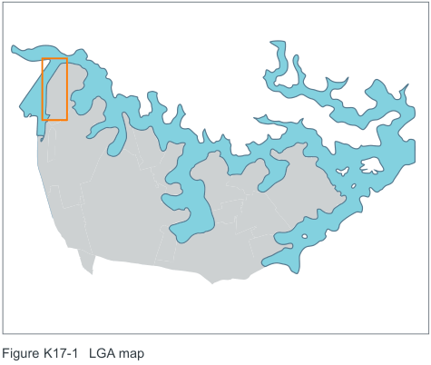

> [Picture on page 187: a picture, saved as a picture (images/part-k-special-precincts-page-187-2.gif, 150 dpi).]

Figure K17-1 LGA map

#### K17.1 Introduction

#### Preliminary

Rhodes West is a Specialised Centre in Canada Bay Local Government Area (LGA) located on the eastern shore of Homebush Bay, Sydney Harbour’s western most bay. Rhodes West has progressively developed under a planning framework established in 1999 under the Sydney Regional Environmental Plan 29: Rhodes Peninsula (SREP 29) (Now repealed) and the Renewing Rhodes Development Control Plan 2000 (RRDCP 2000) (now superseded).

The City of Canada Bay Council was delegated the role of consent authority from the Minister for Planning in 2009. Since that time, Council has investigated the potential opportunities to enhance the community’s facilities and public open space and to build on the existing urban design and planning framework to incorporate sound place making principles in the development of the remaining development sites.

The Rhodes West DCP 2010 formed an important part of the previous implementation of Council’s vision for Rhodes West. This site and precinct specific DCP, Rhodes West DCP 2015, will continue and strengthen this vision to create a sustainable, liveable and well connected place on the peninsula.

This DCP includes:

• A Framework Plan to set the urban design structure for development sites; and

• Development controls for the public and private domain.

#### Vision

The ‘vision’ for Rhodes West is to: 1.Create a diverse and visually interesting commercial centre supported by a high density residential community;

2.Integrate the new community of Rhodes West with the existing community east of the Northern Railway line, Wentworth Point and Sydney Olympic Park through bus, pedestrian and cycle connections and the provision of new community facilities, which are accessible to all;

3.Engender a meaningful ‘sense of place’ and community with a network of activity areas that combine neighbourhood shops, recreation opportunities, and public open space with residential dwellings;

4.Create a range of high quality public open spaces and community facilities;

5.Ensure high quality architectural design that contributes positively to the role of Rhodes as a Specialised Centre in Sydney; and 6.Demonstrate leadership in ESD initiatives.

#### Aims and objectives

The intention of the Rhodes West Development Control Plan is to set the detailed development objectives and controls that support the Canada Bay Local Environment Plan 2013 (as amended).

#### Aims

The following Aims seek to implement Council’s vision for a precinct of high quality urban design that is well connected, liveable and environmentally, economically and socially sustainable.

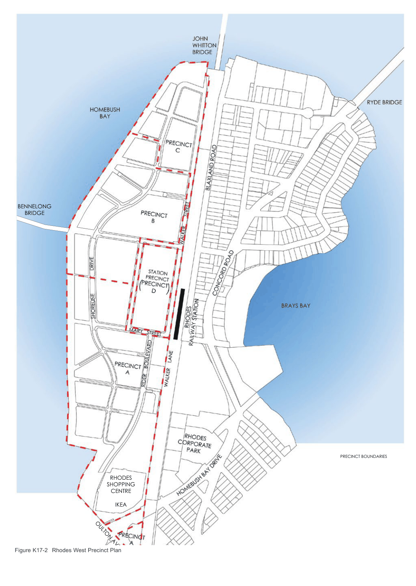

> [Picture on page 188: a picture, saved as a picture (images/part-k-special-precincts-page-188-1.gif, 150 dpi).]
> Words printed on the picture (copied from the PDF):
> BENNELONG
> BRIDGE
> RAILWAY
> PRECINCT BOUNDARIES
> RHODES
> SHOPPING
> CENTRE
> IKEA
> Figure K17-2 Rhodes West Precinct Plan
> OULTON AVENUE

High quality design

A1 High quality public domain design to create memorable places that the community use and enjoy.

A2 Pleasant streetscapes with active street frontages.

A3 High quality architectural design that creates a visually interesting skyline as well as pleasant streetscapes.

Well connected

Connectivity achieved by:

A4 Supporting an integrated, well connected and accessible area to it’s local and regional context.

A5 Providing pathways and cycleways that link public spaces and activity areas through and between residential and mixed use areas and that link with adjacent residential areas.

A6 Enhancing existing connections and creating new connections between Rhodes West and Rhodes East, Wentworth Point and Sydney Olympic Park which supports the proposed construction of the Homebush Bay Bridge between Rhodes West and Wentworth Point.

A7 Promoting and providing a well connected network of public, private and communal areas which offer a range of recreational needs including places with high amenity for workers, local residents and other visitors to enjoy.

Liveable

Liveability achieved by:

A8 Establishing an urban design framework that optimises views, sunlight access and natural air movement and that minimises environmental impacts within Rhodes West and adjacent residential areas.

A9 Providing safe and secure public spaces, pedestrian pathways and cycleways.

A10 Providing well designed public open spaces through the use of high quality materials, street furniture and public art.

A11 Promoting high levels of internal residential amenity in the design of communal areas and internal layout of dwellings having regard to visual and acoustic privacy, thermal comfort, natural airflow and ventilation, sunlight access, adequacy of storage areas, views and aspect.

Sustainable

Environmental sustainability achieved by:

A12 Promoting sustainable transport, reduce car use and increase use of public transport, walking and cycling.

A13 Providing high quality open spaces and a range of recreational facilities.

A14 Conserving the environmental heritage of Canada Bay.

A15 Promoting ecologically sustainable development.

A16 Supporting foreshore areas for parkland open space that balances the need for ecological restoration with functional open space required for public foreshore access.

A17 Promoting a high level of building sustainability performance through energy and water efficiency.

A18 Promoting waste minimisation in building construction and operation.

A19 Promoting pedestrian and cycling network through integrated circulation and wayfinding which will provide safe and enjoyable access to facilities and open space.

Economic sustainability achieved by:

A20 Promoting an appropriate mix of uses that will enhance the role of Rhodes as a Specialised Centre for employment growth.

A21 Promoting a dwelling mix that supports demand for housing that is affordable whilst providing housing choice for a range of household types. Social sustainability achieved by:

A22 Providing community facilities of an appropriate use and size to cater to the demands of a growing population.

A23 Providing an adequate amount of public open spaces designed to suit the needs of the growing population for a variety of passive and active recreational needs.

#### Objectives

The DCP is based on the following objectives in support of Canada Bay Local Environment Plan 2013 (as amended).

Create a specific identify for Rhodes Peninsula

O1 Optimise the waterfront location by providing continuous public access to the foreshore that links adjoining parks.

O2 Substantially retain the alignment of existing seawalls.

O3 Design public open spaces that create a special amenity and passive and active recreation opportunities, which are safe and promote ease of pedestrian movement.

O4 Retain and enhance opportunities for views from the public domain, including views to the water from along the ridge, to Homebush Bay and Brays Bay looking east and west along Mary Street, west along Parramatta River from the point, and to the Millennium Markers and Olympic Park.

O5 Preserve the cultural heritage value of the place by retaining wherever practical existing streets, established stands of trees, site benching, prereclamation shoreline and the flat terrain of the reclaimed area.

O6 Reflect and emphasis the topography with lower buildings at the foreshore and greater height to the east of Shoreline Drive.

O7 Create a visible identity to Rhodes West through the design of high quality tower buildings of slender design.

Provide a street layout that maximises connections to all surrounding areas and creates a high quality public domain that is permeable and safe

O8 Integrate the east and west parts of the Rhodes Peninsula and improve pedestrian and cycle links to Concord West.

O9 Build the Homebush Bay Bridge to provide connectivity for pedestrians and public transport between Rhodes Peninsula and Wentworth Point.

O10 Provide for future flexibility by maximising connections to adjoining areas from Mill Park in the north, across the rail line in the east, and to Oulton Avenue in the south.

O11 Create pedestrian and cycle connections from Bicentennial Park and Millennium Parklands in the south to the Leeds Street boat ramp in the north via streets and the foreshore reserve;

O12 Improve pedestrian connections to the north by providing stairs from Mill Park to John Whitton Bridge and at the ferry wharf at Meadowbank;

O13 Locate streets to enhance views to Homebush Bay, Parramatta River and associated open spaces, and ensure a view to water, open space or sky at the end of every street, to the maximum extent possible.

O14 Establish a continuous network for vehicles, pedestrians and throughout the peninsula, close to the Railway Station, and minimise public dead end streets;

O15 Create pedestrian permeability by providing through block pedestrian access;

O16 Establish a hierarchy of streets that distinguishes between major streets for through traffic and public transport, and local streets to assist orientation and improve legibility;

O17 Create a safe and vibrant public domain by designing streets as social spaces that incorporate a mix of transport modes, including pedestrians, cyclists, moving and parked vehicles;

O18 Give pedestrians and cyclists priority in residential areas by means such as pedestrian through block connections, footpaths, kerb ramps, street trees, minimising vehicle crossings of footpaths, and designing minor carriageways for slow vehicle speeds to deter through traffic. Create a range of public open spaces that complement and supplement the existing local and regional park network, and that maximise connections to all surrounding areas

O19 Contribute to the regional network by providing continuous public open space along the foreshore that is publicly accessible, connecting to Bicentennial Park and the Blaxland Road Boat Ramp and pedestrian/cycleway connections on John Whitton Bridge.

O20 Contribute to the regional network by constructing the proposed Homebush Bay Bridge between Rhodes Peninsula and Wentworth Point creating the Homebush Bay Loop.

O21 Provide a point park that extends the typology of point parks in the harbour and along the Parramatta River foreshores creating the Parramatta River Loop.

O22 Provide an active Foreshore Park as the major public activity point along the foreshore, between Mary and Gauthorpe Streets.

O23 Provide a conservation park which conserves the existing mangroves along the foreshore to the south.

O24 Provide a linear reserve for local recreation including the three major foreshore parks, incorporating planting to extend habitat, enhancing the view of development from the reserve and Homebush Bay, and providing privacy to park front development.

O25 Provide neighbourhood open space as a gathering point in the mixed use zone close to the railway station, near the junction of the major pedestrian routes to the foreshore and retail complex.

O26 Provide local parks along Shoreline Drive to enhance the amenity of this primary through street, which have quality landscaping, trees for shade and areas for supervised children’s play.

O27 Provide strategically positioned local parks and squares in the B4 - Mixed Use and R4 - Residential Zones to provide places for people to meet, gather, sit, actively use or relax.

O28 Maximise public pedestrian and cycle access to all public open spaces.

O29 Create high quality landscaped parks that include deep soil landscape areas, that allow planting of large trees.

Integrate best practice ESD principles in the design and management of the public and private domain

O30 Minimise energy consumption by creating low maintenance environments and encouraging green supply electricity.

O31 Minimise resource deletion by selecting environmentally sustainable building materials in the public and private domain.

O32 Control the quality of water entering Homebush Bay by integrating stormwater management strategies.

O33 Conserve water by maximising opportunities for infiltration of runoff, reducing irrigation

requirements through the planting of locally native species, and using water saving devices in public amenities.

O34 Control the potential impact on air quality by minimising car dependency, promoting pedestrian and cyclist movement throughout the site and encouraging the use of public transport.

O35 Reduce energy consumption by encouraging non-motorised forms of transport. Optimise the use of public transport and reduce travel demand

O36 Provide a mix of residential, community, employment, local and district retail activities within the Rhodes Peninsula.

O37 Concentrate public accessible facilities, commercial development and the entrance to retail facilities with direct and convenient access to Rhodes Station, within 500m of the station entrance.

O38 Maximise access to Rhodes Station by creating a permeable layout of streets, pedestrian arcades and walkways, and create an appropriate setting in terms of pedestrian access, facilities and modal change.

O39 Create a primary retail/commercial street linking Mary Street and a retail centre adjacent to Homebush Bay Drive.

O40 Enable local shops and home based business in residential areas, along Walker Street, within and adjacent the Foreshore Park to complement community facilities, and fronting onto local parks.

O41 Minimise public and private car parking in all developments.

O42 Accommodate a bus route through Rhodes West in the design of streets and connecting bus routes to Wentworth Point over the Homebush Bay Bridge.

O43 Promote cycling as a sustainable alternative to the automobile for commuting as well as for local travel through the provision of an integrated on-road and off-road cycleway network and the provision of bicycle parking within private developments as well as at key activity places in the public domain including Rhodes Railway Station.

O44 Minimise car dependence by encouraging car sharing by providing dedicated on-street spaces for car share companies to use.

Enliven the public domain and encourage walking by distributing active uses, including retail and communal facilities, at street level, particularly along major streets in the mixed use zone

O45 Consolidate mixed uses including publicly accessible facilities, local retail and commercial adjoining Rhodes Railway Station.

O46 Encourage active ground floor uses on primary streets, in particular along the major spine connecting Rhodes Station and the retail centre adjacent to Homebush Bay Drive.

O47 Encourage activities in, and surveillance of, all public areas.

O48 Provide publicly accessible facilities and small scale retailing adjoining and opposite parks and squares, including facilities that accommodate or are ancillary to recreational opportunities relating to the use of the public domain. Embody ESD principles into the design of buildings and external spaces

O49 Create street blocks that facilitate subdivision and building orientation to the north, east and west, provide excellent address to Homebush Bay, the foreshore parks and local parks and that follow the design guidelines within Chapter 4 of the Housing SEPP, titled 'Design of residential apartment development' and the Apartment Design Guide, NSW Department of Planning and Environment, July 2015.

O50 Encourage the design of long life buildings that are durable and designed to accommodate adaptation to future uses, and buildings that innovatively combine ecological, social, cultural and economic objectives.

O51 Conserve energy by maximising the use of natural lighting and ventilation, passive heating and cooling, energy efficient hot water heating and low energy lighting and appliances.

O52 Minimise resource depletion by the selection of environmentally sustainable building materials.

O53 Providing on site facilities for composting, recycling and bulky goods.

O54 Conserve water by matching water quality with its intended use and using water saving devices.

O55 Conserve water by connecting Rhodes West to the water conservation infrastructure known as WRAMS at Sydney Olympic Park, if available.

O56 Maximise water quality by implementing soil erosion and sedimentation control measures during remediation and construction phases, maximising opportunities for infiltration of stormwater, and minimising nutrients and pollution in urban runoff.

O57 Control the potential impact on air quality by minimising reliance on cars, provision of bicycle parking within the basement and providing information to respective residents about the transportation alternatives to private motor vehicles, requiring car share arrangements to integrate into developments and the public domain and the continuance of the reduced on-site parking requirements for private development.

O58 Reduce landfill by:

» Minimising the generation of waste; » Recycling 80% of weight of construction waste. Create a model suburb characterised by high quality architecture, landscape architecture, and urban and environmental design which enhances the locality

O59 Promote a high quality of architectural and landscape design, to create a strong identity for all new development.

O60 Encourage design excellence in architectural and landscape design and follow the design guidelines within Chapter 4 of the Housing SEPP, titled 'Design of residential apartment development' and the Apartment Design Guide, NSW Department of Planning and Environment, July 2015.

O61 Create an architectural character specific to urban location, public domain interface and landscape setting.

O62 Encourage built form that creates a positive urban edge to streets and public open spaces and the foreshore of Homebush Bay.

O63 Encourage built form that optimises sun access to new and existing streets and public open spaces.

O64 Minimise the bulk of tower and tall buildings to protect amenity of adjoining residential areas and parklands.

O65 Encourage built form that has articulated facades to create visually interesting building forms and to assist in breaking up building bulk.

O66 Create private internal and external environments that achieve a high level of amenity to building occupants and neighbours and that create pleasant streetscapes.

Provide workplace and housing choice through a variety of building types to cater for a diverse community

O67 Provide a variety of building types, and encourage flexible living and working accommodation.

O68 Accommodate the needs of people with mobility impairment, including young children in prams and the elderly by providing accessible housing.

O69 Ensure that non-residential activities do not detract from residential amenity. Provide well connected private external spaces that are well integrated with the buildings

O70 Design communal landscape spaces to be useable and easily accessible from adjoining buildings, and that provide a pleasant and comfortable environment;

O71 Provide residential front gardens to dwellings that are set back from the street edge.

#### Land covered by this DCP

This plan applies to the precinct known as Rhodes West, being the precinct generally bounded by the main Northern Rail Line, Outlon Avenue (near Homebush Bay Drive), Homebush Bay and Parramatta River as identified in Figure K17-2 Rhodes West Precinct Plan.

#### Structure of the DCP

The DCP comprises four main sections:

• Section K17.1 Introduction

• Section K17.2 Framework Plan – sets out the urban design structure and principles of the DCP

• Section K17.3 General controls - provides the controls for public and private domain that apply to all development at Rhodes West

• Section K17.4 Site-specific controls – provides the specific controls that apply to the remaining development sites within each of the Precincts

#### K17.2 Framework Plan

#### Urban design and place making principles

The Framework Plan at Figure K17-3 Rhodes West Framework Plan illustrates the overall urban design framework for Rhodes West. This DCP has been prepared making regard to the following urban design and place making principles:

(a) Provide a stronger identity for Rhodes West to enable it to achieve its wider metropolitan potential as a Specialised Centre, particularly for employment generating activities by:

• Establishing a visually interesting and appealing skyline of tower buildings that display high architectural design quality in their slender form as well as detailed articulation and design.

• Designing high quality public open spaces that encourage people to gather, mingle, and traverse. Achieved in the alignment and form of squares and parks that recognise pedestrian desire lines, the framing of public spaces with appropriately scaled built form and in the achievement of excellence in urban design and landscape architecture. Refer to Figure K17-4 Rhodes West Open Space Plan.

• Creating interesting places that people want to visit and that have an appropriate mix of uses that activate and give address to streets and open spaces.

(b) Create focal points with different levels of activity that build on the activity areas that currently exist. Particularly at the Shopping Centre along Rider Boulevard and at the corner of Mary Street and Rider Boulevard adjacent the Rhodes Station. Active recreation spaces include the following:

• Town Square and commercial and retail uses close to the Rhodes Station

• Central Park

• Waterfront activity incorporating community facility, cafes and restaurants

• Shoreline Drive North Park

• Permanent and flexible uses around a mid-block oval plaza and laneways in Station Gateway West (Precinct D)

• New developed Recreation Centre along Gauthorpe Street between Marquet Street and Walker Street

• Community facility at the foreshore

(c) Promote visual connectivity along streets and through development sites to key public domain areas within Rhodes West, and to more distant water views through the following:

• Vehicle, pedestrian, and cyclist connections to align with key views and vistas

• Enhance east west view corridors along streets through greater building setbacks

• Pedestrian connections through Precinct B are to align with a diagonal vista from the elevated location of Walker Street to the extension of Marquet Street (west of Shoreline Drive)

• Terminate north and south views along Shoreline Drive with a tower building

(d) Create attractive streets for people to use through the following means:

• Provide non-residential uses including shops, commercial offices, cafes and restaurants, at activity nodes that activate street frontages where there are higher levels of pedestrian activity

• Planting street trees to provide shade and to soften the built form of adjoining developments

• Introducing building setbacks to provide for ground level front gardens of residential buildings

• Introduce a change in level between the public domain and a residential dwelling and front fencing to provide privacy and to allow surveillance of the public domain

• Create laneways through key peninsula blocks to introduce pedestrian dedicated outdoor areas to create connections and to provide variety in the public domain

(e) Demonstrate high quality architectural design of buildings through the following:

• Design building forms to address and define the public domain

• Reiterate the curved shape of Shoreline Drive in the associated built form to create a visually interesting street

• Cluster tower buildings between Shoreline Drive and Walker Street and close to the railway station. Tower buildings are to be setback from Walker Street and Shoreline Drive with some intervening development to maintain the effect of a street wall, however, without a continuous wall effect

• Stagger buildings to avoid a row of buildings along the ridgeline and vary the height of buildings from foreshore to the ridgeline

• Buildings that are slender and slimline in form and that are highly articulated in their built form and facade treatments are sought

• Tower buildings are to define key street frontages and urban corners

Development Control Plan

MILL

PARK NORTH

DRIVE

CENTRAL PARK BENNELONG BRIDGE

DRIVE

PEG PATERSON

RHODES

WATERSIDE

Part K Special Precincts

RAILWAY

Figure K17-3 Rhodes West Framework Plan

PERMISSIBLE ADDITIONAL

HEIGHT

UNDERPASS OR

OVERPASS

ACTIVITY STRIP

LANEWAY CONNECTIONS

Development Control Plan

Special Precincts

Part K

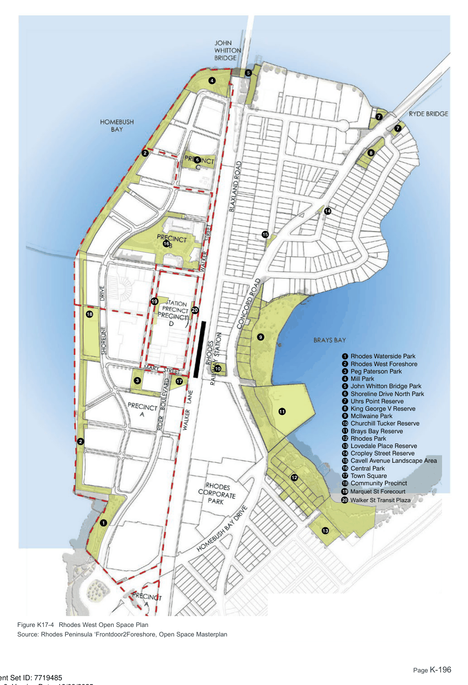

> [Picture on page 196: a map, saved as a picture (images/part-k-special-precincts-page-196-4.gif, 150 dpi); the street names and other small labels are on the picture.]
> Labels printed on the map (copied from the PDF, in no particular order):
> BENNELONG · BRIDGE · 18 · 2 · 1 · 4 · 2 · 6 · 16 · GAUTHORPE STREET · 19 · 20 · MARQUET STREET · 10 · 3 17 RAILWAY · Figure K17-4 Rhodes West Open Space Plan · Source: Rhodes Peninsula ‘Frontdoor2Foreshore, Open Space Masterplan · 5 · 7 · 7 · 8 · 14 · 15 · 1 · 2 · 3 · 9 · 4 · 5 · 6 · 1 · 7 · 2 · 8 · 3 · 9 · 4 · 10 · 11 5 · 12 6 · 13 7 · 14 8 · 11 · 15 · 9 · 16 · 10 · 17 · 11 · 18 · Rhodes Waterside Park · Rhodes West Foreshore · Peg Paterson Park · Mill Park · John Whitton Bridge Park · Shoreline Drive North Park · Uhrs Point Reserve · King George V Reserve · McIlwaine Park · Churchill Tucker Reserve · Brays Bay Reserve · Rhodes Park · Lovedale Place Reserve · Cropley Street Reserve · Cavell Avenue Landscape Area · Central Park · Town Square · Community Precinct · 12 · 13 · 14 · 15 · 16 · 17 · 12 · 18 · Rhodes Waterside Park · Rhodes West Foreshore · Peg Paterson Park · Mill Park · John Whitton Bridge Park · Shoreline Drive North Park · Uhrs Point Reserve · King George V Reserve · McIlwaine Park · Churchill Tucker Reserve · Brays Bay Reserve · Rhodes Park · Lovedale Place Reserve · Cropley Street Reserve · Cavell Avenue Landscape Area · Central Park · Town Square · Community Precinct · 19 · 20 · Marquet St Forecourt · Walker St Transit Plaza · 13

#### Open Spaces of the Master Plan

#### K17.3 General controls

#### Introduction

This Section sets out the general planning objectives and controls that apply to Rhodes West. These controls are to be read and applied in conjunction with the precinct specific controls in Section K17.4 Site-specific controls.

Development Controls are provided for the:

• Public domain

• Private domain

A short description of the intent of the controls is provided and where relevant controls are illustrated with diagrams and images of built projects demonstrating good practice.

#### A. Public domain

#### A.1 Pedestrian network and amenity

Continuity - Promoting pedestrian access is central to creating a high quality public domain. Encouraging pedestrian access reduces car dependency, promotes equal access and increases opportunities for social exchange and community life. Continuous comfortable and safe pedestrian access should be provided throughout Rhodes West and should link all streets, parks, residences, shops, offices, public transport stops and major pedestrian routes in adjoining areas. Refer to Figure K17-5 Rhodes West Public Domain Plan.

Comfort, convenience and appearance - Pedestrian routes need to be as direct as possible and comfortable. Allowing appropriate levels of sunlight, and capturing breezes. Correct orientation and appropriate adjoining building height improves their quality, as does the provision of shade and weather protection. Pavement treatments that clearly define pedestrian areas and level of priority should be used, especially where pedestrian routes and vehicle routes crossover at driveways and pedestrian crossings. Well designed and well constructed pedestrian areas encourage their

use. It is essential that all pedestrian areas are clearly identified as public areas.

Security - An integrated approach can improve actual and perceived personal security in pedestrian areas. Pedestrian routes should be continuous and without dead ends.

Preferably, pedestrian routes should be part of the general street system, with vehicular traffic providing a level of passive surveillance. They should be overlooked from adjoining buildings, have clear lines of sight and be without obstacles like shrubs and bulky street furniture that can provide hiding places. Pedestrian routes with high night time use should be well lit and directed along more trafficked streets that have busy adjoining uses.

Access - Pedestrian routes should be designed to be accessible to everyone, including people with mobility impairments. They should offer a continuous path of unimpeded travel where possible, or include areas without steps and steep grades.

Continuity

| Controls |  |
|---|---|
| C1. | Provide a continuous pedestrian network through the streets, parks and public rights of way as set out in the Framework Plan. |
| C2. | Connect to the regional pedestrian network by linking to the Bicentennial Park path system at the southern end of the peninsula, and to Blaxland Road to the north. |
| C3. | Supplement connections to the street system of the east side of Rhodes Peninsula, through links at Walker Street rail underpass, the retail area and Oulton Avenue. |
| C4. | Extend pedestrian access to the south of Walker Street to improve connections to Homebush Bay Drive, Liberty Grove, Concord West and residential areas to the east. |
| C5. | Provide links to Meadowbank Park and the ferry wharf via the pedestrian link across John Whitton Bridge. |
| C6. | Allow for the pedestrian/cycleway bridge to Homebush Bay West (Wentworth Point) that lands along the alignment of Gauthorpe Street at the Foreshore Park. |
| C7. | Provide pedestrian amenity lighting to meet Australian Standard. |
| C8. | Implement CCTV surveillance to promote security and safety. |

Comfort

| Controls |  |
|---|---|
| C9. | Intersection and crossing design should favour pedestrian convenience and safety. Local pedestrian crossings should link major destinations and areas of intense pedestrian activity. |
| C10. | Provide a paved footpath to both sides of every street. |
| C11. | Separate pedestrian and vehicular traffic through use of a formed vertical kerb between the footpath and the carriageway. |
| C12. | Pavement width should allow for comfortable walking, unimpeded by obstacles. The placement of trees, street furniture and signage should provide for amenity without causing clutter. |
| C13. | Circulating pedestrian pathways is to be 3.0m wide. |
| C14. | Street furniture, trees and light poles are allowed within the zone provided minimum unobstructed width of 2.4m is maintained for pedestrian. |

Appearance

| Controls |  |
|---|---|
| C15. | Avoid ambiguity in the design of public spaces and secondary streets, particularly at parks, entrances and areas with a strong built edge and residential presence. |
| C16. | Access to the foreshore must be open and unambiguous, particularly via the secondary streets and at the entrance / exit points to the foreshore linear park. Avoid the use of walls and gates at these entrances. |

Security

| Controls |  |
|---|---|
| C17. | Minimise pedestrian areas with limited surveillance due to visual or physical access or distance from buildings and / or passing traffic. |
| C18. | Provide quality of lighting in areas of concentrated car parking, pedestrian/ vehicle laneways, and at the interface between buildings and streets in commercial and retail areas. |
| C19. | Identify safe night time pathways through good lighting, maximum casual surveillance and minimal concealment opportunities. |
| C20. | Front fences and walls along street frontages should use visually permeable materials and treatments. Where solid walls or fences are proposed, these should be limited to 1m in height. |

Equal Access

| Controls |  |
|---|---|
| C21. | Integrate design for equal access into the design of streets and open spaces. Design of the public domain should comply with the Commonwealth Disability Discrimination Act. It should incorporate requirements set out in AS 1428, as set out in the City of Canada Bay Council Development Control Plan 2013 – Appendix A: Access and the Canada Bay Standard Conditions of Consent. |
| C22. | Provide kerb ramps at all intersections, with pedestrian refuges at wide or busy streets. |

Development Control Plan

Part K Special Precincts

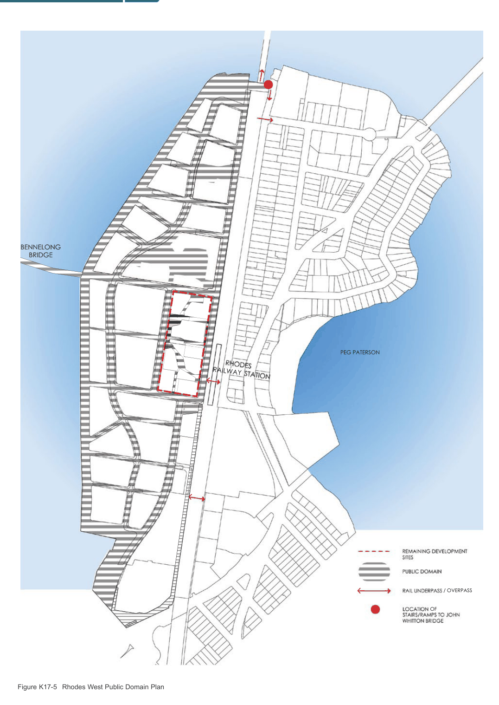

> [Picture on page 199: a picture, saved as a picture (images/part-k-special-precincts-page-199-3.gif, 150 dpi).]
> Words printed on the picture (copied from the PDF):
> BENNELONG
> BRIDGE
> HOMEBUSH
> BAY BRIDGE
> HOMEBUSH
> BAY BRIDGE
> RAILWAY
> Figure K17-5 Rhodes West Public Domain Plan
> PEG PATERSON
> / OVERPASS
> OF

#### A.2 Cycle strategy

A well designed cycle network provides recreational opportunities and reduces car dependency by providing alternative means of transport. All public streets and public rights of way should be designed to encourage cycle use. Dedicated cycle lanes are to be provided in two areas – where additional safety is required in the more heavily trafficked Walker Street, and as a predominantly recreational route along Foreshore Reserve. Both these routes provide connections to regional cycleways, and to major public recreation areas.

Safe and convenient cycle access is also dependent on provision of intersections and crossings that favour cyclists along the dedicated cycle routes, and the provision of cycle lockup facilities at common destinations such as stations, schools, retail areas, residences and work places.

Cycle routes that are illustrated in Figure K17-6 Rhodes West Cycle Strategy should be overlooked from adjoining buildings, have clear lines of sight and uninterrupted path of travel, be well lit, sign posted and protected from high winds. Recreational cycleways should be attractive and made interesting through appropriate location and detailed design.

| C5. | Design intersections and crossings along dedicated cycle routes to favour cyclist’s safety and convenience. |
|---|---|
| C6. | Provide lockable bicycle storage at Rhodes Station, the retail centre, and in publicly accessible facilities. Refer Photo K17-1. |
| C7. | Separate cycle and pedestrian routes through the Foreshore Reserve. |
| C8. | Design cycle paths, cycle parking and end of trip facilities at least to the minimum design standards set out by Austroads. Refer Photo K17-2. |
| C9. | Bicycle parking is to be provided at the station. |

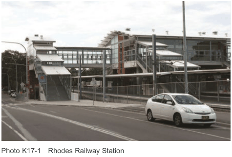

> [Picture on page 200: a picture, saved as a picture (images/part-k-special-precincts-page-200-27.gif, 150 dpi).]

| Controls |  |
|---|---|
| C1. | Provide a cycle network through the public streets and the foreshore park as set out in the Framework Plan. |
| C2. | Connect to the regional cycleway, and improve access to the pedestrian / cycleway at John Whitton Bridge and the new Homebush Bay Bridge. |
| C3. | Provide commuter cycle lanes along Walker Street, from Mary Street to the underpass at the northern end of the peninsula, at a minimum width of 1.4m. |
| C4. | Provide a recreational cycle path through the Foreshore Reserve, which also connects to the regional cycleway at both ends. The recreational cycleway continues under John Whitton Bridge to the stairs and ramps on the eastern side of the bridge. Refer to the Public Domain Technical Manual for standards. |

Photo K17-1 Rhodes Railway Station

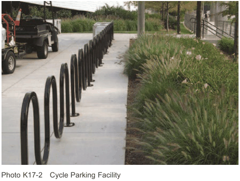

> [Picture on page 200: a picture, saved as a picture (images/part-k-special-precincts-page-200-30.gif, 150 dpi).]

Photo K17-2 Cycle Parking Facility

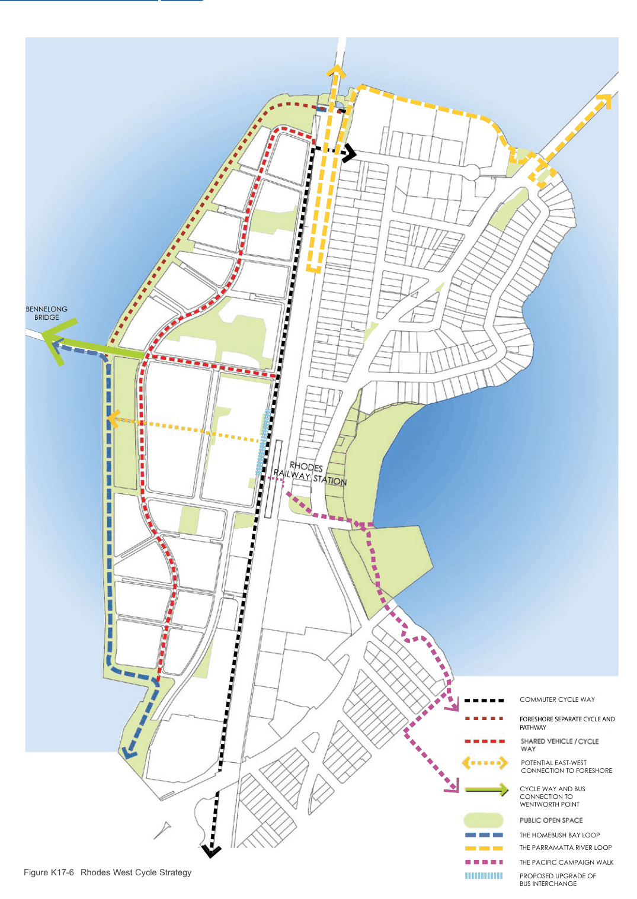

> [Picture on page 201: a map, saved as a picture (images/part-k-special-precincts-page-201-1.gif, 150 dpi); the street names and other small labels are on the picture.]
> Labels printed on the map (copied from the PDF, in no particular order):
> BENNELONG · BRIDGE · HOMEBUSH · BAY BRIDGE · HOMEBUSH · BAY BRIDGE · RAILWAY · Figure K17-6 Rhodes West Cycle Strategy · COMMUTER CYCLE WAY · FORESHORE SEPARATE CYCLE AND · PATHWAY · POTENTIAL EAST-WEST · CONNECTION TO FORESHORE · CYCLE WAY AND BUS · CONNECTION TO · WENTWORTH POINT · THE HOMEBUSH BAY LOOP · THE PARRAMATTA RIVER LOOP · THE PACIFIC CAMPAIGN WALK · PROPOSED UPGRADE OF · BUS INTERCHANGE

#### A.3 Sustainable transport infrastructure

Rhodes Station provides the opportunity to design an integrated neighbourhood that promotes public transport use. Access to public transport decreases car dependency and provides a means of travel for people without car availability. A convenient and safe pedestrian network is central to encouraging public transport use. Access for less abled people, provision of commuter parking for cycles and vehicles, and good interchange between modes and also promotes higher levels of uptake. The rail and bus routes are illustrated in Figure K17-7 Rhodes West Public Transport Plan.

| Controls |  |
|---|---|
| C1. | Provide convenient pedestrian and cycle connections to Rhodes Station, bus stops on Concord Road, and Meadowbank Ferry Wharf. |
| C2. | Encourage interchange between public transport modes. |
| C3. | Promote ease of access to the station through a permeable street network. |
| C4. | Locate bus stops at activity nodes including the retail centre, and also close to publicly accessible facilities. |
| C5. | Bus stops and taxi ranks are to be provided with good lighting, shelters / seating and route / schedule information. |
| C6. | Public bicycle parking facilities are to be located at public open spaces, with convenient access to commuter and recreational cycleways throughout Rhodes West. |

#### A.4 Vehicle circulation and parking

Vehicular routes should provide convenient access to and between peninsula developments. Vehicular access should be designed with consideration of road functional hierarchy, pedestrian activity patterns and safety. On-street parking is to be provided generally throughout, to add life to the streets. Parking controls should reflect the requirements of land uses fronting streets.

| Controls |  |
|---|---|
| C1. | Promote permeability for vehicles, pedestrians and cyclists and a spread of traffic throughout the peninsula by adopting the street layout shown in the Framework Plan. |
| C2. | Access to private vehicle parking in developments is restricted in the locations shown in Figure K17-12 Rhodes West Vehicle Access Restrictions. |
| C3. | To promote the shared use of private vehicles, to reduce parking demand and to minimise traffic generation, developments exceeding 200 dwellings are to allocate one car space in a convenient location on the street frontage for use by a car share company. One additional car share space is to be allocated for each additional 300 dwellings. Note: Car share parking spaces are calculated separately to maximum car parking rates. |
| C4. | Applicants are to provide adequate signage on behalf of the car share company to clearly advertise the provision. |
| C5. | Liaison with TfNSW regarding the integration of bus services within the streetscape. |
| C6. | Bollards used as vehicle barriers shall meet relevant Australian standard to withstand the impact. |

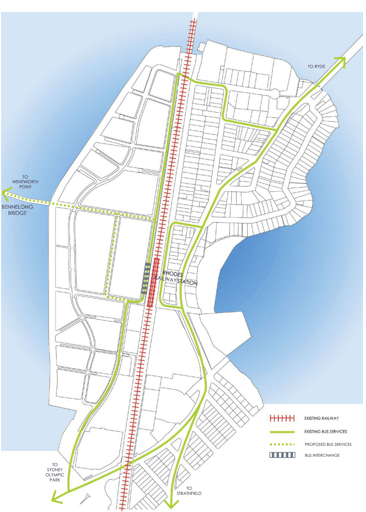

> [Picture on page 203: a map, saved as a picture (images/part-k-special-precincts-page-203-1.gif, 150 dpi); the street names and other small labels are on the picture.]
> Labels printed on the map (copied from the PDF, in no particular order):
> TO RYDE · TO · WENTWORTH · POINT · BENNELONG · BRIDGE · HOMEBUSH · BAY BRIDGE · HOMEBUSH · BAY BRIDGE · RAILWAY · PROPOSED BUS SERVICES · BUS INTERCHANGE · TO · SYDNEY · OLYMPIC · PARK · TO · STRATHFIELD

Figure K17-7 Rhodes West Public Transport Plan

#### A.5 Landscape

Landscape treatment can provide amenity, improve the legibility of the urban environment, reinforce the structure of the public domain, enhance a ‘sense of place’ and define different landscape characters. Tree planting in particular will affect the visual quality and amenity of the public domain, and create a sense of green ‘fingers of landscape’ extending from the river into the site.

A broad framework for the landscaping of streets and parks is proposed below. This will contribute to a consistency of character at Rhodes West. The strategy responds to:

• The strong tradition of street planting in the Canada Bay Local Government Area;

• Pre-existing locally native landscapes, both ridge and riparian, to emphasise the relationship of the public domain framework to landform and landscape;

• Retention of existing trees wherever possible and where they provide particular amenity, or reinforce existing street patterns; and

• Provision of appropriate amenity, including sun and shade, along streets.

#### Controls

C1. Street tree selection for Rhodes West is to follow the current approvals for civil infrastructure works.

C2. Retain, wherever possible, existing trees in the following areas:

• Mary Street and the extension of Mary Street to the foreshore.

• East west stand of trees near the mangroves.

• Along the eastern edge of Walker Street and the extension of Walker Street to the south.

C3. Ensure that appropriate species are selected to suit streetscape conditions including, street width, building height and setback, orientation and views.

C4. Create conditions favourable to the planting and long term health of trees in the design and construction of streets.

C5. Species and spacing should be consistent within blocks.

C6. Establish a riparian zone along the foreshore, with appropriate tree, shrub and groundcover species.

#### A.6 Street furniture, paving and lighting

The design and construction of the public domain can reinforce important site characteristics and contribute to the Rhodes West identity. A number of public domain conditions will be established by the development requiring particular treatments. Each part of the public domain has an individual character and function that should be emphasised through design, however continuity throughout the entire area is paramount.

#### Controls

C1. Design and build the streets in accordance with the Canada Bay Engineering Requirements for Development.

C2. Use the range of standards for furniture, lighting and signage set out in the Canada Bay Engineering Requirements for Development.

Lighting

| Controls |  |
|---|---|
| C3. | Establish a hierarchy of lighting levels based on the civic significance of the street and the perceived threat of crime. Walker Street as a ‘spine’ created by the railway line should have the highest level of illumination, along with the civic and urban streets that link Walker Street with the retail centre and the foreshore. |
| C4. | Provide a level of lighting for streets and parks that enhances security and legibility, while minimising impact on residential dwellings. |
| C5. | Coordinate and standardise street lighting throughout the development. |
| C6. | In riparian and conservation areas additional care should be taken to ensure that light does not interfere with animal habitats. |

Materials

#### Controls

| C7. | For parks establish a simple palette of materials that: |
|---|---|

• Reflects the streetscape palette in the Canada Bay Engineering Requirements for Development;

• Unifies the range of spaces within the public domain;

• Reinforces hierarchies and details within the spaces; and

• Can be used in a variety of ways to allow for variation to suit local conditions.

Paving

| Controls |  |
|---|---|
| C8. | Generally paving is to provide a simple and subdued ground plane, that creates a background to buildings and streetscape elements. Accent paving should only be used on retail and commercial streets, in key public places and in parks. |

Street Furniture

| Controls |  |
|---|---|
| C9. | Utilise simple, robust elements that are durable and fit for their purpose. The range of elements should be coordinated for streets and for parks, and relate to the character and function of these spaces. |
| C10. | Placement of furniture should provide an acceptable level of amenity, without creating clutter or obstruction. |

Signage

| Controls |  |
|---|---|
| C11. | Locate street name signs at intersections, wall mounted on buildings where possible to reduce clutter. |
| C12. | Consolidate traffic signs as far as possible, to reduce clutter. |
| C13. | No private identification sign is permitted within the public right of way. |
| C14. | Public access rights are to be clearly indicated for public space and, where relevant, over publicly accessible private land. |
| C15. | Include signage from the Parramatta River Foreshore Signage Manual, as outlined in the Rhodes Peninsula Domain Manual. |

#### A.7 Infrastructure and water management

A carefully planned system of services, integrated with streetscape design, can reduce maintenance time, damage and repair costs and contribute positively to the quality of the public domain. Measures for controlling and improving the quality of stormwater entering the Parramatta River should be integrated into the design of streets and parks, through engineering structures, and using best practice techniques.

#### Controls

C1. Integrate services design with the design of all new streets and parks with consideration of the following:

• Retaining existing mature trees;

• Creating optimum conditions for new planting; and

• Allowing ease of access to service corridors.

• Streetscaping /landscaping and furnishings should not obstruct driver sightlines to other road users, regulatory signposting, traffic signals etc. Particular care should be taken to ensure appropriate selection and placement of landscaping/furnishings adjacent to intersections, driveways and pedestrian crossing facilities.

C2. Locate all new services underground, within a consolidated strip adjacent to the kerb line. Where possible, new services should occupy a single services corridor, accessible through a single access cover.

C3. Power supply is to be installed in underground format. Street lights must be installed in the precinct to ensure that the precinct is adequately lit to the following standards;

• Walker Street – P1

• Marquet street, Mary street and Gauthope street – P2

• Through site link – PX2

C4. Multi-Function Poles shall be provided with optic fibre connections to facilitate future CCTV, WiFi and LiFi installations for the community where required.

| C5. | Service access covers should relate to the geometry and materiality of paving design. |
|---|---|
| C6. | Utilise water sensitive urban design strategies and integrate stormwater design in the design of streets and parks. |
| C7. | Integrate systems to capture and filter low flow stormwater, to improve the quality of discharge to Homebush Bay and Parramatta River. |
| C8. | Provide litter and sediment traps for stormwater outlets. Engineering structures should be integrated into the design of parks, without the need for extensive screening. |

#### A.8 Public art

Public art is an important cultural activity. It aids legibility of place, enlivens the public domain and can define and reveal a specific identity for Rhodes Peninsula. Public art ranges from the monumental to the temporal. Potential expressions of public art include:

• Free standing objects;

• Artist’s involvement in the siting and layout of public spaces such as parks, squares and forecourts;

• Artist’s involvement in creating site elements such as paving, street furniture, fountains and building modulation; and

• Festivals and other cultural events. Themes relevant to the regional and local context of Rhodes include:

• Local geography, flora and fauna;

• Aboriginal heritage;

• Early European history;

• Harbour location; and

• Urban revitalisation.

Public art is encouraged throughout Rhodes West. It is especially appropriate for the parks, public squares and places that are to have layout, design and details that directly respond to location, function and site conditions. Refer Photo K17-3, Photo K17-4 and Photo K17-5.

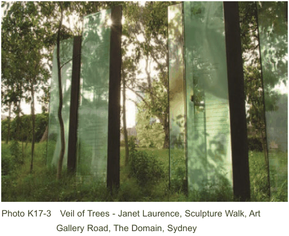

> [Picture on page 207: a picture, saved as a picture (images/part-k-special-precincts-page-207-1.gif, 150 dpi).]

Photo K17-3 Veil of Trees - Janet Laurence, Sculpture Walk, Art Gallery Road, The Domain, Sydney

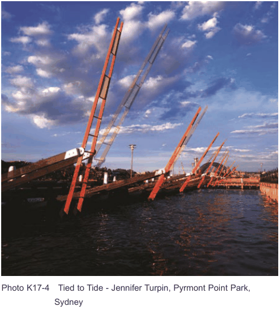

> [Picture on page 207: a picture, saved as a picture (images/part-k-special-precincts-page-207-4.gif, 150 dpi).]

Photo K17-4 Tied to Tide - Jennifer Turpin, Pyrmont Point Park, Sydney

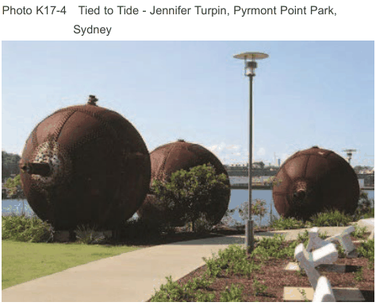

> [Picture on page 207: a picture, saved as a picture (images/part-k-special-precincts-page-207-7.gif, 150 dpi).]

Photo K17-5 Public art reflecting industrial heritage, Jacksons Landing waterfront park, Sydney

| Controls |  |
|---|---|
| C1. | All public art should be relevant to Rhodes West, be of a scale appropriate to the public realm, and be specific to time and place. |
| C2. | Development proposals are to include a public art strategy that describes how proposed public art has been selected to suit the historic, environmental and social contexts of Rhodes West and contributes to a unique ‘sense of place’. |
| C3. | Public art is required in Shoreline Park North, Shoreline Park South and Rhodes Town Square. |
| C4. | Public art is encouraged in other publicly accessible locations such as main entrances, lobbies, street frontages, gardens, walls and rooftops. |
| C5. | Consult with Council and community groups in the design and execution of public artworks. |
| C6. | Consider artworks that serve a dual role, as play equipment for children, or informal seating for example. |

#### B. Private domain

This section of the DCP contains general controls for built form within the private domain and generally adopts the controls from the Renewing Rhodes DCP

2000\. Additional controls have been included in this DCP where refinements have been made to the Framework Plan.

#### B.1 Land use

Mixed use zone

Mixed use development can make a significant contribution to the local character, and provide street surveillance and after hours activity.

#### Controls

C1. Design for a mix of uses within buildings by encouraging:

• Developments with retail and/ or commercial frontage at street level and commercial premises and / or housing at upper levels;

• Flexible design of ground floor apartments to facilitate future change of use, incorporating individual street address, appropriate layout, and adequate floor to floor height; and,

• Home based businesses with flexible layouts for business and residential use.

C2. Create a commercial centre which links to the existing centre on the eastern side of Rhodes Station and to the Rhodes Waterside Shopping Centre by concentrating street level retail / commercial frontage in the following areas:

• An activity strip along Walker Street;

• Between the station entrance and Mary Street; and

• Along the eastern side of Rider Boulevard.

C3. To activate the residential zone, the preferred location for non-residential uses is nominated in key street frontages and corners, whilst managing environmental impacts on surrounding residents. Refer to Figure K17-8 Rhodes West Mixed Use Zone.

C4. To achieve high quality living environments:

• Ground floor level residential apartments are not permitted in the activity strip, although entrance lobbies to residential development above are encouraged.

• Ground floor apartments opposite the activity strip should incorporate sills and balustrades located a minimum 0.5m above finished footpath level for privacy.

• Residential development within 50m of Homebush Bay Drive is not permitted, unless measures to ameliorate adverse impacts of noise, pollution and loss of privacy are incorporated. Refer to SEPP (Transport and Infrastructure) 2021.

Mixed Use in Station Gateway West (Precinct D)

#### Controls

C5. To ensure development in Precinct D optimises its location close to Rhodes Station and is integrated with development of Rhodes West as a whole, it should incorporate the following provisions:

• A 6-8m wide public pedestrian walkway connecting Walker Street, Marquet Street and Shoreline Drive must be created to provide direct access to the foreshore

park. For detail refer to B.5-C4.

• A honeycomb of publicly accessible through block connections especially to Marquet Street and Rider Boulevard is encouraged, to increase choice of routes, particularly to Rhodes Station and enrich the pedestrian environment. Through block connections include internal and external arcades, and double fronted commercial lobbies and shops. Through block connections achieve surveillance and provide public domain character, supplemented by outdoor areas such as courtyards. Their use should be optimised by providing a legally registered public right of way on the title of the land between the hours of 7am and 7pm daily, excluding public holidays, as a minimum.

• Deep soil garden areas and permeable paving should be provided to courtyards within the block, to create a distinctive leafy character and optimise natural infiltration of stormwater.

• An active pedestrian oriented environment with high pedestrian amenity should be created around Rhodes Station and surrounding streets.

• New public squares and a network of through-site links that enhance access between the foreshore and Rhodes Station.

• Mixed use buildings that provide high residential amenity complying with the building separation requirements of the LEP.

• Active street frontages with non-residential uses including community uses, commercial, retail and cafes / restaurants.

Development Control Plan

MILL

PARK NORTH

DRIVE

CENTRAL PARK BENNELONG BRIDGE

DRIVE

PEG PATERSON

RHODES

WATERSIDE

Part K Special Precincts

RAILWAY

Figure K17-8 Rhodes West Mixed Use Zone

PERMISSIBLE ADDITIONAL

HEIGHT

UNDERPASS OR

OVERPASS

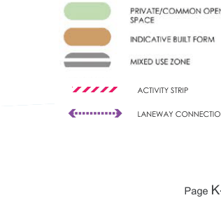

> [Picture on page 210: a picture, saved as a picture (images/part-k-special-precincts-page-210-18.gif, 150 dpi).]
> Words printed on the picture (copied from the PDF):
> ACTIVITY STRIP
> LANEWAY CONNECTIONS

#### B.2 Built form

The height distribution for buildings at Rhodes West generally follows the topography, ranging from lower buildings at the foreshore to taller buildings east of Shoreline Drive. This distribution maximises opportunities for view sharing, protects the amenity of the foreshore park and controls the impact of new development on the harbour.

The site-specific controls in Section K17.4 provides detailed guidance on building height, massing and scale for the remaining development parcels at Rhodes West.

| Controls |  |
|---|---|
| C1. | The maximum height of development should comply with the Height Map contained in the Canada Bay Local Environment Plan 2013 (as amended) and the maximum heights shown in the site-specific controls of this DCP. |
| C2. | The maximum Floor Space Ratio (FSR) of development is to be consistent with the FSR map contained in the Canada Bay Local Environment Plan 2013 (as amended). |
| C3. | Developments are to be consistent with the maximum building envelope plans contained in the site-specific controls in this DCP. |

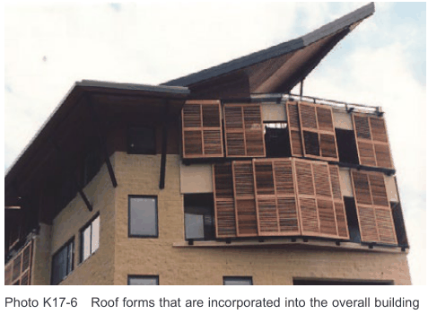

> [Picture on page 211: a picture, saved as a picture (images/part-k-special-precincts-page-211-13.gif, 150 dpi).]

Photo K17-6 Roof forms that are incorporated into the overall building design can add visual interest to the Rhodes West skyline

Internal floor levels

#### Controls

C4. To achieve quality living environments, maximise direct sunlight and allow future adaptability of uses, provide the following minimum heights:

• Provide minimum ceiling heights for apartment and mixed use buildings: » Habitable rooms: 2.7m » Non-habitable room: 2.4m » 2 storey apartments: 2.7m for main living area floor and 2.4m for second floor, where its area does not exceed 50% of the apartment area » Attic spaces: 1.8m at edge of room, with a 300 minimum ceiling slope

• In mixed use areas: Provide minimum 3.3m height for ground and first floor to promote future flexibility of use.

Architectural roof features

#### Controls

C5. To provide a visually interesting skyline, architectural roof features, as defined in the Canada Bay Local Environment Plan 2013 (as amended), may extend above the maximum building height limit provided they are of high architectural design quality integrated into the overall building design, and do not adversely impact on neighbouring properties in terms of overshadowing and loss of views.

Architectural roof features may extend above the maximum height limit of the Height of Buildings Map within the Canada Bay Local Environment Plan 2013 (as amended). Refer Photo K17-6,

Thresholds heights between streets and private domain

#### Controls

C6. To optimise accessibility, provide floor levels to entrances of ground floor retail and commercial uses, that are contiguous with the adjoining footpath level, to the maximum extent practical.

C7. To protect privacy, elevate ground floor level apartments above adjacent footpath levels

– 500mm is suggested as a minimum and 1500mm is suggested as a maximum. This requirement needs to be balanced against the provision of access and adaptability for commercial and retail uses at ground level.

Maximum number of storeys/ height for buildings within parkland open space

#### Controls

C8. To minimise visual impact and optimise views from the private domain, the Community Facility building sited within the Foreshore Park in Precinct B must not be higher than 12m.

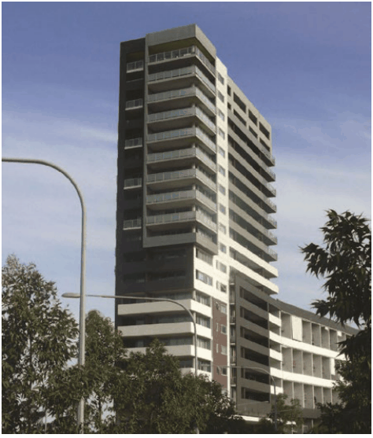

> [Picture on page 212: a picture, saved as a picture (images/part-k-special-precincts-page-212-24.gif, 150 dpi).]

Photo K17-7 Variety in building types is required on large sites

#### B.3 Building bulk

Allow for a mix of building types from low-rise to mid-rise and tower buildings within the development cross section (Refer Photo K17-7). Improve the amenity of living and working environments, and directly promote sustainable practices by:

• Enabling habitable and service rooms to be naturally lit and ventilated;

• Reducing site cover, resulting in increased landscaped areas;

• Permitting views between buildings from the public domain;

• Permitting sunlight between buildings to public spaces;

• Minimising the impact of building bulk on adjoining areas; and

• Creating a silhouette of slender and slimline tower buildings against the sky which is visually consistent with the role of Rhodes as a Specialised Centre.

Retail/ commercial uses

| Controls |  |
|---|---|
| C1. | To avoid bulky towers the floor plate of commercial buildings above 4 storeys should not exceed 1,400m2 including the core. |
| C2. | For retail and commercial uses in the mixed use zone only, deeper building footprints are permitted up to 4 storeys in height. |
| C3. | To optimise natural light to work spaces, no point on an office floor above 4 storeys should be more than 12m from a window, excluding the core. |
| C4. | To allow natural lighting and ventilation at ground and first floor level of deep buildings, courtyards and atria which are open to the sky, are encouraged. For buildings greater than 6 storeys, courtyards and atria should have a minimum width of 8m. |

Residential use

| Controls |  |
|---|---|
| C5. | To achieve good cross ventilation and access to natural light, the depth of residential buildings up to 9 storeys in height should not exceed 18m from window face to window face. |
| C6. | The depth of residential buildings greater than 9 storeys should not exceed 18m from window face to window face, and 26m overall including balconies, terraces and the like. |
| C7. | Should a building exceed the maximum building depths from window face to window face, it needs to be demonstrated that the apartments can achieve acceptable access to natural light and cross ventilation. |
| C8. | To achieve natural ventilation and daylight, a minimum 60% of all residential apartments within a building should have openings in two or more external walls of different orientation. Single orientation apartments should predominantly face north, east or west. |
| C9. | A maximum of 15% of apartments in a building may have a single southern aspect (SW-SE). |
| C10. | To avoid long internal corridors, the number of apartments served by a common lobby should be no more than 8 per floor. Where this cannot be achieved, no more than 12 apartments should be provided off a circulation core on a single level. For buildings of 10 storeys or over, the maximum number of apartments sharing a single lift is 40. |
| C11. | To achieve high quality living environments, double loaded access corridors are to have outlook, access to sunlight and natural day lighting and preferably be naturally ventilated. |

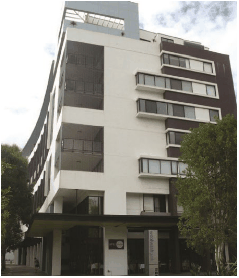

> [Picture on page 213: a picture, saved as a picture (images/part-k-special-precincts-page-213-3.gif, 150 dpi).]

Photo K17-8 Well articulated facades including refinement in window and balcony design

#### B.4 Setbacks

Street setbacks establish the building line. They are needed to create:

• A territorial threshold between the public street and the private dwelling.

• A buffer to street activity.

• Security, where properly designed to avoid ambiguous public accessible small spaces.

• A landscaped setting for buildings.

• Privacy from the street.

• Environmental amenity to buildings such as access to sunlight and daylight.

Consistent ground level setbacks are needed to provide:

• Increased pedestrian amenity.

• Desirable view corridors and vistas.

• Strong street definition where they are continuous.

#### Controls

C1. Street setbacks should comply with Section

K17.4 Site-specific controls

C2. To create an urban character, provide strong street definition, enhance retail activity, and define prominent corners, build to the street edge along and opposite the activity strip in the mixed use zone, and on important corners as nominated in Figure K17-9 Rhodes West Setbacks Plan and as illustrated in Photo K17-9 and Photo K17-14. Non-compliance with these figures will be assessed on a case-by-case basis.

C3. To create a residential character, comply with 3m street setbacks along north south streets, as nominated in Figure K17-9 Rhodes West Setbacks Plan.

C4. To achieve adequate separation between buildings for solar access, and to create wide view corridors to the water, that can be landscaped as ‘green fingers’, a consistent 5m street setback is preferred along east west streets, as nominated in Figure K17-9 Rhodes West Setbacks Plan.

C5. To minimise the impact of tower buildings on the public domain in terms of wind and to create a human scale at street level buildings greater than 9 storeys in height are to be setback a minimum 10m from the primary street boundaries, except within Station Gateway West (Precinct D), where a minimum of 3m setback is permitted.

C6. A 2 to 4 storey street wall fronting Rider Boulevard  is required to create urban character, to provide strong street definition, and achieve a built form that allows direct sun to streets and reduces the apparent scale of taller buildings. Development above the street wall level should be set back 5m from the street edge.

C7. Buildings fronting the foreshore with a façade length of up to 18m are to achieve a minimum 3m setback along the reserve.

C8. To achieve a varied built edge, buildings with a façade length of more than 18m fronting the Foreshore Reserve are to comply with the following controls:

• The ends of buildings fronting the Foreshore Reserve (adjacent to east/west streets) are to have a building setback (including balconies) of not less than 10m from the Foreshore Reserve

• The bays of the building extending forward of the 10m setback line may extend to no less than 7m from the Foreshore Reserve (not including balconies)

• Balconies in the bays of the building extending up to 7m from the Foreshore Reserve shall not extend along the full length of the façade of each bay

• The setback of the building fronting the Foreshore Reserve in between the setback described in dot point two above, may extend to no less than 8.8m from the Foreshore inclusive of balconies

C9. Projecting balconies are permitted forward of the minimum building setback line for a maximum of 50% of the length of the building.

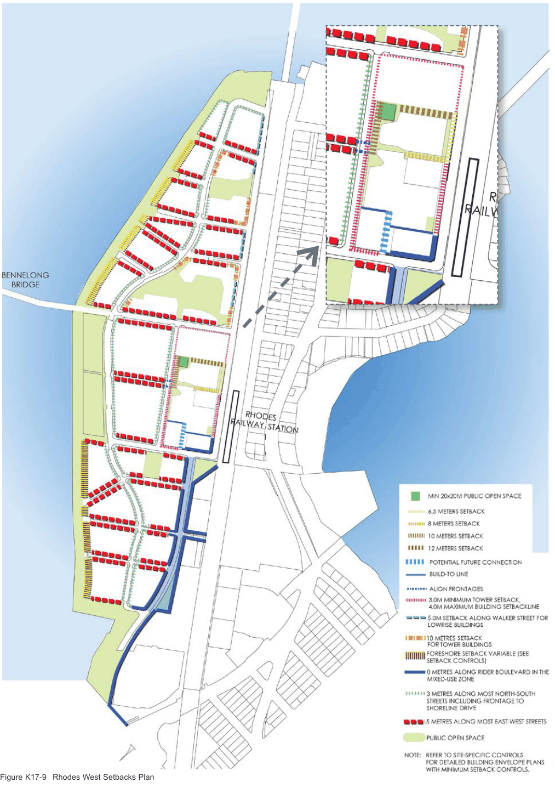

> [Picture on page 215: a picture, saved as a picture (images/part-k-special-precincts-page-215-1.gif, 150 dpi).]
> Words printed on the picture (copied from the PDF):
> Figure K17-9 Rhodes West Setbacks Plan

#### B.5 Definition of streets and open spaces

The definition and character of streets is significantly influenced by:

• The proximity of a building to the street, or street setback;

• Consistency of the street setback;

• Continuity of the building frontage;

• Resultant landscape potential; and

• Building height.

The strategy promotes an urban design response specific to each street condition, while creating a coherent identity for the peninsula and also identifying where special amenity can be achieved through variable building setbacks. The definition of streets and open spaces should be read in conjunction with Figure K17-9 Rhodes West Setbacks Plan and Section K17.4 Site-specific controls.

| Controls |  |
|---|---|
| C1. | To allow buildings to address streets, lots resulting from the subdivision of large blocks, should have at least one frontage to a primary or secondary street. |
| C2. | To contribute to the hierarchy of different street types and functions, development is required to build to identified street and park setback lines as shown in Figure K17-9 Rhodes West Setbacks Plan. |
| C3. | To encourage surveillance of the street and communal gardens, orientate primary openings in living areas to the street and rear gardens. |

C4. To provide a public pedestrian walkway connecting Walker Street, Marquet Street and Shoreline Drive with a width of 6-8m subject to performance requirements to accommodate:

• Sufficient space to accommodate sufficient clear width, swept path and height for emergency vehicle access as required by the NSW Fire Brigade and NSW Ambulances and other day-to-service vehicles required to maintain the central oval plaza and laneway public domain and as necessary to service businesses.

• Planting of mature trees in the laneways and central oval plaza as illustrated in the Public Domain Concept Plan (Context Landscape Design 2014).

• Provision of outdoor dining zones associated with cafe, bar and restaurant tenancies.

• Projecting shop or other signage.

• Laneway vehicular access management in liaison with NSW Police to restrict vehicular access.

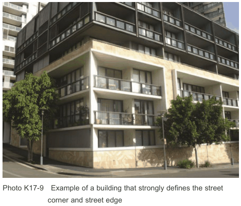

> [Picture on page 216: a picture, saved as a picture (images/part-k-special-precincts-page-216-44.gif, 150 dpi).]

Photo K17-9 Example of a building that strongly defines the street corner and street edge

#### B.6 Building articulation and address

Building articulation refers to the three dimensional modelling of a façade. Refer Photo K17-8, Photo K17-10,     Photo K17-12 and Photo K17-13.

Building articulation establishes the:

• Relationship between the building and the street, through the use of entry porches, loggias, balconies, bay windows and the like;

• Environmental amenity, through the use of sun shading devices, noise barriers, privacy screens; and

• Degree of continuity between the interior rooms and outdoor spaces, through the location of balconies, terraces and verandahs.

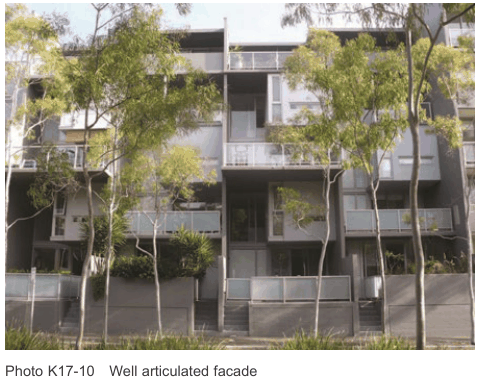

> [Picture on page 217: a picture, saved as a picture (images/part-k-special-precincts-page-217-14.gif, 150 dpi).]

Photo K17-10 Well articulated facade

| Controls |  |
|---|---|
| C1. | Comply with the building envelopes controls in Section K17.4 Site-specific controls including building articulation zones. The intention of the building articulation zone is to promote stepping in the general line of the building facades including the line of windows, and balconies to create visually interesting buildings. |
| C2. | Residential tower buildings greater than 9 storeys in height are to demonstrate a slender and slimline appearance to create a visually interesting skyline. The buildings in Photo K17-11 have a slender and slimline quality. |
| C3. | Residential tower buildings are to articulate the vertical proportions in their external appearance. Extensive horizontal articulation through the use of solid balustrades is to be avoided as this design strategy tends to result in overly bulky buildings which are neither slender nor slimline. |
| C4. | Tower buildings greater than 9 storeys, should demonstrate vertical proportions in the articulation of building facades. Photo K17-11 illustrates how vertical elements appropriately accentuate the vertical proportions of a tower building. |
| C5. | Provide a high degree of articulation. Do not rely on the excessive use of a single type of sun shading to articulate building facades. Louvre type sun shading can add excessively to building bulk when used over large facades areas. |

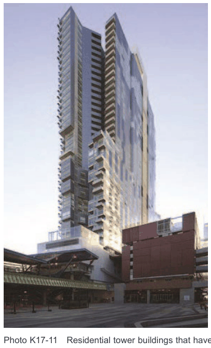

> [Picture on page 218: a picture, saved as a picture (images/part-k-special-precincts-page-218-1.gif, 150 dpi).]

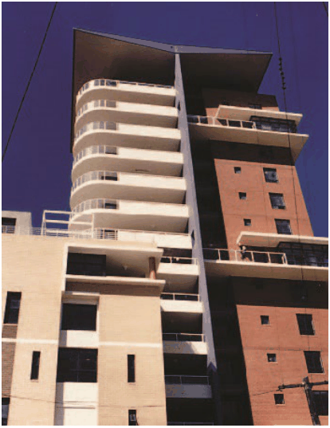

> [Picture on page 218: a picture, saved as a picture (images/part-k-special-precincts-page-218-2.gif, 150 dpi).]

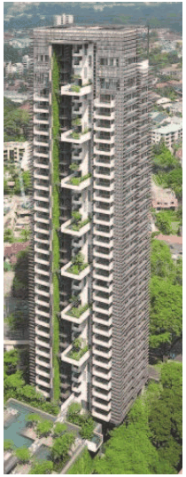

> [Picture on page 218: a picture, saved as a picture (images/part-k-special-precincts-page-218-3.gif, 150 dpi).]

Residential tower buildings that have a slender and slimline quality with elements that accentuate vertical proportions

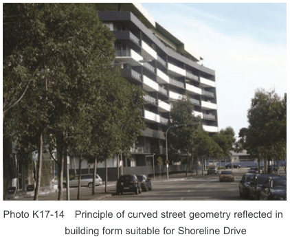

> [Picture on page 218: a picture, saved as a picture (images/part-k-special-precincts-page-218-5.gif, 150 dpi).]

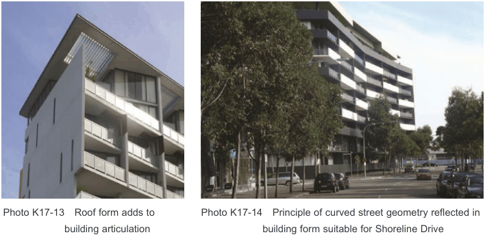

> [Picture on page 218: a picture, saved as a picture (images/part-k-special-precincts-page-218-6.gif, 150 dpi).]

Photo K17-11

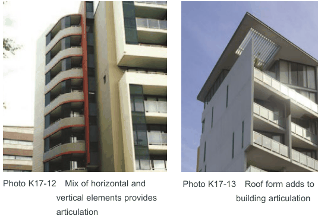

> [Picture on page 218: a picture, saved as a picture (images/part-k-special-precincts-page-218-8.gif, 150 dpi).]

Photo K17-12 Mix of horizontal and vertical elements provides articulation

Photo K17-13 Roof form adds to building articulation

Photo K17-14 Principle of curved street geometry reflected in building form suitable for Shoreline Drive

#### B.7 Diversity of apartment types

A mix of apartment types and sizes is promoted to cater to a variety of socio-economic, age, ethnic and other circumstances. A range of dwelling sizes and types creates a housing mix that will cater to a diverse population and enrich the local character.

This DCP encourages a component of individual duplex, pair and row housing, but recognises that the apartment type is likely to be the predominant housing form on the Rhodes Peninsula.

Apartment typologies can be based on circulation and building section characteristics, which have a significant impact on the quality of air, light, solar access, privacy and outlook to dwellings.

| Controls |  |
|---|---|
| C1. | To achieve a mix of dwelling sizes, all residential and mixed-use development should provide a range of dwelling sizes in accordance with the requirements of the Canada Bay Local Environmental Plan.d |
| C2. | To achieve environmental amenity, all access corridors should have a component of daylight, either at the point of vertical circulation or at the ends of corridors and preferably be naturally ventilated. |
| C3. | To achieve high quality living environments, cross ventilated apartments are encouraged, including dual aspect apartments. |
| C4. | To achieve solar access in high density areas where it may be difficult to ensure direct sunlight to the ground floor in midwinter, two-storey apartments are encouraged at ground floor level. This control is not intended to conflict with the provision of accessible housing. Refer Photo K17-15. |
| C5. | To innovatively combine different apartment types, ‘hybrid’ buildings are encouraged. |

C6. To optimise liveability for all dwellings, internal and external living areas should be integrated. Noise attenuation for buildings facing the rail line and busy roads

C7. A noise attenuation zone should be created between habitable rooms facing the noise source, particularly bedrooms, by;

• Locating service areas such as circulation, kitchens, laundries, storage and bathrooms to create a noise buffer;

• Locating screened balconies or wintergardens to create a noise buffer, and;

• Selecting sound isolating materials, including acoustic glazing.

C8. To protect local residential amenity, building articulation should be designed to minimise external noise reflectivity.

C9. Buildings adjacent the Northern Railway Line are to consider the provisions of State Environmental Planning Policy (Infrastructure) 2007 and related guideline documents and seek appropriately qualified acoustic engineering advice in relation to the mitigation of rail-related impacts on development.

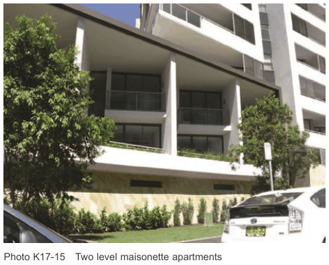

> [Picture on page 219: a picture, saved as a picture (images/part-k-special-precincts-page-219-42.gif, 150 dpi).]

Photo K17-15 Two level maisonette apartments

#### B.8 Flexibility

Flexible building design is sensitive to the access requirements of people of all ages and abilities, and provides for a degree of future adjustment to accommodate:

• Changing access needs, such as for occupants with impaired mobility, including young children in prams and the elderly.

• Households of varying sizes, age groups and privacy needs.

• Housing that is easily modified for occupation and visitation by people with disabilities and progressive frailties.

• Home occupation.

• Future changes of use.

Flexible buildings are more functional in the long term because they are suitable for a wider range of inhabitants and can accommodate changing requirements.

Flexible building design improves the quality of the built environment and achieves sustainable practice, by encouraging development designed for durability, flexibility and low energy consumption.

| Controls |  |
|---|---|
| C1. | To cater for a wider range of occupants and avoid disability discrimination, the accessibility and adaptability of all buildings should be maximised in all residential and mixed use developments. |
| C2. | Adaptable housing units are to be designed and constructed to meet the performance requirements and provide the essential features required by AS4299 Adaptable Housing at the minimum rate of 15% of total dwellings. Where the total number of adaptable housing units to be provided is not a whole number, the number is to be rounded up to the next whole number. One accessible parking space is to be provided for each adaptable unit. |
| C3. | Housing design that provides for a degree of future adjustment of its configuration is encouraged. Consider accommodating: • Variable wall locations • Variable number of bedrooms • Home occupation • Multiple entry points • Adaptable housing • Liveable housing |
| C4. | To optimise flexibility for future changing uses, windows or skylights should be provided to all habitable rooms and to the maximum number of non-habitable rooms possible. |
| C5. | The design of commercial space that provides for a degree of future adjustment of its configuration is encouraged. Consider accommodating: • Variable lettable areas; • Multiple service cores; and • Residential uses including home-based business dwellings. |

#### B.9 Visual privacy and building separation

Thoughtful design can ensure that views and outlook are maximised from all dwellings without compromising the visual privacy of the residents or their neighbours.

Privacy between dwellings and the public domain and non residential uses should also be fully considered.

#### Controls

C1. To achieve privacy to private internal and external spaces, consider:

• Building separation distance

• Appropriate internal room layout

• Location and design of windows and balconies

• Design of appropriate screening devices and landscaping. Refer Photo K17-26.

C2. The use of tinted glazing as the sole means of achieving privacy is not permitted.

C3. To achieve privacy to ground floor level apartments, without compromising surveillance of any adjoining public domain, generally elevate the ground level by a minimum of 0.5m and maximum 1.5m above the adjoining footpath level and provide suitable front walls or fences to front gardens.

C4. To achieve privacy as well as to provide well spaced buildings for sunlight access and natural ventilation, the following minimum separation between openings of habitable and non-habitable rooms within dwellings must be provided for all buildings up to 20 storeys, in accordance within Chapter 4 of the Housing SEPP, titled 'Design of residential apartment development' and the Apartment Design Guide, NSW Department of Planning and Environment, July 2015:

Up to four storeys/12m

• 12m between habitable rooms / balconies

• 9m between habitable and non-habitable rooms

• 6m between non-habitable rooms

C5. Development consent must not be granted to development that results in a building being separated from another building by less than:

• for a building higher than 14 storeys but

not higher than 20 storeys—24 metres,

and

• for a building higher than 20 storeys—40 metres.

Buildings 21 storeys and above have an increased building separation of 40m. This increased separation has been determined through the Master Planning process in order to exceed conventional standards and deliver best practice for a highly visible, high density site consistent with the Vision.

Refer additionally to SEPP 65, Apartment Design Guide:

• Section 2F Building separation, and

• Section 3F Visual privacy.

#### B.10 Acoustic privacy

The potential for unwanted noise sources increases in more densely developed areas where there are more people living more closely together. To achieve an appropriate acoustic environment, design consideration must be given to the following:

• Siting of building

• Building planning

• Internal room layout

• Location of private open space

• Location of windows

• Building materials

| Controls |  |
|---|---|
| C1. | To reduce the transmission of noise internally, sound insulation requirements between separating floors, ceilings and walls of adjoining dwellings should exceed the Building Code of Australia minimums. |
| C2. | The siting and design of buildings should minimise the transmission of noise externally, through careful consideration of the layout of internal rooms and external living spaces, design of openings, screens, blade walls, and the like, and choice of materials. |
| C3. | Design restaurants and cafes to minimise the impact of noise associated with late night operation on nearby residents by using measures such as double glazing, and providing outdoor eating areas under awnings to help contain noise to street level. |
| C4. | To enable occupants to control internal living environments, at least 25% of double glazed windows to dwellings should be openable. |

Refer additionally to SEPP 65, Apartment Design Guide:

• Section 4H Acoustic privacy, and

• Section 4J Noise and pollution

#### B.11 Solar access and daylight

Solar access to internal and external areas is a major determinant of environmental comfort. Good passive solar design offers financial benefits, by reducing the need for artificial heating and cooling. Glass allows heat in the form of sunlight to enter buildings, yet is a poor insulator of heat. The design of windows and other glazed areas need to consider the environmental impact of heat gain, heat loss and glare, as well as issues of streetscape, privacy, architectural resolution and views.

To the public domain

#### Controls

C1. To create a useable open space network that can be enjoyed by local residents and workers, new development should retain solar access to a minimum of 50% of the area of neighbourhood parks and green spaces during lunchtime hours (noon to 2:00pm) during mid winter (22 June).

C2. To protect the comfort and safety of pedestrians and motorists, new buildings and facades should minimise glare. Mirror glass is not to be used. A maximum of 20% reflectivity index is permitted for all external glazed elements. A Reflectivity Report that analyses the potential glare of any proposed new development, where building facades contain high proportion of glazing, is required to be submitted with the Development Application.

To the private domain

| Controls |  |
|---|---|
| C3. | To achieve high quality living environments, a minimum of 2 hours direct sunlight between 9:00am and 3:00pm should be provided to principal living rooms and private open spaces in at least 70% of dwellings within a residential development, on 22 June (Winter Solstice). A maximum of 15% of apartments in a building may receive no direct sunlight between 9am to 3pm in mid-winter (21 June). |
| C4. | To assist plant growth, maximise direct sunlight to communal open space as much possible within residential developments on 22 June. |
| C5. | To facilitate solar access to principal living rooms and private open spaces at first floor level, two storey and mezzanine ground floor apartments are encouraged. |
| C6. | To achieve high quality internal environments, appropriate sun protection should be provided to glazed areas facing north, west and east in residential and commercial developments. Refer Photo K17-16 and Photo K17-17. Avoid extensive areas of glazing unprotected from solar access during summer. Shading devices including eaves, awnings, colonnades, balconies, pergolas, external louvres and planting to control the penetration of sun, should be used to maximise solar access in winter, and minimise solar access in summer. On east and west facing facades subject to direct sunlight, external shading should be integrated into the design, or the area of glazing minimised. Avoid the excessive use of louvres of a single style, which can reduce building articulation and add to the bulk and scale of buildings. Refer to Photo K17-18. |

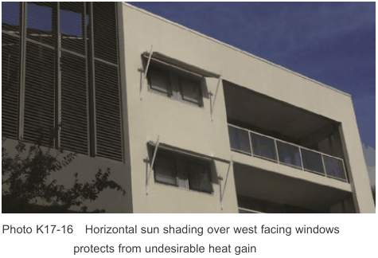

> [Picture on page 223: a picture, saved as a picture (images/part-k-special-precincts-page-223-3.gif, 150 dpi).]

Photo K17-16 Horizontal sun shading over west facing windows protects from undesirable heat gain

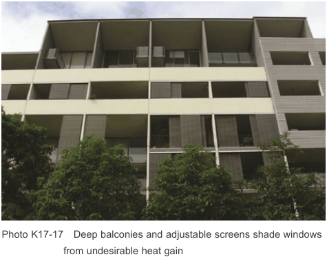

> [Picture on page 223: a picture, saved as a picture (images/part-k-special-precincts-page-223-6.gif, 150 dpi).]

Photo K17-17 Deep balconies and adjustable screens shade windows from undesirable heat gain

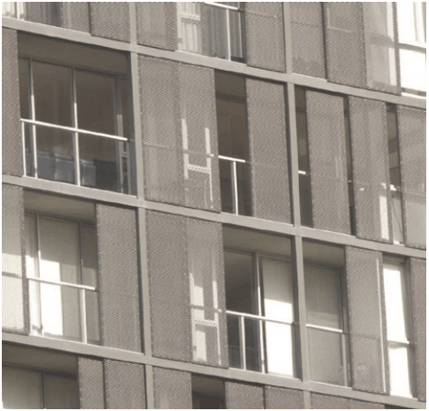

> [Picture on page 223: a picture, saved as a picture (images/part-k-special-precincts-page-223-9.gif, 150 dpi).]

Photo K17-18 Using one type of sun shade over large areas can add to building bulk

#### B.12 Natural ventilation

Living, retail and work environments are to maximise natural lighting. Living and working environments which are not reliant on artificial cooling and daytime lighting during the daylight hours, will have reduced energy inputs over the long term. The provision of good natural ventilation and daylight facilitates builds-in future flexibility.

| C6. | To achieve natural ventilation, doors and openable windows should be located in two walls facing different or preferably opposite directions. The placement of small low windows on the predominantly windward side of the building, and larger higher windows on the leeward side, can encourage cross ventilation. The use of passive climate control in commercial buildings, through stack effect ventilation and the building’s mass to ameliorate extreme temperature variations is encouraged. |
|---|---|
| C7. | To allow daylight into ground and first floor levels, buildings should be articulated using atria and courtyards. |

| Controls |  |
|---|---|
| C1. | To reduce energy inputs over the long term, buildings should be designed so that living and working environments are substantially naturally lit and ventilated, using ventilation by means such as thin cross section buildings. |
| C2. | To avoid reliance on mechanical ventilation or air conditioning and minimise use of artificial lighting, windows should be provided to all living and working environments. Do not rely on skylights to provide the sole source of daylight and ventilation to habitable rooms. |
| C3. | To achieve high quality living environments residential buildings up to a height of 9 storeys are to have a maximum depth of 18m window line to window line. Buildings greater than 9 storeys in height are to have a maximum depth of 23m. |
| C4. | A minimum of 60% of residential apartments should be naturally cross ventilated. |
| C5. | Developments which seek to vary from the maximum building depth and minimum percentage of naturally cross ventilated apartments must demonstrate how natural ventilation can be satisfactorily achieved, particularly in relation to habitable rooms. |

Refer additionally to SEPP 65, Apartment Design Guide Part 4B Natural ventilation.

#### B.13 Building materials, finishes and colours

Building materials, finishes and colours used on external facades create a finer texture to streetscapes and city skylines and can contribute to the identity and ‘sense of place’ at Rhodes West.

Building materials can cause environmental impacts before they reach the building site, during their life in the building and in their eventual disposal. This DCP encourages building materials selected to suit each particular application and which provide the required performance with the least overall environmental impact.

#### Controls

| C1. | To optimise thermal comfort and minimise energy consumption, insulation must be provided in wall, ceiling and roof systems. |
|---|---|
| C2. | To minimise resource depletion, plantation timbers, Australian regrowth timbers and recycled timbers should be used. The use of Australian native rainforest timbers, imported rainforest timbers and timbers from old growth forest is not permitted. |
| C3. | To minimise environmental impacts, materials with the following characteristics are to be selected: • With low embodied energy; |

• That are durable;

• That are recycled or able to be recycled;

• That are sourced from renewable resources and materials;

• That are non-polluting in manufacture, use and in disposal; and,

• That are non toxic, do not “outgas”.

C4. Use colour to provide visual interest in building facades. Colour can be used to articulate vertical proportions of tower buildings, such as in Photo K17-11 or primary building entries such as in Photo K17-19.

C5. Development Applications are required to include an assessment of the environmental sustainability of selected building materials. Selected materials are to display energy efficiency in production and their contribution to sustainable building design and construction.

C6. A best practice sustainable approach to building materials and finishes should be taken, including:

• Use of precast concrete walls;

• Use of re-usable formwork for internal floors and core walls on site;

• Reinforcing steel with a high recycled steel content;

• Low VOC paints for all internal flat and low sheen areas;

• Water based paints for all internal gloss and semigloss areas; and

• No use of unsustainable rainforest timbers, specification of sustainably sourced timber and minimal use of MDF.

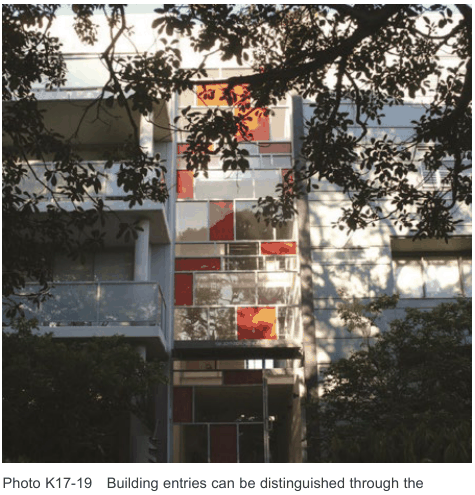

> [Picture on page 225: a picture, saved as a picture (images/part-k-special-precincts-page-225-50.gif, 150 dpi).]

Photo K17-19 Building entries can be distinguished through the use of colour, as well as awnings that extend into the public domain

#### B.14 Public domain interface

Active street frontage

Active street frontages support a lively, interesting and safer public domain. Busy pedestrian areas and nonresidential uses such as shops, studios, offices, cafes, recreational and civic uses promote the most active frontages. Active frontages at ground level should be established along major pedestrian routes. Refer to Photo K17-20 and Photo K17-21.

In residential areas the interaction between the public and private domain can be strengthened by maximising the number of entrances and locating more public functions on the street side of the building. In mixed use areas, ground level retail and commercial frontage provides the benefit of public safety, commercial activity and street life. Active frontages should extend above street level with uses which provide transparency and visual contact with the street.

Due to the temperate climate, favourable orientation, and views to Olympic Park and Homebush Bay from the public domain, Rhodes West is a desirable location for outdoor dining. Outdoor dining has the potential to contribute to the liveliness of the streets and public open spaces.

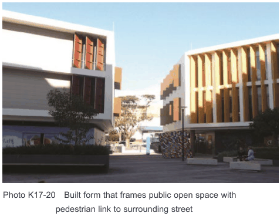

> [Picture on page 226: a picture, saved as a picture (images/part-k-special-precincts-page-226-25.gif, 150 dpi).]

Photo K17-20 Built form that frames public open space with pedestrian link to surrounding street

#### Controls

C1. An active frontage is defined as one, or a combination of the following:

• Shopfronts, if predominantly glazed and accompanied by an entry

• Community use if accompanied by an entry

• Commercial lobby if accompanied by an entry

• Entrance to residential/ commercial use

• Café or restaurant if accompanied by an entry and/ or outdoor seating

• Any other use that in the opinion of the consent authority is consistent with the strategy

C2. Minimise the number and width of vehicle footpath and cyclepath crossings, to optimise pedestrian and cyclist safety.

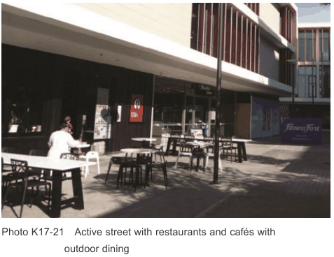

> [Picture on page 226: a picture, saved as a picture (images/part-k-special-precincts-page-226-46.gif, 150 dpi).]

Photo K17-21 Active street with restaurants and cafés with outdoor dining

B4 - Mixed use zone

| Controls |  |
|---|---|
| C3. | To create a lively centre, active frontages must be established along the activity strip identified in Figure K17-9 Rhodes West Setbacks Plan, with ground level retail and commercial uses, and entrances to residential or commercial development above. Active ground floor frontage should also be maximised to all other streets, laneways and plazas in the mixed use zone, especially at street corners. Refer to Photo K17-23 and Photo K17-24. |
| C4. | To create an interesting pedestrian environment, predominantly clear glazing should be provided to the street frontage of retail and commercial windows at ground floor level. |
| C5. | To create a friendly pedestrian environment, roller shutters to ground floor retail street frontages are prohibited. |
| C6. | To create a lively centre, street level retail frontage for individual tenancies is limited to 20m, except on street corners where 30m frontages are permitted, and along Rider Boulevard and Oulton Avenue where bulky retailing may be accommodated. |
| C7. | To create a safe and lively retail complex, active frontages must be provided to the pedestrian spine of the retail centre. Ground level shops with frontage to both a public street and a pedestrian spine, should have public entrances on both frontages. |
| C8. | To enliven the street, laneways and plazas, outdoor eating areas should be located at ground floor and first floor level along street frontages and adjacent to parks, with minimal disturbance to pedestrian circulation and residential amenity. |

| C9. | To enliven the street, provide surveillance, accommodate home occupation, and facilitate potential future adaptation for mixed or commercial use, design every ground floor apartment fronting a primary street in the mixed use zone to incorporate a direct street entrance. |
|---|---|
| C10. | Complete existing connections and establish new pedestrian connections through the block, to create a fine-grained network of interconnected laneways and open spaces. |

R4 - Residential zone

| C11. | To achieve street surveillance, maximise the number of pedestrian entrances to residential buildings. Refer to building articulation and address controls. |
|---|---|
| C12. | To achieve amenity in local neighbourhoods, permissible non-residential uses such as publicly accessible facilities, local shops and cafes are preferred where they will be most accessible and visible, such as at street level, in the following locations: |

• Along Walker Street;

• At the Gauthorpe Street extension in the Foreshore Park; and

• Fronting parks at locations identified in Figure K17-9 Rhodes West Setbacks Plan.

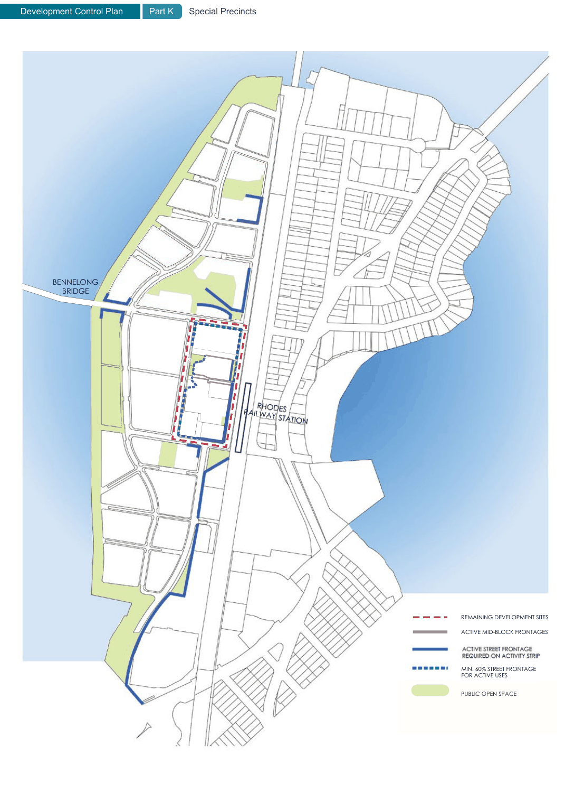

> [Picture on page 228: a map, saved as a picture (images/part-k-special-precincts-page-228-1.gif, 150 dpi); the street names and other small labels are on the picture.]
> Labels printed on the map (copied from the PDF, in no particular order):
> Development Control Plan · BENNELONG · BRIDGE · HOMEBUSH · BAY BRIDGE · HOMEBUSH · BAY BRIDGE · Part K Special Precincts · 19 · RAILWAY · REMAINING DEVELOPMENT SITES · ACTIVE MID-BLOCK FRONTAGES · MIN. 60% STREET FRONTAGE · FOR ACTIVE USES · PUBLIC OPEN SPACE

Figure K17-10 Rhodes West Active Street Frontages

#### B.15 Awnings and entrance canopies

In retail and mixed use streets awnings increase pedestrian amenity by providing wet weather protection and shade. Refer to Photo K17-22. For public and commercial buildings in residential streets discontinuous awnings and entrance canopies create a protected transition area between internal and external spaces at building entrances. Refer to Photo K17-25 and Figure K17-10 Rhodes West Active Street Frontages.

Awnings

| Controls |  |
|---|---|
| C1. | To achieve weather protection in the major pedestrian areas, continuous awnings must be provided to the activity strip and discontinuous awnings in transition areas opposite and adjoining the activity strip. |
| C2. | To provide adequate weather protection awning height is to be minimum 3.2m and maximum 4.5m and integrate with adjoining properties. The awning face should be horizontal. Steps for design articulation or to accommodate sloping streets are to be maximum of 0.75m. Awning width is to be a minimum 2m, setback 0.8m from the face of the kerb and to suit adjoining awnings. Where street trees are required the entire length of the awning is to be set back from the inside edge of the tree hole. Cut out segments are not acceptable. Awnings wider than 3.66m require approval from the Director General of Local Government. |
| C3. | To achieve protection from the sun, awnings should have no more than 50% of their area transparent. |
| C4. | To create a safe pedestrian environment at night and avoid visual clutter, under awning lighting should be provided and recessed into the soffit of the awning or wall mounted on the building. |
| C5. | To promote a safe and weather protected pedestrian connection, a continuous awning from Rhodes Station to the bus interchange should be provided. |

C6. To accommodate a design for any awning or overbridges on ground level and facing the roadway with an underpass of 4.3 meter clearance.

Canvas awnings

C7. To assist sun shading generally, retractable or fixed canvas awnings or shade cloths are permitted.

C8. To provide sun shading to east and west facades, vertical canvas blinds may be used along the outer edge of awnings. These blinds should not carry advertising or signage.

Entrance canopies

C9. To provide weather protection canopies are required at the pedestrian entries of all buildings. Entrance canopies are permitted within building setbacks. Where there is no building setback, entrance canopies can extend 2m beyond the property line over the footpath or further to align with the width of any adjoining discontinuous awning.

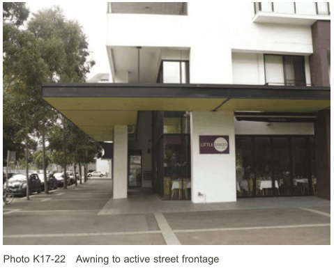

> [Picture on page 229: a picture, saved as a picture (images/part-k-special-precincts-page-229-34.gif, 150 dpi).]

Photo K17-22 Awning to active street frontage

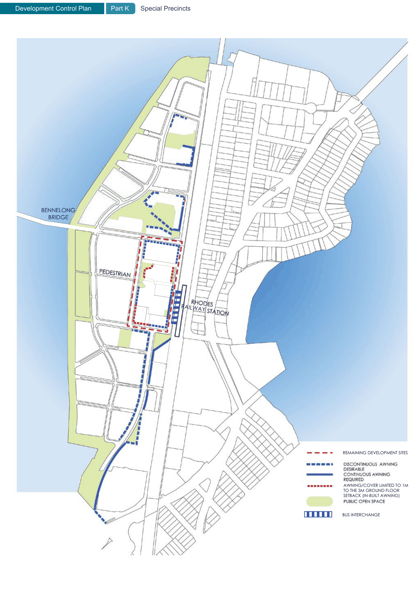

> [Picture on page 230: a map, saved as a picture (images/part-k-special-precincts-page-230-1.gif, 150 dpi); the street names and other small labels are on the picture.]
> Labels printed on the map (copied from the PDF, in no particular order):
> Development Control Plan · BENNELONG · BRIDGE · HOMEBUSH · BAY BRIDGE · HOMEBUSH · BAY BRIDGE · Part K Special Precincts · RAILWAY · REMAINING DEVELOPMENT SITES · AWNING/COVER LIMITED TO 1M · TO THE 3M GROUND FLOOR · SETBACK (IN-BUILT AWNING) · BUS INTERCHANGE

Figure K17-11 Rhodes West Location of Awnings

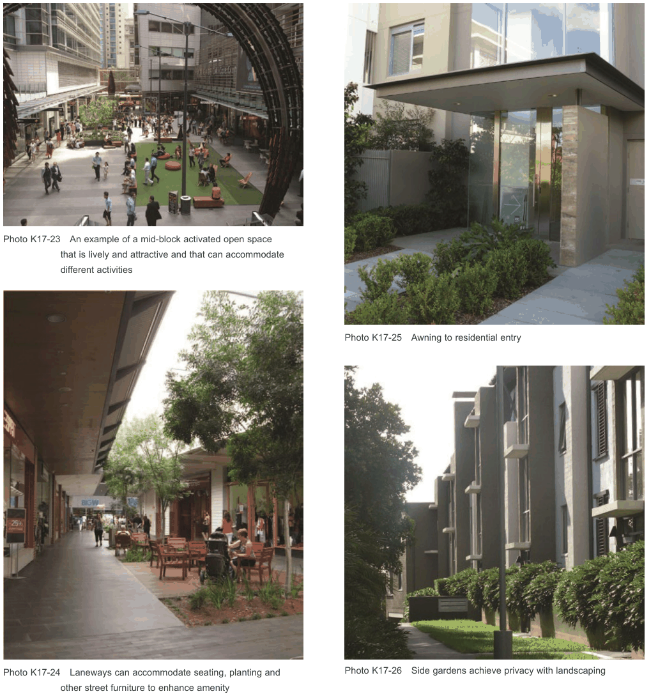

> [Picture on page 231: a picture, saved as a picture (images/part-k-special-precincts-page-231-1.gif, 150 dpi).]

Photo K17-23 An example of a mid-block activated open space that is lively and attractive and that can accommodate different activities

Photo K17-24 Laneways can accommodate seating, planting and other street furniture to enhance amenity

Photo K17-25 Awning to residential entry

Photo K17-26 Side gardens achieve privacy with landscaping

#### B.16 Signage and advertising

Signage and advertising should communicate effectively and contribute in a positive way to the public domain. Signage and advertising structures should be unobtrusive, informative and compatible with an attractive shopping environment. Important factors to be considered are:

• Avoiding physical and visual clutter of the public domain;

• Avoiding conflict between advertising signs and nearby safety; public directions or traffic signs; and

• Protecting residential amenity

| Controls |  |
|---|---|
| C1. | Signage must be designed to avoid confusion with directional and traffic signs. |
| C2. | Signage should be designed to add character to the street and complement the architecture. |
| C3. | To minimise visual clutter, signage should be integrated with awnings. Suspended signage should be a minimum of 2.7m clear above finished footpath level. |
| C4. | Building identification is the only signage permitted above first floor level. |
| C5. | A single retail centre and major tenant pylon is permitted along Homebush Bay Drive. |
| C6. | To achieve durability, signage and advertising should be constructed of non-combustible materials and be resistant to vandalism. |
| C7. | To protect residential amenity, advertising signage is not permitted facing private residential streets, or on side walls abutting residential properties. |
| C8. | To minimise visual clutter, the source of light to illuminated signage should be concealed or integral with the sign. Electrical conduits to illuminated signs including neon signs should be concealed. The ability to adjust the light intensity is required. A curfew on illumination may be imposed to protect the residential amenity of nearby residential development. |

#### B.17 Private and communal open space

Garden spaces

Dwellings should have access to private or communal garden spaces that are useable and comfortable. Internal landscape spaces should contribute to the character and environmental quality of the landscape of the peninsula. These spaces should have a balance of podium, or terrace space, and deep soil, planted garden spaces. Design of podium landscapes should create optimum conditions for establishment and long term viability of planted gardens. Refer to Photo K17-27.

| C6. | To achieve a leafy residential quality, a minimum of one large tree, with a spreading canopy, and mature height of 12m minimum, should be planted in soft landscaping zones for every 100m2 of landscape space. Locally native species are preferred. |
|---|---|
| C7. | Each apartment at ground level or on podiums or car parks, must have minimum private courtyard open space of 15m2, with minimum depth for planting of 3m. |
| C8. | To assist stormwater management, landscape areas should provide some capacity for storage and infiltration of stormwater falling within the total landscape space. |
| C9. | To create optimum conditions for the establishment and long term viability of planted areas. Plantings are to achieve the following guidelines in deep soil zones: • Large trees (13-18m high with 16m diameter canopy at maturity) with: » Minimum soil volume: 80m3 » Minimum soil depth: 1.3m |

| Controls |  |
|---|---|
| C1. | The area of communal open space required should be at least 25% of the site. Developments must achieve at least 50% direct sunlight to the principal useable part of the open space for a minimum of 2 hours between 9am to 3pm on 21 June (mid-winter). |
| C2. | Where communal open space cannot be totally provided at ground level, it should be provided on a podium or roof, communal roof or private open space. Where developments are unable to achieve the recommended communal open space, such as those in dense urban areas, they must demonstrate that residential amenity is provided in the form of increased private open space and/ or in a contribution to public open space. |
| C3. | To optimise natural infiltration and encourage substantial planting, deep soil landscape space should be provided wherever possible, and maximised. |
| C4. | Development sites in the residential zone are to contain landscaped areas in the form of private, common and public open space. Refer to Section K17.4 Site-specific controls. |
| C5. | To achieve a garden quality, half the area of communal open space should be unpaved and provide soft landscaping. |

» Minimum soil area: 8m x 8m or equivalent

• Medium trees (9-12m high with 8m diameter canopy at maturity) with: » Minimum soil volume: 35m3 » Minimum soil depth: 1m » Minimum soil area: 6m x 6m or equivalent

• Small trees (6-8m high with 4m diameter canopy at maturity) with: » Minimum soil volume: 15m3 » Minimum soil depth: 800mm » Minimum soil area: 4.5m x 4.5m or equivalent

#### Controls

C10. Deep soil zone are to be at least 7% of the site area and to meet the following minimum requirements: (ADG – Part 3E: Deep soil zones)

• Site area:

» 650-1,500m2: 3m » Greater than 1,500m2: 6m » Greater than 1,500m2 with significant tree cover: 6m

C11. For planting on top of built structures such as basement car parks, podiums or roofs, ensure that the minimum soil standards for the following plant types and sizes are complied with:

• Large trees (12-18m high with up to 16m diameter canopy at maturity): » Minimum soil volume: 150m3 » Minimum soil depth: 1,200mm » Minimum soil area: 10m x 10m or equivalent

• Medium trees (8-12m high with up to 8m diameter canopy at maturity): » Minimum soil volume: 35m3 » Minimum soil depth: 1,000mm » Minimum soil area: 6m x 6m or equivalent

• Small trees (6-8m high with up to 4m diameter canopy at maturity): » Minimum soil volume: 9m3 » Minimum soil depth: 800mm » Minimum soil area: 3.5m x 3.5m or equivalent

• Shrubs:

» Minimum soil depth: 500-600mm

• Ground cover:

» Minimum soil depth: 300-450mm

• Turf:

» Minimum soil depth: 200mm

C12. Variations may be considered to the above guidelines supported by advice from a qualified arborist.

C13. Drainage and irrigation must be provided to all planters over structure.

C14. All planters on podium levels must be accessible for maintenance.

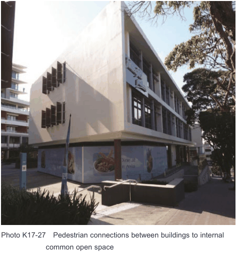

> [Picture on page 234: a picture, saved as a picture (images/part-k-special-precincts-page-234-47.gif, 150 dpi).]

Photo K17-27 Pedestrian connections between buildings to internal common open space

#### B.18 Front gardens

Well designed front gardens can retain existing landscape elements and supplement the stock of vegetation, particularly trees, in the public domain. Front gardens contribute to street character and amenity, enhance definition of the public and private domains, and can provide a positive setting for the building.

Front gardens

| Controls |  |
|---|---|
| C1. | Garden structures such as gazebos, play equipment, swimming pools and spa baths are not permitted in front gardens. |
| C2. | To minimise the visibility of car parking, garages and parking structures are not permitted forward of the building alignment to public streets; |
| C3. | To minimise the impact of driveways in front gardens, appropriate design, materials selection and screen planting is encouraged. |
| C4. | To minimise impact on the root zone of street trees, driveways, kerb crossings, parking, paved areas and external structures should be located appropriately. |
| C5. | Front gardens should generally be wide enough to be useable, and should have adequate continuous access to allow maintenance. |
| C6. | To achieve safety, lighting at both pedestrian and vehicular street entry points should be provided to each residential building. |
| C7. | To provide a pleasant streetscape and privacy of ground level private gardens a minimum of 1 small tree in front gardens of ground floor dwellings is required. |

Front fences

| C8. | The maximum height of front fences is 1.2m from the finished footpath level of the adjoining street. Front fences may be sloping or stepped along sloping streets. |
|---|---|
| C9. | Fences should be integrated with the building and landscape design through the use of common materials and detailing and be part of a suite of fences in the street. Refer Photo K17-28. |
| C10. | Fences should highlight building entrances, to allow for outlook and street surveillance |
| C11. | Fences must be partially transparent. Solid fencing or fencing with frosted or obscure glazing is not permitted |

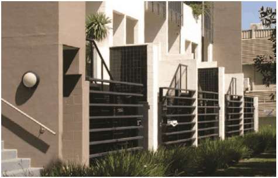

> [Picture on page 235: a picture, saved as a picture (images/part-k-special-precincts-page-235-12.gif, 150 dpi).]

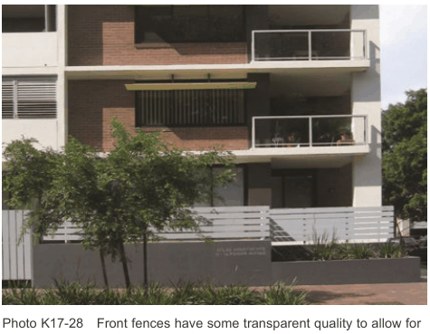

> [Picture on page 235: a picture, saved as a picture (images/part-k-special-precincts-page-235-13.gif, 150 dpi).]

Photo K17-28 Front fences have some transparent quality to allow for surveillance of the adjoining public domain, we well as privacy for occupants

#### B.19 Above ground open space

Every dwelling should have access to private open space to extend the liveable area and take advantage of the temperate climate.

Private open space should be designed to allow privacy, security and solar access. Where private gardens are not possible, well designed balconies and terraces have the potential to improve amenity and lifestyle of apartment residents. Some useable communal open space at ground level should also be provided where there is no access to private gardens.

#### Controls

C1. To achieve residential amenity, at least one balcony, terrace, verandah, loggia, or deck must be provided to each dwelling where direct access to ground level private open space is not available. Refer Photo K17-29.

C2. All apartments are required to have primary balconies as follows:

• Studio apartments: » Minimum area: 4m2 » Minimum depth of balcony: no requirement

• 1 bedroom apartments: » Minimum area: 8m2 » Minimum depth of balcony: 2m

• 2 bedroom apartments: » Minimum area: 10m2 » Minimum depth of balcony: 2m

• 3+ bedroom apartments: » Minimum area: 12m2 » Minimum depth of balcony: 2.4m

• For apartment balconies with the following circumstances:

» At 10 storeys or above, subject to consistently high wind speeds; » In close proximity to road, rail or other noise sources; and

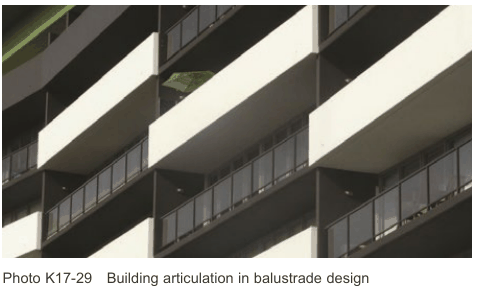

> [Picture on page 236: a picture, saved as a picture (images/part-k-special-precincts-page-236-40.gif, 150 dpi).]

Photo K17-29 Building articulation in balustrade design

» Exposure to significant levels of aircraft noise. In these situations, the use of other forms of balconies (e.g. wintergardens, bay windows or juliet balconies) are appropriate, with natural ventilation demonstrated.

C3. To achieve high quality living environments, smaller secondary above ground open space elements are also encouraged, such as balconies adjacent bedrooms, screened external clothes drying balconies adjacent laundries and bathrooms. Such spaces may have screens to a height of 1.4m. The preferred depth of secondary open space is 1.2m and the minimum permissible depth is 0.9m.

C4. Above ground open space must be designed to provide security and protect the privacy of neighbours.

C5. Lightweight pergolas, sunscreens, privacy screens and planters are permitted on roof terraces, provided they do not increase the bulk of the building. These elements should not significantly affect the views available from adjoining properties, the immediate vicinity or from the nearby ridges.

C6. To optimise useability, the primary above ground space element should include a potable water tap and barbeque gas outlet where possible.

Refer additionally to Chapter 4 of the Housing SEPP, titled 'Design of residential apartment development' and the Apartment Design Guide, NSW Department of Planning and Environment, July 2015 SEPP 65, Apartment Design Guide Part 4E Private open space and balconies.

#### B.20 Services

Low energy services

The consumption of electricity generated by the burning of fossil fuels contributes to CO2 production, the ‘greenhouse effect’ and global warming. The construction and use of buildings, accounts for a high proportion of overall energy consumption and consequently presents opportunities for energy savings and reductions in CO2 emissions. Applicants are required to satisfy the requirements of SEPP (Sustainable Buildings) 2021.

| C6. | Appliances with a low energy rating are to be used when provided as part of a development. |
|---|---|
| C7. | Minimum energy requirements, include: |

| Controls |  |
|---|---|
| C1. | Install energy efficient building services, including but not limited to, low energy heating and cooling systems and timer switches. The use of green power and solar cells is encouraged. |
| C2. | Passive solar design principles should be provided in building design to avoid the need for additional heating and cooling. |
| C3. | Building designs should be energy efficient by isolating and selecting spaces to be heated or provide individual room controls if using a centralised system; select low energy lighting such as compact fluorescent light fittings, and low energy appliances (minimum 3-star rating). |
| C4. | To minimise energy consumption incorporate clothes lines that are screened from public view, in preference to dryers. Locate clothes lines for sun and breeze wherever possible. |
| C5. | To maximise safety and minimise visual clutter all new services should be located underground. Building services such as drainage and sewerage pipe work should not be exposed. |

• Building Management Tools like motion sensors, time based controllers, irrigation control systems and air quality control systems for carparks to minimise water and energy use

• An average thermal comfort star rating of 5 or better (BERSPro, AcuuRate or FirstRate5)

• Double Glazed, low-e glass to all apartment windows achieving summer/ winter (glass only) U-values of 1.7 or less

• R2.5 insulation to all non-glazed external walls

• R3.0 plus foil insulation to the underside of all roofs and roof terraces over apartments

• Energy efficient variable speed fans for mechanical exhaust system

• Energy efficient light fittings

• Energy efficient VVVF lifts

#### B.21 Water conservation

Water conservation is an important element of an integrated ESD strategy. Measures can be implemented to match water quality with its intended use, to reduce water demand and use water more efficiently.

Applicants are required to satisfy the requirements of SEPP (Sustainable Buildings) 2021 and Water Sensitive Urban Design Strategies.

| Controls |  |
|---|---|
| C1. | Water saving devices such as dual flush toilets, tap aerators, low water use dishwashers and washing machines must be provided to all new developments. |
| C2. | Spring return taps must be used for all public amenities. |
| C3. | Appliances and plumbing hardware should have a “AAA” Australian Standards Conservation Rating. |
| C4. | Implement fit for purpose substitution by matching water quality with its intended use. Roofwater should be retained on site for use externally, such as garden watering, cleaning and irrigation. The collection and storage of rainwater for toilet flushing should be considered. The recycling of grey water for toilet flushing or external use should also be considered. |
| C5. | The installation of insinkerators is not permitted. |
| C6. | Water conserving landscape practices, such as use of mulch, irrigation zoning, limited turf areas and flow regulators on hoses should be incorporated into design and management arrangements. |
| C7. | Minimum water requirements, include: • Drip irrigation to all planters/ on slab landscaping, except turf areas • Water efficient taps • Non-potable (recycle) water reticulation to all apartment WC’s and laundries (washing machine supply), the irrigation of gardens and the supply of carwash bays • Recycling of water from the fire pump testing system |

#### B.24 Site facilities

Site facilities include loading areas, waste areas, mail boxes, external stores, end of cycle trip facilities laundries and clothes drying areas. Development should provide appropriate site facilities for retail, commercial and residential uses, and locate and design them to minimise their impact on the streetscape.

| C7. | To facilitate the maintenance of communal open space, garden maintenance storage including connections to water and drainage should be provided. |
|---|---|
| C8. | In addition to storage in kitchens, bathrooms and bedrooms, provide the following storage to each apartment: • Studio: 4m3 • 1 bedroom: 6m3 • 2 bedroom: 8m3 • 3 + bedrooms: 10m3 With: • At least 50% of the required storage to be located within the apartment; and • Storage is to be accessible from circulation spaces, living areas or laundry. |
| C9. | To encourage sustainable transport options provide change rooms, showers and lockers for people walking, running or cycling to work on all employment generating development. Locate these facilities close to secure bicycle parking. |
| C10. | To provide a safe public environment CCTV surveillance is to be provided in liaison with NSW Police. |

| Controls |  |
|---|---|
| C1. | Loading facilities must be provided via a rear lane or side street where such access is available. |
| C2. | Adequate waste and recycling areas must be provided to all developments. These areas are to be visually integrated to minimise their visibility from the street. Such facilities must be located away from openable windows to habitable rooms to avoid amenity problems associated with smell and noise. |
| C3. | To achieve amenity, provide either communal or individual laundry facilities to every dwelling, and at least one external clothes drying area. The public visibility of this area should be minimised. Clothes drying is only permitted on balconies that are permanently screened from public view. |
| C4. | To avoid visual clutter, all apartments are to have a balcony that has portion of the balustrade which has a minimum height of 1.4 metres and minimum width of 1.5 metres wide to screen drying clothes. |
| C5. | To optimise convenience, lockable mail boxes should be provided close to the street, integrated with front fences or building entries. |
| C6. | To minimise the negative impact of smells on occupants on upper levels ducted vents must be provided to commercial kitchens. |

Refer additionally to SEPP 65, Apartment Design Guide Part 4G Storage

#### B.25 Pedestrian access, parking and servicing

Pedestrian access and mobility Most people experience some form of mobility impairment at some stage during their lives which may be caused by a variety of factors including ageing as well as injury and disease. It is important that access to the facilities of the Rhodes Peninsula is made easy for a wide variety of people.

The creation of a barrier free environment in all public spaces, premises and associated spaces will ensure that all people who live, work, or visit Rhodes Peninsula are able to access and use all spaces, services and facilities, and participate in community life at Rhodes.

| Controls |  |
|---|---|
| C1. | To cater for mobility impairment, provide at least one main entry with convenient, barrier-free access in all buildings. Access should be direct and without unnecessary barriers. Obstructions which cause difficulties should be avoided. These include: • Uneven and slippery surfaces • Steep stairs and ramps • Narrow doorways, paths and corridors • Devices such as door handles which require two hands to operate, or revolving doors |
| C2. | To cater for mobility impairment, appropriately designed and convenient seating and ablutions should be provided. |
| C3. | To cater for drivers with mobility impairment, adequate parking should be provided for people with mobility disabilities, and safe, easy and convenient access to the building. |
| C4. | To cater for visitors with mobility impairment, the proportion of visitable dwellings should be maximised. |
| C5. | An assessment of the accessibility of developments is to accompany all development applications for new buildings and substantial alterations to existing buildings involving changes to pedestrian access. |

#### B.26 Vehicular access

Vehicle access to developments should minimise conflicts between pedestrians and vehicles, visual intrusion, and disruption of streetscape continuity. The location and design of vehicle entrances needs to be carefully considered to avoid disrupting pedestrian and cycle movement and promote pedestrian and cycle safety. Minimising the size and quantity of vehicle crossings will retain streetscape continuity and reinforce a high quality public domain.

| Controls |  |
|---|---|
| C1. | Provide access to parking from rear or side lanes or secondary streets wherever possible. Where practical, buildings are to share vehicle access points, and internal on-site signal equipment is to be used if necessary. Vehicular access is to be avoided in locations identified in Figure K17-11 Rhodes West Location of Awnings. |
| C2. | To optimise pedestrian safety, pedestrian and vehicle access should be clearly differentiated. |
| C3. | Provide a minimum 6m distance between a vehicle and pedestrian entries to avoid conflicts and maintain safety. |
| C4. | To optimise pedestrian amenity, driveways should be consolidated within blocks, particularly those in single body corporate ownership. |
| C5. | Vehicle access and pathway layouts should be designed to satisfy Australian Standards. |
| C6. | To optimise pedestrian access and safety, vehicular access ramps parallel to the street frontage are not permitted. |
| C7. | Where a port cochere is proposed, it is to be located so as not to interrupted pedestrian access to a building or along a street frontage. Pedestrian access is to be maintained along street footpaths. |

| C8. | The maximum permitted width of driveway crossings to detached, row and pair housing is 2.5m. The maximum permitted width of driveway crossings to all other lots is 6m generally, and 12m for the entrance to the retail centre near Homebush Bay. Dependent on the number of vehicles, 3m is the preferred width of driveway crossings, and car park and service entries. |
|---|---|
| C9. | In commercial, retail and light industrial developments, minimise the width of driveway crossings by consolidating car access, docks and servicing, and waste disposal. Avoid conflicts with pedestrian access and the impact of any such access on residential amenity. |
| C10. | Visual intrusion of vehicle access points must be minimised in accordance with NSW Police regulations set-out in CPTED ‘Safer by Design’ principles. |

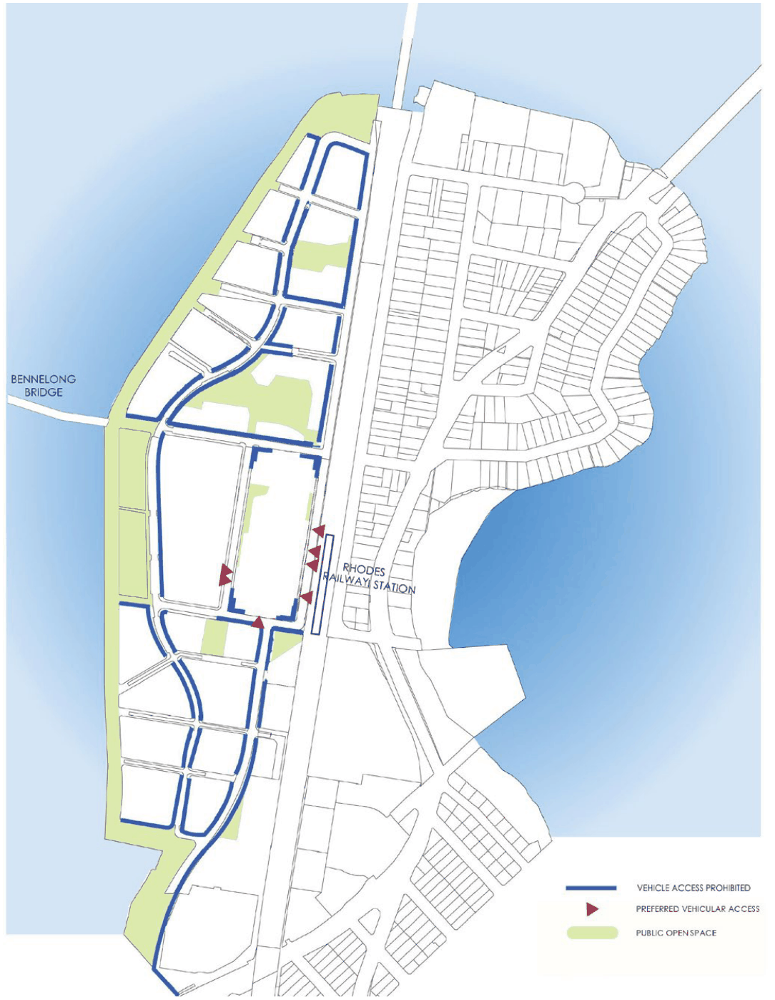

> [Picture on page 242: a picture, saved as a picture (images/part-k-special-precincts-page-242-1.gif, 150 dpi).]

Figure K17-12 Rhodes West Vehicle Access Restrictions

#### B.27 On-site parking

The higher residential density and mixed use envisaged for the Rhodes Peninsula will enhance public transport use and viability, and reduce travel demand. This DCP promotes public transport use by minimising car parking requirements whilst providing for on-site service vehicle parking. Underground and semi-underground parking minimises the visual impact of car parks and is an efficient use of the site creating an opportunity for increased private, common and private open space. Provision

#### Controls

| C1. | Parking provision shall be in accordance with Table K17-1 Private vehicle parking rates. |
|---|---|

General

| C2. | Stack parking is not permitted for residential development except where two spaces are provided for one apartment. |
|---|---|
| C3. | Car share, electric vehicle charging station and motorcycle parking rates are to be as per Table K17-3 |
| C4. | One accessible parking space is to be provided for each adaptable unit. |
| C5. | Parking and service areas are to satisfy AS2890.1 and AS2890.2. |

Basement and semi-basement car parking

C6. To maximise the area for soft landscaping consolidated parking areas should be concentrated under building footprints wherever possible.

At grade car parking

C7. To achieve a high quality public domain, at grade car parking is only permitted to the rear of shops, restaurants and the like, and to detached, pair and row housing. It must be located behind the building line and screened from the public domain unless accessed via a lane or private street.

Above ground car parking

| C8. | To achieve a high quality public domain, internal car parking which protrudes more than 1.2m above ground level of the adjacent public domain must be located behind the building alignment and be screened from the public domain in a manner that is an integral part of the external design of the building. |
|---|---|
| C9. | Parking structures should be designed to minimise reliance on artificial ventilation of car exhaust. |

Bicycle parking

| C10. | To encourage cycling provide the following bicycle parking in accordance with Table K17-2 Bicycle parking rates. |
|---|---|
| C11. | To encourage cycling, ensure resident and employee bicycle parking is secure. |
| C12. | To encourage cycling, provide end of cycle trip facilities in retail/ commercial developments. |
| C13. | Secure bike parking facilities are to be provided in accordance with the following: a) Class 1 bike lockers for occupants of residential buildings; b) Class 2 bike facilities for staff/employees of any land use; and c) Class 3 bike rails for visitors of any land use |
| C14. | Where bike parking for residents is provided in a basement, it is to be located: a) on the uppermost level of the basement; b) close to entry/exit points; and c) subject to security camera surveillance where such security systems exist. |
| C15. | A safe path of travel from bike parking areas to entry/exit points is to be marked. |
| C16. | Bike parking for visitors is to be provided in an accessible on-grade location near a major public entrance to the development and is to be signposted. |

#### Table K17-1 Private vehicle parking rates

| Residential | Refer to Part B. |  |
|---|---|---|
|  | Service vehicles | max 1 space per 50 apartments for first 200 apartments plus 1 |
| Commercial | Commercial offices Service vehicles Retail Service vehicles | max 1 space per 40m2 Gross Floor Area 1 space per 4,000m2 GFA for first 20,000m2 GFA and a space per 8,000m2 GFA thereafter 1 space per 40m2 Gross Floor Area 1 space per 500m2 for first 2,000m2 and 1 space per 1,000m2 thereafter (50% of spaces for trucks) |

#### Table K17-2 Bicycle parking rates

| Residential | Refer to Part B |  |
|---|---|---|
| Commercial | Employees | • 2 per 150m2 GFA (employee) • 2 per 400m2 GFA (visitor) |
| Retail | Visitor Retail complex/ shops Cafes | min 1 space per 750m2 GFA • 2per 250m2 GFA (resident) • 4+2 per 100m2 GFA (visitor) min 1 space per 25m2 public area for employees min 2 spaces for clientele |

Table K17-3 Car share rates, electric vehicle charging stations and motorcycle rates

| Land Use | Rates |
|---|---|
| Residential, Commercial, Retail | • Refer to Canada Bay DCP General Controls |

#### K17.4 Site-specific controls

#### Introduction

Design controls and objectives have been prepared for each development site to ensure that the urban design and built form objectives and principals of the Canada Bay Local Environment Plan 2013 (as amended) and this Development Control Plan are achieved.

Considerable input from Council’s Urban Design Consultant has guided the preferred framework for each site with urban design and place making principles. This input has guided the delivery of high quality living and working environments that are well designed and set a high standard for Rhodes as a recognisable Specialised Centre in Sydney.

These controls provide certainty to the community, Council and landowners as the to general position of the buildings on each site having regard to street setbacks, maximum building depths, building separation distances, and building heights in metres and maximum relative levels (RLs), as well as the size and general configuration of public open spaces. The building envelope controls also nominate the preferred location for non-residential uses to activate the public domain.

The design controls have been prepared on a precinct by precinct basis, however, do not undertake a detailed design of individual buildings. This flexibility in the development control allows the potential for a creative Architectural approach within set parameters, and is subject to refinement as detailed design proceeds. The building envelopes are not intended to prescribe the exact location of buildings footprints or the final location for vehicle and pedestrian access points.

Car parking is generally provided below the buildings and in certain locations extends beyond the building envelope under roads and public open spaces. These arrangements will be subject to detailed discussions at the DA stage for the various buildings and open spaces.

#### Building envelopes

Under the Canada Bay Local Environment Plan 2013 (as amended) Height of Building and Floor Space Ratio development standards have been established for all remaining development lots at Rhodes West.

The building envelopes described in this section allow some flexibility on the design of buildings, however the envelopes have been carefully developed in consultation with Council’s Urban Design Consultant to maximise public benefit.

The envelopes have been tailored to each site, taking into consideration its particular characteristics and place making potential. These characteristics are described for each of the remaining sites in each precinct in terms of the following:

• The relationship of the building to the public domain, including street and public open space frontages;

• The desired character of parks and streets;

• The optimum development potential; and

• The environmental impact.

Building envelopes describe the building setbacks and separation distances, maximum building depths, minimum dimensions of public spaces around buildings and maximum building height.

The Urban Design Framework defines the physical outcome for the remaining development sites, whilst encouraging architectural innovation within the building envelopes indicated. The site-specific building envelope controls should be read in conjunction with the general controls for the private and public domain in Section

K17.3 of this DCP.

The building envelope controls illustrated in this section allow some latitude for the detailed architectural design of buildings. This development control is intended to promote highly articulated buildings with generous balconies, recesses and steps in facades to ameliorate a sense of excessive bulk.

Figure K17-32 Indicative Development Concept of this DCP shows the indicative development concept for all development sites combined, based on developments which comply with the development standards of the Canada Bay Local Environment Plan 2013 (as amended) and this DCP.

#### The Precincts

The Precincts, as defined in the Canada Bay Local Environment Plan 2013 (as amended) and the remaining development sites have been adopted from the previous planning framework (SREP 29: Rhodes Peninsula) and are as follows:

• Precinct A – Site A

• Precinct B – Site 2A, 3A, 3B, 3C and 3D

• Precinct C – Site A

• Precinct D – Station Gateway West Figure K17-13 Rhodes West Precincts, Sites and Lots identifies the precincts, sites and lots, the subject to the site-specific design provisions of this DCP.

For each of the sites, an urban design framework is provided to illustrate the following controls:

• Building Envelope Plan and Sections

• Minimum building setbacks

• Maximum building depth

• Maximum building height

• Building articulation zone

• Location of public and private open space

• Preferred location for vehicle and pedestrian access

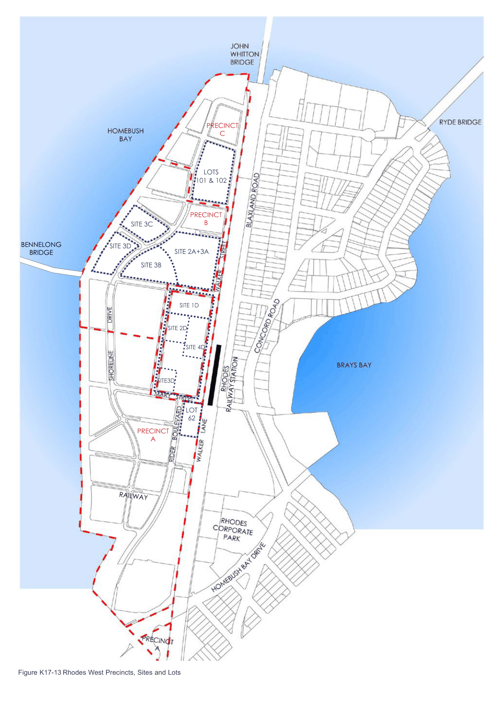

> [Picture on page 247: a map, saved as a picture (images/part-k-special-precincts-page-247-1.gif, 150 dpi); the street names and other small labels are on the picture.]
> Labels printed on the map (copied from the PDF, in no particular order):
> PRECINCT · C · LOTS · 101 & 102 · PRECINCT · B · SITE 3C · BENNELONG · SITE 3D · SITE 2A+3A · BRIDGE · SITE 3B · SITE 1D · SITE 2D · SITE 4D · SITE3D · RAILWAY · LOT · 62 · PRECINCT · A · RAILWAY · Figure K17-13 Rhodes West Precincts, Sites and Lots

#### Precinct A (Site A)

Located at the southern end of Rhodes, Precinct A has a mix of retail, commercial and residential uses. Retail uses are contained in the Rhodes Shopping Centre and at the ground floor level of some of the commercial and residential buildings fronting Rider Boulevard.

The key development controls illustrated in Figure K17-14 Precinct A Building Envelope Plan, Figure K17-15 Precinct A Building Envelope Section A-A and Figure K17-16 Precinct A Building Envelope Section B-B are as follows:

| Controls |  |
|---|---|
| C1. | Maximum building height ranging up to 25 storeys including a 4 storey podium. |
| C2. | Maximum FSR of 2.4:1 (Refer to Canada Bay Local Environment Plan 2013 (as amended)). |
| C3. | An area of 1,375m2 of public open space as a town square located at the northern side of the site. |
| C4. | Vehicle access located off laneway between commercial building to the south and proposed building on Site A. |
| C5. | Preferred location for non-residential uses at ground floor to activate Rider Boulevard and new public open space. |
| C6. | Preferred separate entries for residential and nonresidential uses. |
| C7. | The edge building is to be designed to address the Town Square. The façade of the edge building must be a minimum of three storeys in height and not exceed 4 storeys before setbacks. |
| C8. | A minimum building setback for the tower building of 5m to Rider Boulevard and 5m from the podium alignment to the Rhodes Town Square. |

| C9. | The edge building should incorporate a continuous colonnade along its length and along the Rider Boulevard frontage to accommodate the significant diagonal pedestrian flows traversing the site generated by Rhodes Station. |
|---|---|
| C10. | Consideration should also be given to incorporating an arcade linking the Town Square to the footpath cycleway. |
| C11. | The ground floor of the edge building fronting the Town Square must have active uses such as retail, cafes and taverns. |
| C12. | The tower building form and design is to reinforce and not detract from the civic quality of the Town Square. Generally, this is to be achieved by observing a 5m minimum setback above the 3-4 storey street wall. |
| C13. | Vistas into the site from Walker Street and Servier Avenue must be acknowledged in the overall design of the project and given architectural recognition in the composition of the building façade. The vista from Mary Street, Walker Street and Rider Boulevard into the Town Square also require consideration. |

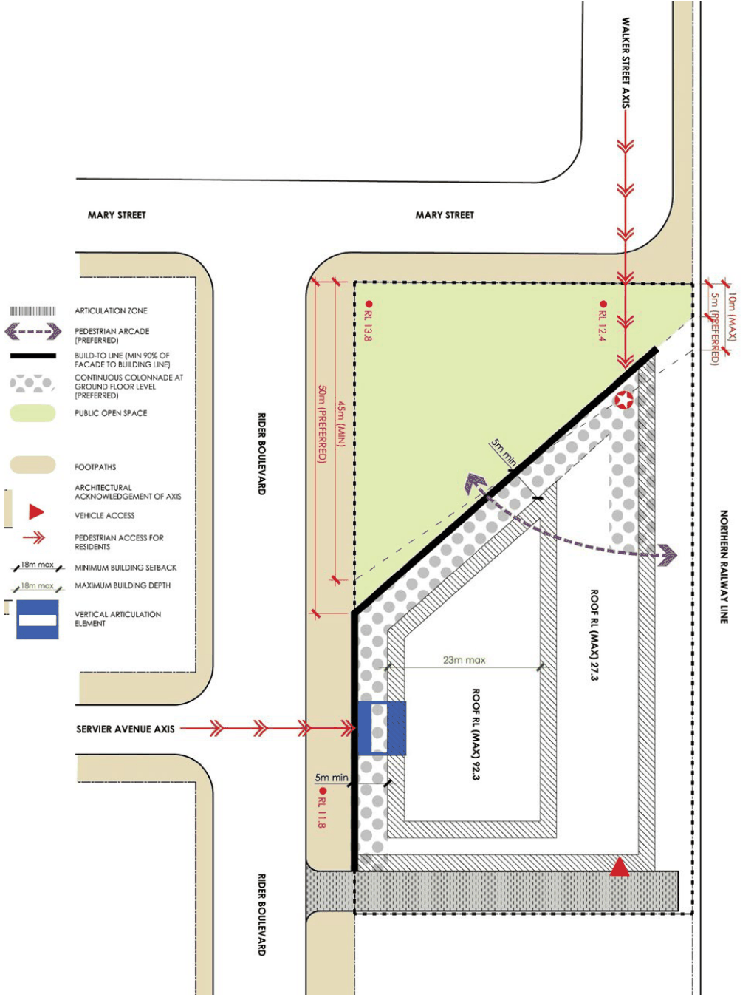

> [Picture on page 249: a picture, saved as a picture (images/part-k-special-precincts-page-249-1.gif, 150 dpi).]

Figure K17-14 Precinct A Building Envelope Plan

Development Control Plan

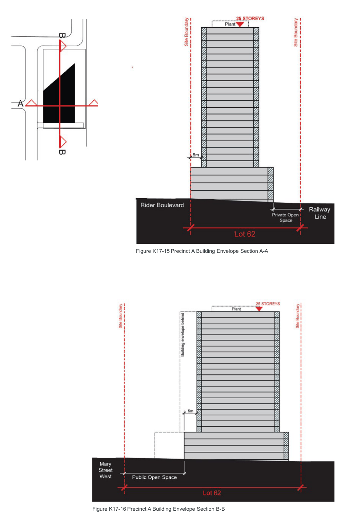

> [Picture on page 250: a picture, saved as a picture (images/part-k-special-precincts-page-250-2.gif, 150 dpi).]

Part K Special Precincts

> Words printed on the picture (copied from the PDF):
> Figure K17-15 Precinct A Building Envelope Section A-A

> Words printed on the picture (copied from the PDF):
> Figure K17-16 Precinct A Building Envelope Section B-B

#### Precinct B

Precinct B is centrally located within Rhodes West. The Precinct is 10.16 hectares in area and is planned as predominantly residential with local non-residential uses such as neighbourhood shops and cafes. There are five remaining development sites and surrounding public domain to be developed following site remediation processes. The remaining development parcels are known as Sites 2A, 3A, 3B, 3C and 3D.

Precinct B comprises a large new local park which straddles these two land ownerships. As such the overall precinct has been considered as one Precinct Plan as illustrated in Figure K17-17 to Figure K17-20. For the purpose of describing the development controls, the separate landownership have been used.

Sites 2A + 3A

Sites 2A and 3A have a frontage to Walker Street of approximately 140m. The sites are located between Timbrol Avenue, a no-through road for vehicles and Gauthorpe Street, which provide public access from Walker Street directly to the foreshore and the planned community facilities. With the consolidation of these lots with the secondary road known as Peake Street, the provision of publicly accessible open space between tower and podium buildings is achieved.

| Controls |  |
|---|---|
| C1. | Building heights ranging from low-rise buildings of 4-5 storeys which frame the public open space to tower buildings in the north east corner (25 storeys), south east corner (25 storeys) and north west corner (20 storeys). |
| C2. | The maximum Floor Space Ratio is 2.8:1. |
| C3. | Car park entry is from Timbrol Avenue. |
| C4. | Combined with Site 3B a minimum of 16,000m2 of public open space is required. |
| C5. | One level of basement car parking and one level of partially above ground car parking. |

| C6. | Above ground parking screened behind the street front building line to all streets and open spaces. |
|---|---|
| C7. | Preferred location for non-residential uses fronting Walker Street and the through site link open space. |
| C8. | Minimum building setbacks as illustrated in Figure K17-17 Precinct B Building Envelope Plan. |
| C9. | Separate pedestrian entries and lobbies for residential and non-residential uses. |
| C10. | The preferred location for non-residential uses including retail and commercial uses is along the Walker Street frontage and fronting onto the diagonal pedestrian plaza from the south east corner of the site. |
| C11. | The indicative alignment of non-residential frontages on the northern and southern sides of the pedestrian plaza are indicated on the building envelope plan. To avoid a ‘gun-barrel’ effect it is recommended that the alignment is to be staggered with stepping and recesses to provide pedestrian interest. |
| C12. | To maintain a view corridor along the diagonal alignment of Marquet Street by providing an undercroft space with a minimum height of 15m beneath the tower building in the south west corner of the site. Exposed columns are to have a high architectural design quality with a slender form and quality materials and integrated into the overall architectural design of the building. |
| C13. | To enhance the forecourt space at the Timbrol Avenue / Walker Street provide an undercroft space over two levels of the tower building. |

Sites 3B, 3C and 3D

Sites 3B is located on the eastern side of Shoreline Drive and forms part of the new Central Park in Precinct B. This site has long frontages to both Shoreline Drive to the west and Gauthorpe Street to the south.

The new park front is to the north of Site 3B. Built form is to be located in the southern part of the site with the contribution to the new park forming the northern part of the site. Sites 3C and 3D are located on the western side of Shoreline Drive and also have a frontage to the Foreshore Reserve. These sites are divided by Peake Street, a secondary street, which provides vehicle access to basement parking on both sites. The key development controls for each of the three remaining development parcels are summarised below:

Site 3B

| Controls |  |
|---|---|
| C14. | A maximum height of 18 storeys above a single level podium stepping down to 15 storeys above a two level podium fronting Shoreline Drive is required. |
| C15. | Break up the bulk and length of the building; provide a recess in the façade of a minimum 4m in depth and length, in the location where the step in height occurs, as illustrated in the building envelope plan. Design the building as two linked buildings. |
| C16. | The car park entry is to be from Gauthorpe Street. |
| C17. | Combined with Sites 2A + 3A provide a minimum of 16,000m2 of public open space. |
| C18. | One level of basement car parking and one level of above ground car parking. |
| C19. | Above ground parking screened behind the street front building line to all streets and open spaces. |
| C20. | The preferred location for the primary pedestrian entry is from Gauthorpe Street. |

Site 3C

| C21. | Building height ranging from 4 storeys fronting the Foreshore Reserve up to 9 storeys fronting Shoreline Drive. |
|---|---|
| C22. | Maximum floor space ratio of 2.2:1. |
| C23. | Car park entry from Peake Street. |
| C24. | Two levels of basement car parking. |
| C25. | All buildings with an address to a street frontage. |
| C26. | The design of the building fronting Shoreline Drive is to accentuate the curvilinear alignment of the street through building setbacks, façade articulation, and balcony and balustrade forms. |

Site 3D

| C27. | Building height ranging from 3 storeys fronting the Foreshore Reserve up to 9 storeys fronting Shoreline Drive. |
|---|---|
| C28. | A maximum floor space ratio of 2.3:1. |
| C29. | Car park entry from Peake Street. |
| C30. | Two levels of basement car parking. |
| C31. | Preferred location for non-residential uses fronting the community facility lot to the south. |
| C32. | The building on the southern boundary is to align with the Gauthorpe Street view corridor. |
| C33. | The building on the northern boundary is to align with the Peake Street view corridor. |
| C34. | Separate pedestrian entries and lobbies for residential and non-residential uses are required. |
| C35. | The design of the building fronting Shoreline Drive is to accentuate the curvilinear alignment of Shoreline Drive through building setbacks, façade articulation, and balcony and balustrade forms. |
| C36. | The central private courtyard is to provide the main pedestrian access to the parallel building fronting the Foreshore Reserve. |

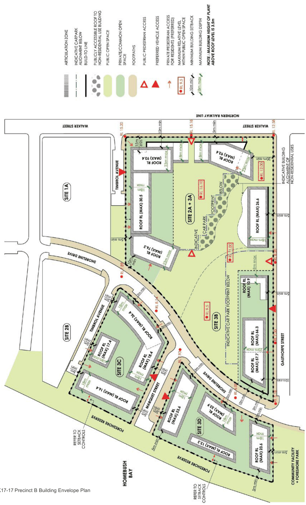

> [Picture on page 253: a picture, saved as a picture (images/part-k-special-precincts-page-253-1.gif, 150 dpi).]
> Words printed on the picture (copied from the PDF):
> Figure K17-17 Precinct B Building Envelope Plan

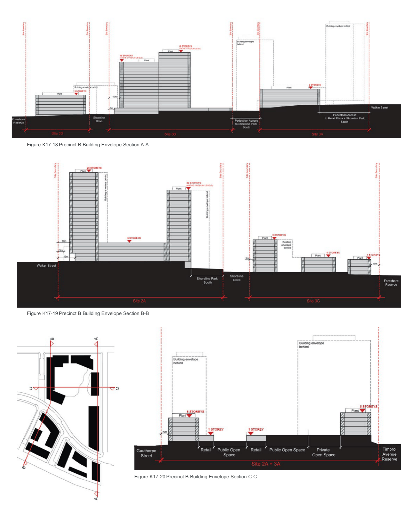

> [Picture on page 254: a picture, saved as a picture (images/part-k-special-precincts-page-254-1.gif, 150 dpi).]
> Words printed on the picture (copied from the PDF):
> Figure K17-18 Precinct B Building Envelope Section A-A

> Words printed on the picture (copied from the PDF):
> Figure K17-19 Precinct B Building Envelope Section B-B
> Figure K17-20 Precinct B Building Envelope Section C-C

#### Precinct C (Site A)

Precinct C is located at the northern end of Rhodes West. The area is predominantly a residential precinct. Two development parcels remain which are known as Site A.

The development provides an opportunity to create additional publicly accessible open space by amalgamating the lots. The open space is to be centrally located with a wide pedestrian accessible link between Walker Street and Shoreline Drive.

The development controls for the parcels are summarised below:

| Controls |  |
|---|---|
| C1. | Tower building in the south west corner of Site A of 25 storeys. |
| C2. | Tower building in the north western corner of Site A of 25 storeys. |
| C3. | Lower-rise buildings of 6 and 7 storeys fronting Shoreline Drive and Walker Street. |
| C4. | Single storey building on the corner of Walker Street and Nina Grey Avenue as a podium to the tower building above. |
| C5. | Building setback controls as illustrated in Figure K17-21 Precinct C Building Envelope Plan, Figure K17-22 Precinct C Building Envelope Section A-A and Figure K17-23 Precinct C Building Envelope Section B-B including: • Tower buildings are setback 10m from Walker Street and Shoreline Drive street frontages • Lower rise buildings are to align with the street frontages with a minimum of 5m setback to provide adequate space for ground level garden courtyards fronting the street |
| C6. | Vehicle access is to be provided from Nina Grey Avenue. |
| C7. | A minimum of 4,600m2 of public open space to be provided in a linear alignment between Walker Street and Shoreline Drive. |
| C8. | The preferred location for non-residential uses including local shops to be provided fronting onto the public open space with a northern aspect with good sunlight access, close to Walker Street. |

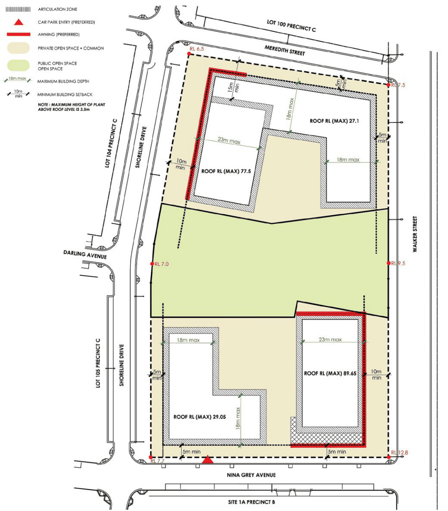

> [Picture on page 256: a picture, saved as a picture (images/part-k-special-precincts-page-256-1.gif, 150 dpi).]

Figure K17-21 Precinct C Building Envelope Plan

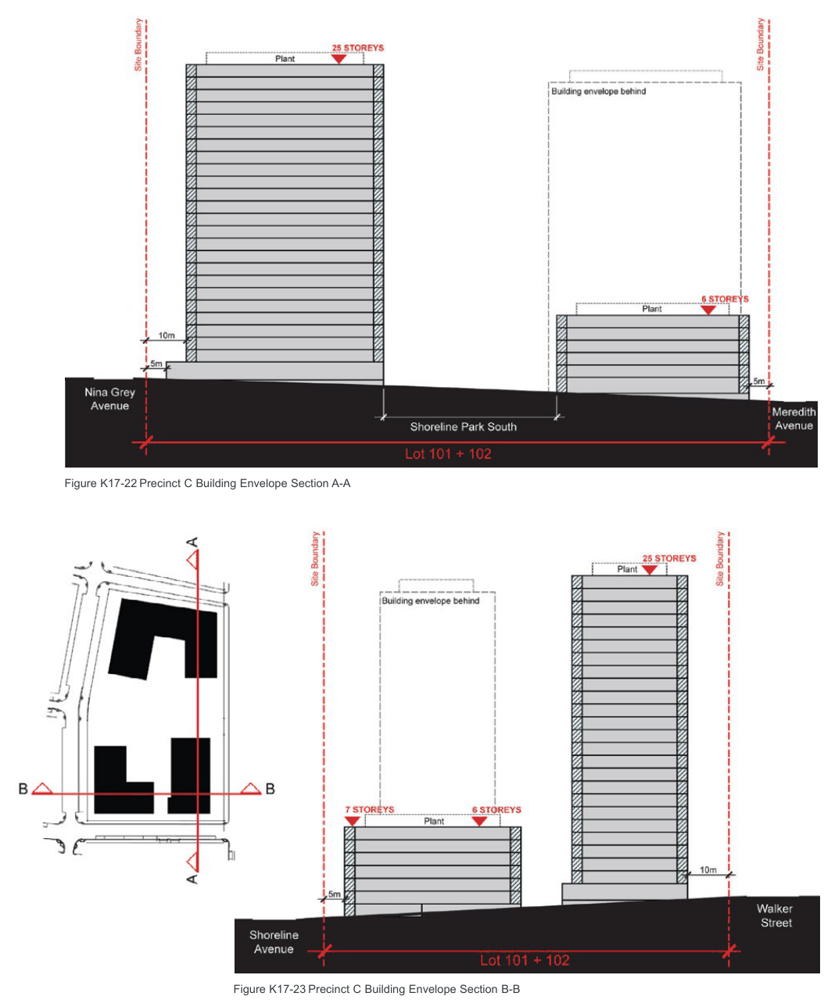

> [Picture on page 257: a picture, saved as a picture (images/part-k-special-precincts-page-257-1.gif, 150 dpi).]
> Words printed on the picture (copied from the PDF):
> Figure K17-22 Precinct C Building Envelope Section A-A
> Figure K17-23 Precinct C Building Envelope Section B-B

#### Precinct D (Station Gateway West)

The Station Gateway West Masterplan (CM+, November 2014) was prepared to inform the planning framework for the Station Precinct and is supported, and superseded in some cases, by the Station Gateway West Master Plan (Hatch Roberts Day, August 2021). Precinct D, known as Station Gateway West, is located next to Rhodes Station, and is bounded by Walker Street, Marquet Street, Mary Street West and Gauthorpe Street. Refer "Figure K17-25-28".

Rhodes West has the potential to grow as a true Transit Oriented Development, adjacent to the waterfront, connected to surrounding communities and metropolitan Sydney. A mixed use precinct that includes residential, commercial and social places.

Station Gateway West will be completed as a place- led urban destination, reflective of and, building upon the original Master Plan intent. The delivery of additional public benefit and amenity to support the urban context and transit importance of the Precinct has driven the design process. The development capacity, height and form of development at Station Gateway West respects the ground plane amenity and demonstrates realisation of the best practice criteria.

Fine grain podium and tower building typologies will activate a connected public space network of forecourts, transit plazas and pedestrian laneways. The podiums will contribute to pedestrian comfort, provide greening opportunities and define a legible ground plane guiding residents and visitors to and from key destinations.

The shape, variety and siting of buildings will contribute to the gateway character of Station Gateway West whilst providing a visually interesting skyline with visible sky from important vistas across the Peninsula.

Critically, the Station Gateway West Master Plan future-proofs:

• the site itself for optimum connectivity, urban open space and residential amenity, and

• the surrounding area, with a particular focus on not compromising existing public spaces and facilitating embellishment and improvement of the public realm and infrastructure.

The architectural expression, is envisaged to be contemporary, exhibiting a sophistication, lightness and

transparency in detailing. The public domain paving, lighting, furniture, signage, materials and finishes, and landscaping will be a seamless continuation of the public domain of the surrounding streets and squares. A highlight of the public domain will be the incorporation of engaging, relevant and place specific public artwork and installations, drawing themes from the history of the place, and from cultural cues, as well as looking to the future.

| Controls |  |
|---|---|
| C1. | The maximum permissible building height on the subject sites are defined in the Canada Bay Local Environment Plan. Building height reaches 159 metres (equivalent to 45 storeys) adjacent to Rhodes Station and steps down to the west and south. Refer to Figure K17-25 Precinct D (Station Gateway West) Master Plan and the building envelope sections in Figures Figure K17-26 to Figure K17-31. |
| C2. | The maximum Floor Space Ratio (FSR) is defined in the Canada Bay Local Environment Plan 2013. |
| C3. | The mid-block is to provide a fine grained network of plaza’s and laneways, creating a permeable city block. |
| C4. | Pedestrian connections, through a series of new urban places and plazas between Rhodes Station, to Marquet Street, Mary Street and Annie Leggett Promenade to the waterfront are required. Additional north- south retail laneway connections between Town Square and the new Recreation Centre are also required. Refer to Figure K17-25 Precinct D (Station Gateway West) Master Plan. |

#### Controls

750 sqm gross floor area max.

core

C5. Consistent with the Objectives and supplementing SEPP 65, building-to building setbacks within the Precinct are to achieve the following separation controls: 15 - 20 storeys - 24m Above 20 storeys - 40m

C6. Towers above 20 storeys are to provide a 4 storey differential in building height.

balconies

(Above) Maximum gross floor area of 750 square metres

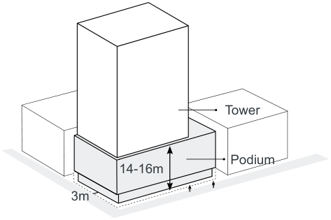

> [Picture on page 259: a picture, saved as a picture (images/part-k-special-precincts-page-259-15.gif, 150 dpi).]
> Words printed on the picture (copied from the PDF):
> Tower
> Podium
> 14-16m
> 3m

C7. Residential towers above podium level shall have a maximum gross floor area of 750 square metres as per diagram opposite.

The two towers at 34 Walker Street can be developed following the existing/approved floor plate, subject to demonstration design quality in accordance with the requirements of the Apartment Design Guide and this DCP.

C8. A minimum podium height of approximately 14-16m building height is required.

C9. A tower and podium building typology is required, subject to the following outcomes:

a) A ground floor setback of 3m is to be provided.

b) A Podium to Tower setback of 4m is to be provided.

c) Maximum 1/3 of a tower frontage along a street or public space can be extended down to the ground.

Public gathering areas must be associated with the 2/3 of the façade that is grounded by a podium.

L Tower

1/3L

Podium

Public Gathering Area

| Controls |  | C14. | Through site links and laneways are to have |
|---|---|---|---|
| C10. | The street wall has a maximum continuous frontage of 45m. Facades longer than 45m are to have a recess of a minimum of 3 x 3 meter and provide other means in the |  | clear line-of-sight from Precinct D to Annie Leggett Promenade, with buildings setback to the same distance as buildings fronting Annie Leggett Promenade. |
|  | visual composition to break up overly bulky | C15. | Union Square must not receive any |
|  | buildings. The composition and detailing |  | additional overshadowing from new |
|  | of a facade is important to the appearance |  | development between 9.00am and 2.00pm |
|  | of the building and influences its perceived scale. Well designed facades reflect the |  | on the Winter Solstice. |
|  | use, internal layout and structure of an |  | Peg Patterson Park must not receive |
|  | apartment building. |  | any additional overshadowing from new development between 12.00pm and 2.00pm |
| C11. | A minimum of 60% street frontage is dedicated to active retail uses. All building fronting a street will have 15-20 doorways per 100m of a façade. |  | on the Winter Solstice. Mcilwaine Park must not receive any additional overshadowing from new development between 8.30pm and 12.30pm |
| C12. | A tower Setback Line applies to all new property frontages and is a minimum of 4m. |  | on the Winter Solstice. Turfed area within Mcilwaine Park must |
| C13. | A Build-to-line with a zero setback is required for the mid-block laneways and plaza. Laneway width is 8-12m |  | not receive any additional overshadowing from new development between 8.00am - 2.00pm on the Winter Solstice. |
|  | and minimum plaza width is 20m. Laneway width is subject to performance | C16. | Provide a taxi rank, kiss-and-ride drop-off and pickup bay and disabled parking |
|  | requirements to accommodate: |  | spaces in proximity of the Rhodes Station |
|  | • Sufficient space to accommodate |  | on Walker Street. |
|  | sufficient clear width, swept path and height for emergency vehicle access as required by the NSW Fire Brigade and NSW Ambulances and other day-to-day service vehicles required to maintain the | C17. | Bus bays relocated and expanded along eastern and western edges of Walker Street to accommodate the projected increase in patronage. |
|  | central oval plaza and laneway public | C18. | Maximise pedestrian amenity by providing |
|  | domain and as necessary to service |  | bus shelters and building awnings for |
|  | businesses |  | weather protection from Rhodes Station to |
|  | • Planting of mature trees in the laneways |  | the bus interchange. |

and central oval plaza as illustrated in the Public Domain Concept Plan (Context Landscape Design 2014)

• Provision of outdoor dining zones associated with cafe, bar and restaurant tenancies

• Projecting shop or other signage

| Controls |  | C21. | Proponents are to address the provision of |
|---|---|---|---|
| C19. | Buildings are designed to minimise wind impacts to new areas of open space without the need for roofs or canopy structures. Any proposed development must demonstrate that a sufficient level of ‘Wind |  | cycle routes, crossings and parking facilities in relation to Station Gateway West, including at Rhodes Station and at key precinct destinations. Refer to section A.2 Cycle Strategy and to Figure K17-6 Rhodes West Cycle Strategy. |
|  | Comfort Standard for Sitting in Parks’ (in | C22. | Restrict vehicular and servicing access |
|  | accordance with Lawson Wind Comfort |  | to the midblock to ensure for a safe, |
|  | Criteria) is achievable without the need |  | pedestrian prioritised network of mid-block |
|  | for any open space cover or mitigation measures other than the design of the |  | laneways and plazas to thrive. |
|  | building itself. | C23. | Major truck and service vehicle access |
|  |  |  | to Station Gateway West basements is |
|  | Maximum awnings coverage consistent |  | preferably from Walker Street and Marquet |
|  | with the Station Gateway West Master Plan |  | Street at the preferred locations identified in |
|  | (Hatch Roberts Day, August 2021) and Figure K17-11. | C24. | Figure K17-12. Consolidate wherever possible, vehicular |
| C20. | A single overhead connection from the development to the Station Concourse |  | entry points to Station Gateway West development and ensure good sight lines at |
|  | with a pedestrian bridge over Walker Street is permitted subject to a high level of urban design and architectural quality | C25. | pedestrian cross-overs. Maintain fire and emergency vehicle access |
|  | being achieved. A pedestrian bridge should |  | via one or more laneways, as required by |
|  | appear light and slender in design and |  | emergency service authorities. |
|  | maximise Walker Street openness and vistas. The proposed pedestrian bridge over Walker Street is to meet the following | C26. | A minimum of 4,000 sqm of publicly accessible open space to be provided within the Precinct. |
|  | requirements: |  |  |
|  | • TfNSW and Sydney Trains specifications for access to a station (including design |  | The open space allocation shall be distributed as per Figure K17-4. |
|  | for growth and 24/7 access for the public) |  | New publicly accessible open spaces on |
|  | • Disability Standards for Accessible Public |  | Marquet St and Walker St must achieve 2h |
|  | Transport 2002 |  | of solar access on 50% of its area between |
|  | • Vertical transport and commuter access to buses on both sides of the roads and |  | 9.00am and 3.00pm on the Winter Solstice. |
|  | station | C27. | Public plazas are required to be open to |
|  | • In accordance to safety regulations set by NSW Police and their CPTED ‘Safer by Design’ principles |  | the sky and unobstructed, except for certain permitted obstructions such as planting, seating, and other plaza amenities. |

#### Controls

| C28. | The street interface of a public plaza is required to have a minimum 50% of its area free of obstructions. Plazas that front on a street intersection are required to maintain a clear area within 5m of the intersection. The remaining 50% of the sidewalk frontage may contain obstructions such as fixed and movable seating, plantings and trees, light poles, public space signage, litter bins or other design elements that are permitted within public plazas. |
|---|---|
| C29. | Marquet Street Forecourt must be designed to have: |

• A minimum width of 10m for the entire street frontage,

• An average length of 20m,

• A minimum clear usable space of 20 x 20m (the major portion)

• 2hrs of sun over 50% of the space (9am- 3pm)

• Awning/ cover limited to 1m in addition to the 3m ground floor setback (establishing an in-built awning) on new building podiums.

• The main portion of the space is termed the “major portion” of the public space and must account for at least 75% of the public area. The smaller areas are then considered to be “minor portions” and are limited to no more than 25% of the public area.

Refer to Figure K17-25 for spatial explanation.

| C30. | Walker Street Transit Plaza must be designed to have: • A minimum width of 6.5m for the entire street frontage, • Clear and direct link to the Gateway West Pedestrian Laneways • 2hrs of sun over 50% of the space (9am- 3pm) • No additional awning/ cover to that of the 3m ground floor setback (establishing an in-built awning) on new building podiums Refer to Figure K17-25 for spatial explanation. |
|---|---|
| C31. | On site landscape replacement must be provided as the equivalent or more of the total site area. Landscape replacement can be provided through the following: - Vertical and facade greening. - Rooftop greening and greening of communal podium spaces. - Public open space, through site links within the site boundary. |

| Controls |  |
|---|---|
| C32. | All development must contribute to and demonstrate a 25% Green View Index using the methodology outlined in Figure K17-24 and described below. The Green View Index (GVI) is a numerical value given to the amount of green canopy and landscape perceived by an individual at street level. Tree canopies, understorey vegetation, and facade greening are the three primary contributors to the GVI. The GVI target for Station Gateway West (Precinct D) is 25%. To achieve this, the design of streets and new developments must include an objective assessment of the GVI value achieved, using the following method: • Where tree canopies and understorey vegetation do not achieve the GVI target, facade greening is required to the extent necessary to achieve the minimum requirement. |
| C33. | • NOTE: for the purposes for the purposes of calculation GVI at street level, a standard height of 14m above ground level has been set, consistent with the podium height. • A mix of small (<7m canopy), medium (7-15m canopy), and large (15m + canopy) trees is required, appropriate to the scale of spaces and building interfaces. |

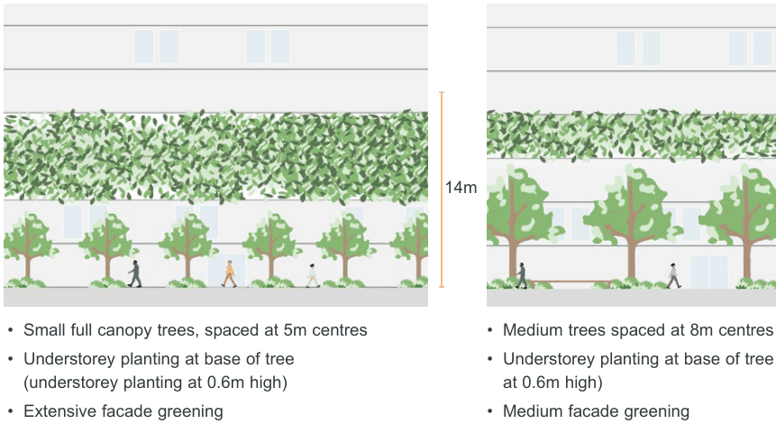

> [Picture on page 264: a picture, saved as a picture (images/part-k-special-precincts-page-264-1.gif, 150 dpi).]

• Small full canopy trees, spaced at 5m centres

• Understorey planting at base of tree (understorey planting at 0.6m high)

• Extensive facade greening

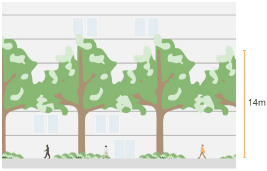

> [Picture on page 264: a picture, saved as a picture (images/part-k-special-precincts-page-264-6.gif, 150 dpi).]

• Large Tree spaced at 10m centres

• Understorey planting at base of tree (understorey planting at 0.6m high)

> [Picture on page 264: a picture, saved as a picture (images/part-k-special-precincts-page-264-10.gif, 150 dpi).]

• Medium foreground trees spaced at 3-5 m centres for plazas and parks.

14m

14m

> [Picture on page 264: a picture, saved as a picture (images/part-k-special-precincts-page-264-15.gif, 150 dpi).]

• Medium trees spaced at 8m centres

• Understorey planting at base of tree (understorey planting at 0.6m high)

• Medium facade greening

> [Picture on page 264: a picture, saved as a picture (images/part-k-special-precincts-page-264-20.gif, 150 dpi).]

14m

14m

• Medium foreground trees spaced at 8m centres.

• Understorey planting at base of tree (understorey planting at 0.6m high)

• Possible where there is widened verge or open space to the streetscape

Figure K17-24 Tree Canopy Strategy

#### Public domain

The urban and landscape design of Station Gateway West is guided by the following Public Domain Principles:

| Controls |  |
|---|---|
| C34. | Provide a raised threshold pedestrian crossing to Rhodes Station, across Walker Street, that: • Encompasses and connects the future bus interchanges on either side of Walker Street, • Has the same materiality and treatment as the future Walker Street Transit Plaza and is flush (no kerbs), • Integrates a cycleway along the eastern side of Walker Street connecting north and to the Station. Provide a raised threshold pedestrian mid-point, across Marquet Street, to Annie Leggett Promenade. |
| C35. | Provide generous through-site pedestrian links (as shown in Figure K17-25 Precinct D (Station Gateway West) Master Plan) with tree planting arranged to maximise views into the mid-block, and taking into account of access and safety considerations. |
| C36. | Wherever possible provide active edges along all pedestrian passageways and around the proposed plaza. |
| C37. | Central Oval Plaza – this is an opportunity for a flexible, simple and uncluttered space, with minimal and carefully chosen landscape, furniture, lighting and artwork. The plaza and laneways are a focus for cafes, small daytime events, community activities and temporary markets. |
| C38. | There is an opportunity to integrate a water feature within the Station Gateway West plaza. |

| C39. | Provide new street trees in surrounding streets – Gauthorpe, Marquet, Mary and Walker Streets. |
|---|---|
| C40. | Celebrate the Walker Street and Marquet Street entry plazas to the precinct with groves of distinctive palm trees. |
| C41. | Integrate Walker Street public domain generally in accordance with Council's Public Domain Concept Plan. |
| C42. | Integrate public art and feature lighting into the public domain – opportunities include embedded artwork in the paving or sculptural installations, as a focus in the entry plazas, and in the central oval plaza – to entice pedestrians to the ‘heart’ of the precinct. |
| C43. | Integrate sustainability and WSUD initiatives in the designated public domain. |
| C44. | Integrate the Station Gateway West paving, furniture, lighting and materials and finishes, seamlessly with the adjoining Rhodes Peninsula public domain. |
| C45. | Through-site links are crucial to creating a continuous pedestrian and green network within Gateway Rhodes West. The proposed through-site links must: • Provide uninterrupted views through the links between Marquet and Walker Street. • Allow for continuous 3m wide (minimum) pedestrian through zone within the minimum laneway width established within the Master Plan and this DCP. • Outside of the 3m pedestrian zone, provide trees along the length of link, spaced to achieve a continuous canopy of shade when mature. • Provide public furniture integrated into the space, co-located with building entries and key nodes where appropriate. |

#### Controls

C46. Assure CPTED principles are implemented to ensure reduced opportunities for crime. Public spaces:

• should be designed to support natural surveillance

Through-site links:

• Must have uninterrupted views between Marquet St and Walker Street

• Must provide direct visual connection to Annie Leggett Promenade

• Must be provided as part of the public domain

• Must provide visible, unobstructed and easily distinguished entries to buildings

C47. All public space design must adhere to the Australian Standard Design for Access and Mobility (AS1428).

• Public plazas should generally be located at the same level of adjoining public domain. Minor changes in elevation, not to exceed 0.6m above the level of the adjacent area, are permitted

• Plazas should generally not be sunken below street level

• Step risers must be no less than 100mm, and no greater than 150mm (exception can be made for vanishing steps)

• Seating steps shall be in the range of 150mm-500mm

C48. Circulation paths must be designed to ensure ease of access to and within public space. For optimal outcomes:

• Circulation paths must be a minimum of 2.4m in width and extend to a minimum of 80% of the depth of the space

• Trees planted flush-to-grade, light poles, public space signage, and litter bins are permitted within circulation paths, However, 1.8m of continuous path must remain clear of fixed furniture elements at all times

• Circulation paths must have a cross-fall no greater than 2.5%

• Garage entrances, driveways, parking spaces, loading berths, exhaust vents, mechanical equipment, and building bin storage facilities are prohibited within all public plazas

• Any such elements located adjacent to a public plaza are required to be screened or concealed from view. Vents and mechanical equipment are prohibited on any adjacent building walls within 5m of the level of the public plaza. Air intake vents and intake shafts, are permitted within public plazas if they are incorporated into plaza design features and do not impair visibility within the plaza

C49. Union Square must not receive any additional overshadowing from new development between 9.00am and 2.00pm on the Winter Solstice.

Peg Patterson Park must not receive any additional overshadowing from new development between 12.00pm and 2.00pm on the Winter Solstice.

#### Controls

C50. The configuration, location and diversity of seating available should be considered to ensure social interactions can be undertaken in a safe and comfortable manner.

Seating requirements:

• At least 1 linear metre of seating must be provided for every 30m2 of plaza space.

• Movable seating for cafes may constitute up to 50% of the seating requirement, and may be stored outside of trading hours

• Up to 50% of seating may be informal (e.g. low walls/bleacher steps). To create an active street edge a portion of the required seating must be provided within 5m of the street boundary. A minimum 1 lineal meter of seating for every 2 lineal meters of street frontage is required. To ensure that this seating is comfortable and engages the public by being oriented toward the street, 50% of such seating is required to have backs, and 50% of the seats with backs are required to face the street.

To provide variety, the public plazas are required to provide at least 3 different seating types, with moveable seating one of the three required seating types.

A substantial proportion of seats in a plaza should have backs to facilitate comfort and usability by people of all ages and abilities. To ensure sufficient variety in seating types in the public plaza, seating steps and walls are limited to no more than 15% of the total required seating in the public plaza.

Seating must be minimum 450mm depth, and in the height range of 400mm to 500mm. To allow for generous plantings, seating provided on planter ledges are required to be at least 550mm deep.

C51. Spikes, rails, or deliberately uncomfortable materials or shapes, placed on any surfaces that would otherwise be suitable for seating are prohibited within public plazas.

Devices incorporated into seating that are intended to prevent damage caused by skateboards are generally permitted. Such deterrents are required to be spaced at least 1.5m apart from one another, be constructed of high-quality materials that are integrated with the seating design, and should not inhibit seating.

C52. Bollards should only be included where it is necessary to discourage vehicle movement. They must not be perceived as a pedestrian barrier. They should only be used as an element of access control. Bollards are recommended where trafficable areas adjoin flush with public spaces (e.g. plazas).

In alignment with best practice, a variety of bollards can be used. This includes bollards that contain planting, removable bollards, fixed bollards and bollards as seating elements.

C53. Requirements for general waste and recycling bins are to be as directed by Council.

All waste facilities are to be located within 15m of seating and gathering spaces. Visual appearance and impacts of smell should be carefully considered when locating waste facilities.

C54. All signage in public space must be visible and legible. Signage design (i.e. font, colour and shape) should be aligned with the greater public domain elements palette.

Where required by Council, wayfinding and signage are to integrate digital technologies.

#### Controls

C55. Public art can serve an important role turning spaces into places, giving people reason to stop and engage with the public domain. It can also celebrate cultural and environmental diversity and instill a sense of belonging.

A site specific Public Arts Plan is to be prepared by an arts and cultural planner and will be required to address the following:

• Identify opportunities for the integration of public art in the proposed development

• Identify themes for public art

• Durability, robustness and longevity of the public art

• Demonstrate how public art is incorporated in the site and built form design

• Demonstrating that the scale of the public art is appropriate and proportionate to the development and thoughtfully sited & integrated with the building to create a point of interest and define the location of area

• The proposal should also provide a program for installation and integration with the construction program for the development

Public art must be delivered in accordance with City of Canada Bay’s Public Art Plan.

C56. To ensure a vibrant and visually appealing public space consideration must be given to the treatment of adjoining walls and facades.

• Any building entry must be clear and legible. The entries must be unobstructed within 5m of entry

• Walls required for planters or to mitigate changes in grade must not be visually or spatially intrusive on the space, and most be designed to a comfortable seating height wherever possible

• Blank building walls or facades facing onto public space must be treated with public art or screened with vertical planting to a minimum height of 5m above the ground

C57. Large plazas can are to accommodate a more varied palette of design features. Potential additional amenities include water features, such as fountains or reflecting pools; children’s play areas; game tables; and food service, such as open air cafés, kiosks, or food service in adjacent retail spaces.

The design must consider incorporating at least 2 of these elements at a scale and location appropriate to each plaza space. Any proposals must take into consideration existing amenities in the surrounding area.

C58. To encourage greater landscaping variety and to prevent plazas from being excessively hard-surfaced, public plazas are required to be comprised of at least 20% planted areas, in the form of planting beds, ground cover or accessible lawns.

To ensure visibility throughout the space, bounding walls for planters or planting beds cannot exceed 450mm in height.

#### Controls

C59. At least 50% of required trees should be planted either flush-to-grade or within at-grade planting beds.

When planted flush-to-grade, the trees must be surrounded by a porous surface at least 1.5m in width that allows water to penetrate to the tree roots while at the same time accommodating pedestrian circulation. Trees provided in planting beds are required to have a minimum of 1.5m square of porous area, such as mulch or planted area to allow for water penetration.

Trees must be located in deep soil areas wherever possible. If on structure, trees must be provided soil depth and volumes in accordance with the NSW Department of Planning Apartment Design Guide.

Designs should consider the use of deciduous trees where appropriate for solar access in the cooler months.

C60. All public open spaces should seek to integrate Water Sensitive Urban Design (WSUD) and other sustainability initiatives.

#### Additional Referral Requirement Controls

C61. Requirement for a Development Approval is subject to a Sydney Airport ‘Operate Equipment’ Approval. Information required by Sydney Airport prior to any approval is to include:

• The location of any temporary structure or equipment, i.e. construction cranes, planned to be used during construction relative to Mapping Grid of Australia 1994 (MGA94);

• The swing circle of any temporary structure/ equipment used during construction;

• The maximum height, relative to Australian Height Datum (AHD), of any temporary structure or equipment i.e. construction cranes, intended to be used in the erection of the proposed structure/ activity; and

• The period of the proposed operation (i.e. construction cranes) and desired operating hours for any temporary structures.

Development Control Plan

Part K Special Precincts

#### This page was intentionally left blank

Development Control Plan

Part K Special Precincts

> [Picture on page 271: a map, saved as a picture (images/part-k-special-precincts-page-271-3.gif, 150 dpi); the street names and other small labels are on the picture.]
> Labels printed on the map (copied from the PDF, in no particular order):
> BOUNDARY · BOUNDARY · KERB · 24.0m min between · habitable frontages · 24.0m min between · habitable frontages · RL8.0 · RL12.7 · RL8.0 · RL12.7 · ANNIE LEGGETT · PROMENADE · T · E · E · R · T · S · T · E · U · Q · R · A · M · 24.0m min between · habitable frontages · 24.0m min between · habitable frontages · 18.0m min between · habitable and · 18.0m min between · habitable and · non-habitable frontages · non-habitable frontages · 01 · 02 · 03 · 04 · RL11.7 · RL11.7 · PEG · PATERSON · PARK · 05 · L · A · R · T · N · E · C · K · R · A · P · RL12.4 · RL12.4 · GAUTHORPE      STREET · 45 STOREYS · CENTRE · N · O · I · T · A · E · R · C · E · R 3 STOREYS · 8.0m min · laneway 8.0m retail · 1 · STOREY · 12.0m min · 6.5m min · 20m · 1 STOREY · Min. Clear Usable · 20m · 10.0m · min · 1 · STOREY · (Existing) · (Existing) · 36 STOREYS · 2 · STOREYS · 4 STOREYS · EXISTING LANEWAY · 1 · STOREY · T · E · E · R · T · S · R · E · K · L · A · W · (Existing) · RL12.6 · RL12.6 · (Existing) · 8.0m min · laneway RL12.6 · RL12.6 · PLAZA · 3 STOREY · PODIUM · Space · 25 STOREYS · 40 STOREYS · 20.0m min · 3 STOREY · PODIUM · 3 STOREYS · PODIUM · 37 STOREYS · PODIUM · RL12.6 · RL12.6 · RL12.6 · RL12.6 · PLAZA · 7 STOREYS 2 STOREYS · PLAY · AREA · CHILD · 4 STOREYS · (Existing) · 8 STOREYS · 8 STOREYS · 8 STOREYS · (Existing) · (Existing) · 3 · STOREYS · 33 STOREYS · 4 STOREYS · 4 STOREYS · RL13.1 · RL12.8 · RL13.1 · RL12.8 · RL14.3 · RL14.3 · MARY      STREET · RL15.0 · RL15.0 · 8.0m min · laneway 8.0m retail · LANEWAY · 6.5m min · laneway 8.0m retail · 05 · RL12.5 · RL12.5 · TOWN · SQUARE · BOULEUARD · RIDER · 06 · Minimum building setback · Public open space accessible 24/7 · Podium articulation zone maximum setback 4.0m and maximum continuous street wall 45m. 3.0m minimum tower setback line · Footpaths Public open space accessible 24/7 Podium articulation zone maximum setback 4.0m and maximum continuous street wall 45m. Minimum building setback 3.0m minimum tower setback line · 5.0m min · 5.0m min · Maximum relative level within public open space Align frontages · Footpaths · Legend · Legend Preferred vehicular access · Preferred vehicular access Private pedestrian access · Private pedestrian access for residents (preferred) · for residents (preferred) Build-to line · Build-to line Maximum relative level within public open space Align frontages · 13.0m min between · habitable and · 13.0m min between · habitable and · non-habitable frontages · non-habitable frontages · RL19.5 · 02 · 01 · 8.0m min · laneway · 8.0m min · laneway · D · A · O · R · D · N · A · L · X · A · L · B · non-habitable frontages · non-habitable frontages · RL18.94 · RL18.94 · STATION · RHODES · (Concourse) · (Concourse) · 03 · 04 · 18.0m min between · habitable frontages · 13.0m min between · habitable and · 18.0m min between · habitable frontages · 13.0m min between · habitable and · E · V · R · E · S · E · R · R · E · K · C · U · T · L · L · I · H · C · R · U · H · C

Figure K17-25 Precinct D (Station Gateway West) Master Plan

TN/DA H Dn/Ch Issue

STATION PRECINCT MASTERPLAN 13114-SK010

Long Term Proposition

Title Date Dwg No

13114 . RHODES STATION PRECINCT CITY OF CANADA BAY COUNCIL

Client

Project

2013 © CM+

Public open space

Potential Future Built Form - Long Term Proposition

accessible 24/7 -

Architecture+Interiors+Heritage+Urban Design+Masterplanning T. 61 2 8244 8888   F .61 2 8244 8877   E. mail@cmplus.com.au

52-58 William Street    East Sydney    NSW   2011   Australia

Conybeare Morrison International Pty Ltd

1:1000 @ A3

5

50m

10

20

0

29.10.2014

3 2 1

Max. Height

3

> [Picture on page 272: a map, saved as a picture (images/part-k-special-precincts-page-272-4.gif, 150 dpi); the street names and other small labels are on the picture.]
> Labels printed on the map (copied from the PDF, in no particular order):
> 45 Storeys · Plant Room · Max. Height · 40 Storeys · 45 · 44 · 43 · Plant Room · 40 · 42 · 41 · 40 · 39 · 39 · 2 1 · 38 · 37 · 36 · 35 · 34 · 33 · 32 · 31 · 30 · 29 · 28 · 27 · 38 · 37 · 36 · 35 · 34 · 33 · 32 · 31 · 30 · 29 · 28 · 27 · 26 · 25 · 24 · 23 · 22 · 26 · 25 · 24 · 23 · 22 · Site Boundary · Property Boundary · 3m min. · Tower Setback · 21 · 20 · 19 · 18 · 17 · 16 · 15 · 14 · 13 · 12 · 11 · 10 · 9 · 8 · 7 · 6 · 5 · 4 · 21 · 20 · 19 · 18 · 17 · 16 · 15 · 14 · 13 · 12 · 11 · 10 · 9 · 8 · 7 · 6 · 5 · 4 · 3 · 3 · MARQUET · STREET · Recreation Centre · Existing · Residential · Building · 2 · 2 · RL 12.000 1 · RL 11.100 · 1 · 34 Walker Street · Site Boundary · Railway Corridor Boundary · 3m min. · Tower Setback · WALKER · STREET · Railway · Corridor · 14m · Podium

Figure K17-26 Precinct D - Section 1-1

> Labels printed on the map (copied from the PDF, in no particular order):
> 32 Storeys · Plant Room · 32 · 31 · 30 · 29 · 28 · 27 · 26 · 25 · 24 · 23 · 22 · 21 · 20 · 19 · Site Boundary · Property Boundary · 4m · min. · Tower · Setback · 10m min. · 18 · 17 · 16 · 15 · 14 · 13 · 12 · 11 · 10 · 9 · 8 · 7 · 6 · 5 · MARQUET · STREET · 4 · 3 · 2 · Existing · Residential · Building · Existing · Residential · Building · Existing · Garden · Court · 14-16m · Podium · 1 · 29 Marquet Street · 24-32 Walker Street · Site Boundary · Railway Corridor Boundary · WALKER · STREET · Railway · Corridor

Max. Height

Figure K17-27 Precinct D - Section 2-2

> [Picture on page 273: a map, saved as a picture (images/part-k-special-precincts-page-273-1.gif, 150 dpi); the street names and other small labels are on the picture.]
> Labels printed on the map (copied from the PDF, in no particular order):
> 3 2 1 · Max. Height · 36 Storeys · Plant Room · 2 1 · 3 · KEY PLAN · Max. Height · 25 Storeys · 36 · 35 · 34 · 33 · 32 · 31 · 30 · 29 · 28 · 27 · Plant Room · Site Boundary · Property Boundary · 3m min. · Tower Setback · 25 · 24 · 23 · 22 · 21 · 20 · 19 · 18 · 17 · 16 · 15 · 14 · 13 · 12 · 11 · 10 · 9 · 8 · 7 · 6 · 5 · 4 · MARQUET · STREET · 26 · 25 · 24 · 23 · 22 · 21 · 20 · 19 · 18 · 17 · 16 · 15 · 14 · 13 · 12 · 11 · 10 · 9 · 8 · 7 · 6 · 5 · 4 · Oval · Plaza · 3 · 3 · Existing · Residential · Building · 2 · 2 · 14m · Podium · RL 12.600 · 1 · 1 · 6-14 Walker Street · & 11-21 Marquet Street · Site Boundary · Railway Corridor Boundary · 3m min. · Tower Setback · WALKER · STREET Rhodes · Railway · Station · Pedestrian · Bridge

Figure K17-28 Precinct D - Section 3-3

> Labels printed on the map (copied from the PDF, in no particular order):
> 33 Storeys · Plant Room · 33 · 32 · 31 · Site Boundary · 30 · 29 · 28 · 27 · 26 · Property Boundary · 3m min. · Tower Setback · 6.5m · MARQUET · STREET · Laneway · 25 · 24 · 23 · 22 · 21 · 20 · 19 · 18 · 17 · 16 · 15 · 14 · 13 · 12 · 11 · 10 · 9 · 8 · 7 · 6 · 5 · 4 · Child Play · Area · 3 · Existing · Residential · Building · Existing · Residential · Building · 14-16m · Podium 2 · 1 · 3-9 Marquet Street & 4 Mary Street · 2A Walker Street · Site Boundary · Railway Corridor Boundary · WALKER · STREET · Rhodes · Railway · Station

Max. Height

Figure K17-29 Precinct D - Section 4-4

4

5

5

> [Picture on page 274: a map, saved as a picture (images/part-k-special-precincts-page-274-4.gif, 150 dpi); the street names and other small labels are on the picture.]
> Labels printed on the map (copied from the PDF, in no particular order):
> 36 Storeys · Max. Height · 4 · Max. Height · Plant Room · 36 · 33 Storeys · 34 · 35 · Plant Room · 33 · 32 · 33 · Max. Height · 32 · 31 · 25 Storeys · 31 · 30 · 29 · 28 · Plant Room · Site Boundary · Property Boundary · 27 · 26 · 25 · 24 · 23 · 22 · 21 · 20 · 19 · 3m min. · Tower Setback · ADG · Compliant · Setback · 18 · 17 · 16 · 15 · 14 · 13 · 12 · 11 · 10 · MARY · STREET · 25 · 24 · 23 · 22 · 21 · 20 · 19 · 18 · 17 · 16 · 15 · 14 · 13 · 12 · 11 · 10 · 9 · 8 · 7 · 6 · 5 · 4 · 9 · 8 · 7 · 6 · 5 · 4 · 30 · 29 · 28 · 27 · 26 · 25 · 24 · 23 · 22 · 21 · 20 · 19 · 18 · 17 · 16 · 15 · 14 · 13 · 12 · 11 · 10 · 9 · 8 · 7 · 6 · 5 · 4 · Plaza · 3 · 3 · Existing · Residential · Building · 3 · 2 · 2 · 2 · 14-16m · Podium · 14-16m · Podium · 1 · Open Space · 1 RL 12.600 · 1 · 1-9 Marquet Street & 4 Mary Street · 11-21 Marquet Street · 29 Marquet Street · 23 Marquet Street · 40 Storeys · Plant Room · 40 · 39 · 38 · 37 · 36 · 35 · 34 · 33 · 32 · 31 · 30 · 29 · 28 · 27 · 26 · 25 · 24 · 23 · 22 · 21 Site Boundary · 20 · Property Boundary · 19 · 18 · 17 · 16 3m min. · Tower Setback · 15 · 14 · 13 · 12 · 11 · 10 · 9 · 8 · 7 · 6 · 5 · 4 · GAUTHORPE · STREET · 3 · Existin · Reside · Apartm · 2 · RL 11.100 1 · 34 Walker Street

Figure K17-30 Precinct D - Section 5-5

Figure K17-31 Precinct D - Section 6-6

Max. Height

> Labels printed on the map (copied from the PDF, in no particular order):
> 6 · 6 · Max. Height · 36 Storeys (Heliostat) · Plant Room · Site Boundary · Property Boundary · 36 · 35 · 34 · 33 · 32 · 31 · 30 · 29 · 28 · 27 · 13m min. · Setback · 18m min. · Setback · 26 · 25 · 24 · 23 · 22 · 21 · 20 · 19 · 18 · 17 · 16 · 15 · 14 · 13 · 12 · 11 · 10 · 9 · 8 · 7 · 6 · 5 · 4 · 14m · Podium · 3 · Existing · Residential · Building · Existing · Residential · Building · Existing · Residential · Building · MARY · STREET · TOWN · SQUARE · 2 · RL 12.600 1 · 2A Walker Street · 6-14 Walker Street · 18-22 Walker Street 24-32 Walker Street · 16 Walker · Street · 45 Storeys · Plant Room · 45 · 44 · 43 · 42 · 41 · 40 · 39 · 38 · 37 · 36 · 35 · Site Boundary · Property Boundary · 34 · 33 · 32 · 31 · 30 · 29 · 28 · 27 · 26 · 25 · 24 · 23 · 22 · 3m min. · Tower Setback · 21 · 20 · 19 · 18 · 17 · 16 · 15 · 14 · 13 · 12 · 11 · 10 · 9 · 8 · 7 · 6 · 5 · 4 GAUTHORPE · STREET · 3 · 2 · 14-16m · Podium · RL 12.000 1 · 34 Walker Street

Max. Height

#### Indicative development concept

This Indicative Development Concept reflects the principles embodied in this DCP and illustrates building footprints that can be achieved by developments that comply with the Station Gateway West Masterplan and the development controls of this DCP. Illustrated is the desired future character of development which complies with this DCP.

Figure K17-32 Indicative Development Concept

It is not the intention of the Indicative Development Concept plan to identify the exact form and design of future development proposals, however, it does illustrate the desired character of the built form and public open spaces. Developments must generally comply with the building envelope controls provided earlier in this section of the DCP.

> [Picture on page 275: a picture, saved as a picture (images/part-k-special-precincts-page-275-17.gif, 150 dpi).]

Not to scale. The diagram illustrates the indicative concepts for built form and public domain

Development Control Plan

Part K Special Precincts

> [Picture on page 276: a picture, saved as a picture (images/part-k-special-precincts-page-276-3.gif, 150 dpi).]
