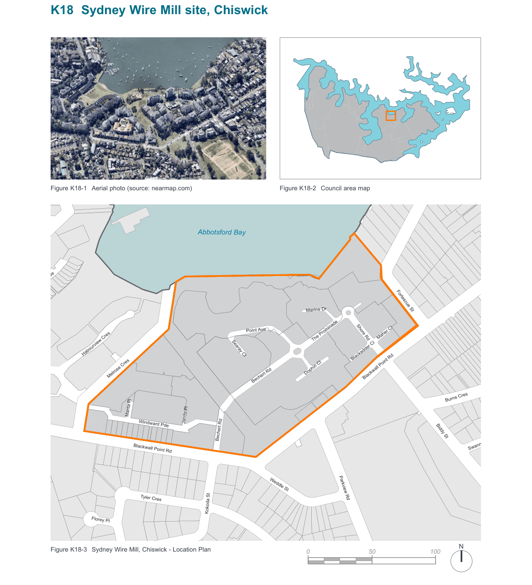
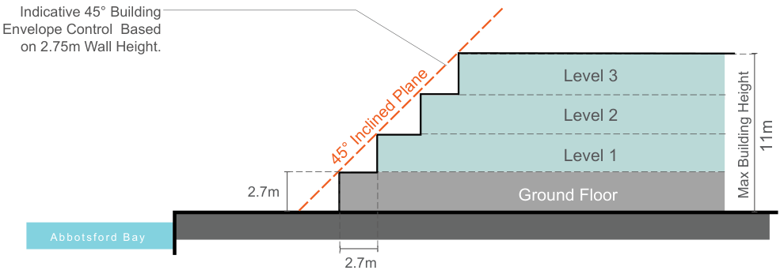
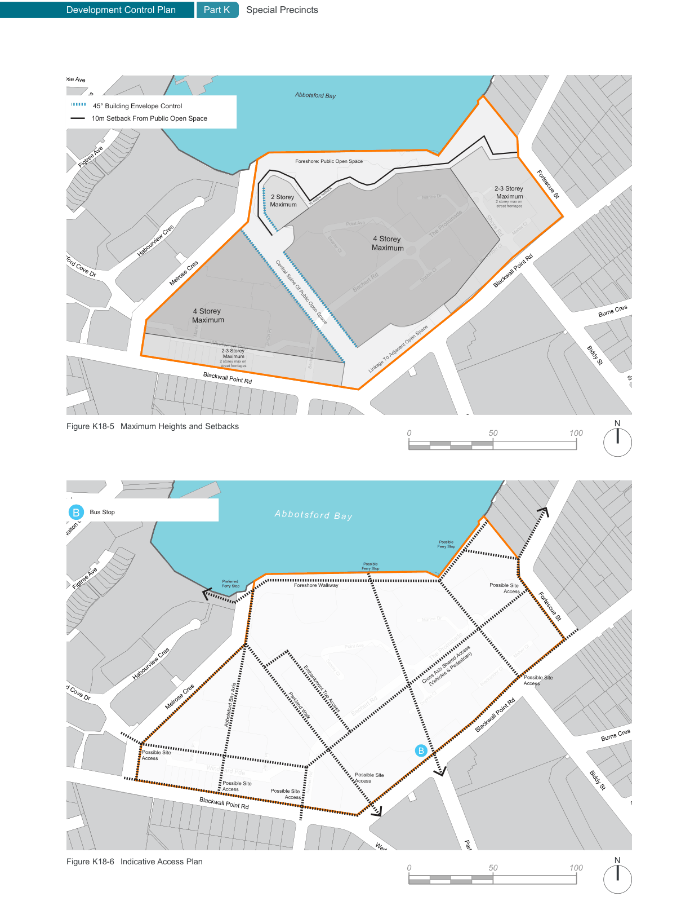

### K18  Sydney Wire Mill site, Chiswick

> [Picture on page 277: a map, saved as a picture (images/part-k-special-precincts-page-277-2.gif, 150 dpi); the street names and other small labels are on the picture.]
> Labels printed on the map (copied from the PDF, in no particular order):
> Figure K18-1 Aerial photo (source: nearmap.com) · Figure K18-2 Council area map · Abbotsford Bay · Figtree Ave · Fortescue St · Marine Dr · Point Ave · Maher Cl · The Prominade · Habourview Cres · Searay Cl · Blackadder Cl · Dophin Cl · Melrose Cres · Blackwall Point Rd · Bechert Rd · Burns Cres · Manta Pl · Janda Pl · Windward Pde · Biddy St · Shore Rd · Bechert Rd · Swannell · Blackwall Point Rd · Weddle St · Parkview Rd · Tyler Cres · Kokoda St · Florey Pl · N · Figure K18-3 Sydney Wire Mill, Chiswick - Location Plan · 0 · 50 · 100

#### K18.1 General objectives

O1. To encourage and facilitate development on the site which, in terms of scale, bulk, form and character, reflects the physical context of the site, is sympathetic to surrounding development, particularly residential development, and does not dominate the landscape; O2. To retain and incorporate, where possible, significant buildings, trees, natural and man made landforms and any other site features identified as having heritage values, to create a sense of place which respects and enhances those values; O3. To minimise the impact of development in terms of overlooking, loss of view and loss of sunlight on adjoining and neighbouring properties; O4. To provide unrestricted public access to the foreshore of Abbotsford Bay, linked to adjoining foreshore access systems and to existing parks; O5. To provide for the active and passive recreational needs of the residents of the development; and O6. To provide a publicly accessible street and pedestrian network as an extension of the existing street network.

#### K18.2 Specific provisions

#### Design Scale and Bulk Objectives

O7. To ensure the scale and bulk of proposed buildings responds in a sympathetic and harmonious manner to the site and its context, including the waterway and the surrounding residential neighbourhood; and O8. To provide a high standard of amenity and environmental quality for future residents.

| Controls |  |
|---|---|
| C1. | A four storey maximum height limit applies to most of the site with a two storey height limit on land located opposite existing residential development. The height of buildings, including any car parking levels, must not exceed the height limits specified for the precincts illustrated in Figure K18-5 Maximum Heights and Setbacks. |
| C2. | Buildings shall not occupy more than 30% of the total site area. |
| C3. | A 4.5m building line applies to that part of the site fronting Blackwall Point Road which faces existing residential development (see Figure K18-5 Maximum Heights and Setbacks). |
| C4. | Buildings adjacent to the central spine of public open space and Melrose Crescent shall be set back from this public open space or road reserve boundary as shown on the building envelope control included as Figure K18-4 Indicative 45° Building Envelope Control based on 2.7m wall height. |
| C5. | Buildings adjacent to the public foreshore open space boundary shall be setback from this public open space as shown on the building envelope control included as Figure K18-5 Maximum Heights and Setbacks. |

#### Open Space Objectives

O9. To provide  public and private open space that meets the needs of residents and the local community having regard for existing land forms, including historic modifications, and visual and functional links with adjoining open space. O10. To produce a low maintenance landscaped outcome and a management plan for its future maintenance requirements.

| Controls |  |
|---|---|
| C15. | In addition to areas zoned RE1 Public Recreation, smaller, more intimate public, community and private landscaped open spaces shall be provided throughout the site, linked by and forming part of the pedestrian and cycle movement system. |
| C16. | Landscaped areas should generally be designed in plan to be dominated by vegetation rather than by masonry elements. Hard paved areas should be kept to a minimum, consistent with meeting standards for parking, disabled access and site drainage. |
| C17. | Private open space for each dwelling at ground level must have: a minimum dimension of 3m; direct access from a living area; a maximum gradient of 1 in 10; and screening where necessary to ensure privacy. |
| C18. | Private open space for each dwelling above ground in the form of a balcony or roof terrace should have: convenient access from the main living area; a minimum area of 10m²; and a minimum dimension of 2m. |

| Controls |  |
|---|---|
| C6. | Buildings elsewhere on the site should be setback progressively as wall heights increase to reduce bulk and overshadowing. |
| C7. | Visually the impact of the development of the site should make a positive contribution to ‘the landscape and special scenic qualities of the Parramatta River’. |
| C8. | A gradation of building heights is desirable (see Figure K18-4 Indicative 45° Building Envelope Control based on 2.7m wall height). |
| C9. | Buildings are to be articulated and are not to present long unrelieved structures that dominate the landscape; |
| C10. | Buildings shall not be located so as to directly abut any public open space and must be setback as shown on Figure K18-4 Indicative 45° Building Envelope Control based on 2.7m wall height and Figure K18-5 Maximum Heights and Setbacks. |
| C11. | Buildings shall have a formal presentation to their street frontages, and where appropriate, to Abbotsford Bay and the waterway generally. |
| C12. | Development shall recognise the contours and natural and man-made landforms of the site and compliment surrounding areas. |
| C13. | Architectural elements, materials and colour schemes should blend with existing landscape forms and colours. |
| C14. | The preferable roof form for the bulk of development on the site should be pitched, providing the opportunity for innovative uses of roof spaces. |

#### Impacts on adjoining and nearby residential

properties

#### Objective

O11. To provide safe, attractive streetscapes which link with and enhance the amenity of neighbouring development.

#### Controls

C19. The street reserves together with the buildings and landscaping defining them should be designed to create an attractive streetscape and establish a clear identity or ‘sense of place’ to the street, place or precinct.

C20. Setbacks of buildings from their street frontage should be appropriate to the desired streetscape character and respond to features of the site in terms of views, vistas and existing natural features, including vegetation.

> [Picture on page 280: a map, saved as a picture (images/part-k-special-precincts-page-280-20.gif, 150 dpi); the street names and other small labels are on the picture.]
> Labels printed on the map (copied from the PDF, in no particular order):
> Indicative 45° Building · Envelope Control  Based · on 2.75m Wall Height. · Level 3 · Level 2 · 11m · Level 1 · 45° Inclined Plane · Max Building Height · 2.7m · Ground Floor · A bbot sf ord B ay

2.7m

Figure K18-4 Indicative 45° Building Envelope Control based on 2.7m wall height

> [Picture on page 281: a map, saved as a picture (images/part-k-special-precincts-page-281-1.gif, 150 dpi); the street names and other small labels are on the picture.]
> Labels printed on the map (copied from the PDF, in no particular order):
> Montrose Ave · Abbotsford Bay · 45° Building Envelope Control · Walton Cres · 10m Setback From Public Open Space · Foreshore: Public Open Space · Figtree Ave · 2-3 Storey · Maximum Fortescue St · Marine Dr · 10 metre setback · 2 storey max on · street frontages · 2 Storey · Maximum · Point Ave · Maher Cl · The Prominade · 4 Storey · Maximum · Searay Cl · Habourview Cres · tsfo · Blackadder Cl · rd Cove D · r · Dophin Cl · Melrose Cres · Blackwall Point Rd · Bechert Rd · Burns Cres · 4 Storey · Maximum Central Spine Of Public Open Space · Manta Pl · Janda Pl · Windward Pde · Biddy St · Shore Rd · 2-3 Storey · Maximum · 2 storey max on · street frontages · Bechert Rd · Linkage To Adjacent Open Space · Swannell · Blackwall Point Rd · N · Figure K18-5 Maximum Heights and Setbacks · 0 · 50 · 100 · Parkview Rd · Montrose Ave · Bus Stop · B · Abbotsford Bay · Walton Cres · Possible · Ferry Stop · Possible · Ferry Stop · Preferred · Ferry Stop · Foreshore Walkway · Possible Site · Figtree Ave · Access · Fortescue St · Marine Dr · Point Ave · Maher Cl · The Prominade · Searay Cl · Habourview Cres · Cross Axis Shared Access · Possible Site · Access · Blackadder Cl · (Vehicles & Pedestrian) · rd Cove D · r · Dophin Cl · Melrose Cres · Embankment Top Access · Bechert Rd · Parkland Walk · Abbotsford Bay Axis · Blackwall Point Rd · Burns Cres · B · Manta Pl · Possible Site · Access · Janda Pl · Windward Pde · Possible Site · Access · Biddy St · Shore Rd · Bechert Rd · Possible Site · Access Possible Site · Access · Swannell · Blackwall Point Rd · Weddle St · N · Figure K18-6 Indicative Access Plan · Parkview Rd
