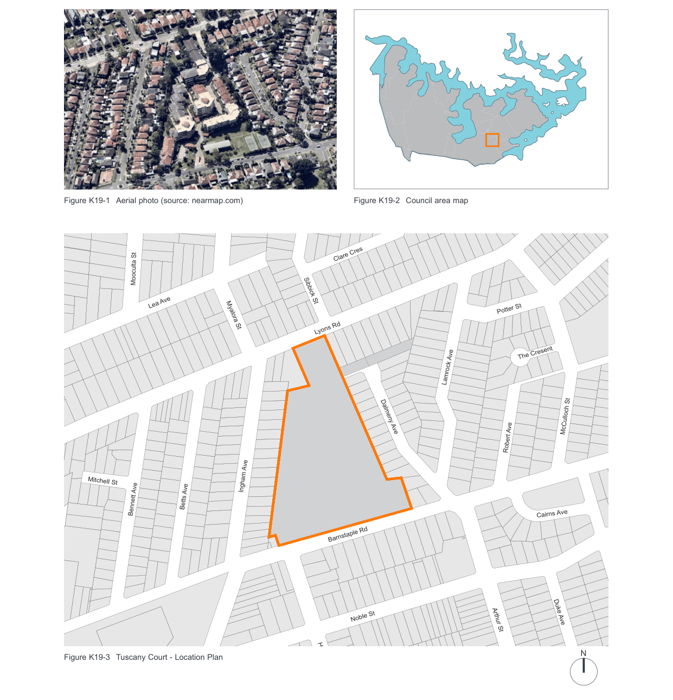
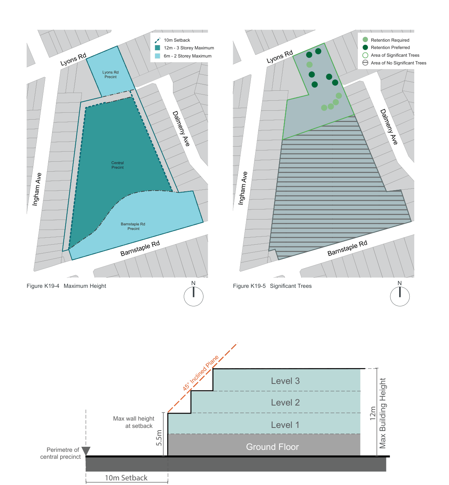
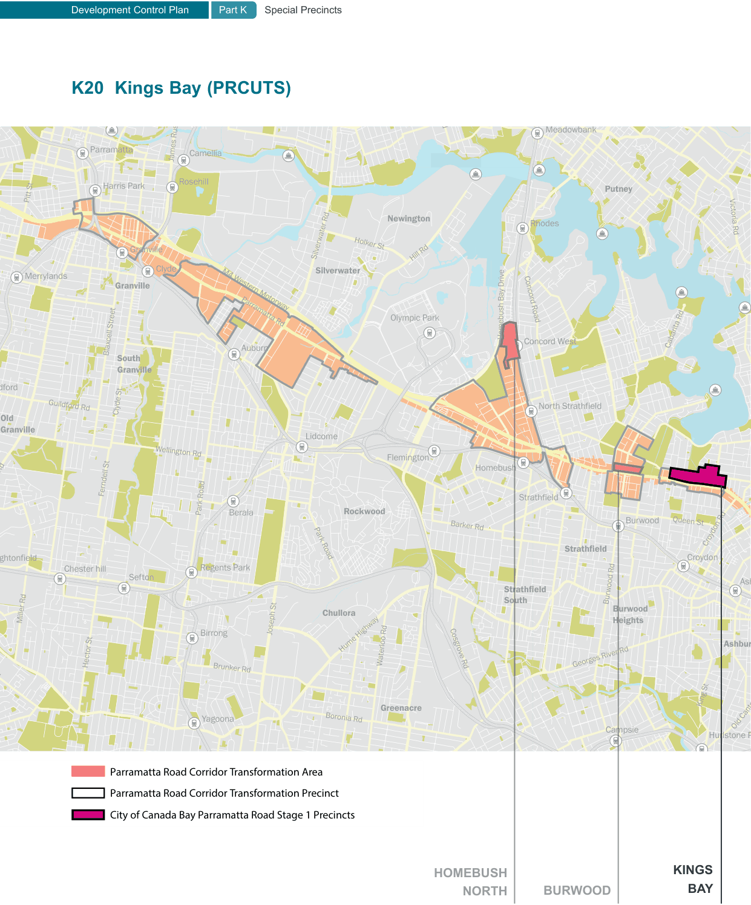

### K19  Tuscany Court

> [Picture on page 282: a map, saved as a picture (images/part-k-special-precincts-page-282-2.gif, 150 dpi); the street names and other small labels are on the picture.]
> Labels printed on the map (copied from the PDF, in no particular order):
> Figure K19-1 Aerial photo (source: nearmap.com) · Figure K19-2 Council area map · Clare Cres · Mooculta St · Sibbick St · Lea Ave · Myalora St · Lyons Rd · Lamrock Ave · Dalmeny Ave · Mitchell St · Ingham Ave · Betts Ave · Bennett Ave · Barnstaple Rd · Noble St · Figure K19-3 Tuscany Court - Location Plan · Heath St · Potter St · The Cresent · Speed Ave · McCulloch St · Robert Ave · Cairns Ave · Duchess Ave · Duke Ave · Arthur St · N

#### K19.1 General objectives

O1 To encourage and facilitate development on the site which, in terms of scale, bulk, form and character reflects the physical context of the site and is sympathetic to surrounding residential development;

O2 To minimise the impact of the development in terms of overlooking and loss of sunlight from adjoining and neighbouring properties;

O3 To provide for the active and passive recreation needs of residents of the development and incorporate recreation facilities such as a swimming pool and tennis courts;

O4 To identify and retain any significant trees on the site; and

O5 To provide for safe access to and from the site.

#### K19.2 Specific provisions

#### Density, Design, Scale and Bulk Objective

O6 To achieve a development outcome which, in terms of its density, design, scale and bulk, responds in a sympathetic and harmonious manner to the site and surrounding residential development.

#### Height Controls

C1. The height of buildings, including any car parking, should comply with the height limits for the three precincts specified in Figure K19-4 Maximum Height.

C2. Buildings should be sited within the building envelope from the eastern and western boundaries of the site as illustrated in Figure K19-6 Indicative 45° Building Envelope Control. This includes a minimum setback of 10m from the eastern and western boundaries with the upper two levels to be setback within a 45° plane to minimise overshadowing and overlooking of adjoining properties.

#### Setbacks

| Controls |  |
|---|---|
| C3. | Buildings located on the eastern and western boundaries of the site and the northern boundary adjoining 355 Lyons Road are to be located no closer than 10 metres at any point, from these boundaries (see Figure K19-4 Maximum Height and Figure K19-6 Indicative 45° Building Envelope Control). |
| C4. | The location of any building near a tree nominated in Figure K19-5 Significant Trees must take account of the drip lines and root systems of the tree. |

#### Design and Form

| Controls |  |
|---|---|
| C5. | Buildings are to be articulated and are not to present long, unrelieved structures that dominate the landscape. |
| C6. | A diversity of accommodation is to be provided, including townhouses and small, medium and large units. |
| C7. | A pitched roof form is preferable for all development on the site as it provides the opportunity for innovative use of roof space. |

#### Site coverage

| Controls |  |
|---|---|
| C8. | Buildings, excluding any community facilities should occupy less than 40% of the site area. |

#### Landscaped and Open Space Objective

O7 To provide for private open space that meets resident requirements for recreational and social activities and for landscaping;

O8 To ensure all significant trees are retained or relocated on the site; and

O9 To assist on-site drainage by the provision of at ground landscaped open space.

#### Controls

C9. To ensure adequate provision of open space the maximum permissible site coverage is 40%.

C10. Landscaped open spaces should be provided to accommodate a range of communal and individual needs. There should be a primary open space area containing a recreation facility such as a pool/spa or similar, and this facility is to be easily accessible to all residents on site. Smaller, more intimate landscaped areas should be provided throughout the site and be accessible via a pathway system.

C11. Landscaping on the eastern and western boundaries is to ensure the privacy of adjoining residential development.

C12. In accordance with Figure K19-5 Significant Trees trees identified as “must be retained” should be retained on the site. Other trees nominated should be retained or relocated on-site where practicable. Buildings in the vicinity of these nominated trees must be setback from the drip line and root systems of these trees.

C13. Landscaped areas should generally be dominated by vegetation and not masonry elements. Hard paved areas should, where possible, be kept to a minimum in order to reduce stormwater runoff, although wheelchair access and remediation requirements must be considered.

#### Access Objective

O10 Adequate provisions should be made for access to and from the site.

#### Vehicular Access

| Controls |  |
|---|---|
| C14. | Access to the site is not to be provided by a ‘gatehouse’ security system which limits public access to the site. |
| C15. | Vehicular access is to be maintained to 347 Lyons Road. |
| C16. | The primary two-way access is to be from Barnstaple Road. |
| C17. | A secondary access is to be provided from Lyons Road with an island on Lyons Road installed to prohibit entry to the site from the west and exit from the site to the east. |

#### Pedestrian Access

| Controls |  |
|---|---|
| C18. | Pedestrian access is to be maintained from Lyons Rd to Dalmeny Ave. |

#### Streetscape Objective

O11 To provide attractive streetscapes which enhance the amenity of neighbouring development.

| Controls |  |
|---|---|
| C19. | The street reserve together with the dwelling fronts and gardens are to create an attractive streetscape and establish a clear character and identity for the street or precinct. |
| C20. | The setback of buildings from the street frontages to be appropriate to the streetscape character. |

> [Picture on page 285: a map, saved as a picture (images/part-k-special-precincts-page-285-1.gif, 150 dpi); the street names and other small labels are on the picture.]
> Labels printed on the map (copied from the PDF, in no particular order):
> 10m Setback · 12m - 3 Storey Maximum · 6m - 2 Storey Maximum · Lyons Rd · Lyons Rd · Precint · Dalmeny Ave · Central · Precint · Ingham Ave · Barnstaple Rd · Precint · Barnstaple Rd · N · Figure K19-4 Maximum Height · Lyons Rd · Ingham Ave · Figure K19-5 Significant Trees · Retention Required · Retention Preferred · Area of Significant Trees · Area of No Significant Trees · Dalmeny Ave · Barnstaple Rd · N

Perimetre of

central precinct

> Words printed on the picture (copied from the PDF):
> 45° Inclined Plane
> Max wall height
> at setback
> 5.5m
> 10m Setback
> 12m
> Max Building Height

Figure K19-6 Indicative 45° Building Envelope Control

#### Level 3 Level 2 Level 1 Ground Floor

Development Control Plan

Part K Special Precincts

#### This page was intentionally left blank

> [Picture on page 287: a map, saved as a picture (images/part-k-special-precincts-page-287-1.gif, 150 dpi); the street names and other small labels are on the picture.]
> Labels printed on the map (copied from the PDF, in no particular order):
> Wharf Rd · Meadowbank · Meadowb · Parramatta · Camellia · James Ruse Dr · Rosehill · Harris Park · Putney · O’Connell St · Pitt St · Newington · Rhodes · Rhodes · Victoria Rd · Holker St · Granville · Silverwater Rd · Hill Rd · Silverwater · Clyde · Merrylands · Granville · M4 Western Motorway · Concord Road · Concord Road · Olympic Park · Olympic Park · Parramatta Rd · e · vir · D · y · a · B · h · s · u · b · e · m · o · H · Concord West · Concor · Cabarita Rd · Auburn · Blaxcell Street · South · Granville · dford · North Strathfield · Guildford Rd · Old · Granville · Lidcome · Wellington Rd · Flemington · Flemington · Homebush · bush · Ferndell St · Clyde St · Strathf · Strathfield · Park Road · Rockwood · Berala · Burwood Queen St · Barker Rd · Croydon Rd · Strathfield · Park Road · Croydon · Regents Park · Sefton · Chester hill · ghtonfield · Ash · ield · Burwood Rd · Strathfie · South · Chullora · Miller Rd · Burwood · Heights · Joseph St · Birrong · Ashbur · Hume Highway · Waterloo Rd · Hector St · Georges River Rd · Cosgrove Rd · Brunker Rd · King St · Greenacre · a · Yagoona · Boronia Rd · Old Canter · Hurlstone P · Campsie · Parramatta Road Corridor Transformation Area · Parramatta Road Corridor Transformation Precinct · City of Canada Bay Parramatta Road Stage 1 Precincts · BAY
