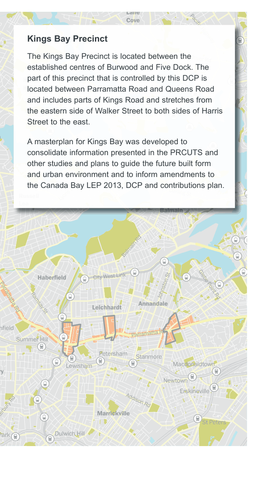

### K20  Kings Bay (PRCUTS)

e Rd

d

#### KINGS

#### HOMEBUSH

#### NORTH BURWOOD

Figure K20-1 PRCUTS Parramatta Road Corridor (Source: PRCUTS, 2016)

> [Picture on page 288: a map, saved as a picture (images/part-k-special-precincts-page-288-1.gif, 150 dpi); the street names and other small labels are on the picture.]
> Labels printed on the map (copied from the PDF, in no particular order):
> Lane · Cove · Pacific Highway · River Rd · Hunters · Hill · Burns Bay Road · Victoria Road · Darling St · Lyons Rd · Russell · Lea · Balmain · Balmain Rd · City West Link · Haberfield · Johnston St Glebe Point Rd · Leichhardt · Annandale · Parramatta Rd Ramsay St · hfield · Parramatta Rd · Summer Hill · Petersham · Stanmore · Macdonaldtown · Lewisham · ry · Newtown · Erskineville · Addison Rd · Marrickville · anterbury Rd · St Peters · Dulwich Hill · Park

#### Kings Bay Precinct

The Kings Bay Precinct is located between the established centres of Burwood and Five Dock. The part of this precinct that is controlled by this DCP is located between Parramatta Road and Queens Road and includes parts of Kings Road and stretches from the eastern side of Walker Street to both sides of Harris Street to the east.

A masterplan for Kings Bay was developed to consolidate information presented in the PRCUTS and other studies and plans to guide the future built form and urban environment and to inform amendments to the Canada Bay LEP 2013, DCP and contributions plan.

#### K20.1 Parramatta Road Corridor Urban Transformation Strategy (PRCUTS)

This DCP has been prepared to support the implementation of the NSW Government Parramatta Road Corridor Urban Transformation Strategy (PRCUTS) published in November 2016.

The DCP has been prepared to deliver the desired future character envisaged in PRCUTS, with refinements to achieve better urban design and community outcomes.

Two development pathways are available:

1\) Land is developed to the standards identified on the Floor Space Ratio and Height of Building maps.

2\) Where development achieves the minimum lot size and/or identified community infrastructure is delivered, the land may be developed to the standards identified on the Community Infrastructure Floor Space Ratio and Height of Building Maps. The provisions in this DCP describe the planning controls permitted under Option 2.

PRCUTS aims to renew Parramatta Road and adjacent communities through investments in homes, jobs, transport, open spaces and public amenity. It presents significant urban renewal opportunities for land within defined development precincts.
