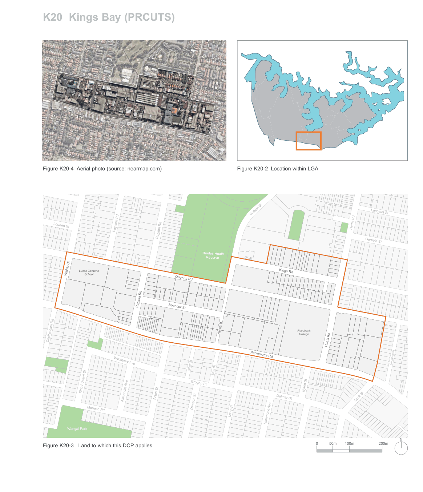

### K20  Kings Bay (PRCUTS)

> [Picture on page 289: a map, saved as a picture (images/part-k-special-precincts-page-289-2.gif, 150 dpi); the street names and other small labels are on the picture.]
> Labels printed on the map (copied from the PDF, in no particular order):
> Parramatta River · St Lukes Park · Figure K20-2 Location within LGA · Figure K20-4 Aerial photo (source: nearmap.com) · Henry St · Barnwell Park · Golf Course · Lancelot St · William St · Louden St · Bayview Rd · Regatta Rd · Garfield St · Charles Heath · Reserve · Lucas Gardens · Kings Rd · Walker St School · Queens Rd · Regatta Rd · Spencer St · Rosebank · William St · College · Cheltenham Rd · Harris Rd · Harris Rd · Parramatta Rd · Courland St · Wychbury Ave · Alfred St · Short St · Byron St · King Edward St · Acton St · Dalmar St · Grogan St · Alexandra Ave · Scott St · Dawson St · Monash Pd · Lang St · Hammond Ave · Wangal Park · N · 200m · 100m · 50m · 0 · Figure K20-3 Land to which this DCP applies

oncord Oval

#### K20.2 Existing Character

The Kings Bay Precinct currently consists of a mix of smaller fine grain lots and larger landholdings occupied by light industrial service industries such as small manufacturers, car sales and servicing centres, panel beaters, upholsterers, and other urban support services. Wholesalers occupy large format, low density warehouse spaces.

Key community infrastructures include Rosebank College, Lucas Gardens School, Five Dock Leisure Centre and a childcare centre. Medium density residential development is located on Kings Road. Public open space is limited and the street network is characterised by small front setbacks, narrow or no footpaths and few street trees.

#### Strengths and opportunities

• large land holdings, generally unfragmented land and limited strata titled properties;

• a grid-like pattern of streets;

• potential reduction in traffic volumes with the opening of WestConnex;

• proximity to high amenity open space, recreation facilities and the Parramatta River foreshore;

• potential to enhance existing recreational opportunities and linkages for active transport and extend the existing green corridor from Hen and Chicken Bay to Parramatta Road:

• potential to facilitate the relocation of the Concord Community Centre and/or Concord Library, if the circumstances are appropriate; and

• access to future metro West rail stations and Burwood North (Concord) and Five Dock.

#### Challenges and constraints

• existing high traffic volumes on surrounding streets;

• limited north-south connections across Parramatta Road, particularly for pedestrians and cyclists;

• a current lack of reliable public transport;

• heritage items and sensitive uses which require appropriate setbacks and transitions; and

• limited, poor quality public domain.

#### K20.3 Desired Future Character

"Kings Bay will be a new residential and mixed use urban village on Parramatta Road, with an active main street and strong links to the open space network along Sydney Harbour."

As industry moves west, the precinct’s traditional industrial area is changing and transforming into more light industrial and urban support services that can capitalise on the rapid transit connections to Sydney CBD, Burwood Town Centre and many large areas of open space.

Spencer Street will form the main street of local shops and services. A new fine grain will be introduced along Spencer Street to reinforce the local nature of the centre, and provide a pedestrian focus with high amenity and low traffic. A new north-south park and pedestrian link will connect Spencer Street to Queens Road and the recreational facilities and foreshore just north of the precinct.

Kings Bay offers the opportunity to be a new address for medium and high density residential development. Taller residential buildings will mark the centre of the precinct at the corner of Parramatta Road, William Street and Spencer Street. Buildings will transition in height and density towards adjacent residential areas, Rosebank College and Lucas Garden School.

A new green link along William Street will connect to open space and the foreshore. The new regional cycleway will link Concord Road, Gipps Street, Patterson Street and Queens Road and will connect to the M4 Motorway in the west and Iron Cove and the Bay Run in the east. Parramatta Road will have significant tree planting and wider public domain to improve the amenity and environment.
