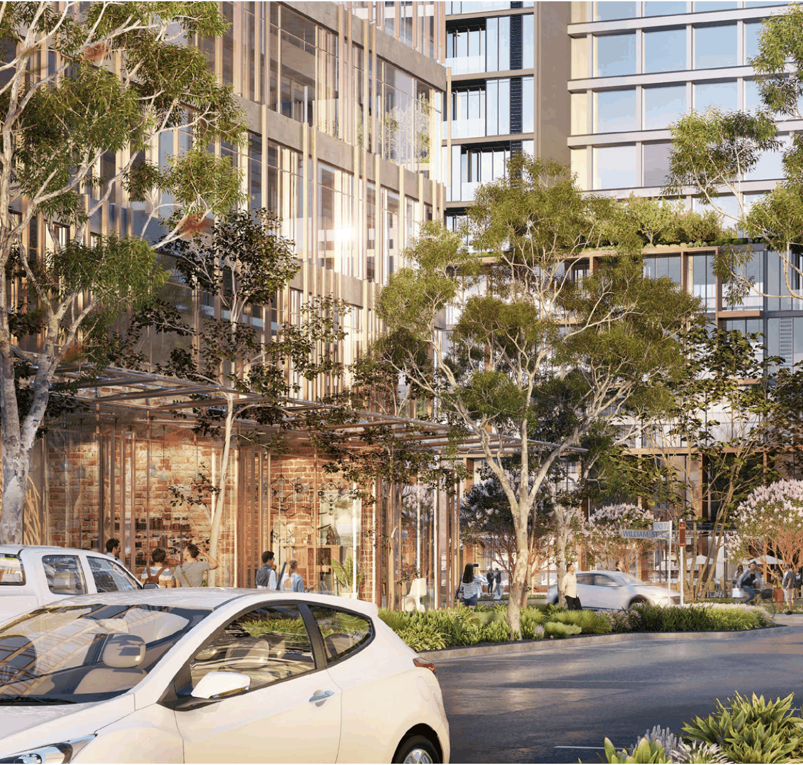
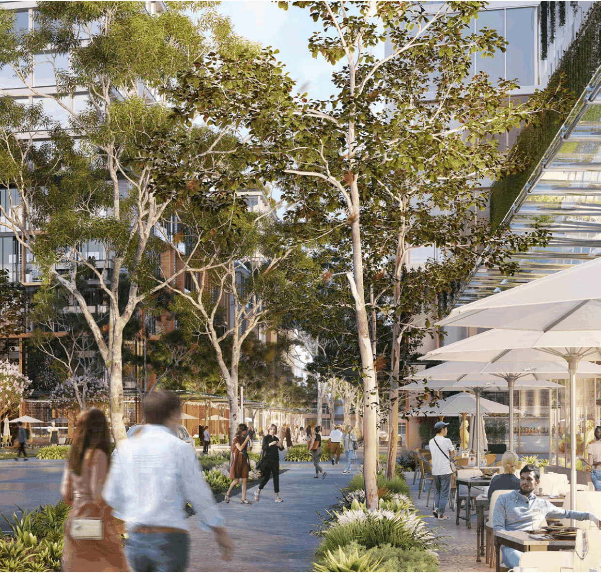

### K20  Kings Bay (PRCUTS)

> [Picture on page 291: a picture, saved as a picture (images/part-k-special-precincts-page-291-2.gif, 150 dpi).]

Figure K20-5 Artist impression of indicative future character along Spencer Street, Kings Bay

Development Control Plan

Part K Special Precincts

> [Picture on page 292: a picture, saved as a picture (images/part-k-special-precincts-page-292-3.gif, 150 dpi).]
