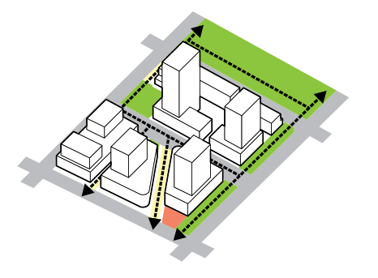
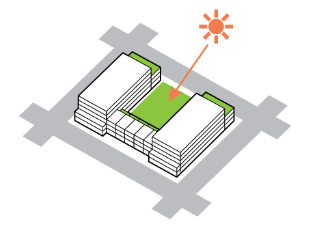
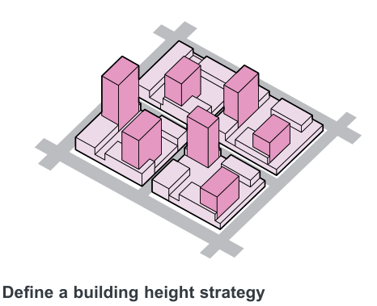
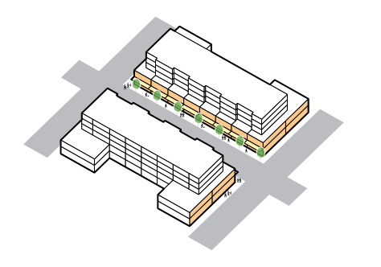
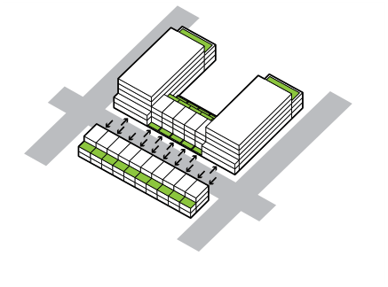
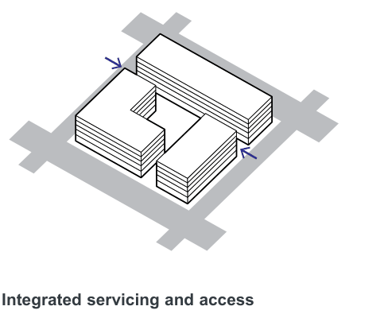
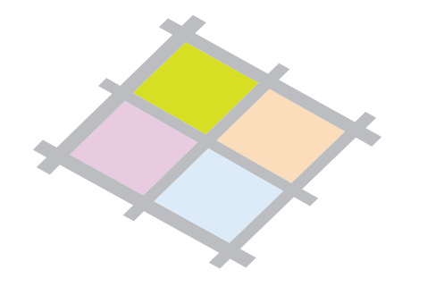
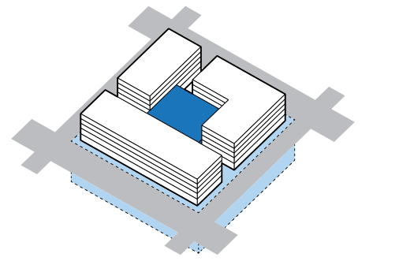

### K20  Kings Bay (PRCUTS)

#### K20.4 Urban Design Principles

> [Picture on page 293: a picture, saved as a picture (images/part-k-special-precincts-page-293-3.gif, 150 dpi).]

#### Create an active and permeable public realm

Expand open space network and provide easy access and connection throughout the public realm.

Promote active transport such as walking and cycling.

> [Picture on page 293: a picture, saved as a picture (images/part-k-special-precincts-page-293-8.gif, 150 dpi).]

#### Maximise solar access and amenity

Ensure all public open spaces have adequate solar access.

Putting heights towards the southern boundaries to ensure solar access penetrates the site and minimise overshadowing.

> [Picture on page 293: a picture, saved as a picture (images/part-k-special-precincts-page-293-15.gif, 150 dpi).]

#### Define a building height strategy

Create a dynamic skyline by spreading higher built form.

> [Picture on page 293: a picture, saved as a picture (images/part-k-special-precincts-page-293-19.gif, 150 dpi).]

#### Promote fine grain and active frontages

Reinvent Spencer Street and its eastern extension as a Place for People that responds to the vision set out in PRCUTS;

‘streets with high demand for activities and lower levels of vehicle movement. They create places people enjoy, attract visitors, and are places communities value’.

> [Picture on page 294: a picture, saved as a picture (images/part-k-special-precincts-page-294-1.gif, 150 dpi).]

#### Interactive frontages

Promote direct ground floor access from the street in residential areas to enhance passive surveillance.

> [Picture on page 294: a picture, saved as a picture (images/part-k-special-precincts-page-294-5.gif, 150 dpi).]

#### Integrated servicing and access

Avoid putting service access on traffic-heavy and pedestrian-oriented streets.

Minimise the impact on public domain by integrating services within the building.

> [Picture on page 294: a picture, saved as a picture (images/part-k-special-precincts-page-294-11.gif, 150 dpi).]

Create character precincts celebrate the

industrial character of Kings Bay Utilise the current industrial context and history of each block as a driver for place making, facade expression and block character.

> [Picture on page 294: a picture, saved as a picture (images/part-k-special-precincts-page-294-17.gif, 150 dpi).]

#### Minimise the impacts of parking

Parking should be put underground as a priority. Where an underground option is not possible, parking should be sleeved with active uses or considerable facade treatment to avoid exposing the structure directly to the street.
