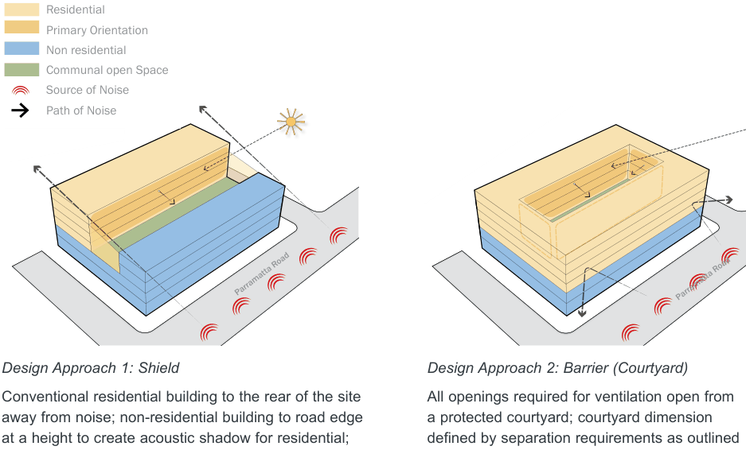
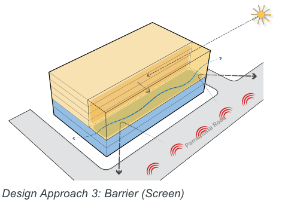
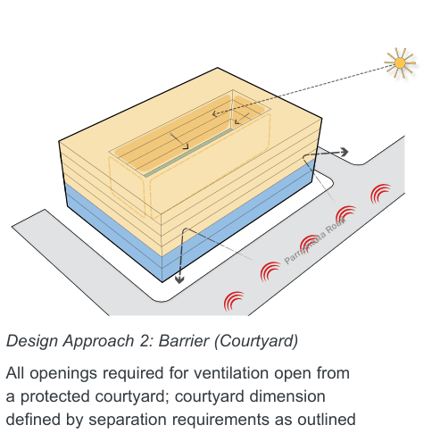
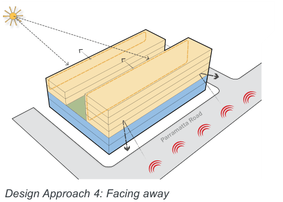
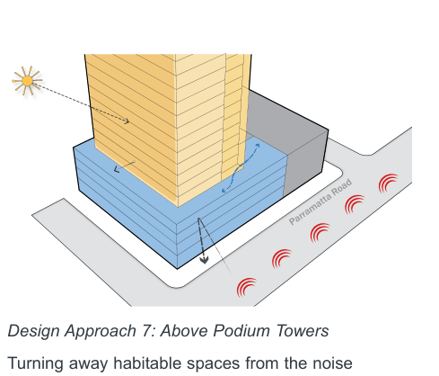
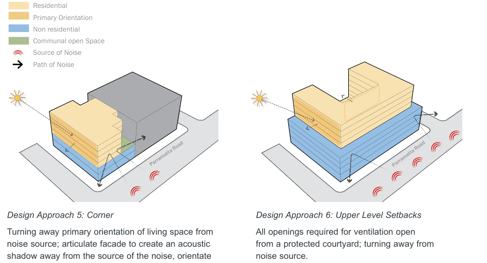

### K20  Kings Bay (PRCUTS)

#### K20.5 Design Approach

Residential

Primary Orientation

Non residential

Residential

Communal open Space

> [Picture on page 295: a picture, saved as a picture (images/part-k-special-precincts-page-295-8.gif, 150 dpi).]
> Words printed on the picture (copied from the PDF):
> Primary Orientation
> Source of Noise
> Non residential
> Path of Noise
> Communal open Space
> Source of Noise
> Path of Noise
> Parramatta Road

Design Approach 1: Shield

Conventional residential building to the rear of the site away from noise; non-residential building to road edge at a height to create acoustic shadow for residential; fixed solid glazed element encloses courtyard.

> [Picture on page 295: a picture, saved as a picture (images/part-k-special-precincts-page-295-14.gif, 150 dpi).]
> Words printed on the picture (copied from the PDF):
> Parramatta Road

Design Approach 3: Barrier (Screen) A fixed solid glazed edge to provide a protected courtyard space for ventilation; the glazed courtyard is open to the sky to allow for natural ventilation.

Residential

Primary Orientation

Non residential

> [Picture on page 295: a picture, saved as a picture (images/part-k-special-precincts-page-295-22.gif, 150 dpi).]
> Words printed on the picture (copied from the PDF):
> Communal open Space
> Source of Noise
> Path of Noise
> Parramatta Road

Design Approach 2: Barrier (Courtyard) All openings required for ventilation open from a protected courtyard; courtyard dimension defined by separation requirements as outlined in the Apartment Design Guide.

> [Picture on page 295: a picture, saved as a picture (images/part-k-special-precincts-page-295-28.gif, 150 dpi).]
> Words printed on the picture (copied from the PDF):
> Parramatta Road

Design Approach 4: Facing away

Habitable rooms to be orientated away from the source of noise; locate secondary uses such as cores and walkways facing the source of noise.

Figure K20-6 Design approaches to minimise noise and air quality impacts (Source: PRCUTS Guidelines 2016)

Residential

Primary Orientation

Non residential

Communal open Space

Design Approach 5: Corner

Turning away primary orientation of living space from noise source; articulate facade to create an acoustic shadow away from the source of the noise, orientate openings within the acoustic shadow.

> [Picture on page 296: a picture, saved as a picture (images/part-k-special-precincts-page-296-10.gif, 150 dpi).]
> Words printed on the picture (copied from the PDF):
> Parramatta Road

Design Approach 7: Above Podium Towers Turning away habitable spaces from the noise source; utilised fixed solid glazed edge to provide an enclosed space for ventilation.

Residential

Primary Orientation

> [Picture on page 296: a picture, saved as a picture (images/part-k-special-precincts-page-296-17.gif, 150 dpi).]
> Words printed on the picture (copied from the PDF):
> Source of Noise
> Path of Noise
> Parramatta Road
> Non residential
> Communal open Space
> Source of Noise
> Path of Noise
> Parramatta Road

Design Approach 6: Upper Level Setbacks All openings required for ventilation open from a protected courtyard; turning away from noise source.
