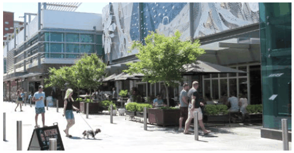
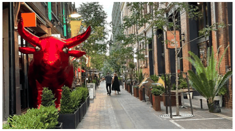
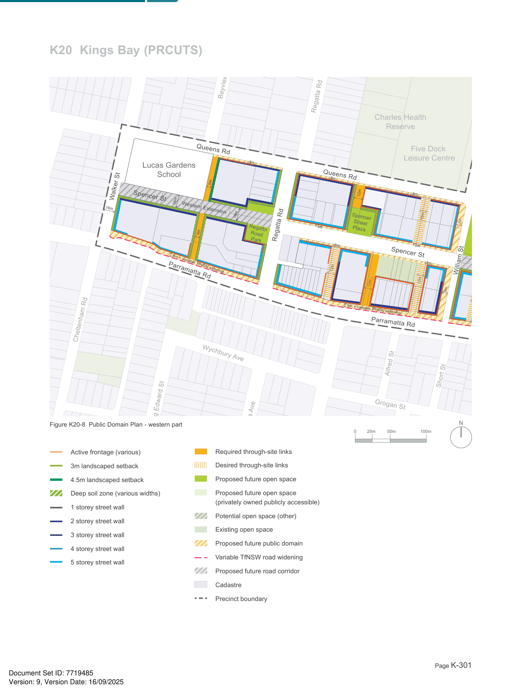

### K20  Kings Bay (PRCUTS)

#### K20.7 Access Network

A permeable urban structure is key to successful places. The provision of new links and open spaces is encouraged to build upon the existing access network and support the uptake of active and public transport and linking key destinations within and beyond the precinct.

#### Objectives

O1 To provide a finer grain access network to more effectively link the precinct to Parramatta Road, open spaces and public transport stops.

O2 To encourage travel behaviour change by discouraging car usage and supporting sustainable travel choices such as public and active transport.

O3 To improve network permeability, in particular for pedestrians, by breaking up long blocks with new streets and quality pedestrian prioritised links.

O4 To meet access requirements for future development and enable increased density in selected locations.

> [Picture on page 299: a picture, saved as a picture (images/part-k-special-precincts-page-299-23.gif, 150 dpi).]

A more permeable urban structure and a focus on a high quality pedestrian environment will support walking and cycling.

> [Picture on page 299: a picture, saved as a picture (images/part-k-special-precincts-page-299-26.gif, 150 dpi).]

Slow speed, shared spaces provide links that encourage pedestrian access across the precinct.

#### Controls

C1. The existing access network is retained and new streets, through-site links and cycle routes are provided as identified in Figure K20-8 and Figure K20-9.

C2. New public open spaces are located as identified in Figure K20-8 and Figure K20-9. See Section K20.8 Public Domain Experience for more detail.

C3. Wherever possible, long blocks are broken up with new high quality pedestrian prioritised links, particularly where new connections would facilitate access to public transport, open spaces and community facilities.

C4. Size and location of footpaths, laneways, cycleways, planting and parks are to be provided according to Council’s PRCUTS Public Domain Plan and PRCUTS Masterplan.

C5. New roads, public domain widenings, parks and cycleways are required to be in public ownership where identified in the LEP. New roads and parks that are identified in the LEP to be publicly accessible but not in public ownership, may be delivered as a public access easement over private land. Future pedestrian links may be delivered as a public access easement over private

land. Provision is to be in accordance with the LEP, PRCUTS Infrastructure Strategy and Council’s specifications.

C6. Future pedestrian/ cycle links are to be naturally lit and ventilated, appropriately lit after hours, publicly accessible 24/7, and have clear sightlines from end to end.

C7. All new pedestrian/ cycle links are to be defined by built form and quality edge treatments such as low semi-transparent fences and landscaping.

C8. Bicycle facilities, such as parking, secure storage and end-of-trip facilities are to be easily accessible from the public domain and conveniently located near entrances and/or lifts of new development.

#### K20.8 Public Domain Experience

Private development has a large influence on the local character and the support of the existing or future functioning of the public realm, for example by clearly addressing a new pedestrian link and providing good levels of surveillance. The scale of built form, its appearance and the design of private-public interfaces has a significant impact on how people experience a streetscape and the safety of the neighbourhood.

Key elements apart from the built form that need to be considered include front setbacks, boundary treatments, vegetation and landscape design, vehicular access, visible activity at street level, and surveillance provided by doors, windows and balconies.

#### Objectives

O1 To protect and improve the quality, accessibility and safety of the public domain across the precinct.

O2 To support walking and cycling to key destinations such as the Five Dock Leisure Centre and local schools.

O3 To improve the interface to Parramatta Road and support increased activity levels, safety and comfort.

O4 To increase tree canopy cover and provide for more greenery associated with the public domain.

#### Controls

C1. New development that fronts onto streets identified as active frontages, including vibrant, friendly and mixed facades (see Figure K20-10) must:

a) minimise the number and width of vehicular driveways across the footpath;

b) ensure building entries are clearly visible and pedestrian access to entries and lobbies is direct;

c) pay particular attention to the 'human-scale' of lower levels and display a high degree of detailed design and articulation;

d) maximise the number of doors and windows on upper levels overlooking the street; and

e) provide vehicular access off a rear laneway; driveways off Parramatta Road are strictly prohibited.

C2. New development that fronts onto Parramatta Road is to:

a) set back as per Figure K20-8 and

#### Figure K20-9.

b) apply coordinated urban and landscape design features that unify the linear green edge; and

c) prioritise urban services uses.

C3. Development is to support the experience and safety of future public open spaces as identified in Figure K20-8 and Figure K20-9. Development that faces open space must:

a) maximise the number of doors and windows overlooking the open space;

b) pay particular attention to quality architectural detail at the lower levels;

c) ensure that at least 50% of each open space receives a minimum of 3h direct solar access in mid-winter (21 June) between 9am and 3pm; and

d) where an active frontage is required by the LEP, encourage active uses on the ground floor with a preference for community facilities and cafes/ restaurants with outdoor seating. The minimum floor to floor height of the first two levels is to be as per the 'Adaptable' category in Section K20.6 Block Configuration.

C4. Development fronting Queens Road is to maximise entry doors and windows overlooking the street, minimise vehicular entry points and pay particular attention to quality landscape and architectural detail along lower levels. For more controls see Section K20.11 Transitions and Interfaces.

C5. Any development on a corner site including corners of the new open spaces must pay particular attention to overall design quality due to the location's high visibility and impact on the local character, i.e. well proportioned facades and quality material, finishes and plant species selection.

Barnwell Pa

Golf Club

> [Picture on page 301: a map, saved as a picture (images/part-k-special-precincts-page-301-3.gif, 150 dpi); the street names and other small labels are on the picture.]
> Labels printed on the map (copied from the PDF, in no particular order):
> ntra Park · O.H. Watts · Reserve · Regatta Rd · Charles Health · Reserve · Five Dock · Leisure Centre · Lucas Gardens · School · 3m · 12m · 3m · 3m · Walker St · 18m · 16m · Queens Rd · Queens Rd · Quee · Spencer St · Western Extension · 18m · 12m · Spencer · Street · Plaza · Regatta · 6m · 6m · Regatta Rd · William · Street · Park · Road · Park · 3m · 3m · 3m · Spencer St · 3m · 12m · 6m + variable TfNSW widening · William St · Parramatta Rd · 12m · 12m · 8m · 8m · 6m + variable TfNSW widening · Parramatta Rd · Active frontage (various) · Cheltenham Rd · 3m landscaped setback · 4.5m landscaped setback · Wychbury Ave · Deep soil zone (various widths) · Alfred St · 1 storey street wall · Short St · 2 storey street wall · Grogan St · 3 storey street wall · King Edward St · Bayview Rd · 4 storey street wall · Figure K20-8 Public Domain Plan - western part · N · 100m · 50m · 25m · 0 · 5 storey street wall · Alexandra Ave · Required through-site links · Active frontage (various) · Acton St · Desired through-site links · 3m landscaped setback · Proposed future open space · 4.5m landscaped setback · Deep soil zone (various widths) · Proposed future open space · (privately owned publicly accessible) · 1 storey street wall · Potential open space (other) · Wangal · 2 storey street wall · Park Existing open space · 3 storey street wall · Proposed future public domain · 4 storey street wall · Variable TfNSW road widening · 5 storey street wall · Proposed future road corridor · Cadastre · Precinct boundary
