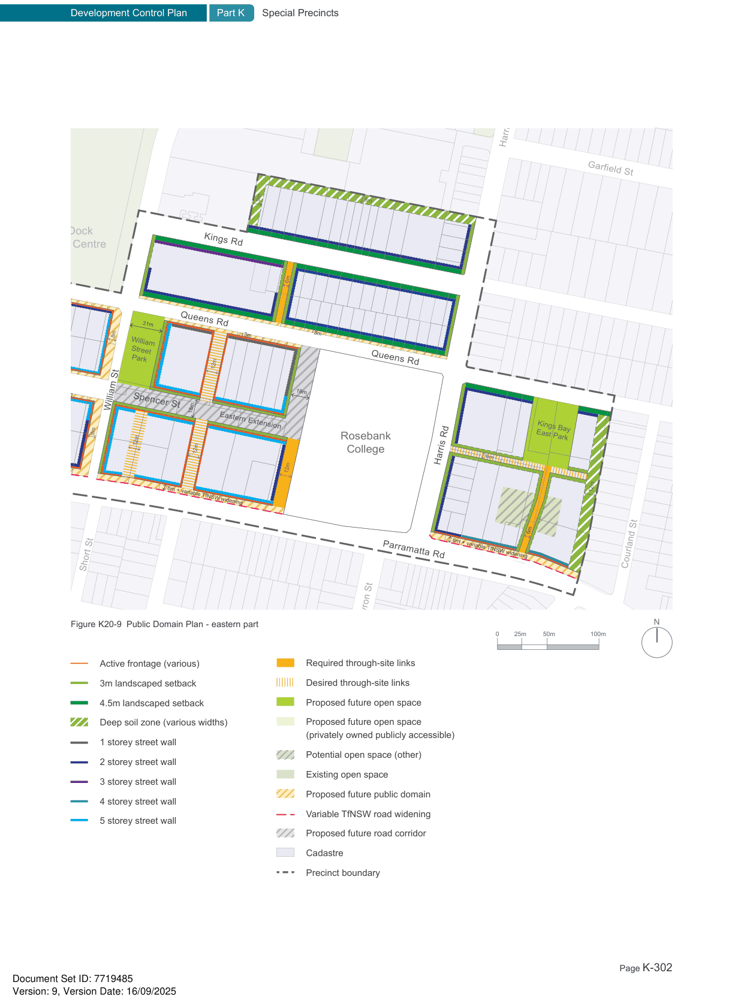

### K20  Kings Bay (PRCUTS)

Barnwell Park

Golf Club

Henry St

> [Picture on page 302: a map, saved as a picture (images/part-k-special-precincts-page-302-4.gif, 150 dpi); the street names and other small labels are on the picture.]
> Labels printed on the map (copied from the PDF, in no particular order):
> O.H. Watts · Reserve · Lancelot St · Garfield St · harles Health · 9m · 8m · Reserve · Kings Rd · Five Dock · Leisure Centre · 6m · 31m · 3m · 3m · William · Street · Park · Queens Rd · Queens Rd · 12m · 18m · 3m · William St · 18m · Spencer St · Eastern Extension · 8m · 8m · Kings Bay · East Park · Rosebank · 12m · 12m · College · 6m · Harris Rd · Harris Rd · 12m · Active frontage (various) · 12m · 6m + variable TfNSW widening · 3m landscaped setback · 4.5m landscaped setback · 6m · Deep soil zone (various widths) · 6m + variable TfNSW widening · Parramatta Rd · Courland St · 1 storey street wall · Short St · 2 storey street wall · 3 storey street wall · Byron St · 4 storey street wall · Figure K20-9 Public Domain Plan - eastern part · N · 100m · 50m · 25m · 0 · 5 storey street wall · Required through-site links · Active frontage (various) · Desired through-site links · 3m landscaped setback · Proposed future open space · 4.5m landscaped setback · Deep soil zone (various widths) · Proposed future open space · (privately owned publicly accessible) · 1 storey street wall · Potential open space (other) · 2 storey street wall · Existing open space · 3 storey street wall · Proposed future public domain · 4 storey street wall · Variable TfNSW road widening · 5 storey street wall · Proposed future road corridor · Cadastre · Precinct boundary
