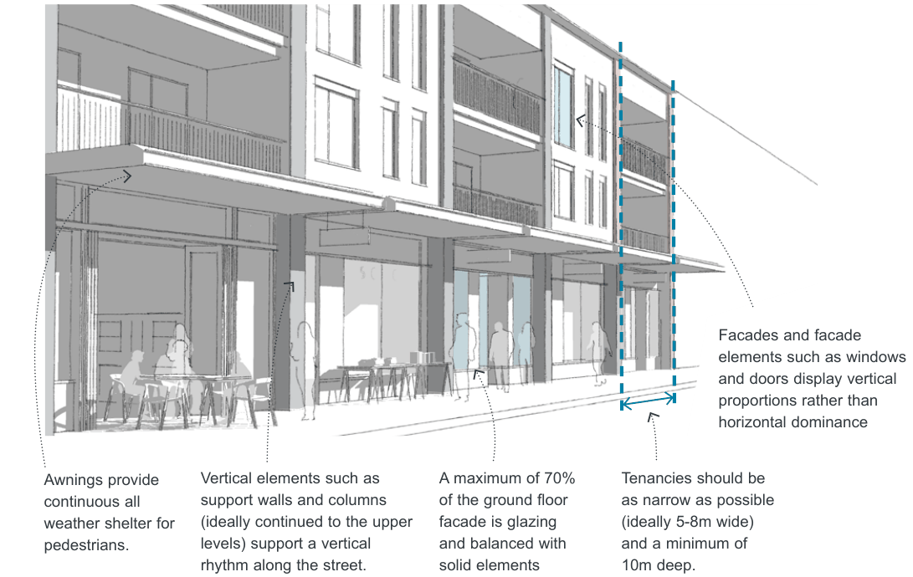
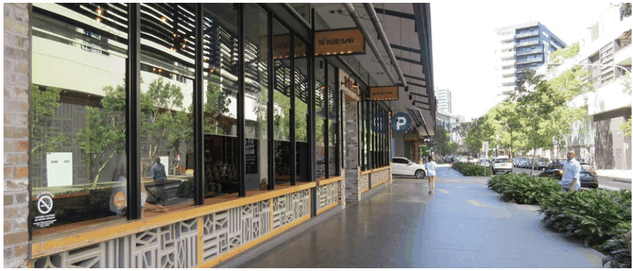
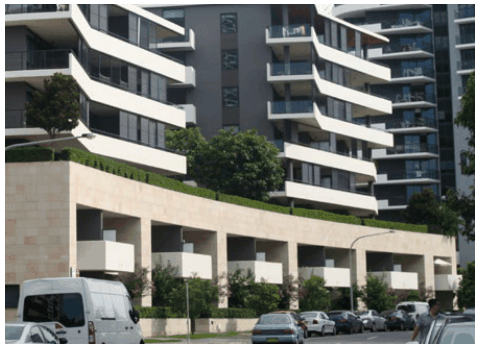
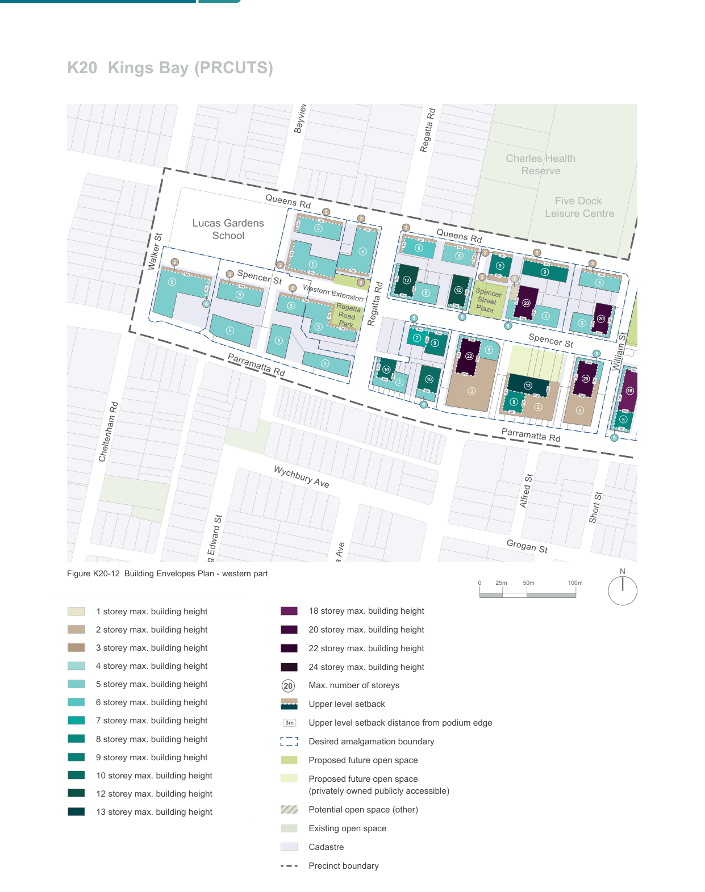

### K20  Kings Bay (PRCUTS)

> [Picture on page 305: a picture, saved as a picture (images/part-k-special-precincts-page-305-2.gif, 150 dpi).]
> Words printed on the picture (copied from the PDF):
> Facades and facade
> proportions rather than
> horizontal dominance

Awnings provide

continuous all

weather shelter for

pedestrians.

Vertical elements such as support walls and columns (ideally continued to the upper levels) support a vertical rhythm along the street.

Figure K20-11 Active Frontage Design Guidance

A maximum of 70% of the ground floor facade is glazing and balanced with solid elements

elements such as windows and doors display vertical

Tenancies should be

as narrow as possible

(ideally 5-8m wide)

and a minimum of

10m deep.

> [Picture on page 305: a picture, saved as a picture (images/part-k-special-precincts-page-305-25.gif, 150 dpi).]

Stall risers, richness of material choices and operable glazing contribute to high quality street interfaces

#### K20.10 Street Wall Heights and Setbacks

Street setback areas are an integral part of the streetscape and their treatment is fundamental to the amenity and character of a place. Combined with building height and road reserve width, they define the proportion, scale and visual enclosure of the street. Street setbacks not only establish the alignment of buildings along the street, they also provide for landscaping and deep soil areas, building entries and a transition between public and private space.

Street wall heights and upper level setbacks further define the proportion, scale and visual enclosure of the public domain and provide a level of consistency across the precinct. Upper level setbacks lessen the visual impact of taller development and help create a more unified, human-scale streetscape environment.

#### Objectives

O1 To ensure setbacks contribute positively to the pedestrian environment at street level.

O2 To provide a sense of enclosure to the street and contribute to a consistent built form scale across the precinct over time.

O3 To enhance development and its relationship with adjoining sites and the public domain, particularly in regard to access to sunlight, outlook, view sharing, ventilation and privacy.

> [Picture on page 306: a picture, saved as a picture (images/part-k-special-precincts-page-306-27.gif, 150 dpi).]

A lower street wall height helps to integrate taller development with lower residential scales

#### Controls

| C1. | All development is to comply with the setbacks shown on Figure K20-8 and Figure K20-9. |
|---|---|
| C2. | Where applicable, a portion of the setback area is to provide deep soil zones and tree planting. Refer to Section K20.18 Landscape Design for more detailed controls. |
| C3. | ‘Undesirable’ elements such as vents, electrical substations, or plant and equipment spaces are not permissible within the setback area and should be accommodated within the building. Service cabinets are to be co-located internally, accessible from loading, waste or parking areas where possible to avoid impact on the public realm. |
| C4. | Upper level setbacks are required towards all public domain interfaces and have been identified on Figure K20-12 and FFigure K20-13. |

C5. The following street wall heights apply:

| Location | Maximum street wall height |
|---|---|
| Parramatta Road | 2, 4 & 5 storeys |
| Queens Road | 1 & 2 storeys |
| Kings Road | 2 & 3 storeys |
| Laneways and through-site links | nil |

Refer Figure K20-8 and Figure K20-9.

Barnwell Pa

Golf Club

> [Picture on page 307: a map, saved as a picture (images/part-k-special-precincts-page-307-3.gif, 150 dpi); the street names and other small labels are on the picture.]
> Labels printed on the map (copied from the PDF, in no particular order):
> O.H. Watts · Reserve · Regatta Rd · Charles Health · Reserve · Five Dock · Leisure Centre · 2 · 2 · Lucas Gardens · 2 · 5 · 3m · 3m · School · 3m · 6 · 5 · 2 · 2 · 3m · 3m · 5 · 2 · 2 · 5 · 2 · Walker St · 3m · 3m · 9 · 9 · 3m · 3m · 3m · 3m · 3m · 2 · 6m · 2 · 3m · 1 · 5 · 2 · 5 · 12 · 3m · 3m · Queens Rd · Queens Rd · 3m · 2 · 12 3m · 3m · 5 · 5 · Spencer · 3m · 7.5m 20 · 4 · 5 · Street · Plaza · Regatta · 26m · 3m · 5 · 5 · 5 · 20 3m · 21m · Regatta Rd · William · Street · Park · 5 · Road · Park · 5 · 5 · 3m · 5 · 3m · 3m · 3m · 3m · 3m · 3m · 3m · 19m · 5 · 7 · 9 · Spencer St · 5 · 5 · 3m 22 18m · 3m · 5 3m · William St 3m · 10 · Spencer St · Spencer St · Western Extension · 35m · Parramatta Rd · 3m · 24m · 14m · 10 · 5m · 5 · 13 · 20 · 10m · 9m · 9m · 3m · 18 · 2 · 30m 3m · 8 32m · 5 · 18m · 23m · 2 · 2 · 3m · 8 · 3m · 5 · Parramatta Rd · Cheltenham Rd · Wychbury Ave · Alfred St · Short St · Grogan St · King Edward St · Bayview Rd · N · Figure K20-12 Building Envelopes Plan - western part · 100m · 50m · 25m · 0 · Alexandra Ave · 18 storey max. building height · 1 storey max. building height · Acton St · 2 storey max. building height · 20 storey max. building height · 3 storey max. building height · 22 storey max. building height · 4 storey max. building height · 24 storey max. building height · 5 storey max. building height · Max. number of storeys · 20 · Wangal · 6 storey max. building height · Upper level setback · Park · 7 storey max. building height · 3m Upper level setback distance from podium edge · 8 storey max. building height · Desired amalgamation boundary · 9 storey max. building height · Proposed future open space · 10 storey max. building height · Proposed future open space · (privately owned publicly accessible) · 12 storey max. building height · Potential open space (other) · 13 storey max. building height · Existing open space · 18 storey max. building height · Cadastre · 20 storey max. building height · Precinct boundary · 22 storey max. building height · 24 storey max. building height · Max. number of storeys

ntra Park
