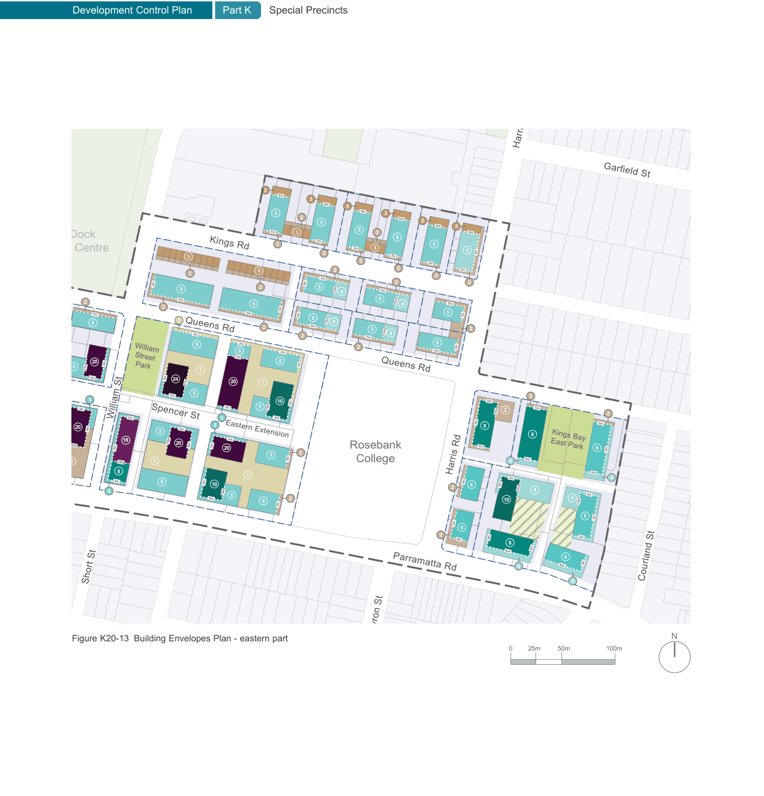

### K20  Kings Bay (PRCUTS)

Quee

Upper level setback

Barnwell Park

Golf Club

Henry St

> [Picture on page 308: a map, saved as a picture (images/part-k-special-precincts-page-308-4.gif, 150 dpi); the street names and other small labels are on the picture.]
> Labels printed on the map (copied from the PDF, in no particular order):
> O.H. Watts · Reserve · 3 · harles Health · Reserve · 5 · 2 · 5 · 8m · 8m · 8m · 8m · 8m · 8m · 3 · 2 · 3 · 3 · 3 · 3 · 3 · 2 · 3 · Kings Rd · 5 · 5 · 5 · 4 · Five Dock · Leisure Centre · 3m · 3m · 3m · 3m · 3 · 3m · 3m · 2 · 3 · 2 · 3m · 2 · 2 · 2 · 2 · 2 · 2 · 3m · 5 · 2 · 5 · 3m · 4 · 5 12m · 2 · 3m · 4 · 5 · 2 · 3m · 3m · 3m · 5 · 3m · 3m · 5 · 12m · 12m · 1 · 4 · 5 · 2 · 2 · 5 12m 4 · 3m · 3m · 2 · 5 · 3m · 3m · 3m · 3m · 2 · 3m · 3m · 3m · 5 · 5 · 3m · 13m · 5 · 20 3m · 5 21m · William · Street · Park 1 · Queens Rd · Queens Rd · 3m · 3m 24 20 1 · 5 · 3m · 2 · 5 · 3m · 10 · 3m · 3m · 3m 15m · 5 · 3m · 3m · 2 · 15m · William St · 3m · 3m · 5 · Spencer St · 5 · 8 · 20 5m · 5 · 8 · Eastern Extension · 3m · 3m · 18 · 21m · 19m 20 6m · 30m · 3m · 3m · 20 · Rosebank · 2 · 5 · 6m · 1 · 4 · 18m · 2 · College · 8 · Harris Rd · Harris Rd · 1 · 3m · 3m · 3m · 3m · 5 · 3m · 10 · 6 · 2 · 32m · 5 · 16m · 5 · 3m · 4 · 2 · 10 · 5 3m · 3m · 3m · 3m · 3m · 6 · 2 3m · 6m · 8 · 3m · 6m · 4 · Parramatta Rd · Short St · Byron St · Figure K20-13 Building Envelopes Plan - eastern part · 25m · 0 · Lancelot St · Garfield St · 2 · 3m · 6 · Kings Bay · East Park · 6m · 4 · 3m · 4 14m · 6 · 3m · 3m · 3m · 6 · 3m · 6m · Courland St · 4 · N · 100m · 50m
