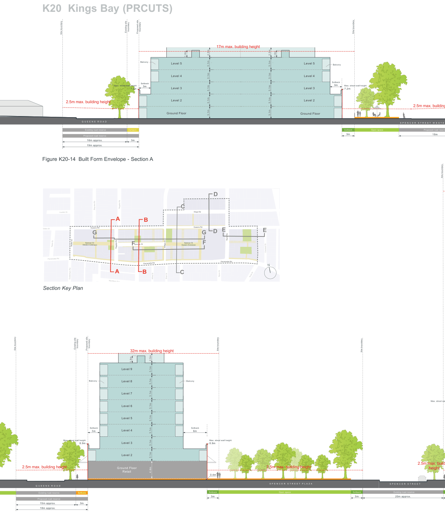
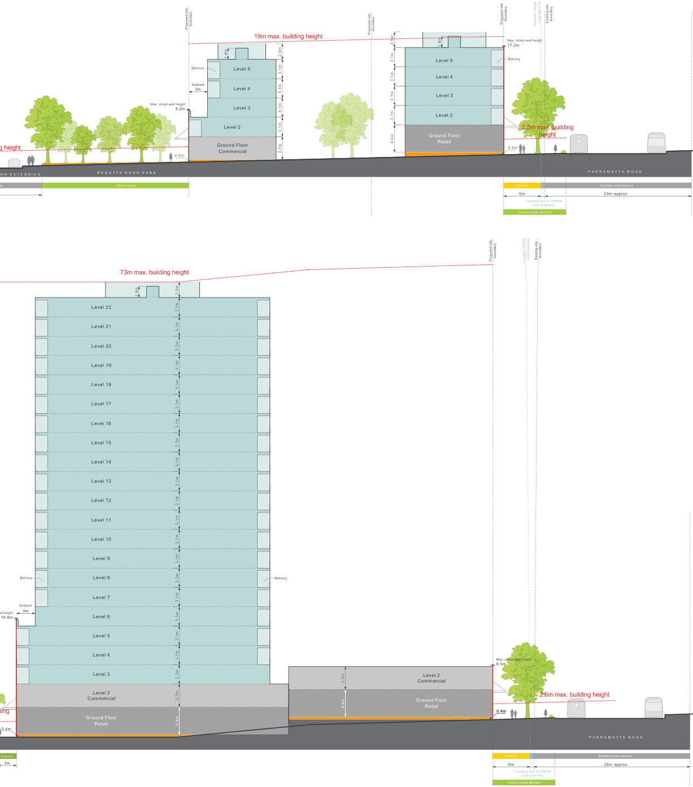

### K20  Kings Bay (PRCUTS)

> [Picture on page 309: a map, saved as a picture (images/part-k-special-precincts-page-309-2.gif, 150 dpi); the street names and other small labels are on the picture.]
> Labels printed on the map (copied from the PDF, in no particular order):
> boundary · boundary · Existing site Proposed site · 17m max. building height · 2.5m · 1.8m · 1.8m · Balcony · Level 5 · Level 5 · Level 4 · Level 4 · Setback · Max. street wall height 3m · Level 3 · Level 3 · 7.2m · Level 2 · Level 2 · 2.5m max. building height · Ground Floor · Ground Floor · 3.1m · 3.1m · 3.1m · 3.1m · 3.1m · 3.1m · 3.1m · 3.1m · 3.1m · 3.1m · 2.5m · Q U E E N S R O A D · Existing road reserve Setback · Proposed road reserve · 16m approx. 3m · 19m approx. · Site boundary · Balcony · Setback · 3m Max. street wall height · 7.2m · Setback Open space · 3m

Site boundary

Figure K20-14 Built Form Envelope - Section A

Figure K20-15 Built Form Envelope - Section B

2.5m max. building

S P E N C E R S T R E E T W E S T E

Proposed road reserv

18m

> Labels printed on the map (copied from the PDF, in no particular order):
> D · Regatta Rd · Bayview Rd · C · Kings Rd · Louden St · A B · Queens Rd · Queens Rd · Gibbs St · E · E · D · G · G · Harris Rd · Spencer St · Spencer St · Western Extension · Spencer St · Eastern Extension · Walker St · Taylor St · F · F William St · Regatta Rd · Courland St · Parramatta Rd · Parramatta Rd · Parramatta Rd · N · A B C · Byron St Scott St · Short St · Alfred St · Cheltenham Rd · Wychbury Ave · Section Key Plan · boundary boundary · Existing site · Site boundary · Proposed site · Site boundary · 32m max. building height · 1.8m · Level 9 · Balcony · Balcony · Level 8 · Level 7 · Level 6 · Level 5 · Setback · Setback · Level 4 · 3m · 6m · Max. street wall height · Level 3 · Max. street wall height · 8.9m · 8.9m · Level 2 · Ground Floor · 2.5m max. building height · 2.5m max. building height · 3.1m · 3.1m · 3.1m · 3.1m · 4.4m · 2.5m · 3.1m · 3.1m · 3.1m · 3.1m · Retail · 0.4m · S P E N C E R S T R E E T P L A Z A · Q U E E N S R O A D · Setback · Open space · Existing road reserve Setback · 3m · Proposed road reserve · 15m approx. 3m · 18m approx. · Site boundary · Site boundary · Max. street wa · 2.5m max. build · height · S P E N C E R S T R E E T · Setback Existing road reserve · 3m · 20m approx.

> [Picture on page 310: a map, saved as a picture (images/part-k-special-precincts-page-310-1.gif, 150 dpi); the street names and other small labels are on the picture.]
> Labels printed on the map (copied from the PDF, in no particular order):
> boundary · Proposed site · 19m max. building height · 2.5m · 1.8m · Balcony Level 5 · Setback · Level 4 · 3m · Max. street wall height · Level 3 · 8.2m · Level 2 · Ground Floor · 3.1m · 3.1m · 3.1m · 3.1m · 3.7m · Commercial · 0.4m · R N E X T E N S I O N · R E G A T T A R O A D P A R K · Open space · boundary · Proposed site · 2.5m 1.8m · 3.1m Level 5 · Level 4 · Level 3 · Level 2 · 3.1m · 3.1m · 3.1m · Ground Floor · 4.4m Retail · boundary · boundary Existing site · road widening · Proposed site Variable TfNSW · Max. street wall height · 17.2m · Balcony · 2.5m max. building · height 000 · 0.4m · P A R R A M A T T A R O A D · Setback · Existing road reserve · 6m · 24m approx. · * · * variable due to TfNSW · road widening · Future public domain

g height

ve

> Labels printed on the map (copied from the PDF, in no particular order):
> 73m max. building height · 2.5m · 1.8m · Level 22 · Level 21 · Level 20 · Level 19 · Level 18 · Level 17 · Level 16 · Level 15 · Level 14 · Level 13 · Level 12 · Level 11 · Level 10 · 3.1m · 3.1m · 3.1m · 3.1m · 3.1m · 3.1m · 3.1m · 3.1m · 3.1m · 3.1m · 3.1m · 3.1m · 3.1m · Level 9 · Balcony · Balcony · Level 8 · Level 7 · Setback · 3m · all height · Level 6 · 18.8m · Level 5 · Level 4 · Level 3 · 3.1m · 3.1m · 3.7m · Level 2 · Commercial · 4.4m · ding · Ground Floor · 3.1m · 3.7m · 4.4m · 3.1m · 3.1m · 3.1m · 3.1m · 2.5m · Retail · 0.4m · Setback · 3m · Level 2 · Commercial · Ground Floor · Retail · boundary · boundary Existing site · road widening · Proposed site Variable TfNSW · Max. street wall height · 8.5m · 2.5m max. building height · 000 · 0.4m · 0.4m · P A R R A M A T T A R O A D · Setback · Existing road reserve · 6m · 26m approx. · * · * variable due to TfNSW · road widening · Future public domain
