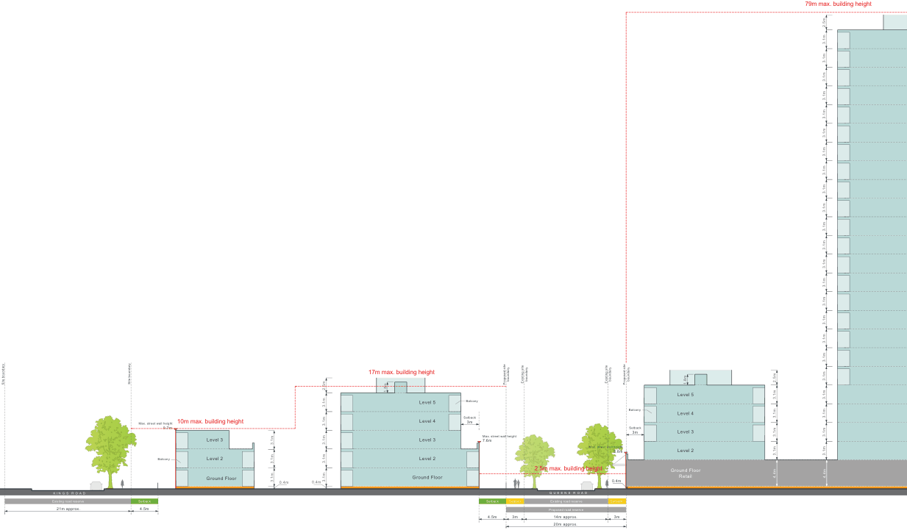
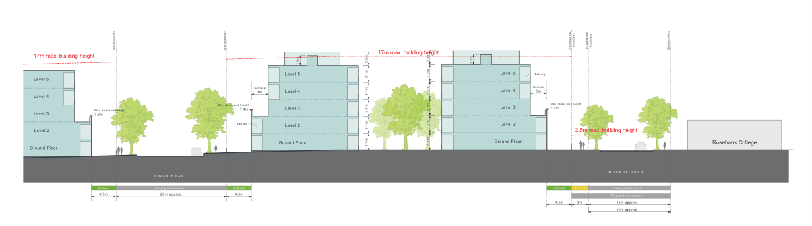
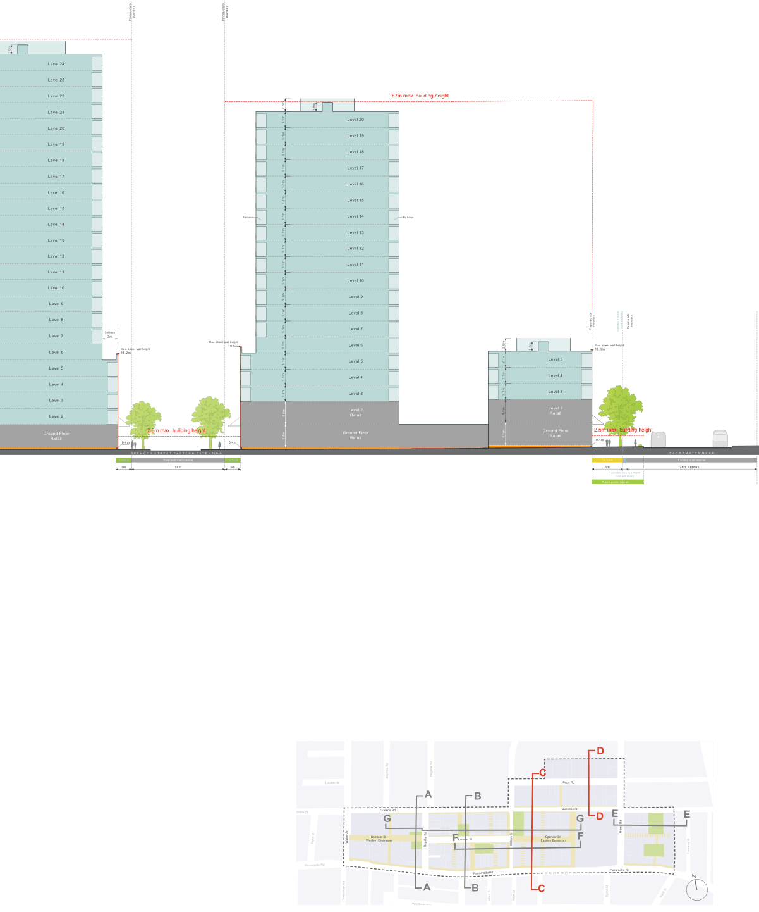

### K20  Kings Bay (PRCUTS)

> [Picture on page 311: a map, saved as a picture (images/part-k-special-precincts-page-311-2.gif, 150 dpi); the street names and other small labels are on the picture.]
> Labels printed on the map (copied from the PDF, in no particular order):
> 17m max. building height · boundary · boundary · boundary · boundary · Existing site · Existing site · 1.8m · Proposed site · Proposed site · Site boundary · 2.5m 1.8m · Level 5 · Balcony · Level 5 · Balcony · Level 4 · Setback · Level 4 3m · 10m max. building height · Max. street wall height · Setback · 9.7m · Level 3 · 3m · Level 3 · Level 3 · Max. street wall height · 7.6m · Max. street wall height · Level 2 · 5.8m · Balcony · Level 2 · Level 2 · 2.5m max. building height Ground Floor · Retail · Ground Floor · Ground Floor · 3.1m · 3.1m · 3.1m · 3.1m · 3.1m · 3.1m · 3.1m · 3.1m · 0.4m · 0.4m 0.4m · Q U E E N S R O A D · K I N G S R O A D · Existing road reserve Setback · Setback Existing road reserve · Setback · Setback · 21m approx. 4.5m · Proposed road reserve · 4.5m 3m 14m approx. 3m · 20m approx.

79m max. building height

2.5m

2.5m

Site boundary

3.1m

3.1m

3.1m

3.1m

3.1m

3.1m

3.1m

3.1m

3.1m

3.1m

3.1m

3.1m

3.1m

4.4m

3.1m

3.1m

3.1m

3.1m

3.1m

3.1m

3.1m

3.1m

3.1m

3.1m

3.1m

3.1m

3.1m

3.1m

4.4m

Figure K20-16 Built Form Envelope - Section C

> [Picture on page 311: a map, saved as a picture (images/part-k-special-precincts-page-311-37.gif, 150 dpi); the street names and other small labels are on the picture.]
> Labels printed on the map (copied from the PDF, in no particular order):
> boundary · boundary Existing site · Site boundary · Site boundary · Proposed site · Site boundary · 17m max. building height · 17m max. building height · 2.5m · 2.5m · 1.8m · 1.8m · Level 5 Balcony · Level 5 · Level 5 · Setback · Level 4 3m · Level 4 · 3m · Setback · Level 4 · Level 3 · Max. street wall height · 7.2m · Max. street wall height · Level 3 · 7.4m · Level 3 · Max. street wall height · 7.2m · Balcony · Level 2 · Level 2 · Level 2 · 2.5m max. building height · Ground Floor · Ground Floor · Rosebank College · 3.1m · 3.1m · 3.1m · 3.1m · 3.1m · 3.1m · 3.1m · 3.1m · 3.1m · 3.1m · Ground Floor · Q U E E N S R O A D · K I N G S R O A D · Setback · Existing road reserve · Setback · Setback Existing road reserve · Setback · 4.5m 20m approx. 4.5m · Proposed road reserve · 4.5m 3m 15m approx. · 15m approx.

Figure K20-17 Built Form Envelope - Section D

Development Control Plan

1.8m

Level 24

Level 23

Level 22

Level 21

Level 20

Level 19

Level 18

Level 17

Level 16

Level 15

Level 14

Level 13

Level 12

Level 11

Level 10

Level 9

Level 8

Level 7

Level 6

Level 5

Level 4

Level 3

Level 2

Ground Floor Retail

Part K

Special Precincts

> [Picture on page 312: a map, saved as a picture (images/part-k-special-precincts-page-312-30.gif, 150 dpi); the street names and other small labels are on the picture.]
> Labels printed on the map (copied from the PDF, in no particular order):
> boundary · boundary · Proposed site · Proposed site · Balcony · Setback · 3m · Max. street wall height · 19.5m · Max. street wall height · 18.2m · 2.5m max. building height · 0.4m · 0.4m · S P E N C E R S T R E E T E A S T E R N E X T E N S I O N · Setback Proposed road reserve Setback · 3m 18m 3m · 67m max. building height · 1.8m · Level 20 · Level 19 · Level 18 · Level 17 · Level 16 · Level 15 · Level 14 Balcony · Level 13 · Level 12 · Level 11 · Level 10 · Level 9 · Level 8 · Level 7 · Level 6 · Level 5 · 3.1m · 3.1m · Level 4 · Level 3 · Level 2 · Retail · Ground Floor · 3.1m · 4.4m · 4.4m · 2.5m · 3.1m · 3.1m · 3.1m · 3.1m · 3.1m · 3.1m · 3.1m · 3.1m · 3.1m · 3.1m · 3.1m · 3.1m · 3.1m · 3.1m · 4.4m · 2.5m · 3.1m · 3.1m · 3.1m · 3.1m · 4.4m · Retail · boundary · boundary Existing site · road widening · Proposed site Variable TfNSW · 1.8m · Max. street wall height · 18.5m · Level 5 · Level 4 · Level 3 · Level 2 · Retail · 2.5m max. building height · Ground Floor · 000 · Retail · 0.4m · P A R R A M A T T A R O A D · Setback · Existing road reserve · 6m · 26m approx. · * · * variable due to TfNSW · road widening · Future public domain

> Labels printed on the map (copied from the PDF, in no particular order):
> Regatta Rd · Bayview Rd · Louden St · A B · Queens Rd · Gibbs St · G · Spencer St · Spencer St · Western Extension · Walker St · Taylor St · F William St · Regatta Rd · Parramatta Rd · Parramatta Rd · A B · Short St · Alfred St · Cheltenham Rd · Wychbury Ave · Section Key Plan · D · C · Kings Rd · Queens Rd · E · E · D · G · Harris Rd · Spencer St · Eastern Extension F · Courland St · Parramatta Rd · N · C · Byron St Scott St
