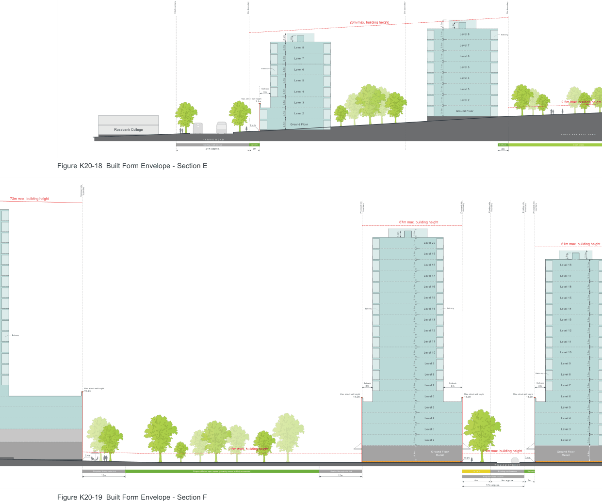
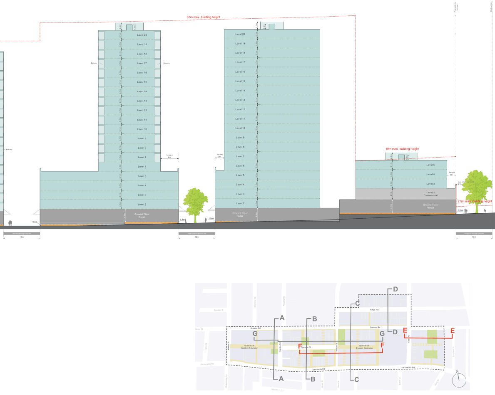

### K20  Kings Bay (PRCUTS)

Site boundary

Rosebank College

Site boundary

Figure K20-18 Built Form Envelope - Section E

Figure K20-19 Built Form Envelope - Section F

Site boundary

Site boundary

> [Picture on page 313: a map, saved as a picture (images/part-k-special-precincts-page-313-9.gif, 150 dpi); the street names and other small labels are on the picture.]
> Labels printed on the map (copied from the PDF, in no particular order):
> 000 · H A R R I S R O A D · Existing road reserve · 21m approx. · 1.8m · Level 8 · 3.1m · 2.5m · Level 7 · Balcony Level 6 · Level 5 · Setback · Level 4 · 3m · Max. street wall height · 7.5m Level 3 · Level 2 · 3.1m · 3.1m · 3.1m · 3.1m · 3.1m · 3.1m · Ground Floor · 0.4m 3.1m · Setback · 3m · 28m max. building height · 1.8m · Level 8 Balcony · Level 7 · Level 6 · Level 5 · Level 4 · Level 3 · Level 2 · Ground Floor · 3.1m · 3.1m · 3.1m · 3.1m · 3.1m · 3.1m · 3.1m · 3.1m · 2.5m · Setback · 3m · 2.5m max. building height · K I N G S B A Y E A S T P A R K · Open space

> Labels printed on the map (copied from the PDF, in no particular order):
> boundary · Proposed site · 73m max. building height · Balcony · Max. street wall height · 19.4m · 2.5m max. building height · 0.4m · Required through site link · Proposed future open space (privately owned publicly accessible) · 12m · boundary · Proposed site · Balcony · Setback · 3m · Max. street wall height · 18.2m · Desired through site link · 12m · boundary · boundary · boundary · boundary · Existing site Existing site Proposed site · Proposed site · 67m max. building height · 1.8m · Level 20 · Level 19 · Level 18 · Level 17 · 3.1m · 3.1m · 3.1m · 3.1m · Level 16 · Level 15 · Balcony · Level 14 · Level 13 · Level 12 · Level 11 · Level 10 · Level 9 · Balcony · Level 8 · Setback · Setback · Level 7 · 3m · 5m · Max. street wall height · Level 6 · 18.2m · Max. street wall height · 18.2m · Level 5 · Level 4 · Level 3 · 3.1m · 3.1m · 3.1m · Level 2 · 3.1m · 2.5m max. building height · Ground Floor · 4.4m · 3.1m · 3.1m · 3.1m · 3.1m · 3.1m · 2.5m · 3.1m · 3.1m · 3.1m · 3.1m · 3.1m · 3.1m · Retail · 0.4m · 0.4m · W I L L I A M S T R E E T · Setback Existing road reserve Setback · Proposed road reserve · 8m 9m approx. 3m · 17m approx.

61m max. building height

1.8m

Level 18

2.5m

3.1m

Level 17

Level 16

Level 15 3.1m

3.1m

3.1m

Level 14

Level 13

Level 12 3.1m

3.1m

3.1m

Level 11

Level 10

Level 9 3.1m

3.1m

3.1m

Level 8

Level 7

Level 6 3.1m

3.1m

3.1m

Level 5 3.1m

Level 4 3.1m

Level 3 3.1m

Level 2

Ground Floor

3.1m

4.4m

Retail

Site boundary

Site boundary

20m max. building height

1.8m

Level 6

Setback

3m

Level 5

Max. street wall height

13.4m

Level 4

Level 3

Level 2

Existing built form

Ground Floor

3.1m

3.1m

3.1m

3.1m

3.1m

3.1m

2.5m

Setback

Deep soil zone

3m

12m min.

> [Picture on page 314: a map, saved as a picture (images/part-k-special-precincts-page-314-27.gif, 150 dpi); the street names and other small labels are on the picture.]
> Labels printed on the map (copied from the PDF, in no particular order):
> 67m max. building height · 1.8m · 1.8m · Level 20 · Level 20 · 3.1m · Level 19 · Level 19 · 3.1m · Level 18 · Level 18 · Level 17 · Balcony · Balcony · Level 17 · Level 16 · Level 16 · Level 15 · Level 15 · Level 14 · Level 14 · Level 13 · Level 13 · 3.1m · 3.1m · 3.1m · 3.1m · 3.1m · 3.1m · Level 12 · Level 12 · Level 11 · Level 11 · Level 10 · Level 10 · Level 9 · Level 9 · Level 8 · Level 8 · Balcony · Setback · Setback · Level 7 · 3m · 6m · Level 7 · Level 6 · Level 6 · 3.1m · 3.1m · 3.1m · 3.1m · 3.1m · 3.1m · 3.1m · 3.1m · 3.1m · 3.1m · 3.1m · 3.1m · 3.1m · 3.1m · 3.1m · Level 5 · Level 5 · Level 4 · Level 4 · 3.1m · 3.1m · Level 3 · Level 3 · 3.1m · 3.1m · 3.1m · 3.1m · 3.1m · 3.1m · 3.1m · 3.1m · 2.5m · 3.1m · 3.1m · Level 2 · Level 2 · 3.1m · Ground Floor · Ground Floor · 3.1m · 3.1m · 4.4m · 2.5m · Retail · 4.4m Retail · 0.4m · 0.4m · 0.4m · Desired through site link · Desired through site link · 12m · 12m · Regatta Rd · Bayview Rd · Louden St · A B · Queens Rd · Gibbs St · G · Spencer St · Spencer St · Western Extension · Walker St · Taylor St · F William St · Regatta Rd · Parramatta Rd · Parramatta Rd · A B · Short St · Alfred St · Cheltenham Rd · Wychbury Ave · Section Key Plan · boundary · Proposed site Site boundary · 19m max. building height · 1.8m · Level 5 · Setback · Level 4 3m · Level 3 · Max. street wall height · 9.5m · Level 2 · Commercial · 2.5m max. building height · Ground Floor · 3.1m · 2.5m · 3.1m · 3.1m · 3.7m · 4.4m Retail 0.4m · Required through site link · 12m · D · C · Kings Rd · Queens Rd · E · E · G D · Harris Rd · Spencer St · Eastern Extension F · Courland St · Parramatta Rd · N · C · Byron St Scott St
