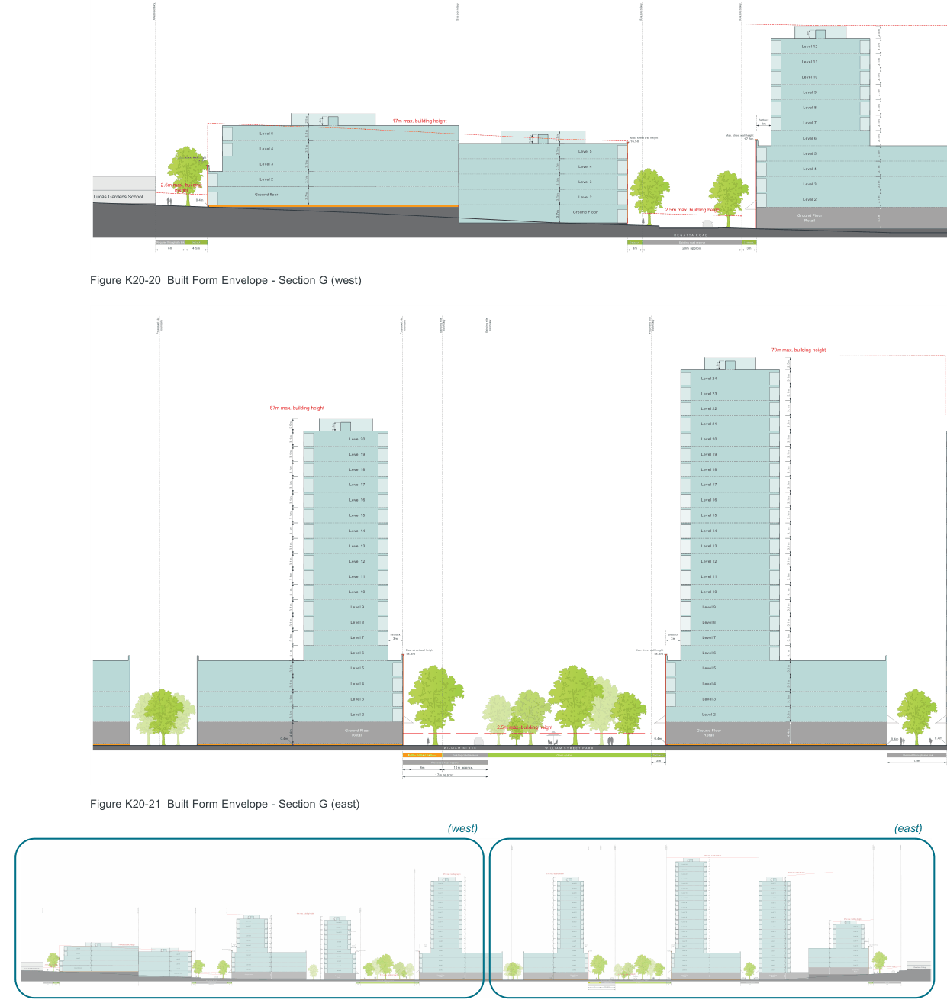
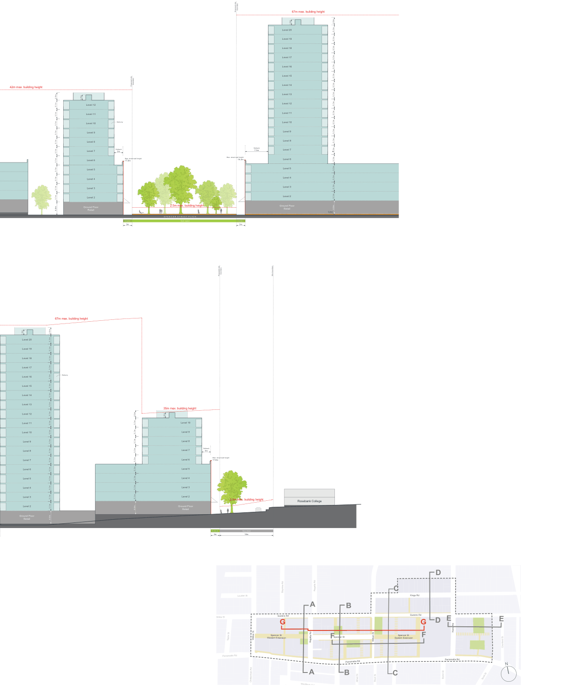

### K20  Kings Bay (PRCUTS)

> [Picture on page 315: a map, saved as a picture (images/part-k-special-precincts-page-315-2.gif, 150 dpi); the street names and other small labels are on the picture.]
> Labels printed on the map (copied from the PDF, in no particular order):
> Site boundary · Site boundary · Site boundary · Site boundary · 1.8m · Level 12 · Level 11 · Level 10 3.1m · Level 9 · Level 8 · Setback · 17m max. building height · Level 7 · 1.8m · 3m · Level 5 · Max. street wall height Level 6 · 17.8m · 1.8m · Max. street wall height · 16.5m · Level 4 · Level 5 · Level 5 · Max. street wall height · 8.2m Level 3 · Level 4 · Level 4 · Level 2 · 3.1m · 3.1m · 3.1m · 3.1m · 2.5m · Level 3 · Level 3 · 2.5m max. building · height Ground floor · Level 2 · Lucas Gardens School · 3.7m · Level 2 · 0.4m · 2.5m max. building height · Ground Floor · Ground Floor · 3.1m · 3.1m · 3.1m · 3.1m · 3.7m · 2.5m · Retail · R E G A T T A R O A D · Required through site link Setback · Setback Existing road reserve Setback · 4.5m · 6m · 20m approx. · 3m · 3m

3.1m

3.1m

3.1m

3.1m

3.1m

3.1m

3.1m

3.1m

2.5m

3.1m

3.1m

4.4m

Figure K20-20 Built Form Envelope - Section G (west)

> Labels printed on the map (copied from the PDF, in no particular order):
> boundary · boundary · boundary · boundary · boundary · Existing site · Existing site · Proposed site · Proposed site · Proposed site · 79m max. building height · 1.8m · Level 24 · Level 23 · 67m max. building height · Level 22 · Level 21 · 1.8m · Level 20 · Level 20 · Level 19 · Level 19 · Level 18 · Level 18 · Level 17 · Level 17 · 3.1m · 3.1m · 3.1m · 3.1m · 3.1m · 3.1m · 3.1m · 3.1m · Level 16 · Level 16 · Level 15 · Level 15 · Level 14 · Level 14 · Level 13 · Level 13 · Level 12 · Level 12 · Level 11 · Level 11 · Level 10 · Level 10 · Level 9 · Level 9 · Level 8 · Level 8 · Setback · Setback · Level 7 · Level 7 · 3m · 3m · Max. street wall height · Level 6 · Level 6 · Max. street wall height · 18.2m · 18.2m · Level 5 · Level 5 · Level 4 · Level 4 · Level 3 · Level 3 · Level 2 · Level 2 · 3.1m · 2.5m max. building height · Ground Floor · Ground Floor · 3.1m · 3.1m · 3.1m · 3.1m · 3.1m · 3.1m · 3.1m · 3.1m · 2.5m · 3.1m · 3.1m · 4.4m · 3.1m · 3.1m · 3.1m · 3.1m · 3.1m · 3.1m · 3.1m · 3.1m · 3.1m · 3.1m · 3.1m · 3.1m · 3.1m · 3.1m · 3.1m · 3.1m · 3.1m · 2.5m · 3.1m · 3.1m · 4.4m · 3.1m · 3.1m · 3.1m · 3.1m · Retail · Retail · 0.4m · 0.4m · 0.4m · 0.4m · W I L L I A M S T R E E T W I L L I A M S T R E E T P A R K · Open space · Public Domain Setback Existing road reserve · Setback · Desired through site link · 3m · 12m · Proposed road reserve · 8m 10m approx. · 17m approx.

Figure K20-21 Built Form Envelope - Section G (east)

(west)

(east)

> Labels printed on the map (copied from the PDF, in no particular order):
> boundary · boundary · boundary · boundary · boundary · boundary Existing site · Existing site Proposed site · Proposed site · Proposed site · Proposed site · Site boundary · 79m max. building height · 1.8m · Level 24 · Level 23 · boundary · Proposed site · 67m max. building height · 67m max. building height · Level 22 · 67m max. building height · Level 21 · 1.8m · 1.8m · 1.8m · Level 20 · Level 20 · Level 20 · Level 20 · Level 19 · Level 19 · Level 19 · Level 19 · 3.1m · 3.1m · Level 18 · Level 18 · Level 18 · Level 18 · Level 17 · Level 17 · Level 17 · Level 17 · 3.1m · 3.1m · 3.1m · 3.1m · 3.1m · 3.1m · 3.1m · 3.1m · Balcony · Level 16 · Level 16 · Level 16 · Level 16 · Level 15 · Level 15 · Level 15 · Level 15 · boundary · Level 14 · Level 14 · Level 14 · Level 14 · Proposed site · Site boundary Site boundary Site boundary · Site boundary · 42m max. building height · Level 13 · Level 13 · Level 13 · Level 13 · 1.8m · 1.8m · 35m max. building height · Level 12 · Level 12 · Level 12 · Level 12 · Level 12 · Level 12 · 1.8m · Level 11 · Level 10 · Level 11 · Level 11 · Level 11 · Level 11 · Level 11 · Level 10 · Balcony · Level 9 · 3.1m · 3.1m · 3.1m · Level 10 · Level 10 · Level 10 · Level 10 · Level 10 · 3.1m · 3.1m · 3.1m · Level 9 · Level 8 · Level 9 · Level 9 · Level 9 · Level 9 · Level 9 · Setback · Level 8 · Level 7 3m · Level 8 · Level 8 · Level 8 · Level 8 · Level 8 · Setback · 17m max. building height · Level 7 · 1.8m · 3m · Level 6 Max. street wall height · 17.8m · Setback · Setback · Setback · Level 7 · Level 7 · Level 7 · Level 7 · 3m · 3m · Level 7 · Setback · 7.5m · 3m · Level 5 · Max. street wall height · Max. street wall height · Level 6 · 17.8m · Max. street wall height · Level 5 · Level 6 · Level 6 · Level 6 · Level 6 · Max. street wall height · 18.2m · 18.2m · 18.2m · 1.8m Max. street wall height · 16.5m · Level 6 Max. street wall height · 17.8m · Level 4 · Level 5 Level 5 · Level 4 · Level 5 · Level 5 · Level 5 · Level 5 · Max. street wall height · Level 5 · 8.2m Level 3 · Level 4 Level 4 · Level 3 · Level 4 · Level 4 · Level 4 · Level 4 · 3.1m · 3.1m · 3.1m · 3.1m · 3.1m · 3.1m · 3.1m · 2.5m · 3.1m · Level 4 · Level 2 · 3.1m · 3.1m · 3.1m · 3.1m · 2.5m · Level 3 Level 3 · Level 2 · Level 3 · Level 3 · Level 3 · Level 3 3.1m · Level 3 · 2.5m max. building · height · 2.5m max. building height Rosebank College · Ground floor · Level 2 · Lucas Gardens School 3.7m · Level 2 · 0.4m · 3.1m · 3.1m · 3.1m · 3.1m · 3.1m · 3.1m · 2.5m · 3.1m · 3.1m · Level 2 · Level 2 · Level 2 · Level 2 · Ground Floor · 3.1m · 3.1m · 3.1m · 3.1m · 3.1m · 3.1m · 3.1m · 3.1m · 2.5m · 3.1m · 3.1m · 3.1m · 3.1m · 3.1m · 3.1m · 3.1m · 3.1m · 3.1m · 3.1m · 3.1m · 3.1m · 3.1m · Level 2 · 4.4m Retail · Ground Floor Ground Floor · 3.1m · 3.1m · 3.1m · 3.1m · 3.7m · 2.5m · Ground Floor · Ground Floor · 2.5m max. building height · 2.5m max. building height · 2.5m max. building height · Ground Floor · Ground Floor · Ground Floor · 4.4m · Retail · 4.4m · 3.1m · 3.1m · 3.1m · 3.1m · 3.1m · 3.1m · 3.1m · 3.1m · 2.5m · 3.1m · 3.1m · 4.4m · 3.1m · 3.1m · 3.1m · 3.1m · 3.1m · 3.1m · 3.1m · 3.1m · 3.1m · 3.1m · 3.1m · 3.1m · 3.1m · 3.1m · 2.5m · 3.1m · 3.1m · 4.4m · 3.1m · 3.1m · 3.1m · 3.1m · 3.1m · 3.1m · 3.1m · 3.1m · 3.1m · 3.1m · 3.1m · 3.1m · 3.1m · 3.1m · 3.1m · 3.1m · 3.1m · 2.5m · 3.1m · 3.1m · 4.4m · 3.1m · 3.1m · 3.1m · 3.1m · Retail · Retail · Retail · Retail · 3.1m · 3.1m · 3.1m · 3.1m · 3.1m · 3.1m · 2.5m · 3.1m · 3.1m · 4.4m Retail · 0.4m · 0.4m · 0.4m · 0.4m · 0.4m · W I L L I A M S T R E E T · R E G A T T A R O A D · S P E N C E R S T R E E T P L A Z A · W I L L I A M S T R E E T P A R K · Required through site link Setback · New street · Setback Existing road reserve Setback · Open space · Setback Setback · Open space · Public Domain Setback Existing road reserve Setback · Desired through site link · Setback · 6m 4.5m · 3m · 3m · 12m · 3m 18m · 20m approx. · 3m · 3m · 3m · Proposed road reserve · 8m 10m approx. · 17m approx.

Figure K20-22 Built Form Envelope - Section G Key Section

Development Control Plan

42m max. building height

3.1m

3.1m

3.1m

3.1m

3.1m

3.1m

3.1m

3.1m

3.1m

2.5m

3.1m

3.1m

Part K Special Precincts

> [Picture on page 316: a map, saved as a picture (images/part-k-special-precincts-page-316-16.gif, 150 dpi); the street names and other small labels are on the picture.]
> Labels printed on the map (copied from the PDF, in no particular order):
> 1.8m · Level 12 · Level 11 · Level 10 · Level 9 · Level 8 · Level 7 · Level 6 · Level 5 · Level 4 · Level 3 · Level 2 · Ground Floor · 4.4m Retail · boundary · Proposed site · Balcony · Setback · 3m · Max. street wall height · 17.8m · Setback · 3m · boundary · Proposed site · 67m max. building height · 1.8m · Level 20 · Level 19 · Level 18 · Level 17 · Level 16 · Level 15 · Level 14 · Level 13 · Level 12 · Level 11 · Level 10 · Level 9 · Level 8 · Setback Level 7 · 7.5m · Max. street wall height Level 6 · 18.2m · Level 5 · Level 4 · Level 3 · Level 2 · 3.1m · 3.1m · 3.1m · 3.1m · 3.1m · 3.1m · 3.1m · 3.1m · 2.5m · 3.1m · 3.1m · 3.1m · 3.1m · 3.1m · 3.1m · 3.1m · 3.1m · 3.1m · 3.1m · 3.1m · 2.5m max. building height · Ground Floor · 4.4m · Retail · 0.4m · S P E N C E R S T R E E T P L A Z A · Open space · Setback · 3m

> Labels printed on the map (copied from the PDF, in no particular order):
> 67m max. building height · 1.8m · Level 20 · Level 19 3.1m · 3.1m · Level 18 · Level 17 · Balcony · Level 16 · Level 15 · Level 14 · Level 13 · Level 12 · Level 11 · Level 10 · Level 9 · Level 8 · Level 7 · Level 6 · Level 5 · Level 4 · Level 3 · Level 2 3.1m · Ground Floor · 3.1m · 3.1m · 3.1m · 3.1m · 3.1m · 3.1m · 3.1m · 3.1m · 2.5m · 3.1m · 3.1m · 4.4m · 3.1m · 3.1m · 3.1m · 3.1m · 3.1m · 3.1m · Retail · 3.1m · 3.1m · 3.1m · 3.1m · 3.1m · 3.1m · 3.1m · 2.5m · 3.1m · 3.1m · 4.4m · boundary · Proposed site · Site boundary · 35m max. building height · 1.8m · Level 10 · Level 9 · Level 8 · Setback · Level 7 3m · Level 6 Max. street wall height · 17.8m · Level 5 · Level 4 · Level 3 · Level 2 · 2.5m max. building height Rosebank College · Ground Floor · Retail · Setback New street · 3m 18m · Regatta Rd · Bayview Rd · Louden St · A B · Queens Rd · Gibbs St · G · Spencer St · Spencer St · Western Extension · Walker St · Taylor St · F · Regatta Rd · Parramatta Rd · Parramatta Rd · A B · Alfred St · Cheltenham Rd · Wychbury Ave · Section Key Plan · D · C · Kings Rd · Queens Rd · E · D · G · Harris Rd · Spencer St · Eastern Extension F · William St · Parramatta Rd · C · Byron St · Short St · E · Courland St · N · Scott St
